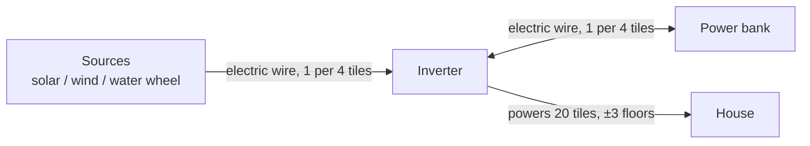
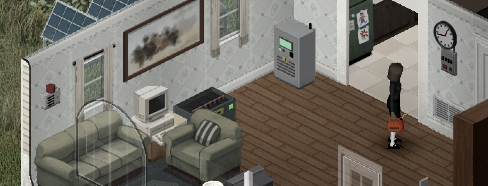
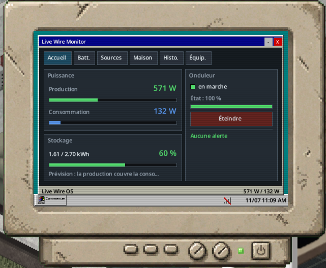

# Live Wire

**The Electrical skill becomes a trade: silent solar, wind and water power for your whole house, with no fuel and no fumes.**

Project Zomboid Build 42.21 · mod id `batman_LiveWire` · EN/FR · MIT licence

Version française : [README_fr.md](README_fr.md)

## Contents

1. [Overview](#overview)
2. [Equipment](#equipment)
3. [How to connect (wiring)](#how-to-connect-wiring)
4. [Inverter screen and management software](#inverter-screen-and-management-software)
5. [Optional equipment and the breaker](#optional-equipment-and-the-breaker)
6. [Calculations](#calculations)
7. [Recipes](#recipes)
8. [Loot tables](#loot-tables)
9. [Wear and maintenance](#wear-and-maintenance)
10. [Electrical skill](#electrical-skill)
11. [Sandbox options](#sandbox-options)
12. [Multiplayer, status and installation](#multiplayer-status-and-installation)
13. [For developers](#for-developers)

## Overview

Solar panels, wind turbines and water wheels produce silent power. An inverter placed in the house powers every appliance around it. Batteries in a power bank store the surplus for the night. The server is authoritative (multiplayer-ready, designed for dedicated servers).

### Three roles, one network

- **Sources produce.** Solar panel 100 W, wind turbine 400 W, water wheel 120 W (nominal). Any number of sources per inverter; each must be within cable range (12 tiles, at most 1 floor apart).
- **Batteries store (optional).** Car batteries or deep-cycle batteries inside a power bank (4 counted per power bank, charge efficiency 0.90). Several power banks per inverter.
- **The inverter converts and distributes.** 1,500 W max (house demand), 20 W idle consumption, efficiency 0.85 to 1.0 (from the installer's level). One per network, can be placed indoors, no toxicity (it is not a game generator).
- **The house.** Every powered appliance within 20 tiles and ±3 floors of the inverter (vanilla options `GeneratorTileRange` / `GeneratorVerticalPowerRange`) is powered. No per-appliance wiring.

**Minimal system:** one source + one inverter. Without batteries, the house runs on current production only (for example, three panels on a sunny day run a fridge-freezer at noon, not at night).

The game itself decides what is powered (a square is powered as if near a generator), so fridges, lights, stoves, TVs and radios work exactly as in vanilla.

**Fridges stay cold while you are away.** Fridges and freezers keep food cold while the area is unloaded, as long as there is power. Checked in game: a fresh steak in a powered fridge, player 300 tiles away, 10 game hours: aged 0.083 day (cold) instead of 0.417 day (warm). Engine limit: the power state found when the area reloads counts for the whole absence.

## Equipment

Each recipe gives a placeable furniture item `Base.Mov_LiveWire_*`. Place, rotate and pick up with the vanilla furniture cursor (ghost, 4 facings, 2 for wall objects). The tile requires a screwdriver and the Electrical level below, also to pick up. A picked-up device keeps its condition.

Placement rules added by the mod: outdoors (open sky) for the solar panel and wind turbine; river bank, ground floor, next to river water for the water wheel (lakes and ponds are refused). A refused square shows the reason in red in the cursor panel.

| Device | Role | Placement | Electrical level |
|---|---|---|---|
| Solar panel | Source, 100 W | Outdoors, open sky; flat roof OK | 3 |
| Wind turbine | Source, 400 W; blades turn with the wind | Outdoors; +15 % wind per floor up to the 3rd | 6 |
| Water wheel | Source, 120 W day and night | Ground floor, next to a river | 7 |
| Inverter | Heart of the network, 1,500 W | Any floor tile, indoors included | 5 |
| Power bank | Storage, 4 batteries counted; opens like a crate (capacity 50) | Anywhere; picked up only when empty | 2 |
| Breaker panel | Safety, optional | On a wall (north or west) | 3 |
| Low battery alarm | Alert, optional | On a wall | 2 |

Batteries are never placed on the floor: drag them into the power bank with the vanilla inventory.

| Battery | Nominal capacity | Life |
|---|---|---|
| Car battery `Base.CarBattery1` | 0.40 kWh | 150 cycles |
| Car battery `Base.CarBattery2` | 0.60 kWh | 150 cycles |
| Car battery `Base.CarBattery3` | 0.90 kWh | 150 cycles |
| Deep-cycle battery `LiveWire.DeepCycleBattery` | 1.50 kWh | 600 cycles |

Effective capacity = nominal × (0.4 + 0.6 × condition / 100) × `BatteryCapacityMultiplier`.

**Lights on the tiles:** the inverter screen is lit when on and shows a red light on fault; sources and the power bank have a green "connected" light; the breaker has a red lamp when tripped; the alarm beacon is lit while ringing.

## How to connect (wiring)

1. Craft the devices (see [Recipes](#recipes)) and place them with the furniture cursor.
2. Right-click a device > **Live Wire** > device name. It shows "Connected to the inverter N tiles away" or "Not connected", then **Connect to an inverter** > one line per inverter in range: "Inverter N tiles away (k wires)". Or right-click the inverter > **Connect equipment** (list of free equipment in range with distance and wires) / **Disconnect equipment**.
3. Pay the cost in electric wire `Base.ElectricWire`.
4. Respect the limits per network.

**Cost:** 1 wire per 4 tiles of distance, rounded up, at least 1 (sandbox `WirePerTiles`; 0 = free). Worked example: a source 9 tiles from the inverter costs ceil(9 / 4) = 3 wires.

**Range:** 12 tiles (sandbox `LinkRange`, 4-30), at most 1 floor apart.

**Limits per network:** at most one breaker, one alarm, one management computer and one backup generator.

**Vanilla objects:** the vanilla generator (backup) and the vanilla desktop computer (management) are linked the same way from their own right-click menu (**Live Wire** > Backup generator / Management computer > Connect to an inverter).

**Moving things:** picking up the inverter disconnects its whole network; rotating it keeps the links. Picking up a source keeps its condition; placed again, it is "Not connected".

**Inverter right-click menu:** Open the inverter screen, Turn on / Turn off, Reset (after a trip), Show the powered area (cyan circle on the ground), Connect equipment, Disconnect equipment, Soundproof the inverter, Inspect, Repair, Overhaul.

## Inverter screen and management software

**LCD panel** (right-click the inverter > Open the inverter screen): backlit screen, 5 pages (Production/Load, Batteries, Sources, House, Status) with `<` and `>`; an I/O button with a light (green on, red off, blinking orange on fault); RESET when tripped; production and load bars on the same scale; long lines scroll.

**Management software "Live Wire Monitor"** has the tabs Overview, Batteries, Sources, House, History and Equipment.

- **Overview:** production and consumption in large figures with bars on the same scale, storage gauge and autonomy, inverter card (state light, condition, On/Off, Reset), alerts.
- **History:** 48 h graphs (production, consumption, battery stock) and the forecast "batteries will last until sunrise". It needs a linked management computer.

**Without the Computer Mod:** a vanilla desktop computer linked to the inverter opens the software on the mod's own computer screen (monitor, boot screen "Live Wire OS", status bar with game time).

**With the optional Computer Mod (Workshop 3725497089) or Laptop Mod (3798992436):** the software comes on a disk, "Disk: Live Wire Management Software" (`LiveWire.MonitorDisk`), found in computer loot. Right-click the computer with the disk > **Install the Live Wire software**. It then appears as a "Live Wire" app on their desktop and runs inside their window (title bar, minimise, close, taskbar). It shows the inverter linked to that computer, or the nearest inverter in cable range.

**Inverter hum:** a sound of the mod, heard only one tile around a switched-on inverter (same floor). Each player sets its volume in Options > Mods > Live Wire (0 = off). Zombies hear the inverter within 2 tiles (sandbox `InverterNoiseRadius`).

**Soundproofing kit** (`LiveWire.SoundproofKit`): fitted on the inverter with a screwdriver (**Soundproof the inverter**), removed with **Remove the soundproofing** (kit given back). Effects: no hum, zombies no longer hear it; the inverter runs warmer and wears 25 % faster. It follows the inverter when picked up.

## Optional equipment and the breaker

| Equipment | Effect | Level |
|---|---|---|
| Breaker panel (wall) | Trips instead of the inverter when the house demand exceeds 1,500 W: the inverter no longer loses 3 condition points. Red lamp when tripped; reset on the breaker itself ("Reset the breaker"), refused while still overloaded. | 3 |
| Low battery alarm (wall) | Below 20 % stock: message to players within 30 tiles, beep every 10 game minutes until "Silence the alarm"; the beacon stays lit until the stock is back above 25 %. | 2 |
| Backup generator (vanilla generator) | Started by the mod under 20 % battery, stopped at 90 % (sandbox). Supplies 1,200 W, burns 1 L of fuel per 3 kWh (on top of its vanilla consumption). Still noisy and toxic indoors; must be plugged and fuelled the vanilla way. Never starts without batteries. | 3 |
| Management computer (vanilla desktop computer) | 48 h history, forecast until sunrise. Load shedding at level 7: switches the lights off under 15 % to keep the fridge, re-armed above 30 %. | 6 |

### When does the breaker trip?

When the demand of the house appliances exceeds the inverter maximum, 1,500 W (the 20 W idle is not counted). It is checked at each simulation step: every 10 game minutes and right after an action. Example: a stacked washer + dryer running together (up to 1,800 W). Without a breaker, the inverter trips and loses 3 condition points (reset on the inverter).

## Calculations

The server computes every 10 game minutes, players present or not (sandbox `SimulateUnloaded`, default on).

**Source power:** `P = nominal × source factor × condition factor × installation efficiency × sandbox multiplier`

- Condition factor = 0.5 + 0.5 × condition / 100.
- Installation efficiency (installer's Electrical level when placed): 0.85 (levels 3-6), 0.95 (7-8), 1.0 (9-10).
- Each source smooths its output (30 game minutes response): a passing cloud does not make the house flicker.

### Solar (100 W)

Sine curve between the season's dawn and dusk. Clouds leave 20 % at full overcast (factor × (1 − 0.8 × clouds)). Snow builds up on the panel during snowfall and melts above 0 °C (use the "Clear the snow" action). About 0.94 kWh per summer day and 0.60 kWh in winter (new panel, clear sky).

### Wind (400 W)

| Wind speed | Share of nominal power |
|---|---|
| Below 10 km/h | 0 |
| 10 to 45 km/h | ((v − 10) / 35)³ |
| 45 to 85 km/h | 100 % |
| Above 85 km/h | 0 (automatic brake) |

Wind gets +15 % per floor, up to the 3rd. Examples: 25 km/h ≈ 31 W, 40 km/h ≈ 252 W.

### Water wheel (120 W)

Runs day and night, about 2.9 kWh per day. Season factor: spring × 1.2, summer × 0.8, autumn and winter × 1.0. Rivers only (the engine cannot tell a lake's current).

### Batteries and inverter

- Charging: surplus × 0.90 (charge efficiency); self-discharge 0.2 % per day; when full, extra production is lost (shown as "production lost").
- The inverter supplies the demand from current production first (× efficiency), then from the batteries. It can only restart when production covers the demand or the batteries hold more than 2 % of their capacity.
- Energy scale: 1 engine power unit per hour = 1,000 W (sandbox `PowerScale`).

### Appliance consumption

Vanilla engine values, switched on.

| Appliance | Consumption |
|---|---|
| Light | 2 W |
| Radio on mains | 10 W |
| Television | 30 W |
| Fridge alone | 80 W |
| Stove, microwave, washer, dryer | 90 W |
| Fridge-freezer | 130 W |
| Stacked washer + dryer | up to 1,800 W |

### Sizing example

One fridge-freezer and 10 lights ≈ 170 W (with the inverter idle 20 W), i.e. 4.1 kWh per day. A 14 h winter night needs ≈ 2.4 kWh: about 4 car batteries or 2 deep-cycle batteries.

| Installation | Summer (kWh/day) | Winter (kWh/day) | Verdict for 4.1 kWh/day |
|---|---|---|---|
| 4 solar panels | 3.8 | 2.4 | Deficit |
| 6 panels + 1 wind turbine (average wind 25 km/h ≈ 0.7 kWh) | 6.3 | 4.3 | Just enough |
| 1 water wheel + 2 panels | 4.8 | 4.1 | Stable |

There is no limit on the number of solar panels; productions add up (100 W nominal each). The 1,500 W limit applies to the house demand, not to production.

## Recipes

Category Electrical; tools in brackets are kept; recipes are learnt automatically at their level.

| Recipe | Level | Inputs | Output | XP |
|---|---|---|---|---|
| Make Voltage Tester | 1 | 1 electronics scrap, 1 electric wire, 1 light bulb, 1 battery; [screwdriver] | Voltage Tester | 5 |
| Dismantle Calculator | none (like vanilla dismantling) | 1 calculator; [screwdriver] | 1 electronics scrap + 1 solar cell | 3 |
| Make Power Bank | 2 | 2 electronics scrap, 3 electric wires, 1 sheet metal, 4 screws; [screwdriver, pliers] | Power Bank | 8 |
| Make Low Battery Alarm | 2 | 1 electronics scrap, 1 electric wire, 1 amplifier; [screwdriver] | Low Battery Alarm | 5 |
| Make Inverter Soundproofing Kit | 2 | 4 planks, 10 nails, 4 ripped sheets; [hammer] | Soundproofing Kit | 5 |
| Make Solar Panel | 3 | 10 solar cells, 1 sheet metal, 2 electric wires, 4 screws, 1 glue; [screwdriver, pliers] | Solar Panel | 15 |
| Make Breaker Panel | 3 | 2 electronics scrap, 1 electric wire, 1 small sheet metal, 2 screws; [screwdriver] | Breaker Panel | 8 |
| Make Inverter | 5 | 4 electronics scrap, 2 amplifiers, 3 electric wires, 1 small sheet metal, 4 screws; [screwdriver, pliers] | Inverter | 25 |
| Make Wind Turbine | 6 | 2 speakers (magnets), 3 electric wires, 4 electronics scrap, 2 sheet metal, 2 metal bars, 1 pipe, 6 screws; [screwdriver, pliers, hammer] | Wind Turbine | 30 |
| Make Deep-Cycle Battery | 6 | 2 car batteries (any), 2 electric wires, 1 scrap metal; [pliers] | Deep-Cycle Battery (empty, condition = average of the two) | 20 |
| Make Water Wheel | 7 | 8 planks, 20 nails, 2 speakers, 3 electric wires, 4 electronics scrap, 1 metal bar; [hammer, screwdriver] | Water Wheel | 30 |
| Make Solar Cell from Scrap | 8 | 5 electronics scrap, 1 aluminum; [pliers] | 1 Solar Cell | 4 |

The management computer and the backup generator are not crafted: they are vanilla objects found in the world.

## Loot tables

**How to read these tables.** Project Zomboid tests each item independently at each roll of a container list. A weight of W gives about W % per roll at normal loot rarity (before sandbox loot settings and zombie density). "Rolls" is the number of rolls of that vanilla list. Approximate chance per container ≈ 1 − (1 − W/100)^Rolls. For placeable furniture items like the solar panel, vanilla applies the "Other" loot modifier (0.6 at normal rarity).

**Solar cell** `LiveWire.SolarCell` (always):

| Vanilla list | Where | Weight | Rolls | ≈ chance per container |
|---|---|---|---|---|
| GarageTools | Garage tool storage | 2 | 4 | 7.8 % |
| CrateTools | Tool crates | 1 | 4 | 3.9 % |
| GarageMetalwork | Garage metalwork storage | 1 | 4 | 3.9 % |
| MechanicShelfElectric | Mechanic shop, electrical shelf | 2 | 4 | 7.8 % |
| ElectricianTools | Electrician's tools | 3 | 3 | 8.7 % |
| MetalShopTools | Metal shop tools | 1 | 4 | 3.9 % |
| WireFactoryElectric | Wire factory, electrical | 2 | 4 | 7.8 % |
| ToolStoreMisc | Hardware store, miscellaneous | 2 | 4 | 7.8 % |

**Ready-made solar panel** `Base.Mov_LiveWire_SolarPanel` (always; furniture, × 0.6 at normal rarity):

| Vanilla list | Where | Weight | Rolls | ≈ chance per container |
|---|---|---|---|---|
| GarageTools | Garage tool storage | 0.3 | 4 | 0.7 % |
| CrateTools | Tool crates | 0.3 | 4 | 0.7 % |
| GarageMetalwork | Garage metalwork storage | 0.2 | 4 | 0.5 % |
| ToolStoreMisc | Hardware store, miscellaneous | 0.5 | 4 | 1.2 % |
| ToolStoreTools | Hardware store, tools | 0.3 | 4 | 0.7 % |

**Management software disk** `LiveWire.MonitorDisk` (only when the Computer Mod is active):

| Vanilla list | Where | Weight | Rolls | ≈ chance per container |
|---|---|---|---|---|
| ElectronicStoreComputers | Electronics store, computers | 2 | 1 | 2.0 % |
| CrateComputer | Computer crates | 2 | 4 | 7.8 % |
| BookstoreComputer | Bookstore, computer section | 1 | 4 | 3.9 % |
| UniversityDesk_Computer | University desk, computing | 1 | 4 | 3.9 % |
| UniversityDesk_Electrical | University desk, electrical | 2 | 4 | 7.8 % |
| OfficeDesk | Office desks | 0.3 | 4 | 1.2 % |

Also: 1 solar cell per calculator dismantled (no level); at level 8, a solar cell from 5 electronics scrap + 1 aluminum.

## Wear and maintenance

| Device | Normal wear | Accelerators |
|---|---|---|
| Solar panel | −1 per 10 days | Thunderstorm, only if sandbox `StormDamage` (off by default) |
| Wind turbine | −1 per 4 days | Wind > 85 km/h with `StormDamage` |
| Water wheel | −1 per 6 days | none |
| Inverter | −1 per 5 days while on | Load > 80 %: wear × 2; each trip without breaker: −3; soundproofed: × 1.25 |
| Breaker | −1 per 15 days | none |
| Power bank, alarm | −1 per 30 days | none |
| Battery | 100 / life cycles per full cycle | Discharge below 20 %: wear doubled; self-discharge 0.2 % per day |

- **Repair:** 1 electronics scrap + 1 electric wire, gain 5 + Electrical level points (up to 90). Failure chance: max(5, 40 − 5 × level) %, halved from level 8; parts are lost on failure.
- **Overhaul** (level 8, 4 scrap + 2 wires): back to 100.
- **Recondition a battery** (level 4): 1 electronics scrap + 0.5 L water, +15 condition, cap 80.
- **Voltage tester** (`LiveWire.VoltageTester`): right-click a tile > Live Wire > Measure. It tells power yes/no (level 0), origin (1), appliance consumption (2), network balance (4).

## Electrical skill

| Level | Unlocks | Continuous effect |
|---|---|---|
| 0 | Read a tester: powered or not | none |
| 1 | Voltage tester | Detailed reading of the tile |
| 2 | Power bank, low battery alarm, soundproofing kit | Battery wear −5 % |
| 3 | Solar panels, breaker, backup generator | Installation efficiency 0.85 |
| 4 | Recondition a battery | Autonomy reading |
| 5 | Inverter | none |
| 6 | Wind turbine, deep-cycle battery, management computer | Battery wear −10 % |
| 7 | Water wheel, load shedding | Installation efficiency 0.95 |
| 8 | Solar cells from scrap, overhaul | Repair failure halved |
| 9-10 | none | Installation efficiency 1.0; device wear −25 % |

**Experience** (always given by the server):

- Mod recipes: see the XP column of the [recipes](#recipes).
- Place a source: 10 (panel), 20 (wind turbine, water wheel).
- Place an inverter: 25.
- Connect a source or battery: 3.
- Inspect a device: 2 (once per device per day).
- Measure with the tester: 1 (once per tile per hour).
- Repair: 5 + 1 per point, max 15.
- Recondition a battery: 8.
- Reset after fixing an overload: 5 (once per hour).
- Soundproof the inverter: 3.

## Sandbox options

Page **LiveWire**.

| Option | Default | Range | Effect |
|---|---|---|---|
| `PowerScale` | 1.0 | 0.1-10 | 1 engine power unit per hour = 1,000 W × this |
| `SolarMultiplier` / `WindMultiplier` / `HydroMultiplier` | 1.0 | 0-10 | Production per source family |
| `BatteryCapacityMultiplier` | 1.0 | 0.1-10 | Battery capacity |
| `BatteryWearMultiplier` / `DeviceWearMultiplier` | 1.0 | 0-10 | Wear; 0 = none |
| `InverterNoiseRadius` | 2 | 0-10 | Radius of the hum heard by zombies; 0 = silent |
| `LinkRange` | 12 | 4-30 | Maximum cable distance |
| `WirePerTiles` | 4 | 0-20 | Tiles per electric wire; 0 = free cabling |
| `StormDamage` | false | n/a | Storm and strong wind damage |
| `XPMultiplier` | 1.0 | 0-10 | Experience given by the mod |
| `SkillGates` | true | n/a | false = no level required |
| `SimulateUnloaded` | true | n/a | Keeps running with nobody nearby |
| `BackupStartPercent` / `BackupStopPercent` | 20 / 90 | 0-90 / 10-100 | Backup generator thresholds |

**Player option** (Options > Mods > Live Wire): inverter hum volume, 0-100 (0 = off).

## Multiplayer, status and installation

### Multiplayer

Production, stock, states, failures and experience are computed by the server; the client displays and sends requests that the server re-checks. Shared installations follow the vanilla safehouse rules. The software may lag up to 10 game minutes. If the server pauses when empty, the installation pauses too. Vanilla generators are unchanged; if a generator and an inverter cover the same appliances, both pay. Debug tools: `-debug` in single player, admins in multiplayer.

### Status

Version 0.1.2. Tested in game in single player during development (placement, container, linking, lights, breaker, alarm, LCD screen, software, powered area, rotation, pick-up, fridge while away; Computer Mod integration). **Multiplayer has not yet been tested in game.** Balancing values are starting values.

### Installation

- Subscribe on the Steam Workshop (once published), or copy `Contents/mods/batman_LiveWire` into your `Zomboid/mods` folder.
- Optional mods: Computer Mod (Workshop 3725497089) or Laptop Mod (3798992436) for the management software disk and desktop app.

### Licence and credits

MIT licence (see [LICENSE](LICENSE)). Original creation: no code or asset from other mods. The tiles are geometric placeholders (final models later).

## For developers

- `docs/`: design documents (in French).
- `tools/check_mod.py`: static checks of the mod.
- `tests/`: tests.
- `source/`: generators for tiles, sound and icon.

Repository: https://github.com/cyberbobjr/LiveWire
