
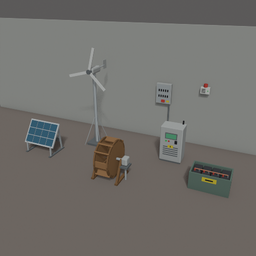

# LiveWire

**The Electrical skill becomes a trade: silent solar, wind and water power for your whole house, with no fuel and no fumes.**

Project Zomboid Build 42.21 and later · LiveWire 2.0.0 · LiveWire Extended 1.0.0 · mod ids `batman_LiveWire` and `batman_LiveWireExtended` · EN/FR · MIT licence

[Steam Workshop](https://steamcommunity.com/sharedfiles/filedetails/?id=3821807453) · [Wiki](https://github.com/cyberbobjr/LiveWire/wiki/EN-Home) · Questions, bug reports, ideas: [Discord](https://discord.gg/QEsBya7hUA) · Release notes: [CHANGELOG.md](CHANGELOG.md)

Version française : [README_fr.md](README_fr.md)

*Solar panels and a wind turbine outdoors, with green "connected" lights.*

## Contents

1. [Overview](#overview)
2. [Equipment](#equipment)
3. [How to connect (wiring)](#how-to-connect-wiring)
4. [Inverter screen and management software](#inverter-screen-and-management-software)
5. [Optional equipment](#optional-equipment)
6. [Water pump](#water-pump)
7. [Calculations](#calculations)
8. [Recipes](#recipes)
9. [Loot tables](#loot-tables)
10. [Wear and maintenance](#wear-and-maintenance)
11. [Electrical skill](#electrical-skill)
12. [Sandbox options](#sandbox-options)
13. [LiveWire Extended](#livewire-extended)
14. [Multiplayer and installation](#multiplayer-and-installation)
15. [Project Viewpoint](#project-viewpoint)
16. [Licence and credits](#licence-and-credits)
17. [For developers](#for-developers)

## Overview

Solar panels, wind turbines and water wheels produce silent power. An inverter placed in the house powers every appliance around it. Batteries in a power bank store the surplus for the night. The server is authoritative (multiplayer-ready, designed for dedicated servers).

### Three roles, one network

- **Sources produce.** Solar panel 100 W, wind turbine 400 W, water wheel 120 W (nominal). Any number of sources per inverter; each must be within cable range (12 tiles horizontally, at most 3 floors apart by default).
- **Batteries store (optional).** Car batteries or deep-cycle batteries inside a power bank (4 counted per power bank, charge efficiency 0.90). Several power banks per inverter.
- **The inverter converts and distributes.** 1,500 W max (house demand), 20 W idle consumption, efficiency 0.85 to 1.0 (from the Electrical level of whoever links it). Up to 4 coupled inverters per network. It can be placed indoors and is not a game generator, so it produces no toxic fumes.
- **The house.** Every powered appliance within 20 tiles and ±3 floors of the inverter (vanilla options `GeneratorTileRange` / `GeneratorVerticalPowerRange`) is powered. No per-appliance wiring. With [LiveWire Extended](#livewire-extended) enabled, power follows the buildings and terminal zones you connect instead of this circle.

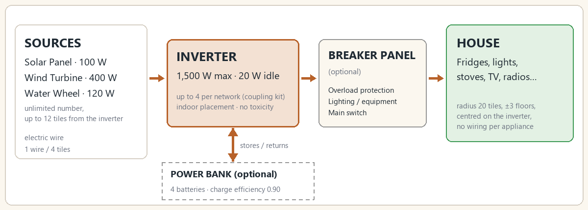

*How it works: sources, inverter, house and power bank.*

**Minimal system:** one source + one inverter. Without batteries, the house runs on current production only (for example, three panels on a sunny day run a fridge-freezer at noon, not at night).

The game itself decides what is powered (a square is powered as if near a generator), so fridges, lights, stoves, TVs and radios work exactly as in vanilla.

**Fridges stay cold while you are away.** Fridges and freezers keep food cold while the area is unloaded, as long as there is power. Checked in game: a fresh steak in a powered fridge, player 300 tiles away, 10 game hours: aged 0.083 day (cold) instead of 0.417 day (warm). On returning, LiveWire replays power changes from a server-side history covering 60 game days. Older periods use the earliest retained state as an approximation; changes discarded before that history existed cannot be recovered.

## Equipment

Each recipe gives a placeable furniture item `Base.Mov_LiveWire_*`. Place, rotate and pick up with the vanilla furniture cursor (ghost, 4 facings, 2 for wall objects). Placing and picking up need a screwdriver, with no Electrical level. The Electrical level in the table below is the one needed to link the device to an inverter (putting an inverter into service, with its first link, needs level 3). A picked-up device keeps its condition.

Placement rules added by the mod: outdoors (open sky) for the solar panel and wind turbine; river bank, ground floor, next to river water for the water wheel (lakes and ponds are refused). A refused square shows the reason in red in the cursor panel.

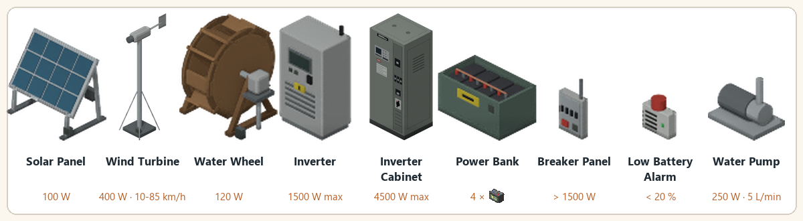

*All devices with their key figures.*

| Device | Role | Placement | Electrical level to link |
|---|---|---|---|
| Solar panel | Source, 100 W | Outdoors, open sky; flat roof OK | 3 |
| Wind turbine | Source, 400 W; blades turn with the wind | Outdoors; +15 % wind per floor up to the 3rd | 2 |
| Water wheel | Source, 120 W day and night; the wheel turns with the river | Ground floor, next to a river | 2 |
| Inverter | Heart of the network, 1,500 W | Any floor tile, indoors included | 3 |
| Inverter cabinet | Heart of the network, 4,500 W; built from an inverter | Any floor tile, indoors included | 3 |
| Power bank | Storage, 4 batteries counted; opens like a crate (capacity 50) | Anywhere; picked up only when empty | 2 |
| Breaker panel | Safety, optional | On a wall (north or west) | 3 |
| Low battery alarm | Alert, optional | On a wall | 2 |
| Water pump | Consumer, 250 W while pumping: moves barrel water to the taps | Any floor tile, indoors or outdoors | 3 |

Batteries are never placed on the floor: drag them into the power bank with the vanilla inventory.

| Battery | Nominal capacity | Life |
|---|---|---|
| Car battery `Base.CarBattery1` | 0.40 kWh | 150 cycles |
| Car battery `Base.CarBattery2` | 0.60 kWh | 150 cycles |
| Car battery `Base.CarBattery3` | 0.90 kWh | 150 cycles |
| Deep-cycle battery `LiveWire.DeepCycleBattery` | 1.50 kWh | 600 cycles |

Effective capacity = nominal × (0.4 + 0.6 × condition / 100) × `BatteryCapacityMultiplier`.

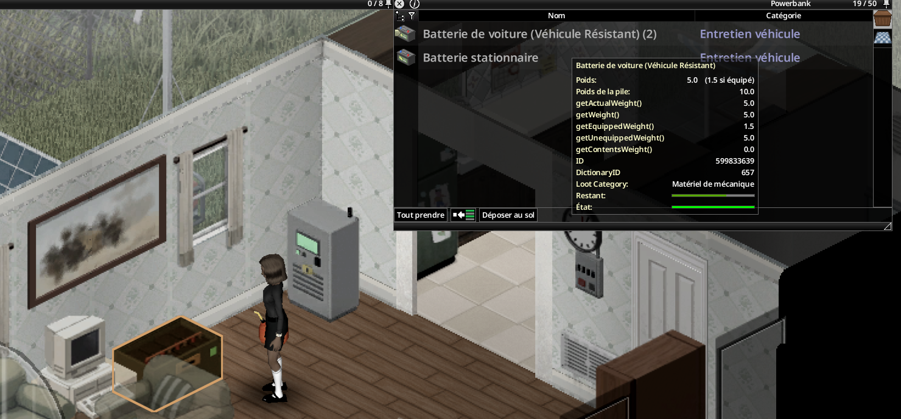

*Power bank opened like a crate.*

**Lights on the tiles:** the inverter screen is lit when on and shows a red light on fault; sources and the power bank have a green "connected" light; the breaker has a green powered-distribution indicator and a red lamp when tripped; the alarm beacon is lit while ringing; the water pump has a blue light whenever powered, including while idle.

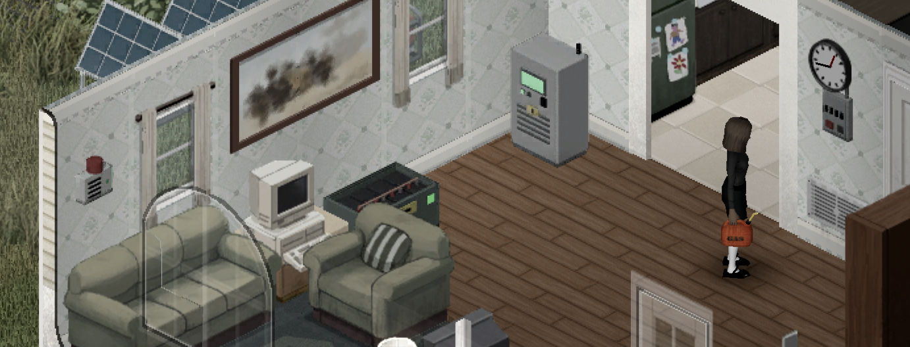

*Indoors: inverter, power bank, computer, wall alarm and breaker.*

*Power bank, inverter and electrical panel screens on the same installation.*

## How to connect (wiring)

1. Craft the devices (see [Recipes](#recipes)) and place them with the furniture cursor. Each link to the inverter needs the device's Electrical level (table above).
2. Right-click a device > **LiveWire** > device name. It shows "Connected to the inverter N tiles away" or "Not connected", then **Connect to an inverter** > one line per inverter in range: "Inverter N tiles away (k wires)". Or right-click the inverter > **Connect equipment** (list of free equipment in range with distance and wires) / **Disconnect equipment**.
3. Pay the cost in electric wire `Base.ElectricWire`.
4. Respect the limits per network.

**Cost:** 1 wire per 4 tiles of distance, rounded up, at least 1 (sandbox `WirePerTiles`; 0 = free). Worked example: a source 9 tiles from the inverter costs ceil(9 / 4) = 3 wires.

**Range:** 12 tiles horizontally (sandbox `LinkRange`, 4-30), at most 3 floors apart by default (sandbox `LinkVerticalRange`, 0-10; 0 = same floor only). The vertical setting also applies to inverter coupling.

**Limits per network:** at most one breaker, one alarm, one management computer and one backup generator.

**Vanilla objects:** the vanilla generator (backup) and the vanilla desktop computer (management) are linked the same way from their own right-click menu (**LiveWire** > Backup generator / Management computer > Connect to an inverter).

**Moving things:** picking up the inverter disconnects its whole network; rotating it keeps the links. Picking up a source keeps its condition; placed again, it is "Not connected".

**Inverter right-click menu:** Open the inverter screen, Turn on / Turn off, Reset (after a trip), Show the powered area (cyan circle on the ground), Connect equipment, Disconnect equipment, Soundproof the inverter, Inspect, Repair, Overhaul.

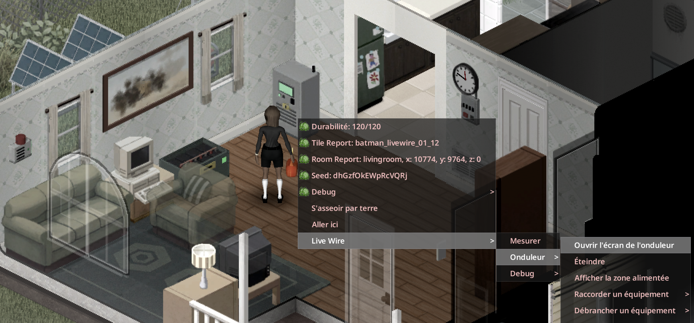

*The LiveWire right-click menu on the inverter.*

## Inverter screen and management software

Left-click equipment for its own LCD and use **Connections** to manage its wiring. The software also lists consumers, the last 30 events and a three-day forecast with a powered management computer. Full guide: [screens and software](https://github.com/cyberbobjr/LiveWire/wiki/EN-05-inverter-screen-and-software).

**LCD panel** (right-click the inverter > Open the inverter screen): backlit screen, 5 pages (Production/Load, Batteries, Sources, House, Status) with `<` and `>`; an I/O button with a light (green on, red off, blinking orange on fault); RESET when tripped; production and load bars on the same scale; long lines scroll. The MAINS and public-grid lines show when the inverter draws from the grid (see [GridCharging](#sandbox-options)).

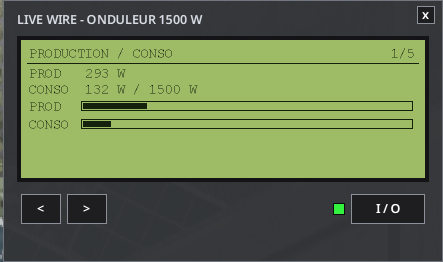

*Inverter LCD panel, page 1 (production / load).*

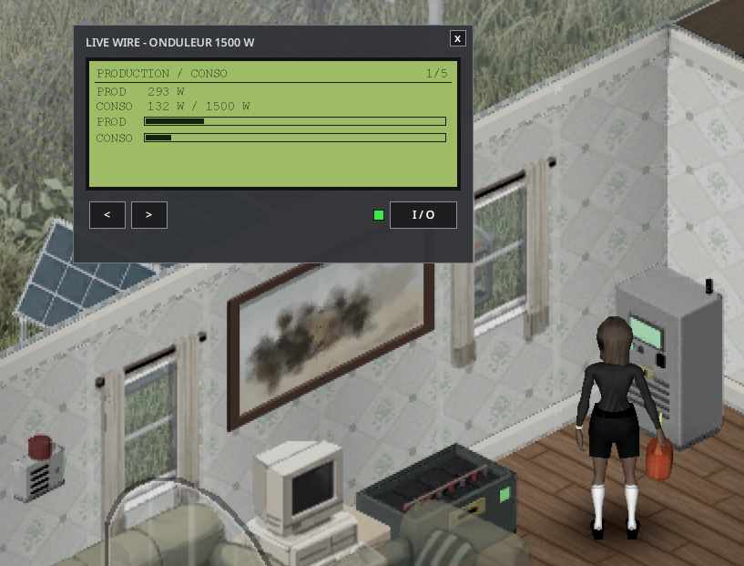

*Inverter LCD panel in the house.*

**Management software "LiveWire Monitor"** has the tabs Overview, Batteries, Sources, House, History and Equipment.

- **Overview:** production and consumption in large figures with bars on the same scale, storage gauge and autonomy, inverter card (state light, condition, On/Off, Reset), alerts.
- **History:** 48 h graphs (production, consumption, battery stock) and a three-day forecast that says whether the batteries will last until sunrise. It needs a linked management computer.

**Without the Computer Mod:** a vanilla desktop computer linked to the inverter opens the software on the mod's own computer screen (monitor, boot screen "LiveWire OS", status bar with game time).

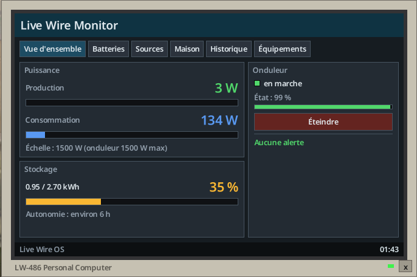

*Management software on a vanilla computer, without the Computer Mod or Laptop Mod.*

**With the optional Computer Mod (Workshop 3725497089) or Laptop Mod (3798992436):** the software comes on a disk, "Disk: LiveWire Management Software" (`LiveWire.MonitorDisk`), found in computer loot. Right-click the computer with the disk > **Install the LiveWire software**. It then appears as a "LiveWire" app on their desktop and runs inside their window (title bar, minimise, close, taskbar). It shows the inverter linked to that computer, or the nearest inverter in cable range.

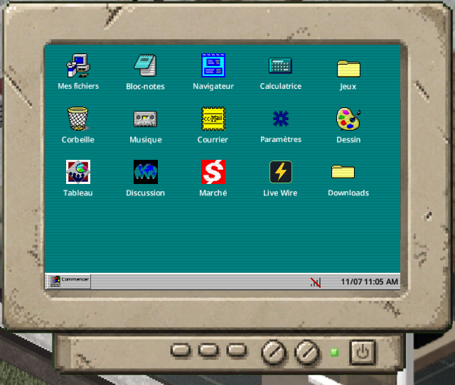

*Computer Mod desktop with the LiveWire icon.*

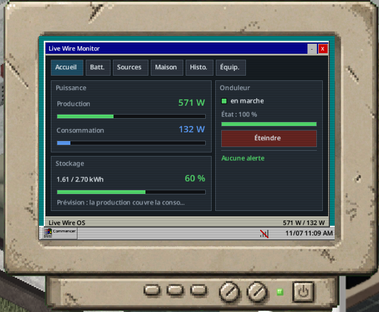

*LiveWire Monitor, Overview tab, inside the Computer Mod.*

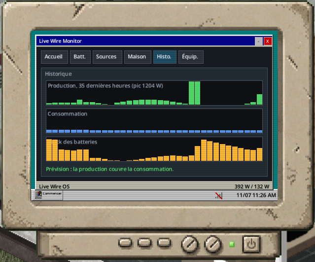

*History tab: 48 h graphs and forecast.*

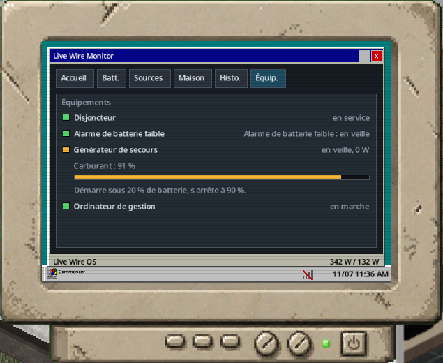

*Equipment tab inside the Computer Mod.*

**Inverter hum:** a sound of the mod, heard only one tile around a switched-on inverter (same floor). Each player sets its volume in Options > Mods > LiveWire (0 = off). Zombies hear the inverter within 2 tiles (sandbox `InverterNoiseRadius`).

**Soundproofing kit** (`LiveWire.SoundproofKit`): fitted on the inverter with a screwdriver (**Soundproof the inverter**), removed with **Remove the soundproofing** (kit given back). Effects: no hum, zombies do not hear it; the inverter runs warmer and wears 25 % faster. It follows the inverter when picked up.

A soundproofed inverter is covered with grey acoustic foam on its top, sides and back (the screen stays visible), and "Soundproofed" shows when it is inspected and on the Status page of its screen.

## Optional equipment

| Equipment | Effect | Electrical level |
|---|---|---|
| Breaker panel (wall) | Trips instead of the inverter when the house demand exceeds 1,500 W: the inverter loses no condition point. Red lamp when tripped; reset on the breaker itself ("Reset the breaker"), refused while the overload lasts. | 3 |
| Low battery alarm (wall) | Below 20 % storage: message to players within 30 tiles, a beep every 2 game hours until it is silenced; the beacon stays lit until storage is back above 25 %. | 2 |
| Backup generator (vanilla generator) | Started by the mod under 20 % battery, stopped at 90 % (sandbox options). Supplies 1,200 W and burns 1 L of fuel per 3 kWh, on top of its vanilla use. Noisy and toxic indoors; connect and fuel it the vanilla way. Never starts without batteries. | 2 |
| Management computer (vanilla desktop) | 48 h history and a three-day forecast of whether the batteries last until sunrise. Automatic load shedding: switches off lights under 15 % to save the fridge, back on above 30 %. | 3 |
| Coupled inverters (up to 3 more) | Network capacity is the sum of the inverters in service: up to 4 × 1,500 W = 6,000 W with standard inverters, more with inverter cabinets (4,500 W each). See below. | 3 |

### Parallel inverters (coupling)

Real off-grid systems get more power by adding identical inverters in parallel, not by pushing one beyond its rating. LiveWire does the same:

- Right-click an inverter > **Couple to an inverter** > a master inverter within cable range. The clicked inverter becomes a **slave**. Cost: the electric wire for the distance and 1 **inverter coupling kit** (recipe at Electrical 3).
- The slave must have no equipment of its own; a master takes at most 3 slaves (4 inverters).
- One network, one battery bank, one powered area (the master's). Capacity = sum of the inverters in service (1,500 W per inverter, 4,500 W per inverter cabinet; both can be coupled together); each switched-on inverter uses its idle consumption (20 W, 60 W for a cabinet) and wears as usual.
- A slave that is switched off or broken does not count: if the demand then exceeds what is left, the breaker (or the master) trips. Each slave has its own On/Off switch; reset on the master or the breaker.
- **Uncouple** on the slave makes it independent again (the kit is given back). A master picked up frees its slaves.
- The LCD Status page and the software show "Coupled: n / total in service" and the total capacity.
- Two independent inverters whose areas overlap do not count the same appliances twice: each appliance is counted by the nearest switched-on inverter.

### When does the breaker trip?

When the demand of the house appliances exceeds the inverter maximum, 1,500 W (the 20 W idle is not counted). It is checked at each simulation step: every 10 game minutes and right after an action. Examples: a stacked washer + dryer running together (1,800 W with the game values); with the 1993 consumption profiles, an electric cooker or a dryer alone. Without a breaker, the inverter trips and loses 3 condition points (reset on the inverter).

## Water pump

A consumer placed like the other devices, linked to the inverter at level 3. It pumps water from water barrels into the house taps.

- Link the pump to the inverter with electric wire, as for any device.
- Link each water barrel (vanilla rain collector, or a barrel of the optional mod Useful Barrels) with one **iron pipe** (`Base.MetalPipe`, given back when the barrel is disconnected). The barrel must stand next to the pump: one of its 8 neighbouring squares, same floor. Up to 8 barrels per pump. Only a barrel holding water (or empty) can be connected.
- Above each plumbed sink, bath, shower or toilet inside a room within **15 tiles** of the pump (sandbox `PumpRange`, 5-30) and up to 3 floors up or down, the pump keeps an invisible relay tank of 25 L. Vanilla plumbing takes the water from it: connect the tap with the pipe wrench as usual ("Plumb...").
- No relay is placed above a tap that already has another water source (vanilla barrel above, running water, another mod).
- While the network has power, the pump refills the relays from its barrels, at 5 L per game minute at most. It draws 250 W only while pumping, and stops when every tap is full. A light motor hum is heard within 4.5 tiles while it runs; zombies hear it within 2 tiles.
- Only water is moved, and the rain keeps filling the barrels as before. Tainted water comes out clean at the tap, as in vanilla.
- Right-click the pump > **Show the supplied taps**: a blue circle shows the range, and the supplied taps, the connected barrels and the pump are highlighted in blue; taps in range that are not plumbed yet are shown in grey. The pump has a blue light whenever powered, including while idle.
- Several pumps per network. The software Equipment tab shows the number of pumps in service and their flow (L/h), nothing else.
- **Before removing the mod**, run the debug action "Remove every water relay" (LiveWire menu > Debug, with administrator rights in multiplayer), otherwise the invisible relay tiles stay in the saved world. The action also stops every pump until the debug action "Enable the water pumps again".

## Calculations

Solar examples below assume clean, snow-free, south-facing panels. Other directions, dirt and weather change the result; use the management forecast for your installation.

The server computes every 10 game minutes, players present or not (sandbox `SimulateUnloaded`, default on).

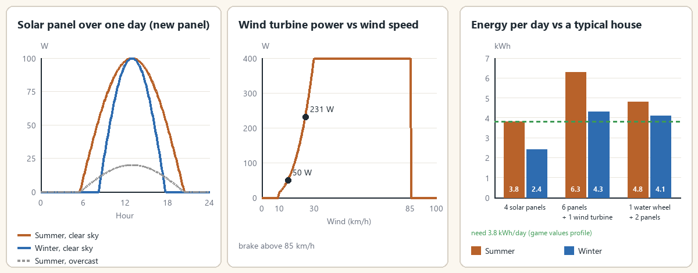

*Solar day, wind curve and energy per day compared with a typical house.*

**Source power:** `P = nominal × source factor × condition factor × installation efficiency × sandbox multiplier`

- Condition factor = 0.5 + 0.5 × condition / 100.
- Installation efficiency (Electrical level of whoever first links the device; the best level seen is kept): 0.85 (levels 0-6), 0.95 (levels 7-8), 1.0 (levels 9-10).
- Each source smooths its output (30 game minutes response): a passing cloud does not make the house flicker.

### Solar (100 W)

Sine curve between the season's dawn and dusk. Clouds leave 20 % at full overcast (factor × (1 − 0.8 × clouds)). Snow builds up on the panel during snowfall and melts above 0 °C (use the "Clear the snow" action). About 0.94 kWh per summer day and 0.60 kWh in winter (new panel, clear sky).

### Wind (400 W)

| Wind speed | Share of nominal power |
|---|---|
| Below 10 km/h | 0 |
| 10 to 30 km/h | (v / 30)³ |
| 30 to 85 km/h | 100 % |
| Above 85 km/h | 0 (automatic brake) |

Wind gets +15 % per floor, up to the 3rd. Examples: 10 km/h ≈ 15 W, 15 km/h ≈ 50 W, 25 km/h ≈ 231 W.

### Water wheel (120 W)

Runs day and night, about 2.9 kWh per day. Season factor: spring × 1.2, summer × 0.8, autumn and winter × 1.0. Rivers only (the engine cannot tell a lake's current).

### Batteries and inverter

- Charging: surplus × 0.90 (charge efficiency); self-discharge 0.2 % per day; when full, extra production is lost (shown as "production lost").
- The inverter supplies the demand from current production first (× efficiency), then from the batteries. It can only restart when production covers the demand or the batteries hold more than 2 % of their capacity.
- Appliance consumption depends on the sandbox `ConsumptionProfile` (below).

### Appliance consumption

The sandbox option **`ConsumptionProfile`** sets how much power each switched-on appliance draws. Values are **averages over a 10-minute step**, not start-up peaks: a fridge compressor cycles on and off, so a fridge-freezer that pulls 300-400 W while running averages about 130 W.

| Appliance (switched on) | Ultra-realistic 1993 | Realistic 1993 | Game values (default) | Comfort |
|---|---|---|---|---|
| Light (one switch, i.e. one room) | 100 W | 60 W | 2 W | 1 W |
| Radio on mains | 40 W | 20 W | 10 W | 5 W |
| Television | 120 W | 80 W | 30 W | 15 W |
| Fridge alone or freezer alone | 130 W | 90 W | 80 W | 40 W |
| Fridge-freezer | 180 W | 130 W | 130 W | 65 W |
| Electric cooker | 3,000 W | 2,000 W | 90 W | 45 W |
| Microwave | 1,500 W | 1,100 W | 90 W | 45 W |
| Washer | 700 W | 500 W | 90 W | 45 W |
| Dryer | 5,000 W | 3,000 W | 90 W | 45 W |
| Combination washer-dryer (washing / drying) | 700 / 3,000 W | 500 / 2,000 W | 90 W | 45 W |
| Stacked washer + dryer (each half running) | 700 + 5,000 W | 500 + 3,000 W | 900 + 900 W | 45 + 45 W |
| Car battery charger | 250 W | 150 W | 50 W | 25 W |
| Gas appliance (controls only) and appliances added by other mods | game value | game value | game value | half |

- **Game values** are the engine's own values, the ones the vanilla generator uses (1 engine power unit per hour = 1,000 W). A base therefore costs the same on an inverter as on a vanilla generator. They are very low for lights, TVs and cookers, and the vanilla stacked washer + dryer is oddly high (0.9 per half instead of 0.09).
- **Realistic 1993** uses typical household draws of the time: 60 W incandescent bulbs, a 25" CRT TV, a 1990s fridge-freezer (about 1,100 kWh a year), a 240 V electric range and dryer.
- **Ultra-realistic 1993** uses older, hungrier appliances: 100 W fixtures, a large CRT, a 1980s fridge, a full-power range and dryer.
- **Comfort** halves the game values and fixes the stacked washer + dryer.
- `PowerScale` multiplies the result of the profile (1 = no change). The inverter itself always uses 20 W idle.
- An appliance that spans several tiles (large shop fridges, wide stoves) counts once, on its first tile: the other tiles of the same piece of furniture draw nothing.
- The profile can be changed during a game: the demand follows at the next measurement.

#### What the realistic profiles change

The inverter limit stays **1,500 W** (4,500 W for the inverter cabinet; [coupled inverters](#parallel-inverters-coupling) add up), in line with the off-grid inverters of the 1990s. In the 1993 profiles:

- An electric cooker (2,000 or 3,000 W) or a dryer trips a single inverter: cook on gas, a wood stove or a campfire, or couple inverters. A breaker panel protects the inverter.
- Lights become the main night load: switch off empty rooms.

### Sizing example

A reference day: one fridge-freezer all day, 10 lights for 6 hours, the TV for 3 hours, plus the inverter idle (20 W). Lights and TV are used at night. A winter night lasts 14 hours.

| Profile | Evening demand | Energy per day | Winter night | Batteries for the night |
|---|---|---|---|---|
| Ultra-realistic 1993 | 1,300 W | 11.2 kWh | 9.2 kWh | about 16 car batteries or 7 deep-cycle |
| Realistic 1993 | 810 W | 7.4 kWh | 5.9 kWh | about 10 car batteries or 4 deep-cycle |
| Game values | 180 W | 3.8 kWh | 2.3 kWh | about 4 car batteries or 2 deep-cycle |
| Comfort | 90 W | 2.1 kWh | 1.3 kWh | about 3 car batteries or 1 deep-cycle |

(Standard car battery: 0.6 kWh; deep-cycle battery: 1.5 kWh; new batteries in full condition.)

Winter production of the sources: solar panel about 0.6 kWh/day, water wheel about 2.9 kWh/day, wind turbine about 0.7 kWh/day with an average 25 km/h wind.

| Installation | Summer (kWh/day) | Winter (kWh/day) | Enough for |
|---|---|---|---|
| 4 solar panels | 3.8 | 2.4 | Comfort |
| 6 panels + 1 wind turbine | 6.3 | 4.3 | Game values |
| 1 water wheel + 8 panels | 9.8 | 7.7 | Realistic 1993 |
| 2 water wheels + 9 panels | 13.1 | 11.2 | Ultra-realistic 1993 (just) |

There is no limit on the number of solar panels; productions add up (100 W nominal each). The 1,500 W limit applies to the house demand, not to production.

## Recipes

LiveWire has 28 recipes: 16 craft devices and parts, 12 dismantle them. They are in the crafting menu. Electrical recipes unlock automatically at their required level; the blade set and mast are in **Metalworking** and need no Electrical level. Tools are kept (some can wear). Every recipe awards Electrical XP, including blades, masts and tester dismantling. Dismantling a device gives back parts; electronic parts depend on its condition. Deep-cycle batteries, solar cells, wind turbine blades and masts cannot be dismantled.

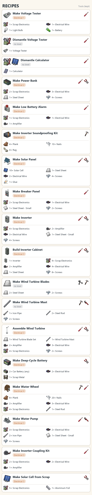

*Illustrated recipe board.*

Ingredients, tools, levels and times for the base recipes: [Recipes](https://github.com/cyberbobjr/LiveWire/wiki/EN-08-recipes). The eight [LiveWire Extended](#livewire-extended) recipes list their ingredients on the [LiveWire Extended](https://github.com/cyberbobjr/LiveWire/wiki/EN-14-livewire-extended) wiki page, and their times on the Recipes page.

## Loot tables

Project Zomboid tests each item independently at each roll of a container list, so a weight of W gives about W % per roll at normal loot rarity. LiveWire adds its equipment to vanilla lists: solar cells, panels, devices, batteries and parts. Vanilla items and their weights are unchanged. Equipment is found in hardware stores, garages and mechanic workshops, electronics stores, electrical factories and warehouse crates; deep-cycle batteries also appear among camping gear. There is no guaranteed map location.

Set **LiveWire equipment and parts loot multiplier** on the **LiveWire** sandbox page: **5 by default**, from **1 to 20**. Restart the game or dedicated server after a change. Only future loot rolls are affected, including vanilla loot respawn if enabled; searched containers are not refilled. At 1, the base weights apply and the new locations are kept. Software disks keep their own rates.

Full weights and chances per container: [Loot tables](https://github.com/cyberbobjr/LiveWire/wiki/EN-09-loot-tables). Also: 1 solar cell per calculator dismantled (no level); at level 3, a solar cell from 5 electronics scrap + 1 aluminum.

## Wear and maintenance

| Device | Normal wear | Accelerators |
|---|---|---|
| Solar panel | −1 per 10 days | Thunderstorm, only if sandbox `StormDamage` (off by default) |
| Wind turbine | −1 per 4 days | Wind > 85 km/h with `StormDamage` |
| Water wheel | −1 per 6 days | none |
| Inverter, inverter cabinet | −1 per 5 days while on | Load > 80 %: wear × 2; each trip without breaker: −3; soundproofed: × 1.25 |
| Breaker | −1 per 15 days | none |
| Water pump | −1 per 10 days while pumping | none |
| Power bank, alarm | −1 per 30 days | none |
| Battery | 100 / life cycles per full cycle | Discharge below 20 %: wear doubled; self-discharge 0.2 % per day |

- **Repair:** 1 electronics scrap + 1 electric wire, gain 5 + Electrical level points (up to 90). Failure chance: max(5, 40 − 5 × level) %, halved from level 8; parts are lost on failure.
- **Overhaul** (level 3, 4 scrap + 2 wires): back to 100.
- **Recondition a battery**: Electrical 4, or 6 for a dead battery; kept screwdriver, 1 electronics scrap + 1 wire + 0.5 L water. +15 condition, capped at 80, at most four repairs. Cycles and stored energy remain; a dead battery returns empty.
- **Voltage tester** (`LiveWire.VoltageTester`): right-click a tile > LiveWire > Measure. It tells power yes/no (level 0), origin (1), appliance consumption (2), network balance (4).

**Battery testing and broken equipment:** test a battery in inventory at Electrical 1/3/5 for increasingly detailed readings. Pick up broken equipment and dismantle it from the crafting menu: its electronic parts depend on its condition. Switch off the master inverter before live work; see the [safety rules](https://github.com/cyberbobjr/LiveWire/wiki/EN-10-electrical-skill-and-maintenance).

## Electrical skill

| Level | Unlocks | Continuous effect |
|---|---|---|
| 0 | Read a tester: powered or not | none |
| 1 | Voltage tester | Detailed reading of the tile |
| 2 | Power bank, low battery alarm, soundproofing kit, backup generator | Battery wear −5 % |
| 3 | Solar panels, breaker, inverter, inverter cabinet, wind turbine assembly, deep-cycle battery, water pump, inverter coupling, solar cells from scrap, management computer (with load shedding), overhaul | Installation efficiency 0.85 |
| 4 | Recondition a battery, water wheel crafting | Autonomy reading |
| 5 | none | none |
| 6 | none | Battery wear −10 % |
| 7 | none | Installation efficiency 0.95 |
| 8 | none | Repair failure halved |
| 9-10 | none | Installation efficiency 1.0; device wear −25 % |

**Experience** (always given by the server):

- Recipes: the XP of each recipe is on the wiki page [Electrical skill and maintenance](https://github.com/cyberbobjr/LiveWire/wiki/EN-10-electrical-skill-and-maintenance).
- First link of a source (once): 10 (panel), 20 (wind turbine, water wheel).
- First link of an inverter, putting it into service (once): 25.
- Link a vanilla generator or computer: 3 (plus the inverter's XP if that link puts it into service). Couple two inverters: 5.
- Inspect a device: 2 (once per device per day).
- Measure with the tester: 1 (once per tile per hour).
- Repair: 5 + 1 per point, max 15.
- Recondition a battery: 8.
- Reset after fixing an overload: 5 (once per hour).
- Soundproof the inverter: 3.
- LiveWire Extended: wiring an appliance to a breaker gives 5 XP per appliance, once per day.

## Sandbox options

Page **LiveWire**. Options of LiveWire Extended are on its own page, see [LiveWire Extended](#livewire-extended).

| Option | Default | Range | Effect |
|---|---|---|---|
| `ConsumptionProfile` | Game values | Ultra-realistic 1993, Realistic 1993, Game values, Comfort | Power drawn by switched-on appliances (see [Appliance consumption](#appliance-consumption)) |
| `EquipmentLootMultiplier` | 5 | 1–20 | LiveWire equipment and solar-cell loot weights only; restart required, future rolls only |
| `PowerScale` | 1.0 | 0.1-10 | Multiplies the consumption given by the profile (1 = no change) |
| `SolarMultiplier` / `WindMultiplier` / `HydroMultiplier` | 1.0 | 0-10 | Production per source family |
| `BatteryCapacityMultiplier` | 1.0 | 0.1-10 | Battery capacity |
| `BatteryWearMultiplier` / `DeviceWearMultiplier` | 1.0 | 0-10 | Wear; 0 = none |
| `InverterNoiseRadius` | 2 | 0-10 | Radius of the hum heard by zombies; 0 = silent |
| `LinkRange` | 12 | 4-30 | Maximum cable distance |
| `LinkVerticalRange` | 3 | 0-10 | Maximum floor difference for equipment connections and inverter coupling; 0 = same floor |
| `PumpRange` | 15 | 5-30 | Radius around a water pump where its taps are supplied |
| `WirePerTiles` | 4 | 0-20 | Tiles per electric wire; 0 = free cabling |
| `SolarOrientation` | true | — | Direction affects solar yield: south 100%, east/west 85%, north 55% |
| `SolarDirt` | true | — | Dirt reduces solar production; rain and cleaning remove it |
| `BatteryCold` | false | — | Outside banks temporarily lose usable capacity in cold weather; energy is retained |
| `LiveWorkRisk` | true | — | Shock risk during live maintenance; switch off the master inverter |
| `StormDamage` | false | n/a | Storm and strong wind damage |
| `XPMultiplier` | 1.0 | 0-10 | Experience given by the mod |
| `SkillGates` | true | n/a | false = no level required |
| `SimulateUnloaded` | true | n/a | Keeps running with nobody nearby |
| `GridCharging` | true | n/a | Charge from the public grid: while the grid works, an inverter inside a building draws from it when the sources are not enough, and charges its batteries from it. Capped at 20 % of the inverter's rating; stops at the vanilla shut-off |
| `BackupStartPercent` / `BackupStopPercent` | 20 / 90 | 0-90 / 10-100 | Backup generator thresholds |

**Player option** (Options > Mods > LiveWire): inverter hum volume, 0-100 (0 = off).

## LiveWire Extended

LiveWire Extended 1.0.0 is an optional add-on, shipped in the same Workshop item. It requires LiveWire 2.0.0 (`require=\batman_LiveWire`) and is not compatible with LG Extended Electricity or KnoxPower. It connects a whole building, powers an outdoor area from a terminal, and wires each appliance to a breaker on a breaker board (one breaker can feed several appliances). Every Extended recipe needs Electrical level 3, and so do the connection jobs (building, terminal, board, breakers, appliance wiring, enlarging). Fitting a twilight switch needs none.

- **Whole buildings.** Right-click an inverter > LiveWire Extended > **Connect the building**. Every floor and the basement get power, even beyond the inverter's circle. One inverter per building. A strip outside the ground floor is powered only if the sandbox option "Outdoor strip around a building" (`BuildingBand`, 0 to 8 squares) is raised; its default is 0.
- **Outdoor power terminal.** Craft a power terminal (or find one with electricians' gear). Link it to an inverter with electric wire, then draw its zone on the ground: up to 16 × 16 squares, rounded to the 8 × 8 blocks the game really powers. A terminal placed inside a building, or right against it, can connect that building too.
- **Breaker boards.** Hang a breaker board (8, 16 or 24 modules) on an inside wall of a building, link it to an inverter, install 15, 20 or 30 A breakers and wire each appliance to a breaker. A board hung outside is refused and the cursor says why. Boards you placed can be enlarged in place (8, then 16, then 24 modules). Vanilla wall electrical boxes on a facade serve the house across the wall.
- **Breakers.** Each breaker takes one module, 120 V, single pole: 1,800 W, 2,400 W or 3,600 W. Overloaded breakers trip and cut their circuit; reset them on the board. Label modules, read the load in W and A and the energy of each circuit, and press **Locate** to light up the appliances a breaker feeds.
- **Twilight switch.** Fitted to a breaker, it closes that circuit only from dusk to dawn.
- **Prewired houses.** Some buildings of the map already have a board, without labels (sandbox `HouseBoardPercent`, default 30 %). Find out which breaker feeds what.
- **Inverter circle.** While Extended is enabled, the inverter's own circle does not power appliances: only connected buildings and terminal zones are powered.
- **Other mods.** Appliances of My Tailor Is Rich (sewing machine) and Functional Appliances 2 (machines set to a temperature) follow their breaker. LiveWire's own water pump and management computer follow their breaker too.
- **Removing it.** Before removing the mod, an admin chooses **Admin: switch every breaker back on (before removing the mod)** from a board's menu. Breakers then cut nothing, and LiveWire goes back to its own circle.
- **Project Viewpoint.** The 3D models of the terminal and the boards come from the optional mod `batman_LiveWireViewpoint`.

Sandbox options on the **LiveWire Extended** page: `BuildingBand` (outdoor strip, 0-8, default 0) and `HouseBoardPercent` (share of map buildings with a prewired board, 0-100, default 30). The sandbox option **Skill requirements** (LiveWire page) also turns off the Extended levels.

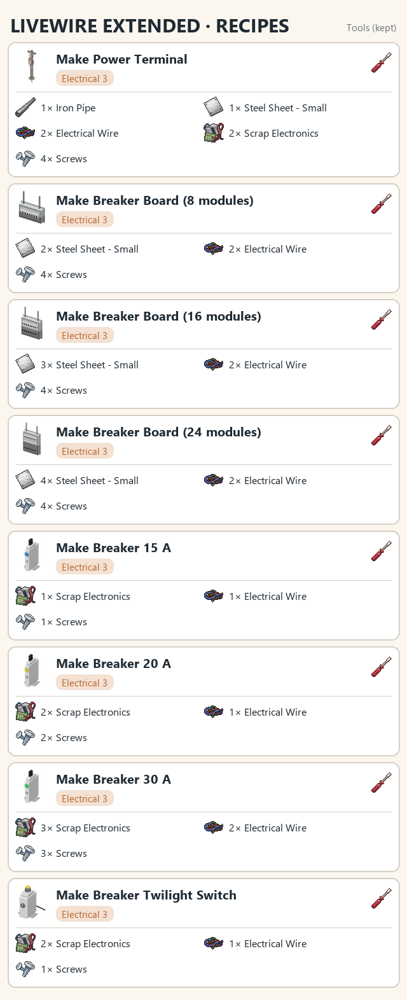

*LiveWire Extended recipes.*

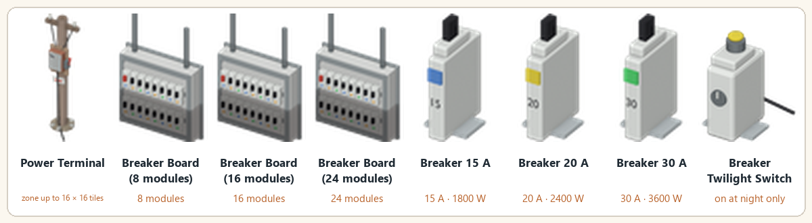

*LiveWire Extended equipment.*

Full guide: [LiveWire Extended](https://github.com/cyberbobjr/LiveWire/wiki/EN-14-livewire-extended).

## Multiplayer and installation

### Multiplayer

Production, stock, states, failures and experience are computed by the server; the client displays and sends requests that the server re-checks. Shared installations follow the vanilla safehouse rules. The software may lag up to 10 game minutes. If the server pauses when empty, the installation pauses too. Vanilla generators are unchanged; if a generator and an inverter cover the same appliances, both pay. Debug tools: `-debug` in single player, admins in multiplayer. Details: [Multiplayer](https://github.com/cyberbobjr/LiveWire/wiki/EN-12-multiplayer).

### Installation

- Subscribe on the Steam Workshop, or copy the mod folders you want from `Contents/mods/` (`batman_LiveWire`, and optionally `batman_LiveWireExtended` and `batman_LiveWireViewpoint`) into your `Zomboid/mods` folder.
- Optional mods: Computer Mod (Workshop 3725497089) or Laptop Mod (3798992436) for the management software disk and desktop app.

## Project Viewpoint

The Workshop item also contains the optional mod **LiveWire - Viewpoint models** (`batman_LiveWireViewpoint`): 3D models of every device, its lights, blade frames and soundproofing foam, plus the LiveWire Extended power terminal and breaker boards when Extended is enabled, for [Project Viewpoint](https://steamcommunity.com/sharedfiles/filedetails/?id=3809306528). Enable it only if you use Project Viewpoint; without it, the mod does nothing. The models are generated from the same Blender geometry as the tiles (`source/viewpoint/export_viewpoint.py`).

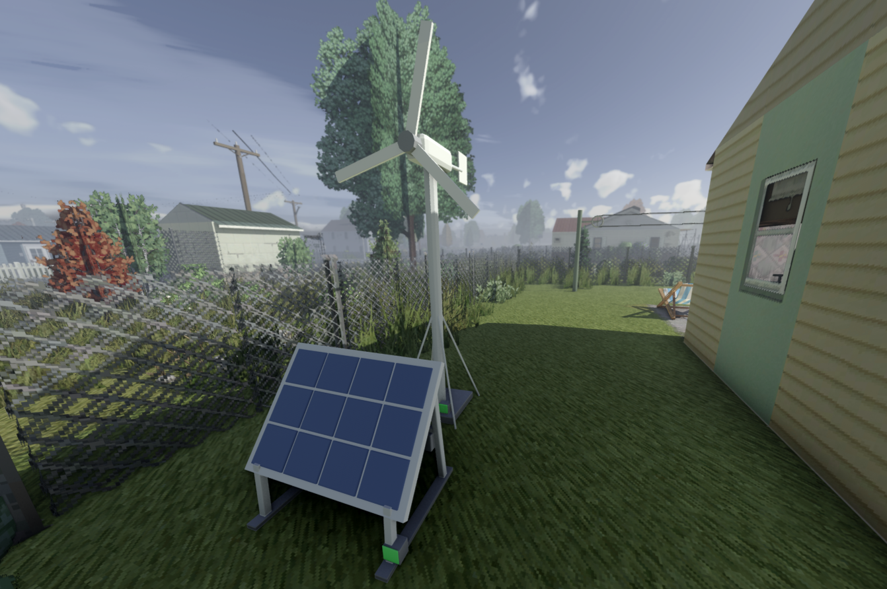
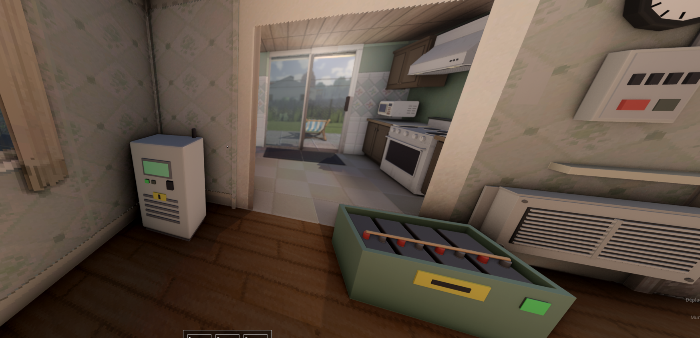

*LiveWire devices seen with Project Viewpoint.*

## Licence and credits

MIT licence (see [LICENSE](LICENSE)). Original creation: no code or asset from other mods.

The inverter cabinet model was contributed by PewPewCricket, who agreed to its release under the MIT licence.

## For developers

- `docs/`: documentation (index `docs/README.md`): design documents in French, wiki sources in `docs/wiki/en` and `docs/wiki/fr`, images in `docs/images`.
- `tools/check_mod.py`: static checks of the mod.
- `tests/`: tests.
- `source/`: generators for tiles, sound and icon.

Repository: https://github.com/cyberbobjr/LiveWire
