
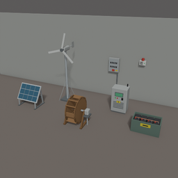

# LiveWire

**La compétence Électricité devient un métier : panneaux, éoliennes et roues à aubes alimentent toute la maison, sans carburant ni fumées.**

Project Zomboid Build 42.21 et versions ultérieures · LiveWire 2.0.0 · LiveWire Extended 1.0.0 · id des mods `batman_LiveWire` et `batman_LiveWireExtended` · EN/FR · licence MIT

[Workshop Steam](https://steamcommunity.com/sharedfiles/filedetails/?id=3821807453) · [Wiki](https://github.com/cyberbobjr/LiveWire/wiki/FR-Home) · Questions, bugs, idées : [Discord](https://discord.gg/QEsBya7hUA) · Notes de version : [CHANGELOG.md](CHANGELOG.md)

[English version: README.md](README.md)

*Panneaux photovoltaïques et éolienne en extérieur, avec les voyants verts « connecté ».*

## Sommaire

1. [Principe](#principe)
2. [Équipements et batteries](#équipements-et-batteries)
3. [Raccorder les éléments](#raccorder-les-éléments)
4. [Écran de l'onduleur et logiciel de gestion](#écran-de-londuleur-et-logiciel-de-gestion)
5. [Équipements optionnels](#équipements-optionnels)
6. [Pompe à eau](#pompe-à-eau)
7. [Tables de calcul](#tables-de-calcul)
8. [Recettes](#recettes)
9. [Tables de butin](#tables-de-butin)
10. [Usure et entretien](#usure-et-entretien)
11. [Compétence Électricité](#compétence-électricité)
12. [Options sandbox](#options-sandbox)
13. [LiveWire Extended](#livewire-extended)
14. [Multijoueur et installation](#multijoueur-et-installation)
15. [Project Viewpoint](#project-viewpoint)
16. [Licence et crédits](#licence-et-crédits)
17. [Pour les développeurs](#pour-les-développeurs)

## Principe

LiveWire repose sur **trois rôles et un seul réseau** :

- **Les sources produisent** : panneau photovoltaïque (100 W), éolienne (400 W), roue à aubes (120 W), en puissance nominale. Le nombre de sources par onduleur n'est pas limité ; chacune doit se trouver à portée de fil (12 cases horizontalement, 3 étages d'écart au plus par défaut).
- **Les batteries stockent** (facultatif) : batteries de voiture ou batteries stationnaires, rangées dans une powerbank (4 batteries comptées par powerbank, rendement de charge 0,90). Plusieurs powerbanks par onduleur.
- **L'onduleur convertit et distribue** : 1 500 W maximum (demande de la maison), 20 W de consommation à vide, rendement de 0,85 à 1,0 (selon le niveau d'Électricité de celui qui le branche). Jusqu'à 4 onduleurs couplés par réseau. Il se pose à l'intérieur et n'est pas toxique (ce n'est pas un générateur du jeu).
- **La maison** : tout appareil situé dans un rayon de 20 cases et à ±3 étages de l'onduleur (options vanilla `GeneratorTileRange` et `GeneratorVerticalPowerRange`) est alimenté. Aucun câblage appareil par appareil. Avec [LiveWire Extended](#livewire-extended) activé, l'alimentation suit les bâtiments et les zones que vous raccordez, et non ce rayon.

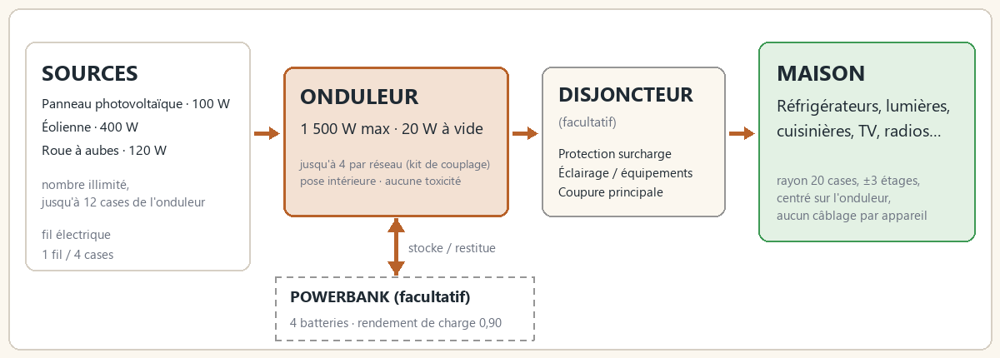

*Sources, onduleur, powerbank et maison.*

**Installation minimale** : une source et un onduleur. Sans batterie, la maison ne tourne que sur la production du moment (par exemple, trois panneaux par grand soleil font fonctionner un congélateur-réfrigérateur à midi, pas la nuit).

C'est le jeu lui-même qui décide ce qui est alimenté (une case est alimentée comme si elle se trouvait près d'un générateur) : frigos, lumières, cuisinières, téléviseurs et radios fonctionnent exactement comme en vanilla.

**Les frigos restent froids pendant votre absence.** Tant qu'il y a du courant, réfrigérateurs et congélateurs conservent la nourriture même quand la zone est déchargée. Vérifié en jeu : un steak frais dans un frigo alimenté, joueur à 300 cases, 10 heures de jeu : âge 0,083 jour (froid) au lieu de 0,417 jour (chaud). Au retour, LiveWire rejoue les changements d'alimentation depuis un historique serveur couvrant 60 jours de jeu. Pour une période plus ancienne, le premier état conservé sert d'approximation ; les changements déjà perdus avant la création de cet historique ne peuvent pas être récupérés.

## Équipements et batteries

Chaque recette donne un meuble posable `Base.Mov_LiveWire_*`. On le pose, le tourne et le ramasse avec le curseur de meubles vanilla (fantôme, 4 orientations, 2 pour les objets muraux). Poser et ramasser exigent un tournevis, sans niveau d'Électricité. Le niveau indiqué dans le tableau est celui du branchement à un onduleur ; mettre un onduleur en service (premier branchement) exige le niveau 3. Un appareil ramassé garde son état.

Règles de pose ajoutées par le mod : en extérieur (ciel dégagé) pour le panneau et l'éolienne ; au rez-de-chaussée, sur la berge, contre l'eau d'une rivière pour la roue à aubes (lacs et étangs refusés). Une case refusée affiche la raison en rouge dans le panneau du curseur.

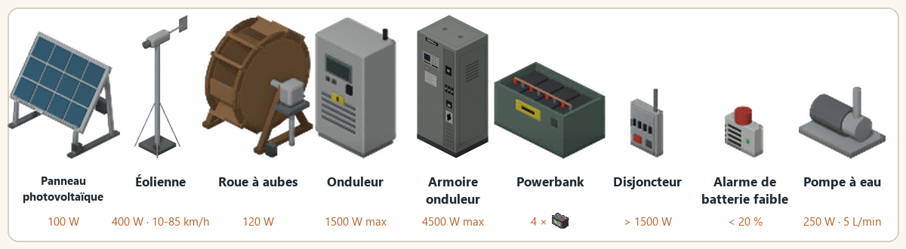

*Tous les équipements et leurs chiffres clés.*

| Appareil | Rôle | Pose | Niveau d'Électricité pour le raccordement |
|---|---|---|---|
| Panneau photovoltaïque | Source, 100 W | En extérieur, ciel dégagé ; toit plat accepté | 3 |
| Éolienne | Source, 400 W ; les pales tournent avec le vent | En extérieur ; +15 % de vent par étage jusqu'au 3e | 2 |
| Roue à aubes | Source, 120 W jour et nuit ; la roue tourne avec la rivière | Rez-de-chaussée, au bord d'une rivière | 2 |
| Onduleur | Cœur du réseau, 1 500 W | Toute case au sol, à l'intérieur compris | 3 |
| Armoire onduleur | Cœur du réseau, 4 500 W ; fabriquée à partir d'un onduleur | Toute case au sol, à l'intérieur compris | 3 |
| Powerbank | Stockage, 4 batteries comptées ; s'ouvre comme une caisse (capacité 50) | Partout ; ne se ramasse que vide | 2 |
| Disjoncteur | Sécurité, facultatif | Sur un mur (nord ou ouest) | 3 |
| Alarme de batterie faible | Alerte, facultatif | Sur un mur | 2 |
| Pompe à eau | Consommateur, 250 W en pompant : envoie l'eau des barils vers les robinets | Toute case au sol, à l'intérieur ou en extérieur | 3 |

**Batteries** (jamais au sol : glissez-les dans la powerbank avec l'inventaire vanilla) :

| Batterie | Capacité nominale | Durée de vie |
|---|---|---|
| Batterie de voiture `Base.CarBattery1` | 0,40 kWh | 150 cycles |
| Batterie de voiture `Base.CarBattery2` | 0,60 kWh | 150 cycles |
| Batterie de voiture `Base.CarBattery3` | 0,90 kWh | 150 cycles |
| Batterie stationnaire `LiveWire.DeepCycleBattery` | 1,50 kWh | 600 cycles |

Capacité effective = nominale × (0,4 + 0,6 × état/100) × `BatteryCapacityMultiplier`.

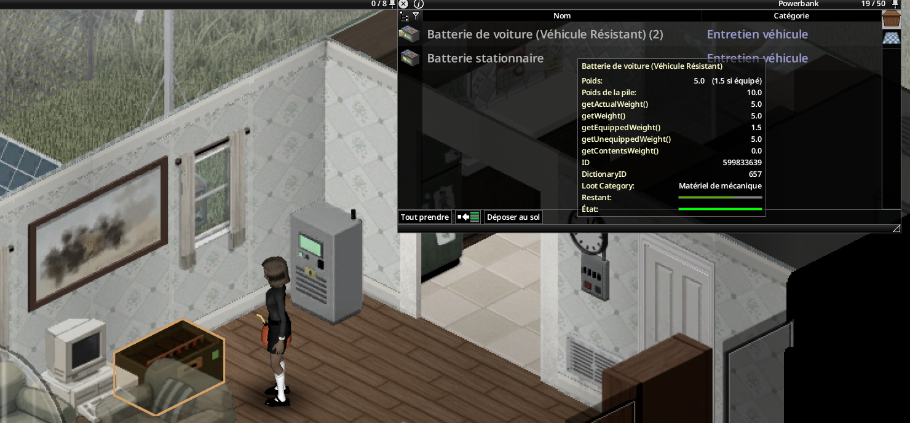

*La powerbank ouverte comme une caisse.*

**Voyants sur les tuiles** : écran de l'onduleur allumé quand il fonctionne, voyant rouge en cas de défaut ; voyant vert « connecté » sur les sources et la powerbank ; voyant vert du disjoncteur lorsque sa distribution est alimentée, rouge quand il a sauté ; gyrophare de l'alarme allumé tant qu'elle sonne ; voyant bleu sur la pompe à eau lorsqu'elle est alimentée, même au repos.

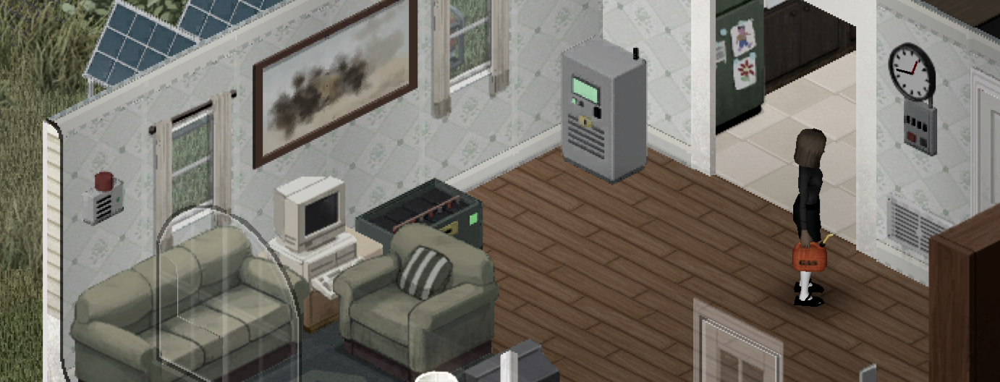

*Intérieur : onduleur, powerbank, ordinateur, alarme et disjoncteur muraux.*

*Écrans de la powerbank, de l'onduleur et du tableau électrique sur la même installation.*

## Raccorder les éléments

1. Fabriquez les appareils ([recettes](#recettes)) et posez-les avec le curseur de meubles. Chaque branchement à l'onduleur exige le niveau d'Électricité de l'appareil (tableau ci-dessus).
2. Clic droit sur un appareil > « LiveWire » > nom de l'appareil : affiche « Raccordé à l'onduleur à N cases » ou « Non raccordé », puis « Raccorder à un onduleur » > une ligne par onduleur à portée : « Onduleur à N cases (k fil(s)) ». Ou clic droit sur l'onduleur > « Raccorder un équipement » (liste des équipements libres à portée, avec distance et nombre de fils) / « Débrancher un équipement ».
3. **Coût** : fil électrique `Base.ElectricWire`, **1 fil par tranche de 4 cases** de distance, arrondi au supérieur, au moins 1 (option `WirePerTiles` ; 0 = gratuit). Exemple : un panneau à 9 cases de l'onduleur coûte 9 / 4 = 2,25, soit **3 fils**.
4. **Portée** : 12 cases horizontalement (option `LinkRange`, de 4 à 30), 3 étages d'écart au plus par défaut (option `LinkVerticalRange`, de 0 à 10 ; 0 = même étage uniquement). La portée verticale s'applique aussi au couplage d'onduleurs.
5. **Limites par réseau** : au plus un disjoncteur, une alarme, un ordinateur de gestion et un générateur de secours.
6. Le générateur vanilla (secours) et l'ordinateur de bureau vanilla (gestion) se raccordent de la même façon, depuis leur propre menu clic droit : « LiveWire » > Générateur de secours / Ordinateur de gestion > Raccorder à un onduleur.
7. Ramasser l'onduleur déconnecte tout son réseau ; le faire pivoter conserve les liens. Une source ramassée garde son état ; reposée, elle est « Non raccordé ».

**Menu clic droit de l'onduleur** : ouvrir l'écran de l'onduleur, allumer / éteindre, réarmer (après un déclenchement), afficher la zone alimentée (cercle cyan au sol), raccorder / débrancher un équipement, insonoriser l'onduleur, inspecter, réparer, remettre à neuf.

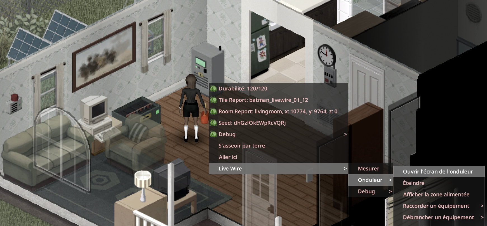

*Menu clic droit « LiveWire » de l'onduleur.*

## Écran de l'onduleur et logiciel de gestion

Un clic gauche ouvre le LCD de chaque équipement ; **Raccordements** permet de gérer son câblage. Le logiciel ajoute les consommateurs, les 30 derniers événements et une prévision sur trois jours avec un ordinateur de gestion alimenté. Guide complet : [écran et logiciel](https://github.com/cyberbobjr/LiveWire/wiki/FR-05-ecran-et-logiciel).

**Écran LCD** (clic droit sur l'onduleur > Ouvrir l'écran de l'onduleur) : écran rétroéclairé de 5 pages (Production/Charge, Batteries, Sources, Maison, État) avec les boutons < et > ; bouton I/O à voyant (vert allumé, rouge éteint, orange clignotant en cas de défaut) ; bouton RESET quand l'onduleur a sauté ; barres de production et de charge à la même échelle ; les longues lignes défilent. Les lignes MAINS et « réseau public » apparaissent quand l'onduleur tire du courant du secteur (voir [GridCharging](#options-sandbox)).

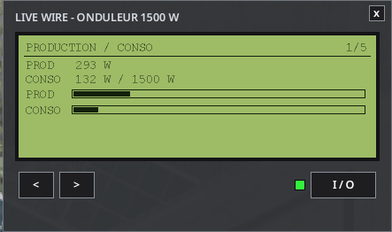

*Écran LCD de l'onduleur, page Production/Charge.*

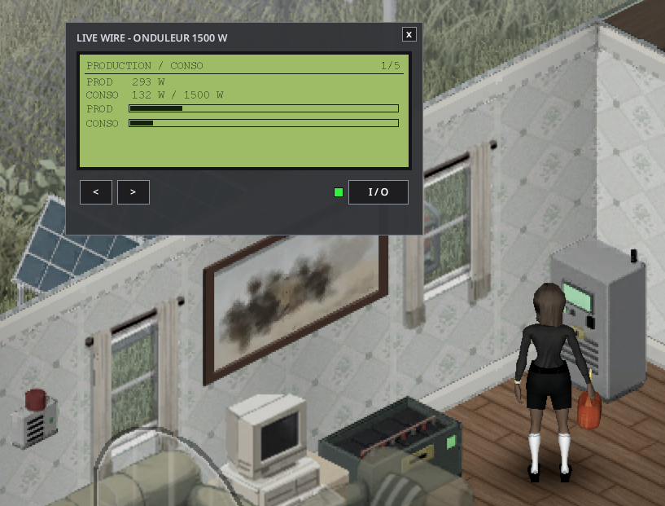

*Écran de l'onduleur dans la maison.*

**Logiciel de gestion « LiveWire Monitor »** : onglets Vue d'ensemble, Batteries, Sources, Maison, Historique, Équipements.

- Vue d'ensemble : production et consommation en grands chiffres avec barres à la même échelle, jauge de stockage et autonomie, fiche de l'onduleur (voyant d'état, état, Marche/Arrêt, Reset), alertes.
- Historique : graphiques sur 48 h (production, consommation, stock des batteries) et une prévision sur trois jours indiquant si les batteries tiendront jusqu'à l'aube. Nécessite un ordinateur de gestion relié.

| Configuration | Fonctionnement |
|---|---|
| **Sans le Computer Mod** | Un ordinateur de bureau vanilla relié à l'onduleur ouvre le logiciel sur l'écran d'ordinateur propre au mod (moniteur, écran de démarrage « LiveWire OS », barre d'état avec l'heure du jeu). |
| **Avec le Computer Mod (Workshop 3725497089) ou le Laptop Mod (3798992436)** | Le logiciel est livré sur un disque, « Disque : logiciel de gestion LiveWire » (`LiveWire.MonitorDisk`), trouvé dans le butin d'ordinateurs. Clic droit sur l'ordinateur avec le disque > « Installer le logiciel LiveWire ». Il apparaît ensuite comme application « LiveWire » sur leur bureau et s'exécute dans leur fenêtre (barre de titre, réduire, fermer, barre des tâches). Il montre l'onduleur relié à cet ordinateur, ou l'onduleur le plus proche à portée de fil. |

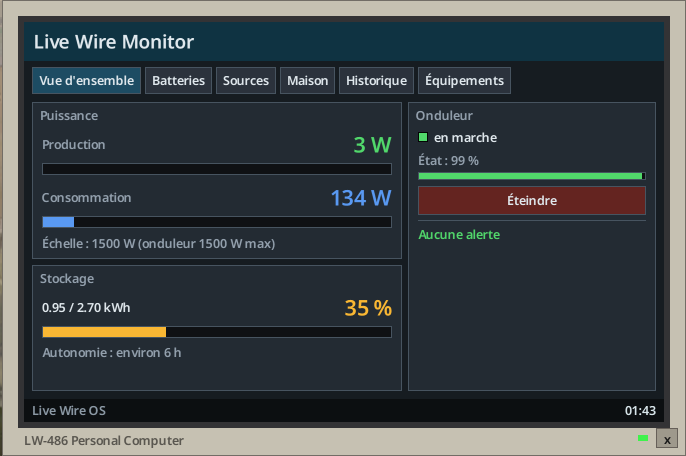

*Logiciel de gestion sur un ordinateur vanilla, sans Computer Mod ni Laptop Mod.*

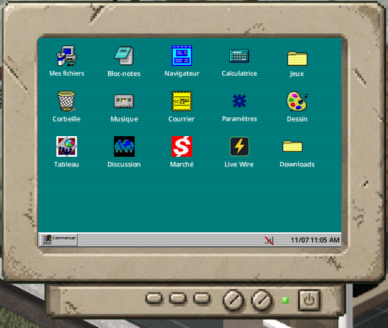

*Bureau du Computer Mod avec l'icône LiveWire.*

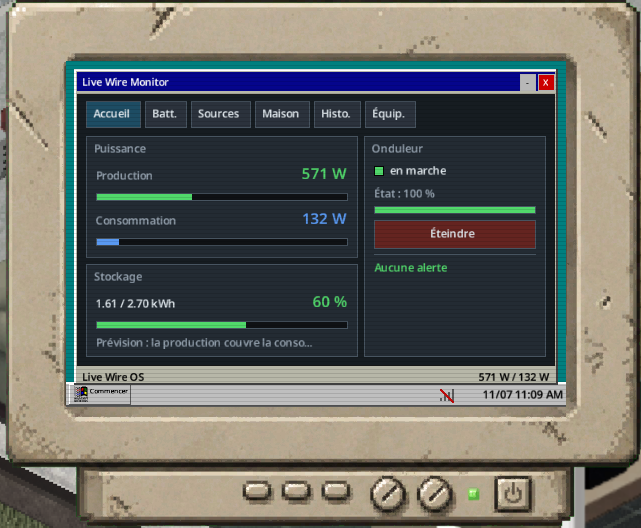

*LiveWire Monitor, vue d'ensemble, dans le Computer Mod.*

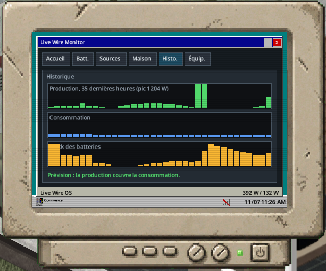

*Historique sur 48 h et prévision.*

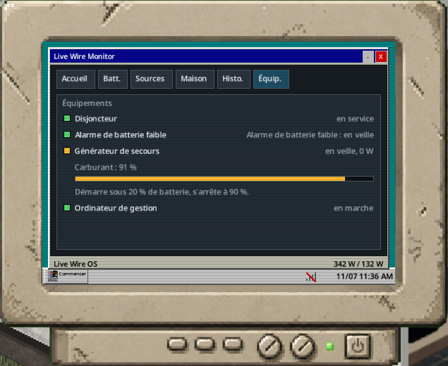

*Onglet Équipements du logiciel dans le Computer Mod.*

**Bourdonnement de l'onduleur** : un son propre au mod, audible seulement à une case autour d'un onduleur allumé (même étage). Chaque joueur règle son volume dans Options > Mods > LiveWire (0 = coupé). Les zombies l'entendent à 2 cases (option `InverterNoiseRadius`).

**Kit d'insonorisation** (`LiveWire.SoundproofKit`) : se monte sur l'onduleur avec un tournevis (« Insonoriser l'onduleur ») et se retire par « Retirer l'insonorisation » (le kit est rendu). Effets : plus de bourdonnement, les zombies ne l'entendent plus ; en contrepartie l'onduleur chauffe davantage et s'use 25 % plus vite. Le kit suit l'onduleur quand on le ramasse.

Un onduleur insonorisé est recouvert de mousse acoustique grise sur le dessus, les côtés et l'arrière (l'écran reste visible), et « Insonorisé » s'affiche quand on l'inspecte et sur la page État de son écran.

## Équipements optionnels

| Équipement | Effet | Niveau |
|---|---|---|
| Disjoncteur (mur) | Saute à la place de l'onduleur quand la demande de la maison dépasse 1 500 W : l'onduleur ne perd aucun point d'état. Lampe rouge quand il a sauté ; réarmement sur le disjoncteur lui-même (« Réarmer le disjoncteur »), refusé tant que la surcharge persiste. | 3 |
| Alarme de batterie faible (mur) | Sous 20 % de stock : message aux joueurs à 30 cases, bip toutes les 2 heures de jeu jusqu'à ce qu'elle soit coupée ; le gyrophare reste allumé jusqu'à ce que le stock repasse au-dessus de 25 %. | 2 |
| Générateur de secours (générateur vanilla) | Démarré par le mod sous 20 % de batterie, arrêté à 90 % (options sandbox). Fournit 1 200 W et brûle 1 L de carburant pour 3 kWh, en plus de sa consommation vanilla. Toujours bruyant et toxique en intérieur ; à brancher et alimenter en carburant à la manière vanilla. Ne démarre jamais sans batteries. | 2 |
| Ordinateur de gestion (ordinateur de bureau vanilla) | Historique 48 h et prévision sur trois jours (les batteries tiendront-elles jusqu'à l'aube ?). Délestage automatique : éteint les lumières sous 15 % pour sauver le frigo, rallumées au-dessus de 30 %. | 3 |
| Onduleurs couplés (jusqu'à 3 onduleurs de plus) | La puissance du réseau est la somme des onduleurs en service : jusqu'à 4 × 1 500 W = 6 000 W avec des onduleurs ordinaires, davantage avec des armoires onduleurs (4 500 W chacune). Voir ci-dessous. | 3 |

### Onduleurs en parallèle (couplage)

Dans une vraie installation autonome, on gagne de la puissance en ajoutant des onduleurs identiques en parallèle, pas en poussant un onduleur au-delà de sa capacité. LiveWire fait de même :

- Clic droit sur un onduleur > **Coupler à un onduleur** > un onduleur maître à portée de câble. L'onduleur cliqué devient **esclave**. Coût : le fil électrique de la distance et 1 **kit de couplage d'onduleurs** (recette au niveau 3 d'Électricité).
- L'esclave ne doit avoir aucun équipement raccordé ; un maître accepte au plus 3 esclaves (4 onduleurs).
- Un seul réseau, un seul parc de batteries, une seule zone alimentée (celle du maître). Capacité = somme des onduleurs en service (1 500 W par onduleur, 4 500 W par armoire onduleur ; les deux se couplent entre eux) ; chaque onduleur allumé consomme sa part à vide (20 W, 60 W pour une armoire) et s'use comme d'habitude.
- Un esclave éteint ou cassé ne compte pas : si la demande dépasse alors ce qui reste, le disjoncteur (ou le maître) saute. Chaque esclave a son interrupteur ; on réarme sur le maître ou le disjoncteur.
- **Découpler** sur l'esclave le rend de nouveau indépendant (le kit est rendu). Un maître ramassé libère ses esclaves.
- La page État de l'écran LCD et le logiciel affichent « Couplés : n / total en service » et la capacité totale.
- Deux onduleurs indépendants dont les zones se recouvrent ne comptent pas deux fois les mêmes appareils : chaque appareil est compté par l'onduleur allumé le plus proche.

### Quand le disjoncteur saute-t-il ?

Quand la demande des appareils de la maison dépasse le maximum de l'onduleur, **1 500 W** (les 20 W à vide ne comptent pas). Le contrôle a lieu à chaque pas de simulation : toutes les 10 minutes de jeu et juste après une action. Exemples : un lave-linge et un sèche-linge superposés qui tournent ensemble (1 800 W avec les valeurs du jeu) ; avec les profils de consommation 1993, une cuisinière électrique ou un sèche-linge seul. Sans disjoncteur, c'est l'onduleur qui saute et perd 3 points d'état (réinitialisation sur l'onduleur).

## Pompe à eau

Un appareil posé comme les autres, branché à l'onduleur au niveau 3. Elle pompe l'eau des barils vers les robinets de la maison. Pas testée en jeu.

- Raccordez la pompe à l'onduleur avec du fil électrique, comme pour tout appareil.
- Raccordez chaque baril d'eau (récupérateur d'eau de pluie vanilla, ou baril du mod facultatif Useful Barrels) avec un **tuyau en métal** (`Base.MetalPipe`, rendu au débranchement). Le baril doit être à côté de la pompe : l'une de ses 8 cases voisines, au même étage. Jusqu'à 8 barils par pompe. Seul un baril qui contient de l'eau (ou vide) peut être raccordé.
- Au-dessus de chaque évier, baignoire, douche ou toilette raccordé, situé dans une pièce à **15 cases** au plus de la pompe (option `PumpRange`, de 5 à 30) et jusqu'à 3 étages au-dessus ou en dessous, la pompe garde un réservoir relais invisible de 25 L. La plomberie vanilla y prend l'eau : raccordez le point d'eau avec la clé anglaise comme d'habitude (« Raccorder la plomberie de… »).
- Aucun relais n'est posé au-dessus d'un robinet qui a déjà une autre source d'eau (baril vanilla à l'étage, eau courante, autre mod).
- Tant que le réseau a du courant, la pompe remplit les relais depuis ses barils, à 5 L par minute de jeu au plus. Elle consomme 250 W seulement en pompant, et s'arrête quand tous les robinets sont pleins. Un léger bourdonnement de moteur s'entend à 4,5 cases pendant la marche ; les zombies l'entendent à 2 cases.
- Seule l'eau est déplacée ; la pluie remplit toujours les barils comme avant. L'eau croupie sort propre au robinet, comme en vanilla.
- Clic droit sur la pompe > **Afficher les points d'eau alimentés** : un cercle bleu montre la portée, et les robinets alimentés, les barils raccordés et la pompe sont surlignés en bleu ; les robinets à portée non raccordés apparaissent en gris. Un voyant bleu s'allume sur la pompe lorsqu'elle est alimentée, même au repos.
- Plusieurs pompes par réseau. L'onglet Équipements du logiciel affiche le nombre de pompes en service et leur débit (L/h), rien d'autre.
- **Avant de retirer le mod**, lancez l'action de débogage « Retirer tous les relais d'eau » (menu LiveWire > Débogage, avec les droits d'administrateur en multijoueur), sinon les tuiles invisibles des relais restent dans la sauvegarde. L'action arrête aussi toutes les pompes jusqu'à l'action de débogage « Réactiver les pompes à eau ».

## Tables de calcul

Les exemples solaires ci-dessous supposent des panneaux propres, déneigés et orientés au sud. Orientation, saleté et météo modifient le résultat ; utilisez les prévisions du logiciel pour votre installation.

Le serveur calcule toutes les 10 minutes de jeu, joueurs présents ou non (option `SimulateUnloaded`, activée par défaut).

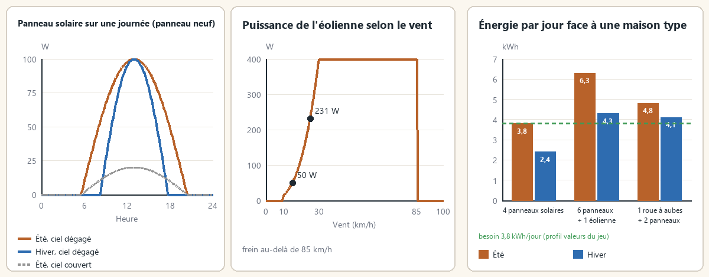

*Journée solaire, courbe de l'éolienne et énergie par jour face à une maison type.*

**Puissance d'une source** : P = nominale × facteur de la source × facteur d'état × rendement d'installation × multiplicateur sandbox.

- Facteur d'état = 0,5 + 0,5 × état/100.
- Rendement d'installation (niveau d'Électricité de celui qui branche l'appareil, au premier branchement ; le meilleur niveau vu est gardé) : 0,85 (niveaux 0 à 6), 0,95 (niveaux 7 et 8), 1,0 (niveaux 9 et 10).
- Chaque source lisse sa sortie (réponse sur 30 minutes de jeu) : un nuage de passage ne fait pas vaciller la maison.

**Solaire (100 W)** : courbe sinusoïdale entre l'aube et le crépuscule de la saison ; un ciel couvert laisse 20 % (facteur × (1 − 0,8 × nuages)) ; la neige recouvre le panneau pendant les chutes et fond au-dessus de 0 °C (action « Déneiger »). Environ 0,93 kWh par jour d'été et 0,60 kWh en hiver (panneau neuf, ciel dégagé), avant rendement d'installation. Avec le rendement habituel de 0,85 (niveau 3 à 6 d'Électricité), cela fait environ 0,79 kWh et 0,51 kWh.

**Éolien (400 W)** : part de la puissance nominale selon la vitesse du vent v, avec +15 % de vent par étage jusqu'au 3e.

| Vent | Part de la puissance |
|---|---|
| Moins de 10 km/h | 0 |
| 10 à 30 km/h | (v / 30)³ |
| 30 à 85 km/h | 100 % |
| Plus de 85 km/h | 0 (frein automatique) |

Exemples : 10 km/h ≈ 15 W, 15 km/h ≈ 50 W, 25 km/h ≈ 231 W.

**Roue à aubes (120 W)** : jour et nuit, ≈ 2,9 kWh par jour ; saison : printemps × 1,2, été × 0,8, automne et hiver × 1,0. Rivières seulement (le moteur ne sait pas distinguer le courant d'un lac).

**Charge des batteries** : surplus × 0,90 (rendement de charge) ; autodécharge 0,2 % par jour ; quand elles sont pleines, l'excédent est perdu (affiché « production perdue »).

**Onduleur** : il couvre d'abord la demande avec la production courante (× rendement), puis avec les batteries ; il ne peut redémarrer que si la production couvre la demande ou si les batteries contiennent plus de 2 % de leur capacité. La consommation des appareils dépend de l'option `ConsumptionProfile` (ci-dessous).

### Consommation des appareils

L'option sandbox **`ConsumptionProfile`** (« Profil de consommation ») fixe la puissance consommée par chaque appareil allumé. Ce sont des **moyennes sur un pas de 10 minutes**, pas des pointes au démarrage : le compresseur d'un frigo s'arrête et redémarre. Un frigo-congélateur qui tire 300 à 400 W quand il tourne consomme donc environ 130 W en moyenne.

| Appareil (allumé) | Ultra-réaliste 1993 | Réaliste 1993 | Valeurs du jeu (défaut) | Confort |
|---|---|---|---|---|
| Lumière (un interrupteur, donc une pièce) | 100 W | 60 W | 2 W | 1 W |
| Radio sur secteur | 40 W | 20 W | 10 W | 5 W |
| Télévision | 120 W | 80 W | 30 W | 15 W |
| Frigo seul ou congélateur seul | 130 W | 90 W | 80 W | 40 W |
| Frigo-congélateur | 180 W | 130 W | 130 W | 65 W |
| Cuisinière électrique | 3 000 W | 2 000 W | 90 W | 45 W |
| Micro-ondes | 1 500 W | 1 100 W | 90 W | 45 W |
| Lave-linge | 700 W | 500 W | 90 W | 45 W |
| Sèche-linge | 5 000 W | 3 000 W | 90 W | 45 W |
| Lave-linge séchant (lavage / séchage) | 700 / 3 000 W | 500 / 2 000 W | 90 W | 45 W |
| Lave-linge + sèche-linge superposés (par moitié en marche) | 700 + 5 000 W | 500 + 3 000 W | 900 + 900 W | 45 + 45 W |
| Chargeur de batterie de voiture | 250 W | 150 W | 50 W | 25 W |
| Appareil au gaz (commandes seulement) et appareils ajoutés par d'autres mods | valeur du jeu | valeur du jeu | valeur du jeu | moitié |

- **Valeurs du jeu** : celles du moteur, utilisées par le générateur vanilla (1 unité de puissance du moteur par heure = 1 000 W). Une base coûte donc autant sur un onduleur que sur un générateur vanilla. Elles sont très basses pour les lumières, les télévisions et les cuisinières. Le lave-linge + sèche-linge superposé vanilla est au contraire étrangement élevé (0,9 par moitié au lieu de 0,09).
- **Réaliste 1993** : consommations courantes d'un foyer de l'époque. Ampoules à incandescence de 60 W, téléviseur cathodique de 63 cm, frigo-congélateur des années 90 (environ 1 100 kWh par an), cuisinière et sèche-linge électriques en 240 V.
- **Ultra-réaliste 1993** : appareils plus anciens et plus gourmands. Plafonniers de 100 W, grand téléviseur cathodique, frigo des années 80, cuisinière et sèche-linge à pleine puissance.
- **Confort** : la moitié des valeurs du jeu, avec le lave-linge + sèche-linge superposé corrigé.
- `PowerScale` multiplie le résultat du profil (1 = aucun changement). L'onduleur consomme toujours 20 W à vide.
- Un appareil de plusieurs cases (grands frigos de magasin, cuisinières larges) compte une seule fois, sur sa première case : les autres cases du même meuble ne consomment rien.
- Le profil peut changer en cours de partie : la demande suit à la mesure suivante.

#### Ce que changent les profils réalistes

La limite de l'onduleur reste **1 500 W** (4 500 W pour l'armoire onduleur ; les [onduleurs couplés](#onduleurs-en-parallèle-couplage) s'additionnent), dans l'ordre de grandeur des onduleurs autonomes des années 90. Avec les profils 1993 :

- Une cuisinière électrique (2 000 ou 3 000 W) ou un sèche-linge fait disjoncter un onduleur seul. Cuisinez au gaz, au poêle à bois ou au feu de camp, ou couplez des onduleurs. Un disjoncteur protège l'onduleur.
- Les lumières deviennent la principale charge de nuit : éteignez les pièces vides.

### Exemple de dimensionnement

Journée de référence : un frigo-congélateur toute la journée, 10 lumières pendant 6 heures, la télévision pendant 3 heures, plus l'onduleur à vide (20 W). Lumières et télévision servent la nuit. Une nuit d'hiver dure 14 heures. La demande du soir exclut la consommation à vide de l'onduleur (20 W) ; l'énergie par jour et la nuit d'hiver l'incluent.

| Profil | Demande le soir (hors à vide) | Énergie par jour | Nuit d'hiver | Batteries pour la nuit |
|---|---|---|---|---|
| Ultra-réaliste 1993 | 1 300 W | 11,2 kWh | 9,2 kWh | environ 16 batteries de voiture ou 7 stationnaires |
| Réaliste 1993 | 810 W | 7,4 kWh | 5,9 kWh | environ 10 batteries de voiture ou 4 stationnaires |
| Valeurs du jeu | 180 W | 3,8 kWh | 2,3 kWh | environ 4 batteries de voiture ou 2 stationnaires |
| Confort | 90 W | 2,1 kWh | 1,3 kWh | environ 3 batteries de voiture ou 1 stationnaire |

(Batterie de voiture standard : 0,6 kWh ; batterie stationnaire : 1,5 kWh ; batteries neuves en parfait état.)

Production des sources par jour, pour des équipements neufs, ciel dégagé, rendement d'installation de 0,85 (niveau 3 à 6 d'Électricité) et un vent stable de 25 km/h au niveau du sol : panneau solaire environ 0,79 kWh en été et 0,51 kWh en hiver ; roue à aubes environ 2,0 kWh en été et 2,4 kWh en automne ou en hiver ; éolienne environ 4,7 kWh dans les deux saisons. Le vent réel varie, et une éolienne ne produit rien sous 10 km/h ni au-dessus de 85 km/h.

| Installation | Été (kWh/jour) | Hiver (kWh/jour) | Suffisant pour (à comparer à l'énergie par jour ci-dessus) |
|---|---|---|---|
| 4 panneaux | 3,2 | 2,0 | Confort en été, juste en dessous en hiver (2,1 nécessaires) |
| 6 panneaux + 1 éolienne | 9,5 | 7,8 | Réaliste 1993 dans les deux saisons |
| 1 roue à aubes + 8 panneaux | 8,3 | 6,5 | Réaliste 1993 en été, Valeurs du jeu en hiver |
| 2 roues à aubes + 9 panneaux | 11,0 | 9,5 | Réaliste 1993 dans les deux saisons ; Ultra-réaliste 1993 juste en dessous en été (11,2 nécessaires) |

Le nombre de panneaux n'est pas limité : les productions s'additionnent (100 W nominaux chacun). La limite de 1 500 W s'applique à la demande de la maison, pas à la production.

## Recettes

LiveWire compte 31 recettes : 16 pour fabriquer les appareils et les pièces, 15 pour les démonter. Elles sont dans le menu d'artisanat. Les recettes d'Électricité se débloquent automatiquement au niveau requis ; les pales et le mât sont dans **Travail des métaux**, sans niveau d'Électricité requis. Les outils sont conservés (certains peuvent s'user). Toutes donnent de l'XP d'Électricité, y compris pales, mât et démontage du testeur. Démonter un appareil rend des pièces ; les pièces électroniques dépendent de son état. Seules les cellules photovoltaïques ne se démontent pas.

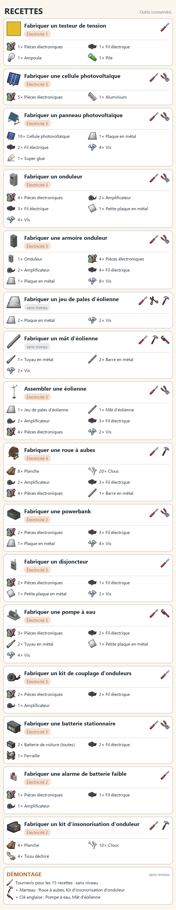

*Planche illustrée des recettes LiveWire.*

Ingrédients, outils, niveaux et durées des recettes de base : [Recettes](https://github.com/cyberbobjr/LiveWire/wiki/FR-08-recettes). Les huit recettes de [LiveWire Extended](#livewire-extended) ont leurs ingrédients sur la page [LiveWire Extended](https://github.com/cyberbobjr/LiveWire/wiki/FR-14-livewire-extended) du wiki, et leurs durées sur la page Recettes.

## Tables de butin

Project Zomboid tire chaque objet indépendamment à chaque tirage d'une liste de conteneurs : un poids de W donne environ W % par tirage à la rareté normale. LiveWire ajoute ses équipements aux listes vanilla : cellules photovoltaïques, panneaux, appareils, batteries et pièces. Les objets vanilla et leurs poids ne changent pas. On trouve les équipements dans les quincailleries, garages et ateliers automobiles, magasins d'électronique, usines électriques et caisses d'entrepôt ; les batteries stationnaires figurent aussi parmi le matériel de camping. Aucun lieu précis ne garantit une découverte.

Réglez **Fréquence des équipements et pièces LiveWire** dans la page sandbox **LiveWire** : **5 par défaut**, de **1 à 20**. Redémarrez le jeu ou le serveur dédié après modification. Seuls les prochains tirages sont concernés, y compris la réapparition vanilla du butin si elle est activée ; aucun remplissage des conteneurs déjà fouillés. À 1, les poids de base s'appliquent et les nouveaux lieux sont conservés. Les disques de logiciel gardent leur propre taux.

Tous les poids et chances par conteneur : [Tables de butin](https://github.com/cyberbobjr/LiveWire/wiki/FR-09-tables-de-butin). Par ailleurs : 1 cellule photovoltaïque par calculatrice démontée (sans niveau) ; au niveau 3, une cellule se fabrique à partir de 5 × Pièces électroniques et 1 × Aluminium.

## Usure et entretien

| Appareil | Usure normale | Accélérateurs |
|---|---|---|
| Panneau photovoltaïque | −1 tous les 10 jours | Orage, seulement avec `StormDamage` (désactivé par défaut) |
| Éolienne | −1 tous les 4 jours | Vent > 85 km/h avec `StormDamage` |
| Roue à aubes | −1 tous les 6 jours | — |
| Onduleur, armoire onduleur | −1 tous les 5 jours en marche | Charge > 80 % : usure × 2 ; chaque déclenchement sans disjoncteur : −3 ; insonorisé : × 1,25 |
| Disjoncteur | −1 tous les 15 jours | — |
| Pompe à eau | −1 tous les 10 jours en pompant | — |
| Powerbank, alarme | −1 tous les 30 jours | — |
| Batterie | 100 / durée de vie par cycle complet | Décharge sous 20 % : usure doublée ; autodécharge 0,2 % par jour |

- **Réparation** : 1 × Pièces électroniques + 1 fil électrique, gain de 5 + niveau d'Électricité points (jusqu'à 90). Chance d'échec : max(5, 40 − 5 × niveau) %, divisée par deux dès le niveau 8 ; les pièces sont perdues en cas d'échec.
- **Remise à neuf** (niveau 3, 4 × Pièces électroniques + 2 fils) : retour à 100.
- **Reconditionnement d'une batterie** : Électricité 4, ou 6 pour une batterie morte ; tournevis conservé, 1 × Pièces électroniques + 1 fil + 0,5 L d'eau. +15 d'état, plafond 80, quatre réparations au maximum. Cycles et énergie conservés ; une batterie morte revient vide.
- **Testeur de tension** (`LiveWire.VoltageTester`) : clic droit sur une case > LiveWire > Mesurer. Alimentée oui/non (niveau 0), origine (1), consommation de l'appareil (2), bilan du réseau (4).

**Test et équipement hors d'usage :** testez une batterie en inventaire aux niveaux 1/3/5 pour des mesures de plus en plus détaillées. Un équipement hors d'usage se ramasse et se démonte depuis le menu d'artisanat : ses pièces électroniques dépendent de son état. Éteignez l'onduleur maître avant d'intervenir ; voir les [règles de sécurité](https://github.com/cyberbobjr/LiveWire/wiki/FR-10-competence-electricite-et-entretien).

## Compétence Électricité

| Niveau | Débloque | Effet continu |
|---|---|---|
| 0 | Lire un testeur : alimenté ou non | — |
| 1 | Testeur de tension | Lecture détaillée de la case |
| 2 | Powerbank, alarme de batterie faible, kit d'insonorisation, générateur de secours | Usure des batteries −5 % |
| 3 | Panneaux photovoltaïques, disjoncteur, onduleur, armoire onduleur, assemblage de l'éolienne, batterie stationnaire, pompe à eau, couplage d'onduleurs, cellules photovoltaïques à partir de déchets, ordinateur de gestion (avec délestage), remise à neuf | Rendement d'installation 0,85 |
| 4 | Reconditionner une batterie, fabrication de la roue à aubes | Lecture de l'autonomie |
| 5 | — | — |
| 6 | — | Usure des batteries −10 % |
| 7 | — | Rendement d'installation 0,95 |
| 8 | — | Échec de réparation divisé par deux |
| 9-10 | — | Rendement d'installation 1,0 ; usure des appareils −25 % |

**Expérience** (toujours attribuée par le serveur) :

- Recettes : l'XP de chaque recette figure sur la page [Entretien et compétence](https://github.com/cyberbobjr/LiveWire/wiki/FR-10-competence-electricite-et-entretien).
- Premier branchement d'une source (une fois) : 10 (panneau), 20 (éolienne, roue à aubes).
- Mise en service d'un onduleur (premier branchement, une fois) : 25.
- Brancher un générateur ou un ordinateur vanilla : 3 (plus l'XP de l'onduleur si ce branchement le met en service). Coupler deux onduleurs : 5.
- Inspecter un appareil : 2 (une fois par appareil et par jour).
- Mesurer avec le testeur : 1 (une fois par case et par heure).
- Réparer : 5 + 1 par point, 15 au maximum.
- Reconditionner une batterie : 8.
- Réinitialiser après avoir corrigé une surcharge : 5 (une fois par heure).
- Insonoriser l'onduleur : 3.
- LiveWire Extended : raccorder un appareil à un disjoncteur donne 5 XP par appareil, une fois par jour.

## Options sandbox

Page « LiveWire » des options sandbox. Les options de LiveWire Extended figurent sur leur propre page, voir [LiveWire Extended](#livewire-extended).

| Option | Défaut | Plage | Effet |
|---|---|---|---|
| `ConsumptionProfile` | Valeurs du jeu | Ultra-réaliste 1993, Réaliste 1993, Valeurs du jeu, Confort | Puissance consommée par les appareils allumés (voir [Consommation des appareils](#consommation-des-appareils)) |
| `EquipmentLootMultiplier` | 5 | 1–20 | Poids du butin des équipements et cellules LiveWire uniquement ; redémarrage requis, prochains tirages uniquement |
| `PowerScale` | 1,0 | 0,1-10 | Multiplie la consommation donnée par le profil (1 = aucun changement) |
| `SolarMultiplier` / `WindMultiplier` / `HydroMultiplier` | 1,0 | 0-10 | Production par famille de sources |
| `BatteryCapacityMultiplier` | 1,0 | 0,1-10 | Capacité des batteries |
| `BatteryWearMultiplier` / `DeviceWearMultiplier` | 1,0 | 0-10 | Usure ; 0 = aucune |
| `InverterNoiseRadius` | 2 | 0-10 | Rayon du bourdonnement entendu par les zombies ; 0 = silencieux |
| `LinkRange` | 12 | 4-30 | Distance de câble maximale |
| `LinkVerticalRange` | 3 | 0-10 | Écart maximal en étages pour les raccordements et couplages ; 0 = même étage |
| `PumpRange` | 15 | 5-30 | Rayon autour d'une pompe à eau dans lequel ses robinets sont alimentés |
| `WirePerTiles` | 4 | 0-20 | Cases par fil électrique ; 0 = câblage gratuit |
| `SolarOrientation` | activé | — | L'orientation modifie le rendement solaire : sud 100 %, est/ouest 85 %, nord 55 % |
| `SolarDirt` | activé | — | La saleté réduit la production ; pluie et nettoyage l'enlèvent |
| `BatteryCold` | désactivé | — | Le froid réduit temporairement la capacité accessible des parcs extérieurs, sans perdre l'énergie |
| `LiveWorkRisk` | activé | — | Risque de choc pendant une intervention sous tension ; éteindre l'onduleur maître |
| `StormDamage` | désactivé | — | Dégâts d'orage et de vent fort |
| `XPMultiplier` | 1,0 | 0-10 | Expérience donnée par le mod |
| `SkillGates` | activé | — | Désactivé = aucun niveau requis pour brancher ou mettre en service |
| `SimulateUnloaded` | activé | — | Continue de simuler sans personne à proximité |
| `GridCharging` | activé | — | Recharge sur le réseau public : tant que le secteur fonctionne, un onduleur dans un bâtiment s'alimente sur le secteur quand les sources ne suffisent pas, et recharge ses batteries. Limité à 20 % de la puissance de l'onduleur ; s'arrête à la coupure vanilla |
| `BackupStartPercent` / `BackupStopPercent` | 20 / 90 | 0-90 / 10-100 | Seuils du générateur de secours |

**Option joueur** (Options > Mods > LiveWire) : volume du bourdonnement de l'onduleur, de 0 à 100 (0 = coupé).

## LiveWire Extended

LiveWire Extended 1.0.0 est un module complémentaire facultatif, livré dans le même objet Workshop. Il exige LiveWire 2.0.0 (`require=\batman_LiveWire`) et n'est pas compatible avec LG Extended Electricity ni KnoxPower. Il raccorde un bâtiment entier, alimente une zone extérieure depuis une borne et branche chaque appareil sur un disjoncteur, dans un tableau électrique (un même disjoncteur peut alimenter plusieurs appareils). Toutes les recettes d'Extended exigent le niveau 3 d'Électricité, et aussi les raccordements (bâtiment, borne, tableau, disjoncteurs, appareils, agrandissement). Poser un interrupteur crépusculaire n'exige aucun niveau.

- **Bâtiments entiers.** Clic droit sur un onduleur > LiveWire Extended > **Raccorder le bâtiment**. Chaque étage et le sous-sol sont alimentés, même au-delà du rayon de l'onduleur. Un onduleur par bâtiment. Une bande extérieure autour du rez-de-chaussée n'est alimentée que si l'option sandbox « Bande extérieure autour d'un bâtiment » (`BuildingBand`, de 0 à 8 cases) est augmentée ; sa valeur par défaut est 0.
- **Borne électrique.** Fabriquez une borne électrique (ou trouvez-en avec le matériel d'électricien). Raccordez-la à un onduleur avec du fil électrique, puis réglez sa zone au sol : 16 × 16 cases au maximum, arrondies aux blocs de 8 × 8 que le jeu alimente réellement. Une borne posée dans un bâtiment, ou contre lui, peut aussi raccorder ce bâtiment.
- **Tableaux électriques.** Accrochez un tableau (8, 16 ou 24 modules) sur un mur intérieur d'un bâtiment, raccordez-le à un onduleur, installez des disjoncteurs de 15, 20 ou 30 A et branchez chaque appareil sur un disjoncteur. Un tableau accroché à l'extérieur est refusé, et le curseur indique pourquoi. Les tableaux que vous avez posés peuvent être agrandis sur place (8, puis 16, puis 24 modules). Les boîtiers électriques muraux vanilla d'une façade alimentent la maison de l'autre côté du mur.
- **Disjoncteurs.** Chaque disjoncteur prend un module, 120 V, monophasé : 1 800 W, 2 400 W ou 3 600 W. Un disjoncteur en surcharge saute et coupe son circuit ; il se réarme sur le tableau. Étiquetez les modules, lisez la charge en W et en A et l'énergie de chaque circuit, et utilisez **Localiser** pour éclairer les appareils alimentés par un disjoncteur.
- **Interrupteur crépusculaire.** Posé sur un disjoncteur, il ne ferme ce circuit qu'entre le crépuscule et l'aube.
- **Maisons précâblées.** Certains bâtiments de la carte ont déjà un tableau, sans étiquettes (option sandbox `HouseBoardPercent`, 30 % par défaut). Trouvez quel disjoncteur alimente quoi.
- **Cercle de l'onduleur.** Quand Extended est activé, le cercle propre de l'onduleur n'alimente pas les appareils : seuls les bâtiments raccordés et les zones des bornes sont alimentés.
- **Autres mods.** Les appareils de My Tailor Is Rich (machine à coudre) et de Functional Appliances 2 (machines réglées à une température) suivent leur disjoncteur. La pompe à eau et l'ordinateur de gestion de LiveWire suivent eux aussi leur disjoncteur.
- **Retrait.** Avant de retirer le mod, un administrateur choisit **Admin : tout remettre en service (avant de retirer le mod)** dans le menu d'un tableau. Les disjoncteurs ne coupent alors plus rien, et LiveWire revient à son propre cercle.
- **Project Viewpoint.** Les modèles 3D de la borne et des tableaux viennent du mod facultatif `batman_LiveWireViewpoint`.

Options sandbox sur la page **LiveWire Extended** : `BuildingBand` (bande extérieure, 0-8, défaut 0) et `HouseBoardPercent` (part des bâtiments de la carte avec un tableau précâblé, 0-100, défaut 30). L'option sandbox **Niveaux requis** (page LiveWire) désactive aussi les niveaux d'Extended.

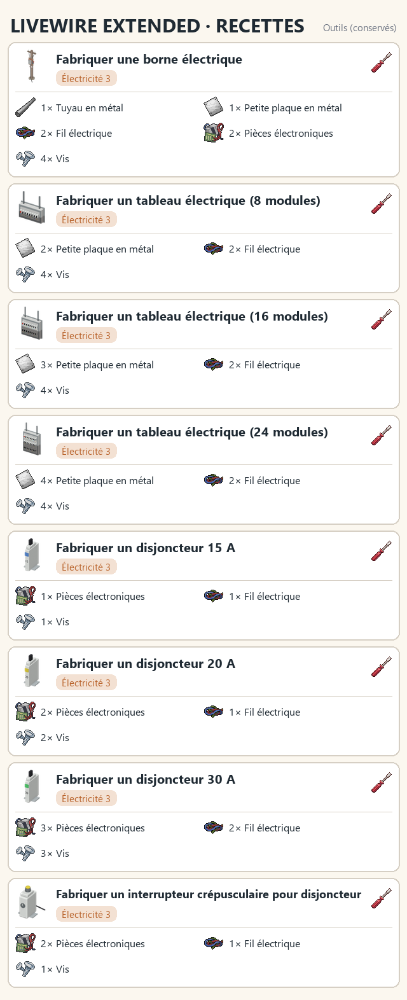

*Recettes de LiveWire Extended.*

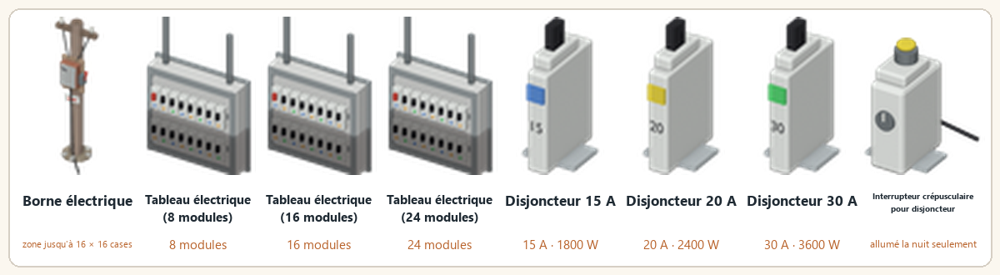

*Équipements de LiveWire Extended.*

Guide complet : [LiveWire Extended](https://github.com/cyberbobjr/LiveWire/wiki/FR-14-livewire-extended).

## Multijoueur et installation

### Multijoueur

Production, stock, états, pannes et expérience sont calculés par le serveur ; le client affiche et envoie des demandes que le serveur revérifie. Installations partagées selon les règles vanilla des refuges. Le logiciel peut avoir jusqu'à 10 minutes de jeu de retard. Si le serveur se met en pause quand il est vide, l'installation se met en pause aussi. Les générateurs vanilla sont inchangés ; si un générateur et un onduleur couvrent les mêmes appareils, les deux sont consommés. Outils de debug : `-debug` en solo, administrateurs en multijoueur. Détails : [Multijoueur](https://github.com/cyberbobjr/LiveWire/wiki/FR-12-multijoueur).

### Installation

- Abonnez-vous au mod sur le Workshop Steam, ou copiez dans votre dossier `Zomboid/mods` les dossiers voulus de `Contents/mods/` : `batman_LiveWire`, et au besoin `batman_LiveWireExtended` et `batman_LiveWireViewpoint`.
- Mods facultatifs : Computer Mod (3725497089) ou Laptop Mod (3798992436) pour le logiciel de gestion installable par disque et l'application de bureau.

## Project Viewpoint

L'objet Workshop contient aussi le mod facultatif **LiveWire - Viewpoint models** (`batman_LiveWireViewpoint`) : les modèles 3D de tous les équipements, de leurs voyants, des pales et de la mousse d'insonorisation, ainsi que la borne et les tableaux de LiveWire Extended quand Extended est activé, pour [Project Viewpoint](https://steamcommunity.com/sharedfiles/filedetails/?id=3809306528). À activer seulement si vous utilisez Project Viewpoint ; sans lui, ce mod ne fait rien. Les modèles sont produits à partir de la même géométrie Blender que les tuiles (`source/viewpoint/export_viewpoint.py`).

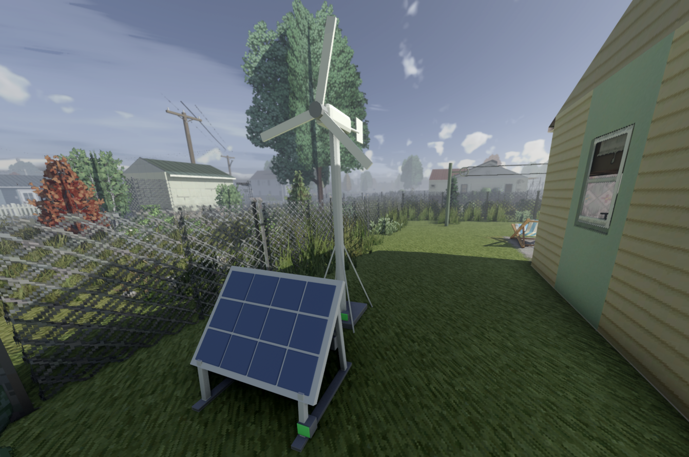
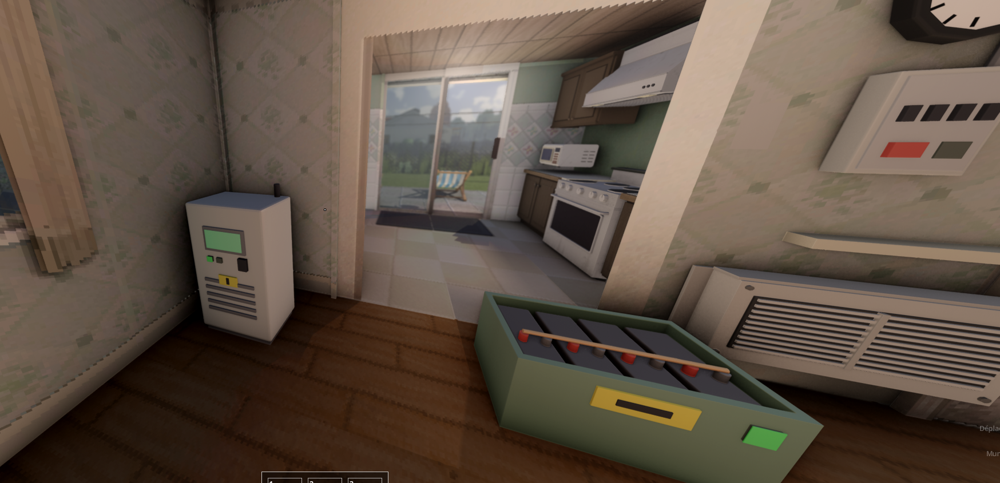

*Les équipements LiveWire vus avec Project Viewpoint.*

## Licence et crédits

Licence MIT (voir [LICENSE](LICENSE)).

Création originale, sans code ni ressource repris d'autres mods.

Le modèle de l'armoire onduleur a été offert par PewPewCricket, qui a accepté sa diffusion sous licence MIT.

## Pour les développeurs

- `docs/` : documentation et sources du wiki (`docs/wiki/en`, `docs/wiki/fr`), images dans `docs/images` ;
- `tools/check_mod.py` : vérification du mod ;
- `tests/` : tests ;
- `source/` : sources et générateurs.
