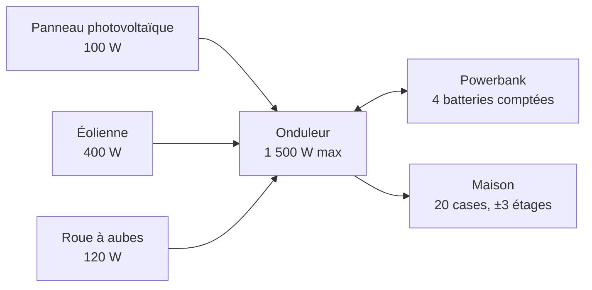

[English version: [Overview](Overview)]

# Présentation

**Live Wire** (`batman_LiveWire`) est un mod pour Project Zomboid, Build 42.21, en anglais et en français. La compétence Électricité devient un vrai métier : panneaux photovoltaïques, éoliennes et roues à aubes produisent un courant silencieux. Un onduleur placé dans la maison alimente tous les appareils alentour, sans carburant ni fumées. Des batteries rangées dans une powerbank stockent le surplus pour la nuit.

Le serveur fait autorité : le mod est conçu pour le multijoueur et les serveurs dédiés.

## Trois rôles, un réseau

| Rôle | Équipement | Détail |
|---|---|---|
| Produire | Panneau (100 W), éolienne (400 W), roue à aubes (120 W) | Nombre de sources illimité par onduleur, chacune à moins de 12 cases de câble et à 1 étage d'écart au plus |
| Stocker (facultatif) | Batteries de voiture ou batteries stationnaires dans une powerbank | 4 batteries comptées par powerbank, rendement de charge de 0,90, plusieurs powerbanks par onduleur |
| Convertir et distribuer | Onduleur | 1 500 W maximum pour la maison, 20 W de consommation à vide, rendement de 0,85 à 1,0 selon le niveau de l'installateur, un seul par réseau |
| Alimenter | La maison | Tout appareil branché à moins de 20 cases et ±3 étages de l'onduleur est alimenté (options vanilla GeneratorTileRange et GeneratorVerticalPowerRange) |

L'onduleur peut être posé à l'intérieur, sans toxicité : ce n'est pas un générateur du jeu. C'est le jeu lui-même qui décide ce qui est alimenté (une case est alimentée comme si elle était près d'un générateur) : frigos, lumières, cuisinières, télévisions et radios fonctionnent exactement comme en vanilla, sans câblage appareil par appareil.

## Installation minimale

Une source et un onduleur suffisent. Sans batterie, la maison ne tourne que sur la production du moment : par exemple, trois panneaux par temps clair font fonctionner un frigo-congélateur à midi, pas la nuit. Ajoutez une powerbank et des batteries pour la nuit (voir [Production et calculs](Production-et-calculs) pour le dimensionnement).

## Frigos pendant une absence

Frigos et congélateurs gardent la nourriture au froid pendant que vous êtes loin (zone déchargée), tant qu'il y a du courant. Vérifié en jeu : un steak frais dans un frigo alimenté, joueur à 300 cases, 10 heures de jeu : vieillissement de 0,083 jour (froid) au lieu de 0,417 jour (chaud).

Limite du moteur : l'état d'alimentation trouvé au rechargement de la zone compte pour toute la durée de l'absence.

## Voir aussi

[Équipements](Equipements) · [Raccordement](Raccordement) · [Production et calculs](Production-et-calculs) · [Multijoueur et FAQ](Multijoueur-et-FAQ)
