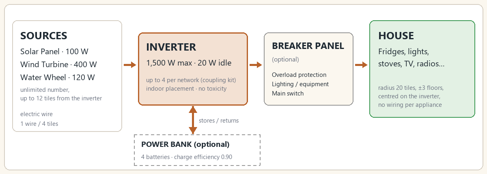
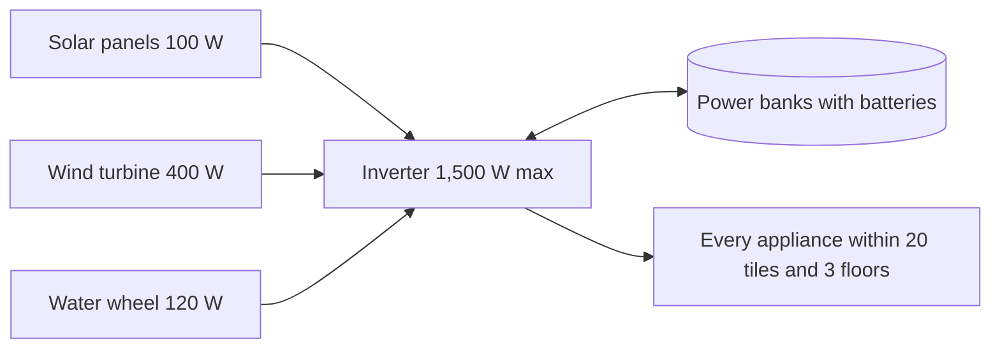
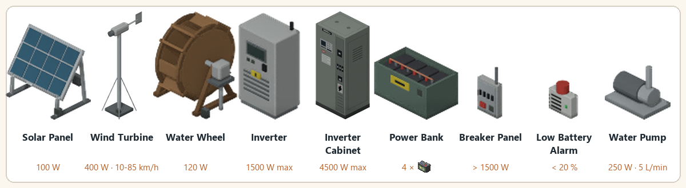
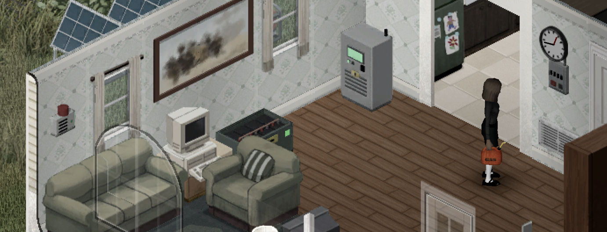

> Version française : [Premiers pas](../fr/01-premiers-pas.md)

# Getting started

**LiveWire** (`batman_LiveWire`) is a Project Zomboid **Build 42.21** mod (it runs on Build 42.22). It turns the Electrical skill into a trade: solar panels, wind turbines and water wheels produce silent power, and an **inverter** placed in your house powers every appliance around it, with no fuel and no fumes. Batteries stored in a **power bank** keep the surplus for the night.

The mod works in single player, on a dedicated server and in multiplayer. The server decides everything, so the rules are the same for every player.

The interface is written in English and French. Translation files are also included for German, Spanish, Portuguese (Brazil and Portugal), Russian, Chinese, Japanese, Korean and Turkish.

*How it works: sources, inverter, house and power bank.*

## Three roles, one network

| Role | Devices | What it does |
|---|---|---|
| Sources produce | Solar panel 100 W, wind turbine 400 W, water wheel 120 W (nominal) | Any number per inverter, each within cable range (12 tiles horizontally, and 3 floors up or down by default) |
| Batteries store (optional) | Car batteries or deep-cycle batteries inside a power bank | 4 batteries counted per power bank, charge efficiency 0.90. Several power banks per inverter |
| The inverter converts and distributes | Inverter: 1,500 W max, 20 W idle consumption, efficiency 0.85 to 1.0 (set by the Electrical level of the player who connected the device) | One master inverter per network, with up to 3 coupled inverters (4 inverters per network). The inverter cabinet: 4,500 W, 60 W idle, built from an inverter at Electrical 3. Both can go indoors and make no fumes (they are not a generator) |
| The house | Every powered appliance | Every appliance within 20 tiles and 3 floors up or down of the inverter is powered. No per-appliance wiring |

The 20 tiles and 3 floors come from the vanilla options `GeneratorTileRange` and `GeneratorVerticalPowerRange`. The game itself decides what is powered (a square is powered as if it were near a generator), so fridges, lights, stoves, TVs and radios work as in vanilla.

Inside a building, the inverter can also draw from the public grid while the power is on. See [Production and calculations](04-production-and-calculations.md#batteries).

## Minimal system

**One source + one inverter.** Without batteries the house runs on the current production only: for example, three panels on a sunny day can run a fridge-freezer at noon, but not at night. Add a power bank with batteries to carry the load through the night.

## Fridges while you are away

Fridges and freezers keep food cold while you are away (the area is unloaded), as long as there is power.

Engine limit: the power state found when the area reloads counts for the whole absence.

## Running water

A water pump wired to the inverter keeps the house taps supplied from water barrels standing next to it (vanilla rain collectors or Useful Barrels): sinks, showers, baths and toilets get water while the network has power. Details in [Water Pump](07-water-pump.md).

## First steps

1. **Get a source and an inverter.** Ready-made solar panels and inverters turn up in garages, hardware stores and electrician storage ([Loot tables](09-loot-tables.md)). You can also craft them in the **Electrical** category: the solar panel kit and the inverter kit need Electrical 3. Solar cells, the parts of the solar panel kit, are crafted from scrap ([Recipes](08-recipes.md)).
2. **Place them** with the vanilla furniture cursor. Placing, turning and picking up need a **screwdriver**, but no Electrical level. Connecting each device to the inverter needs a screwdriver, electric wire and the device's own Electrical level (see [Wiring](03-wiring.md)). Solar panels and wind turbines must stand outdoors, a water wheel must stand on the ground floor next to a river, and the inverter can go indoors.
3. **Connect the source**: right-click it, **LiveWire**, then **Connect to an inverter** (or, from the inverter, **Connect equipment**). It costs 1 electric wire per 4 tiles, rounded up ([Wiring](03-wiring.md)).
4. **Check the result**: the inverter's right-click menu shows the powered area (a cyan circle on the ground) and opens its screen ([Inverter screen and software](05-inverter-screen-and-software.md)).
5. **Add storage for the night** (optional): a power bank holding car batteries or deep-cycle batteries, connected the same way ([Equipment](02-equipment.md)).

## Installation

Subscribe to the mod on the Steam Workshop ([Workshop item 3821807453](https://steamcommunity.com/sharedfiles/filedetails/?id=3821807453)), or copy `Contents/mods/batman_LiveWire` into your `Zomboid/mods` folder, then enable `batman_LiveWire` (Project Zomboid Build 42.21 or later).

[LiveWire Extended](14-livewire-extended.md) is an optional add-on in the same Workshop item. Enable `batman_LiveWireExtended` to use it. The Computer Mod (3725497089) and Laptop Mod (3798992436) are optional. The source code is at https://github.com/cyberbobjr/LiveWire.

## Equipment at a glance

*All devices with their key figures.*

## Screenshots

Outdoors: solar panels and a wind turbine with their green "connected" lights, and the backup generator.

Indoors: the inverter (lit screen), power bank, computer, wall alarm and breaker.

## See also

[Equipment](02-equipment.md) - [Wiring](03-wiring.md) - [Production and Calculations](04-production-and-calculations.md) - [Multiplayer](12-multiplayer.md) - [FAQ](13-faq.md) - [LiveWire Extended](14-livewire-extended.md)
