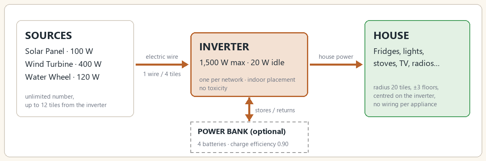
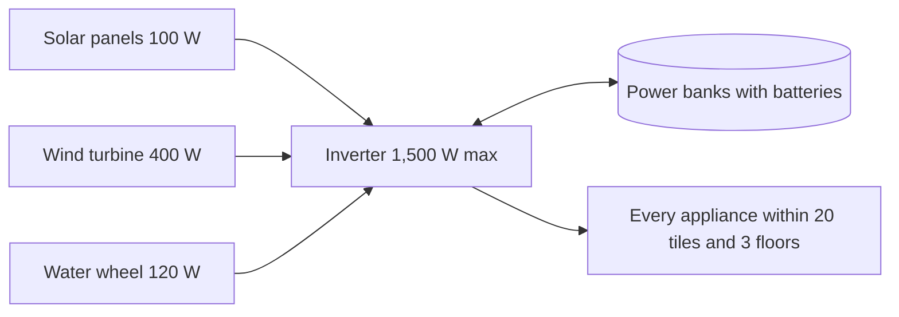
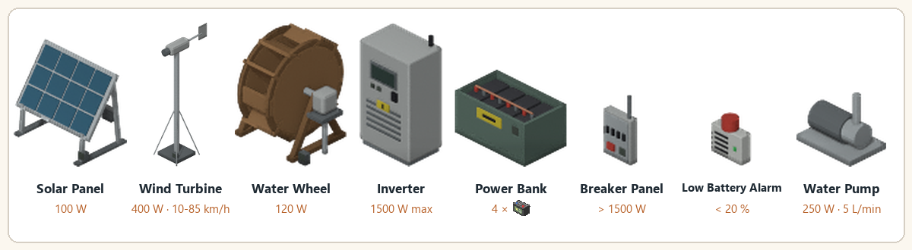

> Version française : [Premiers pas](../fr/01-premiers-pas.md)

# Getting started

**Live Wire** (`batman_LiveWire`) is a Project Zomboid **Build 42.21** mod, translated into English, French, German, Spanish, Portuguese (Brazil and Portugal), Russian, Chinese, Japanese and Korean. It turns the Electrical skill into a trade: solar panels, wind turbines and water wheels produce silent power, and an **inverter** placed in your house powers every appliance around it, with no fuel and no fumes. Batteries stored in a **power bank** keep the surplus for the night. The server is authoritative, so the mod is multiplayer-ready and designed for dedicated servers.

Everything in the mod is original: no code or asset comes from another mod.

*How it works: sources, inverter, house and power bank.*

## Three roles, one network

| Role | Devices | What it does |
|---|---|---|
| Sources produce | Solar panel 100 W, wind turbine 400 W, water wheel 120 W (nominal) | Any number per inverter, each within cable range (12 tiles horizontally, 3 floors apart at most by default) |
| Batteries store (optional) | Car batteries or deep-cycle batteries inside a power bank | 4 batteries counted per power bank, charge efficiency 0.90. Several power banks per inverter |
| The inverter converts and distributes | Inverter | 1,500 W max (house demand), 20 W idle consumption, efficiency 0.85 to 1.0 (from the installer's level). One per network, can be placed indoors, no toxicity (it is not a game generator) |
| The house | Every powered appliance | Every appliance within 20 tiles and 3 floors up or down of the inverter is powered. No per-appliance wiring |

The 20 tiles and 3 floors come from the vanilla options `GeneratorTileRange` and `GeneratorVerticalPowerRange`. The game itself decides what is powered (a square is powered as if it were near a generator), so fridges, lights, stoves, TVs and radios work exactly as in vanilla.

## Minimal system

**One source + one inverter.** Without batteries the house runs on the current production only: for example, three panels on a sunny day run a fridge-freezer at noon, but not at night. Add a power bank with batteries to carry the load through the night.

## Fridges while you are away

Fridges and freezers keep food cold while you are away (area unloaded), as long as there is power. Checked in game: a fresh steak in a powered fridge, player 300 tiles away, 10 game hours: the steak aged 0.083 day (cold) instead of 0.417 day (warm).

Engine limit: the power state found when the area reloads counts for the whole absence.

## Running water (1.2.0)

A water pump wired to the inverter keeps the house taps supplied from water barrels standing next to it (vanilla rain collectors or Useful Barrels): sinks, showers, baths and toilets work again after the water shut-off. Details in [Water Pump](07-water-pump.md).

## First steps

1. **Get a source and an inverter.** Ready-made solar panels and inverters turn up in garages, hardware stores and electrician storage ([Loot tables](09-loot-tables.md)). You can also craft them in the **Electrical** category: solar panel at Electrical 3 (10 solar cells, salvaged from calculators with a screwdriver), inverter at Electrical 5 ([Recipes](08-recipes.md)).
2. **Place them** with the vanilla furniture cursor. Placing and picking up need a screwdriver and the device's Electrical level. Solar panels, wind turbines and water wheels must stand outdoors; the inverter can go indoors.
3. **Connect the source**: right-click it, **Live Wire**, then **Connect to an inverter** (or, from the inverter, **Connect equipment**). It costs 1 electric wire per 4 tiles, rounded up ([Wiring](03-wiring.md)).
4. **Check the result**: the inverter starts switched on. Its right-click menu shows the powered area (a cyan circle on the ground) and opens its screen ([Inverter screen and software](05-inverter-screen-and-software.md)).
5. **Add storage for the night** (optional): a power bank holding car batteries or deep-cycle batteries, connected the same way ([Equipment](02-equipment.md)).

> Capture à faire : the "Connect to an inverter" menu on a solar panel, with the wire count.

## Installation

Subscribe to the mod on the Steam Workshop ([Workshop item 3821807453](https://steamcommunity.com/sharedfiles/filedetails/?id=3821807453)), or copy `Contents/mods/batman_LiveWire` into your `Zomboid/mods` folder, then enable `batman_LiveWire` (Project Zomboid Build 42.21). The Computer Mod (3725497089) and Laptop Mod (3798992436) are optional. The source code is at https://github.com/cyberbobjr/LiveWire.

## Equipment at a glance

*All devices with their key figures.*

## Screenshots

Outdoors: solar panels and a wind turbine with their green "connected" lights, and the backup generator.

Indoors: the inverter (lit screen), power bank, computer, wall alarm and breaker.

## See also

[Equipment](02-equipment.md) - [Wiring](03-wiring.md) - [Production and Calculations](04-production-and-calculations.md) - [Multiplayer](12-multiplayer.md) - [FAQ](13-faq.md)
