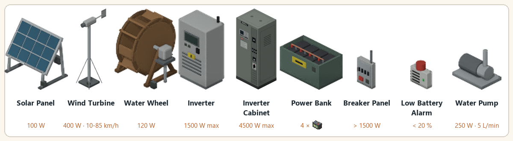
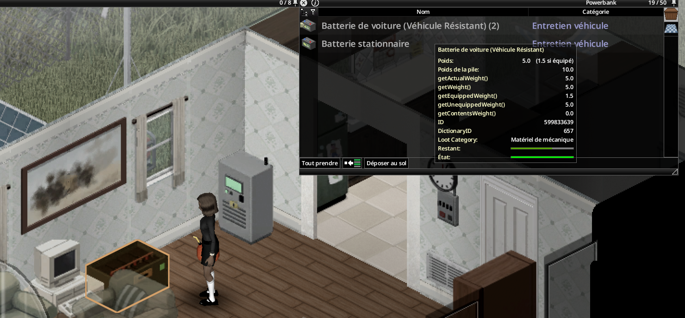

> Version française : [Équipements](../fr/02-equipements.md)

# Equipment

*All devices with their key figures.*

Every device is a real mod tile, placed like vanilla furniture. Each device recipe makes a placeable item named `Base.Mov_LiveWire_*`. Parts and kits (solar cells, coupling kits, soundproofing kits and so on) are separate items.

## Devices

| Device | Role | Placement | Electrical level to link |
|---|---|---|---|
| Solar panel | Source, 100 W | Outdoors, open sky; a flat roof is fine | 3 |
| Wind turbine | Source, 400 W; the blades turn with the wind | Outdoors; the wind is 15 % stronger per floor, up to the 3rd | 2 |
| Water wheel | Source, 120 W day and night; the wheel turns with the river | Ground floor, next to a river | 2 |
| Inverter | Heart of the network, 1,500 W | Any floor tile, indoors included | 3 |
| Inverter cabinet | Heart of the network, 4,500 W, 60 W idle; built from an inverter | Any floor tile, indoors included | 3 |
| Power bank | Storage, 4 batteries counted; opens like a crate (capacity 50) | Anywhere; picked up only when empty | 2 |
| Breaker panel | Safety, optional | On a wall (north or west) | 3 |
| Low battery alarm | Alert, optional | On a wall | 2 |
| Water pump | Feeds the house taps from water barrels, 250 W while pumping | Anywhere, next to its barrels | 3 |

The Electrical level in the last column is the level needed to connect the device to an inverter. An inverter also needs Electrical 3 for its first connection, which puts it into service. Placing needs no level.

Crafting needs more: the water wheel kit needs Electrical 4, and the other kits need Electrical 1 to 3 (see [Recipes](08-recipes.md)).

The optional mod Viewpoint shows 3D models of these devices (see [Home](Home.md)).

## Batteries

Batteries never go on the floor: drag them into the power bank with the vanilla inventory.

| Battery | Nominal capacity | Life |
|---|---|---|
| Car battery `Base.CarBattery1` | 0.40 kWh | 150 cycles |
| Car battery `Base.CarBattery2` | 0.60 kWh | 150 cycles |
| Car battery `Base.CarBattery3` | 0.90 kWh | 150 cycles |
| Deep-cycle battery `LiveWire.DeepCycleBattery` | 1.50 kWh | 600 cycles |

Effective capacity = nominal x (0.4 + 0.6 x condition / 100) x `BatteryCapacityMultiplier`.

## Parts

- **Solar cells** (`LiveWire.SolarCell`) are crafted from 5 Electronics Scrap and aluminum at Electrical 3. A calculator dismantled with the vanilla "Dismantle Simple Electronic Item" recipe also gives one solar cell.
- The **solar panel kit** takes 10 solar cells. See [Recipes](08-recipes.md) for every kit.

## Stack two power banks

Use the native furniture placement cursor to place a second bank on the same square as the first. Its ghost appears above it. A stack holds two banks at most: eight battery slots, four per bank.

Each bank keeps its own container and inverter connection. The LCD's **Bank 1/2** or **Bank 2/2** button switches between the lower and upper bank and selects its loot container. The wiring list also identifies each bank. Stacking creates no batteries and no energy. To move or pick up the lower bank, first empty and pick up the upper one.

## Lights on the tiles

- Inverter and inverter cabinet screen: lit when on, red light on fault.
- Sources and power bank: green "connected" light.
- Breaker: green when distribution is powered, red when tripped. A green lamp does not show that the circuit is safe to work on.
- Alarm: beacon lit while ringing.
- Water pump: blue light whenever powered, including while idle.

## Placement rules

- Place, turn and pick up with the vanilla furniture cursor (ghost, 4 facings, 2 for wall objects).
- Placing, turning and picking up need a **screwdriver**, but no Electrical level.
- Connecting a device to an inverter is covered in [Wiring](03-wiring.md).
- A picked-up device keeps its condition.
- Solar panel and wind turbine: outdoors, under open sky.
- Water wheel: river bank, ground floor, next to river water. Lakes, ponds and swimming pools are refused.
- Water pump: anywhere; its barrels must stand on the 8 squares around it (see [Water Pump](07-water-pump.md)).
- A refused square shows the reason in red in the cursor panel.

## Dismantling

Every device and kit has a dismantle recipe in the crafting menu. It needs a screwdriver (some recipes also need a hammer or a pipe wrench) and no Electrical level. You get metal parts back, and electronic parts depending on the condition of the item: a worn device gives fewer. A soundproofing or coupling kit fitted on an inverter comes back in full.

Deep-cycle batteries, wind turbine blades and masts, and solar cells have no dismantle recipe.

## See also

[Wiring](03-wiring.md) - [Recipes](08-recipes.md) - [Optional Equipment](06-optional-equipment.md) - [Electrical skill and maintenance](10-electrical-skill-and-maintenance.md) - [LiveWire Extended](14-livewire-extended.md)
