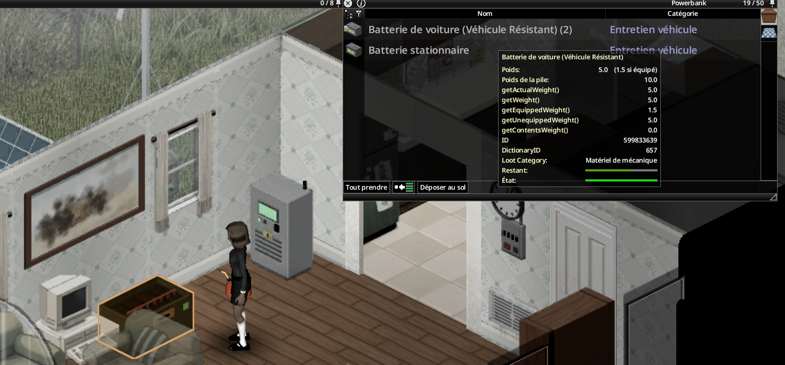

> Version française : [Équipements](../fr/02-equipements.md)

# Equipment

*All devices with their key figures.*

Every device is a real mod tile, placed like vanilla furniture. Each recipe gives a placeable furniture item named `Base.Mov_LiveWire_*`.

## Devices

| Device | Role | Placement | Electrical level |
|---|---|---|---|
| Solar panel | Source, 100 W | Outdoors, open sky; a flat roof is fine | 3 |
| Wind turbine | Source, 400 W; the blades turn with the wind | Outdoors; +15 % wind per floor up to the 3rd | 6 |
| Water wheel | Source, 120 W day and night | Ground floor, next to a river | 7 |
| Inverter | Heart of the network, 1,500 W | Any floor tile, indoors included | 5 |
| Power bank | Storage, 4 batteries counted; opens like a crate (capacity 50) | Anywhere; picked up only when empty | 2 |
| Breaker panel | Safety, optional | On a wall (north or west) | 3 |
| Low battery alarm | Alert, optional | On a wall | 2 |
| Water pump | Feeds the house taps from water barrels, 250 W while pumping | Anywhere, next to its barrels | 6 |

## Batteries

Batteries never go on the floor: drag them into the power bank with the vanilla inventory.

| Battery | Nominal capacity | Life |
|---|---|---|
| Car battery `Base.CarBattery1` | 0.40 kWh | 150 cycles |
| Car battery `Base.CarBattery2` | 0.60 kWh | 150 cycles |
| Car battery `Base.CarBattery3` | 0.90 kWh | 150 cycles |
| Deep-cycle battery `LiveWire.DeepCycleBattery` | 1.50 kWh | 600 cycles |

Effective capacity = nominal x (0.4 + 0.6 x condition / 100) x `BatteryCapacityMultiplier`.

## Lights on the tiles

- Inverter screen: lit when on, red light on fault.
- Sources and power bank: green "connected" light.
- Breaker: red lamp when tripped.
- Alarm: beacon lit while ringing.
- Water pump: blue light when it supplies at least one tap.

## Placement rules

- Place, rotate and pick up with the vanilla furniture cursor (ghost, 4 facings, 2 for wall objects).
- The tile requires a **screwdriver** and the Electrical level shown above, also to pick it up.
- A picked-up device keeps its condition.
- Solar panel and wind turbine: outdoors (open sky).
- Water wheel: river bank, ground floor, next to river water. Lakes and ponds are refused.
- Water pump: anywhere; its barrels must stand on the 8 squares around it (see [Water Pump](07-water-pump.md)).
- A refused square shows the reason in red in the cursor panel.

## See also

[Wiring](03-wiring.md) - [Recipes](08-recipes.md) - [Optional Equipment](06-optional-equipment.md) - [Electrical skill and maintenance](10-electrical-skill-and-maintenance.md)
