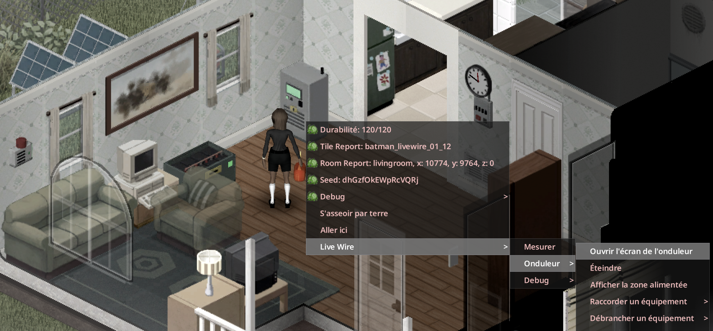

> Version française : [Raccordement](../fr/03-raccordement.md)

# Wiring

Devices are linked to an inverter with electric wire. The house itself needs no wiring: any appliance within range of the inverter is powered.

## Step by step

1. Craft the devices (see [Recipes](08-recipes.md)) and place them with the furniture cursor.
2. Right-click a device, then **Live Wire**, then the device name. It shows "Connected to the inverter N tiles away" or "Not connected". Then choose **Connect to an inverter**: one line per inverter in range, "Inverter N tiles away (k wires)".
3. Or right-click the inverter and choose **Connect equipment**: a list of free equipment in range with distance and number of wires. **Disconnect equipment** does the opposite.

## Wire cost

Electric wire `Base.ElectricWire`: **1 wire per 4 tiles of distance, rounded up, at least 1** (sandbox `WirePerTiles`; 0 = free).

| Distance | Calculation | Wires |
|---|---|---|
| 4 tiles | 4 / 4 = 1 | 1 |
| 9 tiles | 9 / 4 = 2.25, rounded up | 3 |
| 12 tiles | 12 / 4 = 3 | 3 |

## Range and limits

| Item | Value |
|---|---|
| Cable range | 12 tiles horizontally (sandbox `LinkRange`, 4-30), at most 3 floors apart by default (sandbox `LinkVerticalRange`, 0-10; 0 = same floor). Also applies to inverter coupling |
| Inverters per network | 1 |
| Breakers per network | 1 |
| Alarms per network | 1 |
| Management computers per network | 1 |
| Backup generators per network | 1 |

## Vanilla generator and computer

The vanilla generator (backup) and the vanilla desktop computer (management) are linked the same way, from their own right-click menu: **Live Wire**, then Backup generator or Management computer, then **Connect to an inverter**.

## Picking up and rotating

- Picking up the inverter disconnects its whole network.
- Rotating the inverter keeps the links.
- Picking up a source keeps its condition; placed again, it is "Not connected".

## Inverter right-click menu

Open the inverter screen, Turn on / Turn off, Reset (after a trip), Show the powered area (a cyan circle on the ground), Connect equipment, Disconnect equipment, Soundproof the inverter, Inspect, Repair, Overhaul.

## Wire equipment from one window

Click nearby Live Wire equipment directly. Sources and alarms open the wiring
window. From an inverter LCD or bank LCD, press **Connections**. The electrical
board controls circuits and resets overload protection.

Choose an inverter, select equipment, then **Connect** or **Disconnect**. Your
character walks to it; wire costs and skill requirements still apply. The window
stays open for the next device. **Refresh** finds newly placed equipment. Devices
on another network are labelled; disconnect them from that network first.

Right-click menus remain available. Inverter coupling and pump barrels keep their
specific controls.

## See also

[Equipment](02-equipment.md) - [Inverter Screen and Software](05-inverter-screen-and-software.md) - [Optional Equipment](06-optional-equipment.md) - [Sandbox Options](11-sandbox-options.md)
