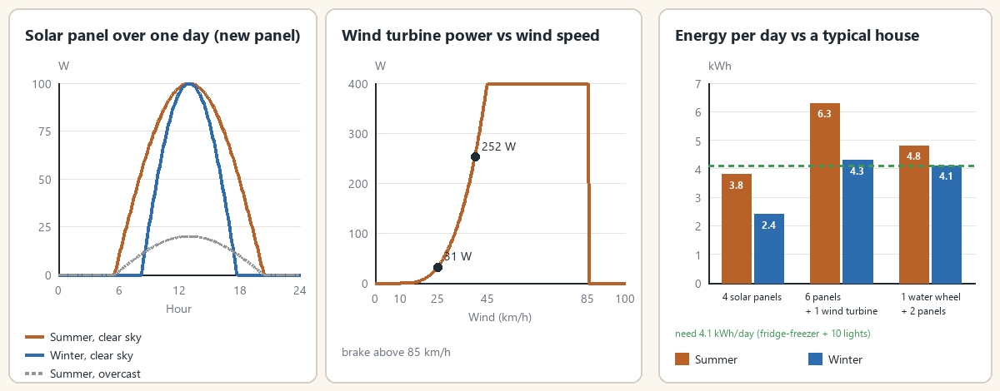

> Version française : [Production et calculs](../fr/04-production-et-calculs.md)

# Production and Calculations

The server computes everything every **10 game minutes**, whether players are present or not (sandbox `SimulateUnloaded`, on by default). The values below are starting values for balancing.

*Solar day, wind curve and energy per day compared with a typical house.*

## Source power

> P = nominal x source factor x condition factor x installation efficiency x sandbox multiplier

Each source smooths its output (30 game minutes response), so a passing cloud does not make the house flicker.

### Condition factor

Condition factor = 0.5 + 0.5 x condition / 100.

| Condition | Factor |
|---|---|
| 100 | 1.000 |
| 75 | 0.875 |
| 50 | 0.750 |
| 25 | 0.625 |
| 0 | 0.500 |

### Installation efficiency

Based on the installer's Electrical level when the device was placed.

| Electrical level | Efficiency |
|---|---|
| 3-6 | 0.85 |
| 7-8 | 0.95 |
| 9-10 | 1.0 |

## Solar panel (100 W)

Sine curve between the season's dawn and dusk. Clouds leave 20 % at full overcast: factor x (1 - 0.8 x clouds). Snow settles on the panel during snowfall and melts above 0 C (use the "Clear the snow" action). A new panel under a clear sky gives about **0.94 kWh per summer day** and **0.60 kWh in winter**.

## Wind turbine (400 W)

- 0 below 10 km/h.
- ((v - 10) / 35)^3 between 10 and 45 km/h.
- 100 % from 45 to 85 km/h.
- 0 above 85 km/h (automatic brake).
- Wind is +15 % per floor, up to the 3rd.

| Wind (km/h) | Share of nominal | Power |
|---|---|---|
| 0 | 0 % | 0 W |
| 10 | 0 % | 0 W |
| 20 | 2 % | about 9 W |
| 25 | 8 % | about 31 W |
| 30 | 19 % | about 75 W |
| 40 | 63 % | about 252 W |
| 45 | 100 % | 400 W |
| 60 | 100 % | 400 W |
| 85 | 100 % | 400 W |
| 90 | 0 % | 0 W (brake) |

Values are the wind share applied to the 400 W nominal, before the condition and efficiency factors.

## Water wheel (120 W)

Produces day and night, about 2.9 kWh per day (120 W x 24 h). Rivers only: the engine cannot tell a lake's current. Season multipliers: spring x 1.2, summer x 0.8, autumn and winter x 1.0.

| Season | Power | Energy per day |
|---|---|---|
| Spring | 144 W | about 3.5 kWh |
| Summer | 96 W | about 2.3 kWh |
| Autumn / winter | 120 W | about 2.9 kWh |

(Nominal, before the condition and efficiency factors.)

## Batteries

- Charging: surplus x 0.90 (charge efficiency).
- Self-discharge: 0.2 % per day.
- When full, extra production is lost (shown as "production lost").
- Effective capacity = nominal x (0.4 + 0.6 x condition / 100) x `BatteryCapacityMultiplier`.

## Inverter supply order

The inverter supplies the demand from the **current production first** (x efficiency), then from the **batteries**. It can only restart when production covers the demand or the batteries hold more than 2 % of their capacity. Energy scale: 1 engine power unit per hour = 1,000 W (sandbox `PowerScale`).

## Appliance consumption

Vanilla engine values, switched on:

| Appliance | Consumption |
|---|---|
| Light | 2 W |
| Radio on mains | 10 W |
| Television | 30 W |
| Fridge alone | 80 W |
| Stove, microwave, washer, dryer | 90 W |
| Fridge-freezer | 130 W |
| Stacked washer + dryer | up to 1,800 W |

## Sizing example

One fridge-freezer and 10 lights is about 170 W (with the inverter idle 20 W), i.e. **4.1 kWh per day**. A 14 h winter night needs about 2.4 kWh: roughly 4 car batteries or 2 deep-cycle batteries.

| Installation | Summer (kWh/day) | Winter (kWh/day) | Verdict for 4.1 kWh/day |
|---|---|---|---|
| 4 solar panels | 3.8 | 2.4 | Deficit |
| 6 panels + 1 wind turbine (average wind 25 km/h, about 0.7 kWh) | 6.3 | 4.3 | Just enough |
| 1 water wheel + 2 panels | 4.8 | 4.1 | Stable |

## How many panels?

There is **no limit**: productions add up (100 W nominal each). The 1,500 W limit applies to the **house demand**, not to production.

## See also

[Equipment](02-equipment.md) - [Electrical skill and maintenance](10-electrical-skill-and-maintenance.md) - [Sandbox Options](11-sandbox-options.md) - [Optional Equipment](06-optional-equipment.md)
