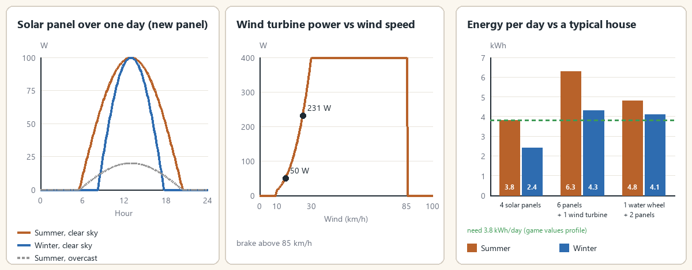

> Version française : [Production et calculs](../fr/04-production-et-calculs.md)

# Production and Calculations

Solar sizing examples assume clean, snow-free, south-facing panels. Orientation, dirt and weather change the actual result.

The server computes everything every **10 game minutes**, whether players are present or not (sandbox `SimulateUnloaded`, on by default). The values below are starting values for balancing.

*Solar day, wind curve and energy per day compared with a typical house.*

## Source power

> P = nominal x source factor x condition factor x installation efficiency x sandbox multiplier

Each source smooths its output (30 game minutes response), so a passing cloud does not make the house flicker.

### Condition factor

Condition factor = 0.5 + 0.5 x condition / 100.

| Condition | Factor |
|---|---|
| 100 | 1.000 |
| 75 | 0.875 |
| 50 | 0.750 |
| 25 | 0.625 |
| 0 | 0.500 |

### Installation efficiency

Set when the device is first connected to an inverter, from the Electrical level of the player who connects it.

| Electrical level | Efficiency |
|---|---|
| 0-6 | 0.85 |
| 7-8 | 0.95 |
| 9-10 | 1.0 |

## Solar panel (100 W)

Sine curve between the season's dawn and dusk. Clouds leave 20 % at full overcast: factor x (1 - 0.8 x clouds). Snow settles on the panel during snowfall and melts above 0 C (use the "Clear the snow" action to remove it by hand). A new panel under a clear sky gives about **0.93 kWh per summer day** and **0.60 kWh in winter**, before installation efficiency. With the usual 0.85 (Electrical 3 to 6), that is about **0.79 kWh** and **0.51 kWh**. The day lasts about 14.6 hours at the summer solstice and 9.4 hours at the winter solstice (game latitude 38).

## Wind turbine (400 W)

- 0 below 10 km/h.
- (v / 30)^3 between 10 and 30 km/h.
- 100 % from 30 to 85 km/h.
- 0 above 85 km/h (automatic brake).
- The wind is 15 % stronger per floor, up to the 3rd floor.

| Wind (km/h) | Share of nominal | Power |
|---|---|---|
| 0 | 0 % | 0 W |
| 10 | 4 % | about 15 W |
| 15 | 13 % | about 50 W |
| 20 | 30 % | about 119 W |
| 25 | 58 % | about 231 W |
| 30 | 100 % | 400 W |
| 60 | 100 % | 400 W |
| 85 | 100 % | 400 W |
| 90 | 0 % | 0 W (brake) |

Values are the wind share applied to the 400 W nominal, before the condition and efficiency factors.

## Water wheel (120 W)

Produces day and night, about 2.9 kWh per day (120 W x 24 h). Rivers only: the engine cannot tell a lake's current. The wheel turns with the river, faster in spring and slower in summer. Season multipliers: spring x 1.2, summer x 0.8, autumn and winter x 1.0.

| Season | Power | Energy per day |
|---|---|---|
| Spring | 144 W | about 3.5 kWh |
| Summer | 96 W | about 2.3 kWh |
| Autumn / winter | 120 W | about 2.9 kWh |

(Nominal, before the condition and efficiency factors.)

## Batteries

- Charging: surplus x 0.90 (charge efficiency).
- Self-discharge: 0.2 % per day.
- When full, extra production is lost (shown as "production lost").
- Effective capacity = nominal x (0.4 + 0.6 x condition / 100) x `BatteryCapacityMultiplier`.

### Public grid

Sandbox option `GridCharging` is on by default. While the public grid works, an inverter that stands in a room of a building can draw power from the mains, up to a fifth of its rated power (300 W for an inverter, 900 W for an inverter cabinet). The grid power first covers what the sources do not supply, then charges the batteries. It is drawn only when needed, so nothing is lost. The grid stops when the game's vanilla power shut-off takes effect.

A broken inverter does not charge from the grid or the sources. A switched-off inverter still lets its sources charge the batteries.

## Inverter supply order

The inverter supplies the demand from the **current production first** (x efficiency), then from the **public grid** while it works (sandbox `GridCharging`), then from the **batteries**. It can only restart when production (grid included) covers the demand, or when the batteries hold more than 2 % of their capacity. Appliance consumption depends on the sandbox `ConsumptionProfile` (below).

## Appliance consumption

The sandbox option **`ConsumptionProfile`** sets how much power each switched-on appliance draws. Values are **averages over a 10-minute step**, not start-up peaks: a fridge compressor cycles on and off, so a fridge-freezer that pulls 300-400 W while running averages about 130 W.

| Appliance (switched on) | Ultra-realistic 1993 | Realistic 1993 | Game values (default) | Comfort |
|---|---|---|---|---|
| Light (one switch, i.e. one room) | 100 W | 60 W | 2 W | 1 W |
| Radio on mains | 40 W | 20 W | 10 W | 5 W |
| Television | 120 W | 80 W | 30 W | 15 W |
| Fridge alone or freezer alone | 130 W | 90 W | 80 W | 40 W |
| Fridge-freezer | 180 W | 130 W | 130 W | 65 W |
| Electric cooker | 3,000 W | 2,000 W | 90 W | 45 W |
| Microwave | 1,500 W | 1,100 W | 90 W | 45 W |
| Washer | 700 W | 500 W | 90 W | 45 W |
| Dryer | 5,000 W | 3,000 W | 90 W | 45 W |
| Combination washer-dryer (washing / drying) | 700 / 3,000 W | 500 / 2,000 W | 90 W | 45 W |
| Stacked washer + dryer (each half running) | 700 + 5,000 W | 500 + 3,000 W | 900 + 900 W | 45 + 45 W |
| Car battery charger | 250 W | 150 W | 50 W | 25 W |
| Gas appliance (controls only) and appliances added by other mods | game value | game value | game value | half |

- **Game values** are the engine's own values, the ones the vanilla generator uses (1 engine power unit per hour = 1,000 W). A base therefore costs the same on an inverter as on a vanilla generator. They are very low for lights, TVs and cookers, and the vanilla stacked washer + dryer is oddly high (0.9 per half instead of 0.09).
- **Realistic 1993** uses typical household draws of the time: 60 W incandescent bulbs, a 25" CRT TV, a 1990s fridge-freezer (about 1,100 kWh a year), a 240 V electric range and dryer.
- **Ultra-realistic 1993** uses older, hungrier appliances: 100 W fixtures, a large CRT, a 1980s fridge, a full-power range and dryer.
- **Comfort** halves the game values and fixes the stacked washer + dryer.
- `PowerScale` multiplies the result of the profile (1 = no change). The inverter itself always uses 20 W idle.
- An appliance that spans several tiles (large shop fridges, wide stoves) counts once, on its first tile: the other tiles of the same piece of furniture draw nothing.
- The profile can be changed during a game: the demand follows at the next measurement.

### What the realistic profiles change

The inverter limit stays **1,500 W** (4,500 W for the inverter cabinet; [coupled inverters](06-optional-equipment.md#parallel-inverters-coupling) add up), in line with the off-grid inverters of the 1990s. In the 1993 profiles:

- An electric cooker (2,000 or 3,000 W) or a dryer trips a single inverter: cook on gas, a wood stove or a campfire, or couple inverters. A breaker panel protects the inverter.
- Lights become the main night load: switch off empty rooms.

## Sizing example

A reference day: one fridge-freezer all day, 10 lights for 6 hours, the TV for 3 hours, plus the inverter idle (20 W). Lights and TV are used at night. A winter night lasts 14 hours. The evening demand leaves out the inverter's 20 W idle draw; the energy per day and the winter night include it. Batteries for the night are the winter-night energy divided by the nominal capacity of a new battery, rounded up, without charge losses.

| Profile | Evening demand (without idle) | Energy per day | Winter night | Batteries for the night |
|---|---|---|---|---|
| Ultra-realistic 1993 | 1,300 W | 11.2 kWh | 9.2 kWh | about 16 car batteries or 7 deep-cycle |
| Realistic 1993 | 810 W | 7.4 kWh | 5.9 kWh | about 10 car batteries or 4 deep-cycle |
| Game values | 180 W | 3.8 kWh | 2.3 kWh | about 4 car batteries or 2 deep-cycle |
| Comfort | 90 W | 2.1 kWh | 1.3 kWh | about 3 car batteries or 1 deep-cycle |

(Standard car battery: 0.6 kWh; deep-cycle battery: 1.5 kWh; new batteries in full condition.)

Production of the sources per day, for new devices, clear sky, installation efficiency 0.85 (Electrical 3 to 6), and a steady 25 km/h wind at ground level (58 % of 400 W = 231 W, or 196 W after efficiency):

- solar panel: about 0.79 kWh in summer and 0.51 kWh in winter;
- water wheel: about 2.0 kWh in summer (96 W) and 2.4 kWh in autumn or winter (120 W);
- wind turbine: about 4.7 kWh, the same in both seasons. Real wind varies, and a turbine gives nothing below 10 km/h or above 85 km/h, so the real yield differs from this steady-wind figure.

| Installation | Summer (kWh/day) | Winter (kWh/day) | Enough for (compared with the energy per day above) |
|---|---|---|---|
| 4 solar panels | 3.2 | 2.0 | Comfort in summer, just short in winter (2.1 needed) |
| 6 panels + 1 wind turbine | 9.5 | 7.8 | Realistic 1993 in both seasons |
| 1 water wheel + 8 panels | 8.3 | 6.5 | Realistic 1993 in summer, Game values in winter |
| 2 water wheels + 9 panels | 11.0 | 9.5 | Realistic 1993 in both seasons; Ultra-realistic 1993 just short in summer (11.2 needed) |

## How many panels?

There is **no limit**: productions add up (100 W nominal each). The 1,500 W limit applies to the **house demand**, not to production.

## Panel care and orientation

With the sandbox option `SolarOrientation` on (the default), south gives 100 %, east and west 85 % (with an earlier or later peak), and north 55 %. Inspect a panel to read its facing, dirt and snow. The `SolarDirt` option adds slow dust build-up (faster in autumn); rain helps wash it off.

Two actions clean a panel. **Clean panel** uses a rag and 0.5 L of water and removes dirt and snow. **Clear the snow** removes only the snow.

A braked wind turbine has a blinking connection lamp.

## See also

[Equipment](02-equipment.md) - [Electrical skill and maintenance](10-electrical-skill-and-maintenance.md) - [Sandbox Options](11-sandbox-options.md) - [Optional Equipment](06-optional-equipment.md)
