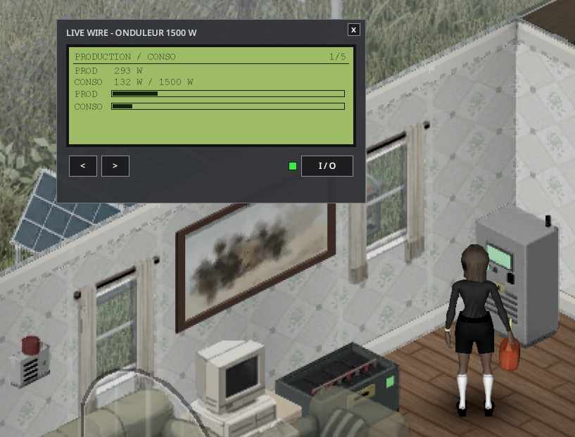
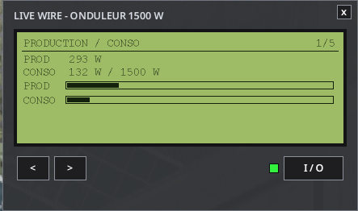
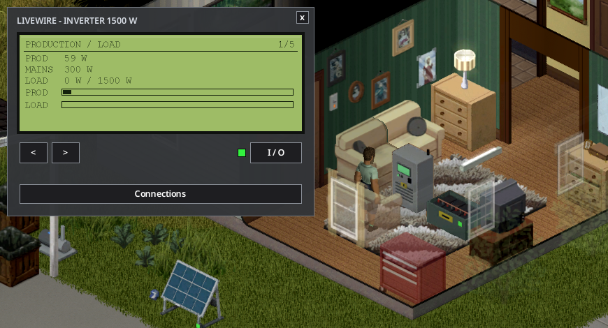
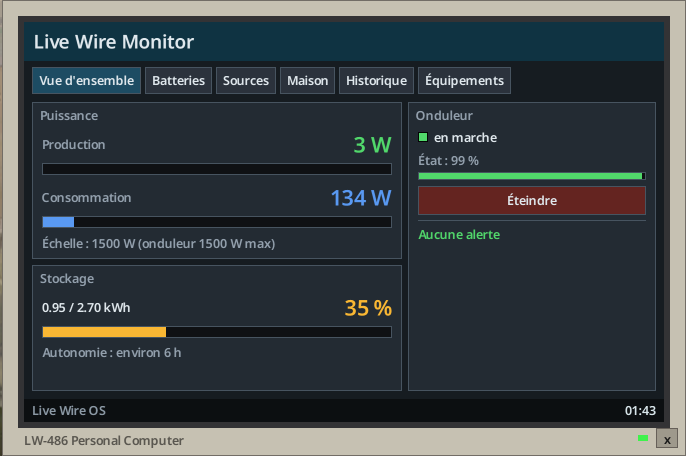
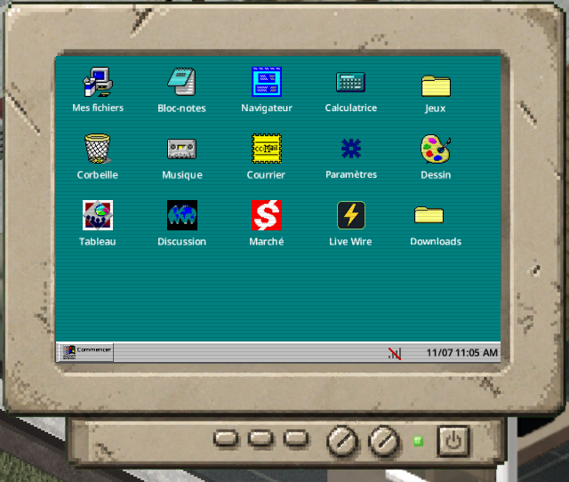
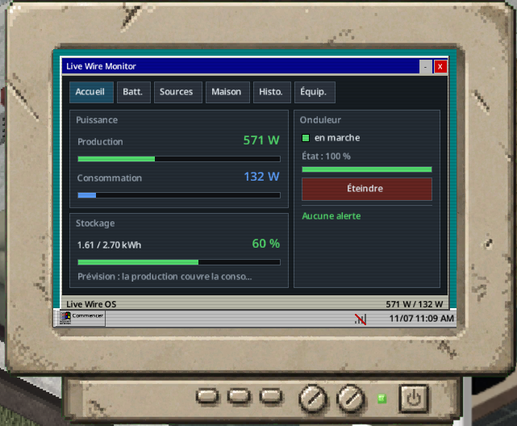
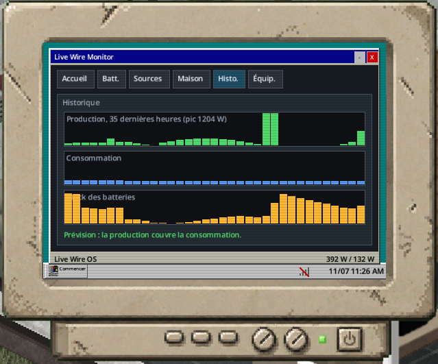
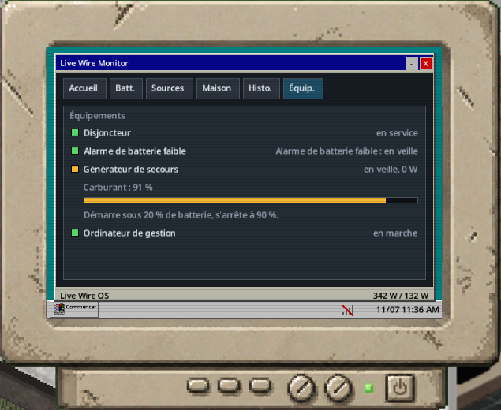
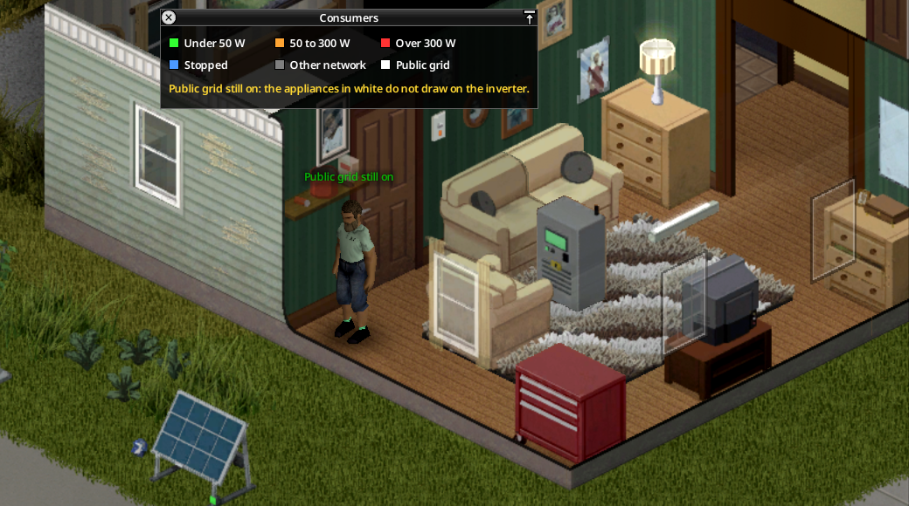

> Version française : [Écran et logiciel](../fr/05-ecran-et-logiciel.md)

# Inverter Screen and Software

You can monitor the network from the inverter's own LCD panel, or from the **LiveWire Monitor** management software.

## The LCD panel

Right-click the inverter, then **Open the inverter screen**. It is a backlit screen with 5 pages, browsed with the **<** and **>** buttons.

| Page | Content |
|---|---|
| 1 | Production / load; a MAINS line while the inverter draws from the public grid |
| 2 | Batteries |
| 3 | Sources; a "Public grid" line when the inverter can use the public grid (sandbox `GridCharging`, inside a building) |
| 4 | House |
| 5 | Status |

- The **I/O** button has a light: green = on, red = off, blinking orange = fault.
- **RESET** is available when the inverter has tripped.
- Production and load bars use the same scale. Long lines scroll back and forth. Text that is cut short ends with three dots.

*Page 1 while the public grid is on: the MAINS line shows the power drawn from the grid.*

## Window size and font

The LiveWire windows (inverter, power bank, device, connections, breaker, and the computer's software screen) follow the game's font size. When a window opens, it is enlarged from the size of the Small font and shrunk if needed to fit the screen. A font change applies after the game restarts.

## Management software "LiveWire Monitor"

| Tab | Content |
|---|---|
| Overview | Production and consumption in large figures with bars on the same scale, storage gauge and autonomy, inverter card (state light, condition, On/Off, Reset), alerts |
| Batteries | Battery details |
| Sources | Source details |
| House | House details |
| History | 48 h graphs (production, consumption, battery stock) and the forecast "batteries will last until sunrise" |
| Equipment | Breaker, alarm, backup generator, computer, and the number of pumps in service with their flow |
| Consumers | Measured appliance watts, up to 200 entries |
| Forecast | Three-day weather-based production estimate; a powered management computer is required |
| Events | Last 30 timestamped network events |

The history and forecast need a linked management computer (see [Optional Equipment](06-optional-equipment.md)).

The network name can be changed with **Rename network** (in the inverter's right-click menu or in the software). The name appears in the software and in low-battery alerts.

### Without the Computer Mod

A vanilla desktop computer linked to the inverter opens the software on the mod's own computer screen: monitor, boot screen "LiveWire OS", status bar with game time.

*Management software on a vanilla computer, without the Computer Mod or Laptop Mod.*

### With the Computer Mod or Laptop Mod

With the optional **Computer Mod** (Workshop 3725497089) or **Laptop Mod** (3798992436), the software comes on a disk: **"Disk: LiveWire Management Software"** (`LiveWire.MonitorDisk`), found in computer loot (see [Loot Tables](09-loot-tables.md)).

1. Right-click the computer while holding the disk.
2. Choose **Install the LiveWire software**.
3. It appears as a "LiveWire" app on their desktop and runs inside their window (title bar, minimise, close, taskbar).

It shows the inverter linked to that computer, or the nearest inverter in cable range.

## Inverter hum

The inverter makes a hum, a sound of the mod, heard within about **two tiles** of a switched-on inverter, loudest right next to it.

- Each player sets its volume in **Options > Mods > LiveWire** (0 = off).
- Zombies hear the inverter within 2 tiles (sandbox `InverterNoiseRadius`; 0 = silent).

## Soundproofing kit

The Soundproofing Kit (`LiveWire.SoundproofKit`, Electrical level 2) is made with a screwdriver and a hammer, and fitted on the inverter with **Soundproof the inverter**. Remove it with **Remove the soundproofing**; the kit is given back.

| Effect | Value |
|---|---|
| Hum | None |
| Zombies | Do not hear the inverter |
| Temperature and wear | The inverter runs warmer and wears 25 % faster |
| Look | Grey acoustic foam on the top, sides and back; "Soundproofed" when inspected and on the Status page |

The kit follows the inverter when it is picked up.

## Consumers, wiring, events and forecasts

The inverter offers toggles for the load map (coloured appliance silhouettes) and wiring view (dashed across floors). Green loads are below 50 W, amber up to 300 W, red above; grey belongs to another inverter.

The software adds paged consumers, the last 30 timestamped events, and a three-day production forecast when a management computer is powered. Forecasts include current panel orientation, dirt, snow, source condition and wind brakes; maintenance is assumed unchanged. An estimate cannot guarantee the weather, future maintenance or failures.

## Direct clicks and the power bank LCD

Stand within about two tiles of the equipment, with it in sight, and left-click it:

- an inverter opens its LCD;
- a breaker opens its electrical panel;
- a power bank opens its LCD;
- a solar panel, wind turbine, water wheel, pump or alarm opens its own LCD.

Avoid aiming or using a construction cursor while clicking.

A **power bank** has its own LCD: usable charge, available kWh, usable capacity, cold reserve, occupied slots and excess batteries. Previous/next buttons show each battery's charge and condition. It works even when disconnected. Use the native inventory to move batteries. Press **Connections** to open the shared wiring window.

**Show consumers** colours the actual appliances, including lights: green below 50 W, orange through 300 W, red above; blue stopped or unpowered, grey another network, **white** for an appliance the public grid still powers. A **Consumers** window at the top of the screen gives the colour legend; its cross closes the view. While the public grid is on, those appliances draw nothing from the inverter: the character says so when the view opens ("Public grid still on") and the window repeats it in yellow. Hiding clears the colours. Exact watts remain in the software list.

*Show consumers while the public grid is still on: the Consumers window gives the legend and the warning in yellow.*

## See also

[Wiring](03-wiring.md) - [Optional Equipment](06-optional-equipment.md) - [Recipes](08-recipes.md) - [Sandbox Options](11-sandbox-options.md)
