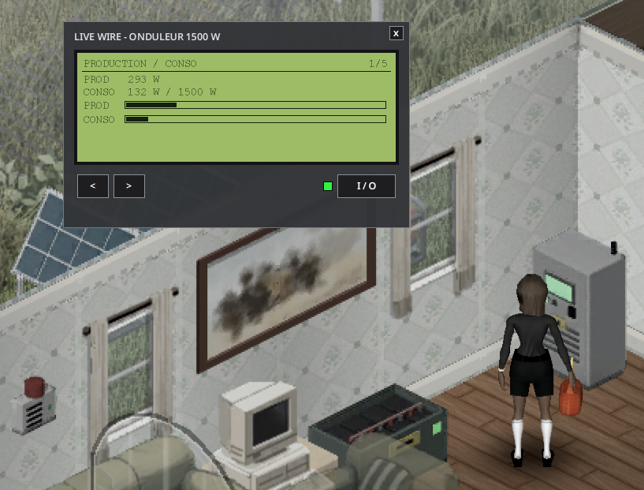
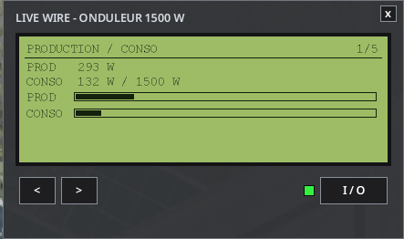
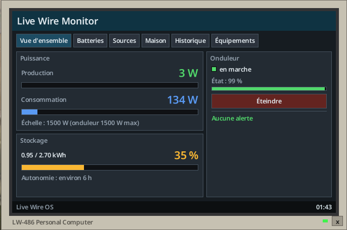
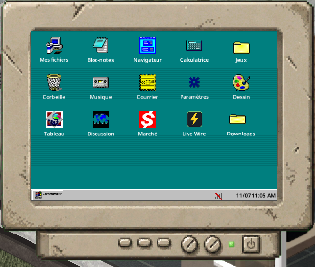
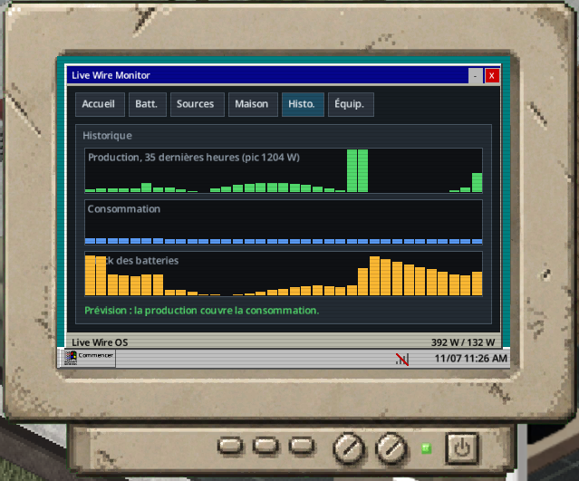
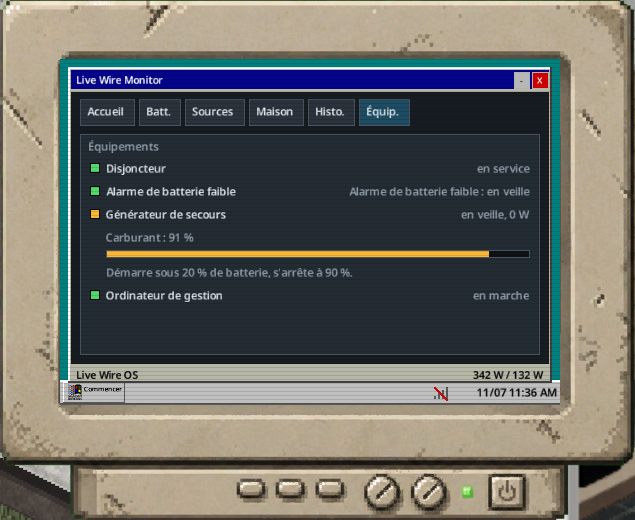

> Version française : [Écran et logiciel](../fr/05-ecran-et-logiciel.md)

# Inverter Screen and Software

You can monitor the network from the inverter's own LCD panel, or from the **Live Wire Monitor** management software.

## The LCD panel

Right-click the inverter, then **Open the inverter screen**. It is a backlit screen with 5 pages, browsed with the **<** and **>** buttons.

| Page | Content |
|---|---|
| 1 | Production / Load |
| 2 | Batteries |
| 3 | Sources |
| 4 | House |
| 5 | Status |

- The **I/O** button has a light: green = on, red = off, blinking orange = fault.
- **RESET** is available when the inverter has tripped.
- Production and load bars use the same scale. Long lines scroll.

## Management software "Live Wire Monitor"

| Tab | Content |
|---|---|
| Overview | Production and consumption in large figures with bars on the same scale, storage gauge and autonomy, inverter card (state light, condition, On/Off, Reset), alerts |
| Batteries | Battery details |
| Sources | Source details |
| House | House details |
| History | 48 h graphs (production, consumption, battery stock) and the forecast "batteries will last until sunrise" |
| Equipment | Breaker, alarm, backup generator, computer |

The history and forecast need a linked management computer (see [Optional Equipment](06-optional-equipment.md)).

### Without the Computer Mod

A vanilla desktop computer linked to the inverter opens the software on the mod's own computer screen: monitor, boot screen "Live Wire OS", status bar with game time.

*Management software on a vanilla computer, without the Computer Mod or Laptop Mod.*

### With the Computer Mod or Laptop Mod

With the optional **Computer Mod** (Workshop 3725497089) or **Laptop Mod** (3798992436), the software comes on a disk: **"Disk: Live Wire Management Software"** (`LiveWire.MonitorDisk`), found in computer loot (see [Loot Tables](09-loot-tables.md)).

1. Right-click the computer while holding the disk.
2. Choose **Install the Live Wire software**.
3. It appears as a "Live Wire" app on their desktop and runs inside their window (title bar, minimise, close, taskbar).

It shows the inverter linked to that computer, or the nearest inverter in cable range.

## Inverter hum

The inverter makes a hum, a sound of the mod, heard only **one tile around** a switched-on inverter (same floor).

- Each player sets its volume in **Options > Mods > Live Wire** (0 = off).
- Zombies hear the inverter within 2 tiles (sandbox `InverterNoiseRadius`; 0 = silent).

## Soundproofing kit

The Soundproofing Kit (`LiveWire.SoundproofKit`, Electrical level 2) is fitted on the inverter with a screwdriver: **Soundproof the inverter**. Remove it with **Remove the soundproofing** (the kit is given back).

| Effect | Value |
|---|---|
| Hum | None |
| Zombies | No longer hear the inverter |
| Temperature and wear | The inverter runs warmer and wears 25 % faster |
| Look | Grey acoustic foam on the top, sides and back; "Soundproofed" when inspected and on the Status page |

The kit follows the inverter when it is picked up.

## See also

[Wiring](03-wiring.md) - [Optional Equipment](06-optional-equipment.md) - [Recipes](08-recipes.md) - [Sandbox Options](11-sandbox-options.md)
