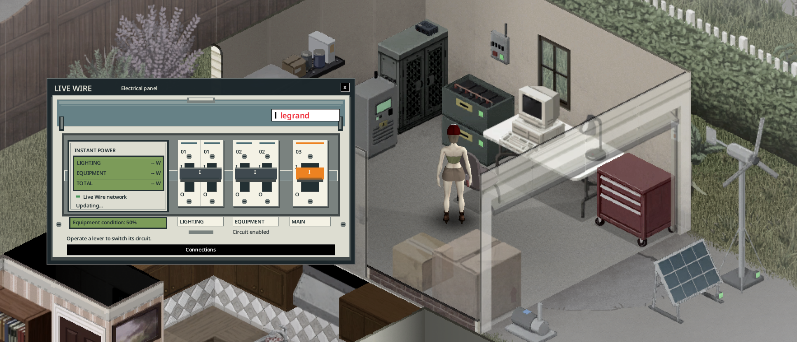

> Version française : [Équipements optionnels](../fr/06-equipements-optionnels.md)

# Optional Equipment

These four add-ons are not required to run a network, but they make it safer and easier to manage. Each network takes at most one of each.

| Equipment | Effect | Level |
|---|---|---|
| Breaker panel (wall) | Trips instead of the inverter when the house demand exceeds its maximum (1,500 W, 4,500 W for an inverter cabinet), so the inverter does not lose 3 condition points. Red lamp when tripped; reset on the breaker itself ("Reset the breaker"), refused while still overloaded. | 3 |
| Low battery alarm (wall) | Below 20 % stock: a message to players within 30 tiles, repeated every 2 game hours. The alarm beeps every 10 game minutes until you choose "Silence the alarm". The beacon stays lit until the stock is back above 25 %. | 2 |
| Backup generator (vanilla generator) | Started by the mod under 20 % battery, stopped at 90 % (sandbox `BackupStartPercent` / `BackupStopPercent`). Supplies 1,200 W, burns 1 L of fuel per 3 kWh (on top of its vanilla consumption). Still noisy and toxic indoors; it must be plugged and fuelled the vanilla way. | 2 |
| Management computer (vanilla desktop computer) | 48 h history, three-day weather forecast, consumer list and event log. Automatic load shedding: switches the lights off under 15 % to keep the fridge, re-armed above 30 %. | 3 |

The management computer and the backup generator are not crafted: they are vanilla objects found in the world. Link them from their own right-click menu (see [Wiring](03-wiring.md)).

## Backup generator manual control

Switching the backup generator on or off yourself (vanilla menu) puts it in manual control. The mod then does not start or stop it. Players within 30 tiles get a notice that explains how to give control back. The inverter screen shows "Generator: manual control", and the software shows "Automatic control suspended".

To return to automatic control: right-click the generator, then **LiveWire**, then **Backup generator**, then **Resume automatic backup**. Players nearby are told when it is back on automatic.

## Parallel inverters (coupling)

Real off-grid systems get more power by adding identical inverters in parallel, not by pushing one beyond its rating. LiveWire does the same. A network holds up to **4 inverters**: one master and up to 3 slaves.

- Right-click an inverter > **Couple to an inverter** > a master inverter within cable range. The clicked inverter becomes a **slave**. Cost: a screwdriver, Electrical 3, the electric wire for the distance, and 1 **inverter coupling kit** (recipe at Electrical 3).
- The slave must have no equipment of its own. A master takes at most 3 slaves.
- One network, one battery bank, one powered area (the master's). Capacity = sum of the inverters in service (1,500 W per inverter, 4,500 W per inverter cabinet; both can be coupled together). Each switched-on inverter uses its idle consumption (20 W, 60 W for a cabinet) and wears as usual.
- A slave that is switched off or broken does not count. If the demand then exceeds what is left, the breaker (or the master) trips. Each slave has its own On/Off switch; reset on the master or the breaker.
- **Uncouple** on the slave makes it independent again, and the kit is given back. Picking up a master frees its slaves.
- The LCD Status page and the software show "Coupled: n / total in service" and the total capacity.
- Two independent inverters whose areas overlap do not count the same appliances twice: each appliance is counted by the nearest switched-on inverter.

## When does the breaker trip?

When the demand of the house appliances exceeds the inverter maximum, **1,500 W** (4,500 W for an inverter cabinet; the idle consumption is not counted). It is checked at each simulation step: every 10 game minutes and right after an action. Examples: a stacked washer + dryer running together (1,800 W with the game values); with the 1993 consumption profiles, an electric cooker or a dryer alone.

Without a breaker, the **inverter** trips and loses 3 condition points; reset it on the inverter. With a breaker, the breaker trips instead; reset it on the breaker ("Reset the breaker"), which is refused while the load is still too high. Switch off some appliances first.

## Two-circuit electrical panel

Open the panel on a connected breaker. It has an LCD wattmeter, two circuit levers (lighting and equipment), and an orange main lever.

- The main lever opens or closes the distribution, or resets an overload once the load is safe. Source production and battery charging continue, and the main lever only opens this network's distribution.
- The **lighting** lever turns the real mains switches off and restores the choices you recorded. Battery lamps are not affected. Native room switches act on the whole room.
- The **equipment** lever stops refrigerators and freezers, mains TVs and radios, stoves, microwaves, washers, dryers, combined machines and car battery chargers. Fuel pumps stop dispensing. LiveWire water pumps stop refilling their relays (water already stored stays available). Lighting can stay on. Appliances that were already off stay off when the power returns, and machine cycles restart with their normal duration. Battery devices keep working on their own.
- Both levers give all four combinations. Your choices are kept when you save and restart the game.

The LCD shows **lighting, equipment and total in watts**, based on the network's latest measurement. Equipment includes LiveWire water pumps. These are current power readings, not kWh totals. Inverter idle use, losses and battery charging are not included. An open circuit with no load shows "0 W / OFF". After returning to an area or reconnecting, "Updating..." and dashes replace a measurement that is not yet available.

Correct the load before you reset an overload. Resetting never closes a circuit you opened on purpose, and automatic light shedding never closes it either.

Coupled inverters share their master's panel. In overlapping areas, each appliance belongs to the nearest independent master. Room switches follow the panel closest to the centre of the room. Opening a circuit stops its appliances, even if another source could power their sockets.

Modded appliances that use the vanilla classes or container types follow the same rules. Custom electrical services need an explicit compatibility. Restore the circuits before you disable LiveWire, so that the saved refrigerators get their original types back.

The electrical panel in game, with its lighting and equipment levers and its instant wattmeter. "Updating..." is the temporary state before fresh measurements arrive.

The context menu has one opening per panel: the electrical panel for the breaker, the LCD panel for the power bank. **Connections** is a separate screen, reached with a button on each equipment panel.

Equipment panels show **Equipment condition: ...%**. This is the wear of the power bank or the electrical panel, separate from battery charge and battery condition. Stacked banks each have their own condition. It stays visible without a connection, and at 0 %. Sources, pumps and alarms also have their own LCDs. The inverter shows its condition on its Status page. "--%" means the condition is unknown.

## Individual LCDs and inverter selection

Click a solar panel, wind turbine, water wheel, pump or alarm to open its LCD. It shows its condition, its measured output and its rated power. Solar panels also show dirt and snow, and wind turbines show the brake. A disconnected or broken source shows 0 W. The pump shows its condition, its measured water flow and its electrical consumption. The alarm has a status screen. While the LCD is open, its readings are refreshed every two seconds.

Each equipment panel has a **Connections** button to choose an inverter for that device alone. On the inverter, the button shows the full equipment list for the chosen network. Disconnect a device before moving it to another network. Cable costs, tools and skill requirements still apply.

The placed breaker's **green indicator** shows powered distribution. It stays green when only the lighting or equipment circuit is open. If the main lever is open or there is no power, it is off. **Red** means the protection has tripped. A green light does not prove that maintenance is safe: switch off the inverter first.

## See also

[Wiring](03-wiring.md) - [Inverter Screen and Software](05-inverter-screen-and-software.md) - [Electrical skill and maintenance](10-electrical-skill-and-maintenance.md) - [Multiplayer](12-multiplayer.md) - [LiveWire Extended](14-livewire-extended.md)
