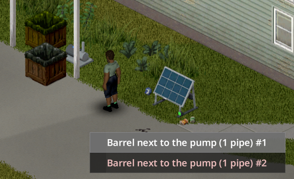

> Version française : [Pompe à eau](../fr/07-pompe-a-eau.md)

# Water Pump

Barrels of water standing on the ground can run the taps of a whole house. An electric pump, wired to the inverter and set next to the barrels, keeps the house sinks, showers, baths and toilets supplied while the network has power.

## What you need

| Item | Detail |
|---|---|
| Water pump | Recipe at Electrical 3 (see [Recipes](08-recipes.md)). Placed with a screwdriver like any LiveWire device, indoors or outdoors, with no level. Connecting the pump to the inverter needs a screwdriver and Electrical 3. Connecting a barrel to the pump needs no level (it uses a pipe). |
| Electric wire | To connect the pump to an inverter, like any device (1 wire per 4 tiles). |
| Water barrels | Vanilla rain collectors, or the barrels of the optional mod **Useful Barrels**. Up to 8 per pump. |
| Iron pipes | 1 per barrel, given back when the barrel is disconnected. |
| Pipe wrench | To plumb the sinks, showers and toilets (vanilla action). |

## Setting it up

1. Place the pump **next to the barrels**: a barrel must stand on one of the 8 squares around the pump, on the same floor (diagonals count). A pump surrounded by barrels takes up to 8.
2. Connect the pump to an inverter: right-click the pump, then **LiveWire**, then **Water pump**, then **Connect to an inverter**.
3. Connect each barrel: right-click the pump, then **Connect a barrel**, or right-click the barrel, then **Water barrel**, then **Pump next to this barrel (1 pipe)**.
4. Plumb the fixtures with a pipe wrench, the vanilla way (right-click the sink, then **Plumb...**). The option appears once the pump supplies the fixture.

*The pump's **Connect a barrel** menu: one line per barrel standing next to it.*

## How it works

- **Only water.** A barrel holding anything else (petrol, alcohol...), even mixed with water, is refused. An empty barrel can be connected and is used once it fills up.
- **Rain water comes out clean.** Rain collected in a barrel is tainted, but a plumbed tap gives clean water, as in vanilla.
- **Range.** The pump supplies the plumbed fixtures within **15 tiles** of it (sandbox `PumpRange`, 5-30), and up to 3 floors up or down (the same floor range as the inverter's power range).
- **Invisible relay tanks.** The game only looks for a water source on the floor just above a fixture. The pump therefore places a small invisible 25-litre tank above each fixture in range. Nothing to place by hand.
- **Only plumbed fixtures are filled.** An empty tank is enough to offer **Plumb...**, so the pump only fills the tanks that feed a fixture already plumbed with the pipe wrench. Unplumbed sinks, and those of the neighbouring houses, take no water from your barrels. A fixture you plumb starts receiving water within a game minute.
- **Flow and power.** 5 litres per game minute per pump, 250 W while pumping. The pump **stops by itself** when the tanks of every plumbed fixture are full: no power used, no sound.
- **Fixtures that already have water** (a vanilla barrel upstairs, mains water still running, another mod) keep it. The pump does not compete with them.
- **Several pumps** can share one network.
- **While you are away**, rain keeps filling the barrels (the game handles it). The pump only works where the area is loaded, which is where taps are used anyway.

## Seeing what is supplied

- Right-click the pump, then **Show the supplied taps**: a blue circle shows the range, and the supplied fixtures, the connected barrels and the pump are highlighted in blue. Fixtures in range that are not plumbed yet are highlighted in grey: they get no water until you plumb them. **Hide the supplied taps** turns the display off.
- A **blue light** shows on the pump when it is powered, even idle or without a linked fixture. It turns off without power or with the equipment/main circuit open.
- The pump menu shows its state: pumping, stopped (every tap full), no power, no water in the barrels, out of order.
- The management software (Equipment tab) shows the number of pumps in service and their flow in litres per hour.

Click the pump for its **individual LCD**: pump condition, measured water flow in L/h and consumption in W. Reading it moves no water. **Connections** selects this pump's inverter; barrel actions keep their usual menus. See [individual screens and wiring](06-optional-equipment.md#individual-lcds-and-inverter-selection).

The pump LCD has a **blue** background. Its world light shows that the pump is powered, not a guaranteed water flow. Barrel and flow rules are the same. Switch off the inverter before maintenance, even when the light is off.

## Noise

A light motor hum is heard around a running pump (same volume slider as the inverter hum, Options > Mods > LiveWire). Zombies hear it within 2 tiles.

## Wear

The pump wears only while it runs (1 condition point per 10 days of pumping) and is repaired like the other devices. Out of order, it stops filling the tanks.

## Before removing the mod

Run the debug or admin action **Remove every water relay** first (right-click, then LiveWire; debug mode in single player, admin in multiplayer), then save. The action also stops every pump, so that no tank comes back. Tanks in areas that are not loaded are removed the next time their area loads, while the mod is still installed. To use the pumps again without removing the mod, run the debug action **Enable the water pumps again**.

## See also

[Equipment](02-equipment.md) - [Wiring](03-wiring.md) - [Recipes](08-recipes.md) - [Sandbox Options](11-sandbox-options.md) - [Multiplayer](12-multiplayer.md)
