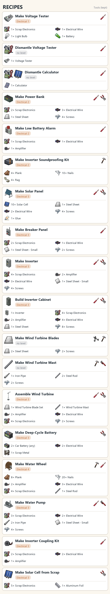
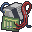
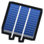
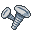
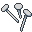
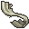
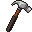
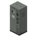
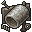
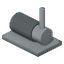

> Version française : [Recettes](../fr/08-recettes.md)

# Recipes

The 31 base LiveWire recipes are in the crafting menu: 16 to make and 15 to dismantle. LiveWire Extended adds 8 make recipes, listed in [LiveWire Extended](14-livewire-extended.md#recipes). Electrical recipes appear at their required level; the blade set and mast are in **Metalworking** and need no Electrical level. Tools are kept (some can wear). Every recipe awards Electrical XP, including blades, masts and tester dismantling.

*Illustrated recipe board.*

## Make recipes

Time is the recipe time of the game script, in game time units.

| Ingredients | Tools (kept) | Skill | Time | Result |
|---|---|---|---|---|
| 1 ×  Scrap Electronics 1 ×  Electrical Wire 1 ×  Light Bulb 1 ×  Battery |  | Electrical 1 | 80 |  **Voltage Tester** |
| 5 ×  Scrap Electronics 1 ×  Aluminum Foil |   | Electrical 3 | 100 |  **Solar Cell** |
| 10 ×  Solar Cell 1 ×  Steel Sheet 2 ×  Electrical Wire 4 ×  Screws 1 ×  Glue |   | Electrical 3 | 270 |  **Solar Panel** |
| 2 ×  Scrap Electronics 1 ×  Electrical Wire 1 ×  Amplifier |  | Electrical 2 | 100 |  **Low Battery Alarm** |
| 2 ×  Scrap Electronics 3 ×  Electrical Wire 1 ×  Steel Sheet 4 ×  Screws |   | Electrical 2 | 200 |  **Power Bank** |
| 4 ×  Plank 10 ×  Nails 4 ×  Rag |   | Electrical 2 | 200 |  **Inverter Soundproofing Kit** |
| 2 ×  Scrap Electronics 1 ×  Electrical Wire 1 ×  Steel Sheet - Small 2 ×  Screws |  | Electrical 3 | 130 |  **Breaker Panel** |
| 4 ×  Scrap Electronics 2 ×  Amplifier 3 ×  Electrical Wire 1 ×  Steel Sheet - Small 4 ×  Screws |   | Electrical 3 | 340 |  **Inverter** |
| 1 ×  Inverter 4 ×  Scrap Electronics 2 ×  Amplifier 4 ×  Electrical Wire 1 ×  Steel Sheet 8 ×  Screws |   | Electrical 3 | 470 |  **Inverter Cabinet** |
| 2 ×  Steel Sheet 2 ×  Screws |    | Metalworking | 120 |  **Wind Turbine Blade Set** |
| 1 ×  Iron Pipe 2 ×  Steel Rod 2 ×  Screws |    | Metalworking | 120 |  **Wind Turbine Mast** |
| 1 ×  Wind Turbine Blade Set 1 ×  Wind Turbine Mast 2 ×  Amplifier 3 ×  Electrical Wire 4 ×  Scrap Electronics 2 ×  Screws |   | Electrical 3 | 160 |  **Wind Turbine** |
| 2 ×  Car Battery (any of the three car battery types) 2 ×  Electrical Wire 1 ×  Scrap Metal |   | Electrical 3 | 270 |  **Deep-Cycle Battery** |
| 3 ×  Scrap Electronics 2 ×  Electrical Wire 2 ×  Iron Pipe 1 ×  Steel Sheet - Small 4 ×  Screws |   | Electrical 3 | 270 |  **Water Pump** |
| 2 ×  Scrap Electronics 2 ×  Electrical Wire 1 ×  Amplifier |  | Electrical 3 | 130 |  **Inverter Coupling Kit** |
| 8 ×  Plank 20 ×  Nails 2 ×  Amplifier 3 ×  Electrical Wire 4 ×  Scrap Electronics 1 ×  Steel Rod |   | Electrical 4 | 400 |  **Water Wheel** |

## Dismantle recipes

Dismantling needs the device picked up first. A working screwdriver is required and kept. No recipe needs an Electrical level. Each recipe is listed with its tools and time.

| Recipe | Tools (kept) | Time |
|---|---|---|
| Dismantle Voltage Tester | Screwdriver | 60 |
| Dismantle Solar Panel | Screwdriver | 200 |
| Dismantle Wind Turbine | Screwdriver | 150 |
| Dismantle Water Wheel | Screwdriver, Hammer | 250 |
| Dismantle Inverter | Screwdriver | 200 |
| Dismantle Inverter Cabinet | Screwdriver | 300 |
| Dismantle Power Bank | Screwdriver | 120 |
| Dismantle Breaker Panel | Screwdriver | 80 |
| Dismantle Low Battery Alarm | Screwdriver | 60 |
| Dismantle Water Pump | Screwdriver, Pipe Wrench | 200 |
| Dismantle Inverter Coupling Kit | Screwdriver | 60 |
| Dismantle Inverter Soundproofing Kit | Screwdriver, Hammer | 150 |
| Dismantle Wind Turbine Blades | Screwdriver | 60 |
| Dismantle Wind Turbine Mast | Screwdriver, Pipe Wrench | 60 |
| Dismantle Deep-Cycle Battery | Screwdriver | 120 |

## Wind turbine parts and amplifiers

Make a blade set with two metal sheets and two screws (metal snips and hammer),
and a mast with one metal pipe, two metal bars and two screws (hammer and pipe wrench).
Neither part requires an Electrical level. Assemble both parts with two amplifiers,
three wires, four electronics scrap and two screws at Electrical 3. The water wheel
requires Electrical 4 to craft, also using two amplifiers.

Blade sets and masts are also loot items; see [Loot Tables](09-loot-tables.md).
Amplifiers are vanilla parts recovered by dismantling devices. Their loot rates are
unchanged. Both complete machines require only Electrical 2 to link to an inverter.
Placing and picking them up need a screwdriver and no Electrical level.

## Inverter cabinet

**Build Inverter Cabinet** turns an ordinary inverter into a full-height inverter
cabinet: 4,500 W instead of 1,500 W, 60 W idle consumption instead of 20 W. It needs
Electrical 3 to craft and to put it into service (its first link); placing and picking
it up need a screwdriver and no Electrical level. The inverter used in the recipe is consumed
(its condition is lost: the cabinet starts new). A cabinet works like an inverter
(screen, running and fault lights, soundproofing kit, wear) and couples with inverters
or other cabinets; the network capacity is the sum of the inverters in service.
It is not found as loot. Model contributed by PewPewCricket.

## Dismantle a voltage tester

The crafting recipe **Dismantle Voltage Tester** consumes one LiveWire voltage
tester and gives one electronics scrap. A working screwdriver is required and
kept. No Electrical level is required; the action takes 60 recipe-time units
and awards 2 Electrical XP. Wire, bulb and battery used in its construction are
not recovered, so a craft/dismantle cycle cannot create materials.

Every LiveWire recipe awards Electrical XP; blades and masts each award 2 XP.

## Dismantle equipment

Every base LiveWire device and kit can be dismantled from the crafting menu
(**Dismantle Inverter**, **Dismantle Solar Panel** and so on): pick the device up
first, then dismantle it from your inventory. A working screwdriver is required and
kept; no Electrical level is needed. You always get back fewer parts than the
recipe cost, so building and dismantling again never creates materials.
LiveWire Extended devices have no dismantle recipe.

The metal parts always come back. The electronic parts depend on the device's
condition: the table gives them at 100 %; a device at 60 % gives 60 % of them,
rounded down, and a worn-out device gives none. A soundproofing kit fitted on an
inverter, or the coupling kit of a coupled inverter, is given back whole.

| Equipment | Always | Electronic parts at 100 % |
|---|---|---|
| Solar panel | 1 steel sheet, 2 screws | 8 solar cells, 1 electrical wire |
| Wind turbine | blade set, mast, 1 screw | 2 amplifiers, 2 wires, 3 scrap electronics |
| Water wheel (also a hammer) | 6 planks, 10 nails, 1 steel rod | 2 amplifiers, 2 wires, 3 scrap electronics |
| Inverter | 1 small steel sheet, 2 screws | 2 amplifiers, 2 wires, 3 scrap electronics |
| Inverter cabinet | 1 steel sheet, 1 small steel sheet, 6 screws | 4 amplifiers, 5 wires, 6 scrap electronics |
| Power bank | 1 steel sheet, 2 screws | 2 wires, 1 scrap electronics |
| Wind turbine blade set | 1 steel sheet, 1 screw | — |
| Wind turbine mast | 1 iron pipe, 1 iron bar, 1 screw | — |
| Deep-cycle battery | 1 scrap metal | 2 wires |
| Breaker panel | 1 small steel sheet, 1 screw | 1 wire, 1 scrap electronics |
| Low battery alarm | 1 wire | 1 amplifier |
| Water pump (also a pipe wrench) | 2 iron pipes, 1 small steel sheet, 2 screws | 1 wire, 2 scrap electronics |
| Inverter coupling kit | 1 amplifier, 1 wire, 1 scrap electronics | — |
| Soundproofing kit (hammer as well as screwdriver) | 3 planks, 5 nails, 2 rags | — |

The solar cell cannot be dismantled. A broken
device is picked up first (screwdriver), then dismantled like any other.

A calculator dismantled with the game's own **Dismantle Simple Electronic Item** recipe
also gives a solar cell.

## Extended recipes

LiveWire Extended adds eight make recipes, all at Electrical 3 and all with a screwdriver. Their ingredients are listed in [LiveWire Extended](14-livewire-extended.md#recipes).

| Recipe | Result | Time |
|---|---|---|
| Make Power Terminal | Power Terminal | 270 |
| Make Breaker Board (8 modules) | Breaker Board, 8 modules | 190 |
| Make Breaker Board (16 modules) | Breaker Board, 16 modules | 240 |
| Make Breaker Board (24 modules) | Breaker Board, 24 modules | 290 |
| Make Breaker 15 A | Breaker 15 A | 90 |
| Make Breaker 20 A | Breaker 20 A | 100 |
| Make Breaker 30 A | Breaker 30 A | 120 |
| Make Breaker Twilight Switch | Breaker Twilight Switch | 130 |

## See also

[Equipment](02-equipment.md) - [Loot Tables](09-loot-tables.md) - [Electrical skill and maintenance](10-electrical-skill-and-maintenance.md) - [Wiring](03-wiring.md) - [LiveWire Extended](14-livewire-extended.md)
