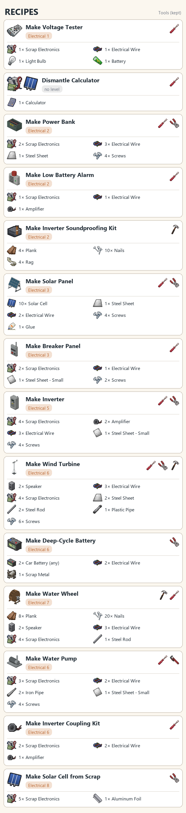

> Version française : [Recettes](../fr/08-recettes.md)

# Recipes

Recipes are in the crafting menu, category **Electrical**, and are learnt automatically when the Electrical level is reached. Tools are kept.

*Illustrated recipe board.*

| Ingredients | Tools (kept) | Skill | Result |
|---|---|---|---|
| 1 ×  Scrap Electronics 1 ×  Electrical Wire 1 ×  Light Bulb 1 ×  Battery |  | Electrical 1 |  **Voltage Tester** |
| 1 ×  Calculator |  | none | 1 ×  **Scrap Electronics** 1 ×  **Solar Cell** |
| 2 ×  Scrap Electronics 3 ×  Electrical Wire 1 ×  Steel Sheet 4 ×  Screws |   | Electrical 2 |  **Power Bank** |
| 1 ×  Scrap Electronics 1 ×  Electrical Wire 1 ×  Amplifier |  | Electrical 2 |  **Low Battery Alarm** |
| 4 ×  Plank 10 ×  Nails 4 ×  Rag |  | Electrical 2 |  **Inverter Soundproofing Kit** |
| 10 ×  Solar Cell 1 ×  Steel Sheet 2 ×  Electrical Wire 4 ×  Screws 1 ×  Glue |   | Electrical 3 |  **Solar Panel** |
| 2 ×  Scrap Electronics 1 ×  Electrical Wire 1 ×  Steel Sheet - Small 2 ×  Screws |  | Electrical 3 |  **Breaker Panel** |
| 4 ×  Scrap Electronics 2 ×  Amplifier 3 ×  Electrical Wire 1 ×  Steel Sheet - Small 4 ×  Screws |   | Electrical 5 |  **Inverter** |
| 2 ×  Speaker 3 ×  Electrical Wire 4 ×  Scrap Electronics 2 ×  Steel Sheet 2 ×  Steel Rod 1 ×  Plastic Pipe 6 ×  Screws |    | Electrical 6 |  **Wind Turbine** |
| 2 ×  Car Battery (any) 2 ×  Electrical Wire 1 ×  Scrap Metal |  | Electrical 6 |  **Deep-Cycle Battery** |
| 8 ×  Plank 20 ×  Nails 2 ×  Speaker 3 ×  Electrical Wire 4 ×  Scrap Electronics 1 ×  Steel Rod |   | Electrical 7 |  **Water Wheel** |
| 3 ×  Scrap Electronics 2 ×  Electrical Wire 2 ×  Iron Pipe 1 ×  Steel Sheet - Small 4 ×  Screws |   | Electrical 6 |  **Water Pump** |
| 2 ×  Scrap Electronics 2 ×  Electrical Wire 1 ×  Amplifier |  | Electrical 6 |  **Inverter Coupling Kit** |
| 5 ×  Scrap Electronics 1 ×  Aluminum Foil |  | Electrical 8 |  **Solar Cell** |

## See also

[Equipment](02-equipment.md) - [Loot Tables](09-loot-tables.md) - [Electrical skill and maintenance](10-electrical-skill-and-maintenance.md) - [Wiring](03-wiring.md)
