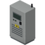
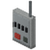
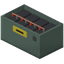
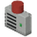

> Version française : [Tables de butin](../fr/09-tables-de-butin.md)

# Loot Tables

Live Wire adds solar cells, ready-made equipment and an optional software disk to vanilla loot lists.

## How to read the tables

Project Zomboid tests each item independently at each roll of a container list. A **weight** of W gives about W % per roll at normal loot rarity (before sandbox loot settings and zombie density). The **Rolls** column is the number of rolls of that vanilla list.

Approximate chance per container = 1 - (1 - W / 100)^Rolls. For placeable furniture items like the solar panel, vanilla applies the "Other" loot modifier (0.6 at normal rarity).

## Solar cell (`LiveWire.SolarCell`, always)

Weights at ×5; estimates assume this list is selected and a vanilla loot modifier of 0.6. Actual sandbox settings, zombie density, time and container space can change the result.

| Vanilla list | Where | Weight (×5) | Rolls | ≈ chance per container |
|---|---|---|---|---|
| `GarageTools` | Garage tool storage | 10 | 4 | 21.9 % |
| `CrateTools` | Tool crates | 5 | 4 | 11.5 % |
| `GarageMetalwork` | Garage metalwork storage | 5 | 4 | 11.5 % |
| `MechanicShelfElectric` | Mechanic shop, electrical shelf | 10 | 4 | 21.9 % |
| `ElectricianTools` | Electrician's tools | 15 | 3 | 24.6 % |
| `MetalShopTools` | Metal shop tools | 5 | 4 | 11.5 % |
| `WireFactoryElectric` | Wire factory, electrical | 10 | 4 | 21.9 % |
| `ToolStoreMisc` | Hardware store, miscellaneous | 10 | 4 | 21.9 % |
| `CrateElectronics` | Electronics crates | 10 | 4 | 21.9 % |
| `ElectronicStoreMisc` | Electronics store, miscellaneous | 10 | 4 | 21.9 % |
| `ToolStoreMetalwork` | Hardware store, metalwork | 5 | 4 | 11.5 % |
| `CrateMetalwork` | Metalwork crates | 5 | 4 | 11.5 % |

## Ready-made Live Wire equipment

Ready-made equipment, at the default EquipmentLootMultiplier = 5 (range 1–20). Estimates assume this loot list is selected, a vanilla loot modifier of 0.6, no zombie-density or time modifiers and enough container space; they are not a guaranteed discovery rate.

Look in hardware stores, garages and mechanic workshops, electronics stores, electrical factories and warehouse crates. Deep-cycle batteries also appear among camping gear. Locations and equipment vary by loot category; there is no guaranteed map location. Water wheels can now be found in farming, carpentry and technical storage; water pumps remain craft-only.

Set **Live Wire equipment and parts loot multiplier** on the **LiveWire** sandbox page: **5 by default**, from **1 to 20**. Restart the game or dedicated server after a change. Existing saves without this option use 5. Only future loot rolls are affected, including vanilla loot respawn if enabled; searched containers are not refilled. Solar cells are included. Vanilla items and their weights are unchanged; software disks keep their existing rates. At 1 the old weights are restored in existing categories, with the new locations still available.

| Equipment | Vanilla list | Where | Weight (×5) | Rolls | ≈ chance per container |
|---|---|---|---|---|---|
|  **Solar Panel** (furniture: × 0.6 included) | `ToolStoreMisc` | Hardware store, miscellaneous | 2.5 | 4 | 5.9 % |
|  | `CrateElectronics` | Electronics crates | 2.5 | 4 | 5.9 % |
|  | `ElectronicStoreMisc` | Electronics store, miscellaneous | 2.5 | 4 | 5.9 % |
|  | `GarageTools` | Garage tool storage | 1.5 | 4 | 3.6 % |
|  | `CrateTools` | Tool crates | 1.5 | 4 | 3.6 % |
|  | `ToolStoreTools` | Hardware store, tools | 1.5 | 4 | 3.6 % |
|  | `CrateMetalwork` | Metalwork crates | 1.5 | 4 | 3.6 % |
|  | `ToolStoreMetalwork` | Hardware store, metalwork | 1.5 | 4 | 3.6 % |
|  | `GarageMetalwork` | Garage metalwork storage | 1 | 4 | 2.4 % |
|  **Voltage Tester** | `ElectricianTools` | Electrician's tools | 15 | 3 | 24.6 % |
|  | `ToolStoreTools` | Hardware store, tools | 5 | 4 | 11.5 % |
|  | `GarageTools` | Garage tool storage | 5 | 4 | 11.5 % |
|  | `CrateTools` | Tool crates | 5 | 4 | 11.5 % |
|  | `WireFactoryElectric` | Wire factory, electrical | 5 | 4 | 11.5 % |
|  | `ElectronicStoreMisc` | Electronics store, miscellaneous | 5 | 4 | 11.5 % |
|  | `CrateElectronics` | Electronics crates | 5 | 4 | 11.5 % |
|  | `MechanicShelfElectric` | Mechanic shop, electrical shelf | 5 | 4 | 11.5 % |
|  | `MechanicShelfTools` | Mechanic shop, tools | 5 | 4 | 11.5 % |
|  **Deep-Cycle Battery** | `CarSupplyBatteries` | Car parts store, batteries | 10 | 4 | 21.9 % |
|  | `MechanicShelfElectric` | Mechanic shop, electrical shelf | 5 | 4 | 11.5 % |
|  | `CrateMechanics` | Mechanic supply crates | 3.5 | 4 | 8.1 % |
|  | `CrateElectronics` | Electronics crates | 2.5 | 4 | 5.9 % |
|  | `ElectronicStoreMisc` | Electronics store, miscellaneous | 2.5 | 4 | 5.9 % |
|  | `GarageMechanics` | Garage, mechanic storage | 1.5 | 4 | 3.6 % |
|  | `CampingStoreGear` | Camping store, gear | 1.5 | 4 | 3.6 % |
|  **Inverter** (furniture: × 0.6 included) | `ElectricianTools` | Electrician's tools | 2.5 | 3 | 4.4 % |
|  | `WireFactoryElectric` | Wire factory, electrical | 2.5 | 4 | 5.9 % |
|  | `CrateElectronics` | Electronics crates | 2.5 | 4 | 5.9 % |
|  | `ElectronicStoreMisc` | Electronics store, miscellaneous | 2.5 | 4 | 5.9 % |
|  | `ElectronicStoreAppliances` | Electronics store, appliances | 1.5 | 1 | 0.9 % |
|  | `MechanicShelfElectric` | Mechanic shop, electrical shelf | 1.5 | 4 | 3.6 % |
|  | `ToolStoreMisc` | Hardware store, miscellaneous | 1 | 4 | 2.4 % |
|  | `CrateTools` | Tool crates | 1 | 4 | 2.4 % |
|  | `GarageTools` | Garage tool storage | 0.5 | 4 | 1.2 % |
|  **Breaker Panel** (furniture: × 0.6 included) | `ElectricianTools` | Electrician's tools | 5 | 3 | 8.7 % |
|  | `WireFactoryElectric` | Wire factory, electrical | 5 | 4 | 11.5 % |
|  | `CrateElectronics` | Electronics crates | 3.5 | 4 | 8.1 % |
|  | `ToolStoreMisc` | Hardware store, miscellaneous | 2.5 | 4 | 5.9 % |
|  | `ElectronicStoreMisc` | Electronics store, miscellaneous | 2.5 | 4 | 5.9 % |
|  | `ToolStoreTools` | Hardware store, tools | 2.5 | 4 | 5.9 % |
|  | `GarageTools` | Garage tool storage | 1.5 | 4 | 3.6 % |
|  | `CrateTools` | Tool crates | 1.5 | 4 | 3.6 % |
|  | `CrateMetalwork` | Metalwork crates | 1.5 | 4 | 3.6 % |
|  **Power Bank** (furniture: × 0.6 included) | `ElectricianTools` | Electrician's tools | 2.5 | 3 | 4.4 % |
|  | `MechanicShelfElectric` | Mechanic shop, electrical shelf | 2.5 | 4 | 5.9 % |
|  | `CrateElectronics` | Electronics crates | 2.5 | 4 | 5.9 % |
|  | `ElectronicStoreMisc` | Electronics store, miscellaneous | 2 | 4 | 4.7 % |
|  | `ToolStoreMisc` | Hardware store, miscellaneous | 1.5 | 4 | 3.6 % |
|  | `CrateMechanics` | Mechanic supply crates | 1.5 | 4 | 3.6 % |
|  | `GarageTools` | Garage tool storage | 1 | 4 | 2.4 % |
|  | `GarageMechanics` | Garage, mechanic storage | 1 | 4 | 2.4 % |
|  | `CrateTools` | Tool crates | 1 | 4 | 2.4 % |
|  **Low Battery Alarm** (furniture: × 0.6 included) | `ElectricianTools` | Electrician's tools | 5 | 3 | 8.7 % |
|  | `WireFactoryElectric` | Wire factory, electrical | 5 | 4 | 11.5 % |
|  | `CrateElectronics` | Electronics crates | 3.5 | 4 | 8.1 % |
|  | `ToolStoreMisc` | Hardware store, miscellaneous | 2.5 | 4 | 5.9 % |
|  | `ElectronicStoreMisc` | Electronics store, miscellaneous | 2.5 | 4 | 5.9 % |
|  | `CrateTools` | Tool crates | 1.5 | 4 | 3.6 % |
|  | `GarageTools` | Garage tool storage | 1.5 | 4 | 3.6 % |
|  **Wind Turbine** (furniture: × 0.6 included) | `WireFactoryElectric` | Wire factory, electrical | 2.5 | 4 | 5.9 % |
|  | `ToolStoreMetalwork` | Hardware store, metalwork | 2.5 | 4 | 5.9 % |
|  | `WireFactoryTools` | Wire factory, tools | 2.5 | 4 | 5.9 % |
|  | `ToolStoreMisc` | Hardware store, miscellaneous | 1.5 | 4 | 3.6 % |
|  | `CrateElectronics` | Electronics crates | 1.5 | 4 | 3.6 % |
|  | `CrateMetalwork` | Metalwork crates | 1.5 | 4 | 3.6 % |
|  | `CrateTools` | Tool crates | 1.5 | 4 | 3.6 % |
|  | `CrateFarming` | Farming supply crates | 1.5 | 4 | 3.6 % |
|  | `ToolStoreFarming` | Hardware/outdoor store, farming | 1.5 | 4 | 3.6 % |
|  | `MechanicShelfTools` | Mechanic shop, tools | 1.5 | 4 | 3.6 % |
|  **Water Wheel** (furniture: × 0.6 included) | `CrateCarpentry` | Carpentry crates | 2.5 | 4 | 5.9 % |
|  | `ToolStoreCarpentry` | Hardware store, carpentry | 2.5 | 4 | 5.9 % |
|  | `CrateFarming` | Farming supply crates | 2.5 | 4 | 5.9 % |
|  | `ToolStoreFarming` | Hardware/outdoor store, farming | 1.5 | 4 | 3.6 % |
|  | `CrateTools` | Tool crates | 1.5 | 4 | 3.6 % |
|  | `CrateMechanics` | Mechanic supply crates | 1.5 | 4 | 3.6 % |
|  | `CrateMetalwork` | Metalwork crates | 1.5 | 4 | 3.6 % |
|  **Wind Turbine Blade Set** | `CrateMetalwork` | Metalwork crates | 5 | 4 | 11.5 % |
|  | `ToolStoreMetalwork` | Hardware store, metalwork | 5 | 4 | 11.5 % |
|  | `CrateTools` | Tool crates | 3.5 | 4 | 8.1 % |
|  | `CrateFarming` | Farming supply crates | 3.5 | 4 | 8.1 % |
|  | `ToolStoreFarming` | Hardware/outdoor store, farming | 3.5 | 4 | 8.1 % |
|  | `WireFactoryTools` | Wire factory, tools | 3.5 | 4 | 8.1 % |
|  **Wind Turbine Mast** | `CrateMetalwork` | Metalwork crates | 5 | 4 | 11.5 % |
|  | `ToolStoreMetalwork` | Hardware store, metalwork | 5 | 4 | 11.5 % |
|  | `CrateTools` | Tool crates | 3.5 | 4 | 8.1 % |
|  | `CrateMechanics` | Mechanic supply crates | 3.5 | 4 | 8.1 % |
|  | `CrateFarming` | Farming supply crates | 3.5 | 4 | 8.1 % |
|  | `ToolStoreFarming` | Hardware/outdoor store, farming | 3.5 | 4 | 8.1 % |

## Mod components

Solar cells, wind turbine blade sets and masts are Live Wire components and use the same multiplier.
Only objects defined by Live Wire appear in these added loot entries and tables.
Vanilla crafting ingredients (wire, scrap, amplifiers, speakers, bulbs, batteries
and building materials) keep their existing distributions and weights. No vanilla
item is added, removed or reweighted by this option.

## Management software disk (`LiveWire.MonitorDisk`, only when the Computer Mod is active)

| Vanilla list | Where | Weight | Rolls | Chance per container |
|---|---|---|---|---|
| ElectronicStoreComputers | Electronics store, computers | 2 | 1 | 2.0 % |
| CrateComputer | Computer crates | 2 | 4 | 7.8 % |
| BookstoreComputer | Bookstore, computer section | 1 | 4 | 3.9 % |
| UniversityDesk_Computer | University desk, computing | 1 | 4 | 3.9 % |
| UniversityDesk_Electrical | University desk, electrical | 2 | 4 | 7.8 % |
| OfficeDesk | Office desks | 0.3 | 4 | 1.2 % |

## Other ways to get solar cells

- Dismantle a calculator: 1 solar cell each, no level required.
- At Electrical level 8, make a solar cell from 5 electronics scrap + 1 aluminum.

## See also

[Recipes](08-recipes.md) - [Equipment](02-equipment.md) - [Inverter Screen and Software](05-inverter-screen-and-software.md) - [Multiplayer](12-multiplayer.md)
