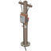
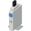
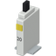
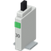

> Version française : [Tables de butin](../fr/09-tables-de-butin.md)

# Loot Tables

LiveWire adds solar cells, ready-made equipment and an optional software disk to vanilla loot lists. Electrician vehicles (including the electrical company vans) and metalworker vehicles also carry equipment: lists named `ElectricianTruckBed`, `ElectricianGloveBox` and `MetalWelderTruckBed` below.

## How to read the tables

Project Zomboid tests each item independently at each roll of a container list. An item of **weight** W has a chance of W × M % per roll, where M is the game's loot modifier for that item. The **Rolls** column is the number of rolls of that vanilla list.

Approximate chance per container = 1 - (1 - W × M / 100)^Rolls.

The game picks M from the item's loot category, set on the sandbox **Loot Rarity** page. LiveWire and LiveWire Extended items have no category of their own, so they fall under **Other**. The only exception is the deep-cycle battery: the game files it as vehicle maintenance, so it follows **Mechanics**. Both settings are 0.6 at normal rarity, so the tables use M = 0.6 for every item. With other loot settings, the real chances change; zombie density, time and container space change them too.

## Solar cell (`LiveWire.SolarCell`, always)

Weights at ×5; estimates assume this list is selected and the game's loot modifier at normal rarity (0.6).

| Vanilla list | Where | Weight (×5) | Rolls | ≈ chance per container |
|---|---|---|---|---|
| `GarageTools` | Garage tool storage | 10 | 4 | 21.9 % |
| `CrateTools` | Tool crates | 5 | 4 | 11.5 % |
| `GarageMetalwork` | Garage metalwork storage | 5 | 4 | 11.5 % |
| `MechanicShelfElectric` | Mechanic shop, electrical shelf | 10 | 4 | 21.9 % |
| `ElectricianTools` | Electrician's tools | 15 | 3 | 24.6 % |
| `MetalShopTools` | Metal shop tools | 5 | 4 | 11.5 % |
| `WireFactoryElectric` | Wire factory, electrical | 10 | 4 | 21.9 % |
| `ToolStoreMisc` | Hardware store, miscellaneous | 10 | 4 | 21.9 % |
| `CrateElectronics` | Electronics crates | 10 | 4 | 21.9 % |
| `ElectronicStoreMisc` | Electronics store, miscellaneous | 10 | 4 | 21.9 % |
| `ToolStoreMetalwork` | Hardware store, metalwork | 5 | 4 | 11.5 % |
| `CrateMetalwork` | Metalwork crates | 5 | 4 | 11.5 % |
| `ElectricianTruckBed` | Electrician vehicle, truck bed or trunk | 10 | 4 | 21.9 % |

## Ready-made LiveWire equipment

Weights at the default EquipmentLootMultiplier = 5 (range 1–20). Estimates assume this loot list is selected, the game's loot modifier at normal rarity (0.6), no zombie-density or time modifiers and enough container space; they are not a guaranteed discovery rate.

Look in hardware stores, garages and mechanic workshops, electronics stores, electrical factories and warehouse crates. Deep-cycle batteries also appear among camping gear. Each kind of container has its own list; there is no guaranteed map location. Water wheels are found in carpentry and farming stores and crates, and in tool, mechanic and metalwork crates. Water pumps and inverter cabinets are craft-only.

Set **LiveWire equipment and parts loot multiplier** on the **LiveWire** sandbox page: **5 by default**, from **1 to 20**. Restart the game or dedicated server after a change. Only future loot rolls are affected, including vanilla loot respawn if enabled; searched containers are not refilled. Solar cells are included. Vanilla items and their weights are unchanged. The software disk is not affected by this option.

| Equipment | Vanilla list | Where | Weight (×5) | Rolls | ≈ chance per container |
|---|---|---|---|---|---|
|  **Solar Panel** | `GarageMetalwork` | Garage metalwork storage | 2.5 | 4 | 5.9 % |
|  | `ToolStoreMisc` | Hardware store, miscellaneous | 2.5 | 4 | 5.9 % |
|  | `CrateElectronics` | Electronics crates | 2.5 | 4 | 5.9 % |
|  | `ElectronicStoreMisc` | Electronics store, miscellaneous | 2.5 | 4 | 5.9 % |
|  | `ElectricianTruckBed` | Electrician vehicle, truck bed or trunk | 2.5 | 4 | 5.9 % |
|  | `GarageTools` | Garage tool storage | 1.5 | 4 | 3.6 % |
|  | `CrateTools` | Tool crates | 1.5 | 4 | 3.6 % |
|  | `ToolStoreTools` | Hardware store, tools | 1.5 | 4 | 3.6 % |
|  | `CrateMetalwork` | Metalwork crates | 1.5 | 4 | 3.6 % |
|  | `ToolStoreMetalwork` | Hardware store, metalwork | 1.5 | 4 | 3.6 % |
|  | `GarageMechanics` | Garage, mechanic storage | 1.5 | 4 | 3.6 % |
|  | `MetalWelderTruckBed` | Metalworker vehicle, truck bed or trunk | 1.5 | 4 | 3.6 % |
|  **Voltage Tester** | `ElectricianTools` | Electrician's tools | 5 | 3 | 8.7 % |
|  | `ElectricianTruckBed` | Electrician vehicle, truck bed or trunk | 5 | 4 | 11.5 % |
|  | `WireFactoryElectric` | Wire factory, electrical | 2.5 | 4 | 5.9 % |
|  | `ToolStoreTools` | Hardware store, tools | 1.5 | 4 | 3.6 % |
|  | `ElectronicStoreMisc` | Electronics store, miscellaneous | 1.5 | 4 | 3.6 % |
|  | `CrateElectronics` | Electronics crates | 1.5 | 4 | 3.6 % |
|  | `MechanicShelfElectric` | Mechanic shop, electrical shelf | 1.5 | 4 | 3.6 % |
|  | `ElectricianGloveBox` | Electrician vehicle, glove box | 1.5 | 1 | 0.9 % |
|  | `GarageTools` | Garage tool storage | 1 | 4 | 2.4 % |
|  | `CrateTools` | Tool crates | 1 | 4 | 2.4 % |
|  **Deep-Cycle Battery** (loot setting: Mechanics) | `CarSupplyBatteries` | Car parts store, batteries | 10 | 4 | 21.9 % |
|  | `MechanicShelfElectric` | Mechanic shop, electrical shelf | 5 | 4 | 11.5 % |
|  | `CrateMechanics` | Mechanic supply crates | 3.5 | 4 | 8.1 % |
|  | `CrateElectronics` | Electronics crates | 2.5 | 4 | 5.9 % |
|  | `ElectronicStoreMisc` | Electronics store, miscellaneous | 2.5 | 4 | 5.9 % |
|  | `GarageMechanics` | Garage, mechanic storage | 1.5 | 4 | 3.6 % |
|  | `CampingStoreGear` | Camping store, gear | 1.5 | 4 | 3.6 % |
|  **Inverter** | `ElectricianTools` | Electrician's tools | 2.5 | 3 | 4.4 % |
|  | `WireFactoryElectric` | Wire factory, electrical | 2.5 | 4 | 5.9 % |
|  | `CrateElectronics` | Electronics crates | 2.5 | 4 | 5.9 % |
|  | `ElectronicStoreMisc` | Electronics store, miscellaneous | 2.5 | 4 | 5.9 % |
|  | `ElectricianTruckBed` | Electrician vehicle, truck bed or trunk | 2.5 | 4 | 5.9 % |
|  | `ElectronicStoreAppliances` | Electronics store, appliances | 1.5 | 1 | 0.9 % |
|  | `MechanicShelfElectric` | Mechanic shop, electrical shelf | 1.5 | 4 | 3.6 % |
|  | `GarageMechanics` | Garage, mechanic storage | 1.5 | 4 | 3.6 % |
|  | `ToolStoreMisc` | Hardware store, miscellaneous | 1 | 4 | 2.4 % |
|  | `CrateTools` | Tool crates | 1 | 4 | 2.4 % |
|  | `GarageTools` | Garage tool storage | 0.5 | 4 | 1.2 % |
|  **Breaker Panel** | `ElectricianTools` | Electrician's tools | 5 | 3 | 8.7 % |
|  | `WireFactoryElectric` | Wire factory, electrical | 5 | 4 | 11.5 % |
|  | `ElectricianTruckBed` | Electrician vehicle, truck bed or trunk | 5 | 4 | 11.5 % |
|  | `CrateElectronics` | Electronics crates | 3.5 | 4 | 8.1 % |
|  | `ToolStoreMisc` | Hardware store, miscellaneous | 2.5 | 4 | 5.9 % |
|  | `ElectronicStoreMisc` | Electronics store, miscellaneous | 2.5 | 4 | 5.9 % |
|  | `ToolStoreTools` | Hardware store, tools | 2.5 | 4 | 5.9 % |
|  | `GarageTools` | Garage tool storage | 1.5 | 4 | 3.6 % |
|  | `CrateTools` | Tool crates | 1.5 | 4 | 3.6 % |
|  | `CrateMetalwork` | Metalwork crates | 1.5 | 4 | 3.6 % |
|  | `GarageMechanics` | Garage, mechanic storage | 1.5 | 4 | 3.6 % |
|  | `GarageMetalwork` | Garage metalwork storage | 1.5 | 4 | 3.6 % |
|  **Power Bank** | `ElectricianTools` | Electrician's tools | 2.5 | 3 | 4.4 % |
|  | `MechanicShelfElectric` | Mechanic shop, electrical shelf | 2.5 | 4 | 5.9 % |
|  | `CrateElectronics` | Electronics crates | 2.5 | 4 | 5.9 % |
|  | `ElectricianTruckBed` | Electrician vehicle, truck bed or trunk | 2.5 | 4 | 5.9 % |
|  | `ElectronicStoreMisc` | Electronics store, miscellaneous | 2 | 4 | 4.7 % |
|  | `ToolStoreMisc` | Hardware store, miscellaneous | 1.5 | 4 | 3.6 % |
|  | `CrateMechanics` | Mechanic supply crates | 1.5 | 4 | 3.6 % |
|  | `GarageTools` | Garage tool storage | 1 | 4 | 2.4 % |
|  | `GarageMechanics` | Garage, mechanic storage | 1 | 4 | 2.4 % |
|  | `CrateTools` | Tool crates | 1 | 4 | 2.4 % |
|  **Low Battery Alarm** | `ElectricianTools` | Electrician's tools | 5 | 3 | 8.7 % |
|  | `WireFactoryElectric` | Wire factory, electrical | 5 | 4 | 11.5 % |
|  | `ElectricianTruckBed` | Electrician vehicle, truck bed or trunk | 5 | 4 | 11.5 % |
|  | `CrateElectronics` | Electronics crates | 3.5 | 4 | 8.1 % |
|  | `ToolStoreMisc` | Hardware store, miscellaneous | 2.5 | 4 | 5.9 % |
|  | `ElectronicStoreMisc` | Electronics store, miscellaneous | 2.5 | 4 | 5.9 % |
|  | `CrateTools` | Tool crates | 1.5 | 4 | 3.6 % |
|  | `GarageTools` | Garage tool storage | 1.5 | 4 | 3.6 % |
|  | `GarageMechanics` | Garage, mechanic storage | 1.5 | 4 | 3.6 % |
|  **Wind Turbine** | `WireFactoryElectric` | Wire factory, electrical | 2.5 | 4 | 5.9 % |
|  | `ToolStoreMetalwork` | Hardware store, metalwork | 2.5 | 4 | 5.9 % |
|  | `WireFactoryTools` | Wire factory, tools | 2.5 | 4 | 5.9 % |
|  | `ToolStoreMisc` | Hardware store, miscellaneous | 1.5 | 4 | 3.6 % |
|  | `CrateElectronics` | Electronics crates | 1.5 | 4 | 3.6 % |
|  | `CrateMetalwork` | Metalwork crates | 1.5 | 4 | 3.6 % |
|  | `CrateTools` | Tool crates | 1.5 | 4 | 3.6 % |
|  | `CrateFarming` | Farming supply crates | 1.5 | 4 | 3.6 % |
|  | `ToolStoreFarming` | Hardware/outdoor store, farming | 1.5 | 4 | 3.6 % |
|  | `MechanicShelfTools` | Mechanic shop, tools | 1.5 | 4 | 3.6 % |
|  | `MetalWelderTruckBed` | Metalworker vehicle, truck bed or trunk | 1.5 | 4 | 3.6 % |
|  | `GarageMetalwork` | Garage metalwork storage | 1 | 4 | 2.4 % |
|  **Water Wheel** | `CrateCarpentry` | Carpentry crates | 2.5 | 4 | 5.9 % |
|  | `ToolStoreCarpentry` | Hardware store, carpentry | 2.5 | 4 | 5.9 % |
|  | `CrateFarming` | Farming supply crates | 2.5 | 4 | 5.9 % |
|  | `ToolStoreFarming` | Hardware/outdoor store, farming | 1.5 | 4 | 3.6 % |
|  | `CrateTools` | Tool crates | 1.5 | 4 | 3.6 % |
|  | `CrateMechanics` | Mechanic supply crates | 1.5 | 4 | 3.6 % |
|  | `CrateMetalwork` | Metalwork crates | 1.5 | 4 | 3.6 % |
|  **Wind Turbine Blade Set** | `CrateMetalwork` | Metalwork crates | 5 | 4 | 11.5 % |
|  | `ToolStoreMetalwork` | Hardware store, metalwork | 5 | 4 | 11.5 % |
|  | `MetalWelderTruckBed` | Metalworker vehicle, truck bed or trunk | 5 | 4 | 11.5 % |
|  | `CrateTools` | Tool crates | 3.5 | 4 | 8.1 % |
|  | `CrateFarming` | Farming supply crates | 3.5 | 4 | 8.1 % |
|  | `ToolStoreFarming` | Hardware/outdoor store, farming | 3.5 | 4 | 8.1 % |
|  | `WireFactoryTools` | Wire factory, tools | 3.5 | 4 | 8.1 % |
|  | `GarageMetalwork` | Garage metalwork storage | 3.5 | 4 | 8.1 % |
|  **Wind Turbine Mast** | `CrateMetalwork` | Metalwork crates | 5 | 4 | 11.5 % |
|  | `ToolStoreMetalwork` | Hardware store, metalwork | 5 | 4 | 11.5 % |
|  | `MetalWelderTruckBed` | Metalworker vehicle, truck bed or trunk | 5 | 4 | 11.5 % |
|  | `CrateTools` | Tool crates | 3.5 | 4 | 8.1 % |
|  | `CrateMechanics` | Mechanic supply crates | 3.5 | 4 | 8.1 % |
|  | `CrateFarming` | Farming supply crates | 3.5 | 4 | 8.1 % |
|  | `ToolStoreFarming` | Hardware/outdoor store, farming | 3.5 | 4 | 8.1 % |
|  | `GarageMetalwork` | Garage metalwork storage | 3.5 | 4 | 8.1 % |

## Mod components

Solar cells, wind turbine blade sets and masts are LiveWire components and use the same multiplier.
Only objects defined by LiveWire appear in these added loot entries and tables. Vanilla crafting ingredients
(wire, scrap, amplifiers, speakers, bulbs, batteries and building materials) keep their existing distributions
and weights. No vanilla item is added, removed or reweighted by this option.

## LiveWire Extended loot

The optional add-on's equipment (power terminal, breaker boards, breakers and twilight switch) uses the same multiplier. Breakers are the most common find: electrician's tools, hardware stores, electronics and wire-factory crates, electrician vehicles, and also the garage tool storage, tool crates and garage metalwork storage of houses. Breaker boards and twilight switches are rarer: they are only in the electrician's tools, hardware store, electronics crate and wire-factory lists, and in electrician vehicles (except the 24-module board, never found in vehicles). The power terminal is in the same lists and in electrician vehicles.

| Equipment | Vanilla list | Where | Weight (×5) | Rolls | ≈ chance per container |
|---|---|---|---|---|---|
|  **Power Terminal** | `ElectricianTools` | Electrician's tools | 1.5 | 3 | 2.7 % |
|  | `WireFactoryElectric` | Wire factory, electrical | 1.5 | 4 | 3.6 % |
|  | `ElectricianTruckBed` | Electrician vehicle, truck bed or trunk | 1.5 | 4 | 3.6 % |
|  | `ToolStoreMisc` | Hardware store, miscellaneous | 1.1 | 4 | 2.5 % |
|  | `CrateElectronics` | Electronics crates | 1.1 | 4 | 2.5 % |
|  **Breaker 15 A** | `ElectricianTools` | Electrician's tools | 4 | 3 | 7.0 % |
|  | `WireFactoryElectric` | Wire factory, electrical | 4 | 4 | 9.3 % |
|  | `ElectricianTruckBed` | Electrician vehicle, truck bed or trunk | 4 | 4 | 9.3 % |
|  | `ToolStoreMisc` | Hardware store, miscellaneous | 2.8 | 4 | 6.6 % |
|  | `CrateElectronics` | Electronics crates | 2.8 | 4 | 6.6 % |
|  | `GarageTools` | Garage tool storage | 1.6 | 4 | 3.8 % |
|  | `CrateTools` | Tool crates | 1.2 | 4 | 2.8 % |
|  | `GarageMetalwork` | Garage metalwork storage | 0.8 | 4 | 1.9 % |
|  **Breaker 20 A** | `ElectricianTools` | Electrician's tools | 4 | 3 | 7.0 % |
|  | `WireFactoryElectric` | Wire factory, electrical | 4 | 4 | 9.3 % |
|  | `ElectricianTruckBed` | Electrician vehicle, truck bed or trunk | 4 | 4 | 9.3 % |
|  | `ToolStoreMisc` | Hardware store, miscellaneous | 2.8 | 4 | 6.6 % |
|  | `CrateElectronics` | Electronics crates | 2.8 | 4 | 6.6 % |
|  | `GarageTools` | Garage tool storage | 1.6 | 4 | 3.8 % |
|  | `CrateTools` | Tool crates | 1.2 | 4 | 2.8 % |
|  | `GarageMetalwork` | Garage metalwork storage | 0.8 | 4 | 1.9 % |
|  **Breaker 30 A** | `ElectricianTools` | Electrician's tools | 2.5 | 3 | 4.4 % |
|  | `WireFactoryElectric` | Wire factory, electrical | 2.5 | 4 | 5.9 % |
|  | `ElectricianTruckBed` | Electrician vehicle, truck bed or trunk | 2.5 | 4 | 5.9 % |
|  | `ToolStoreMisc` | Hardware store, miscellaneous | 1.8 | 4 | 4.1 % |
|  | `CrateElectronics` | Electronics crates | 1.8 | 4 | 4.1 % |
|  | `GarageTools` | Garage tool storage | 1 | 4 | 2.4 % |
|  | `CrateTools` | Tool crates | 0.8 | 4 | 1.8 % |
|  | `GarageMetalwork` | Garage metalwork storage | 0.5 | 4 | 1.2 % |
|  **Breaker Board (8 modules)** | `ElectricianTools` | Electrician's tools | 1 | 3 | 1.8 % |
|  | `WireFactoryElectric` | Wire factory, electrical | 1 | 4 | 2.4 % |
|  | `ToolStoreMisc` | Hardware store, miscellaneous | 0.7 | 4 | 1.7 % |
|  | `CrateElectronics` | Electronics crates | 0.7 | 4 | 1.7 % |
|  | `ElectricianTruckBed` | Electrician vehicle, truck bed or trunk | 0.5 | 4 | 1.2 % |
|  **Breaker Board (16 modules)** | `ElectricianTools` | Electrician's tools | 0.6 | 3 | 1.1 % |
|  | `WireFactoryElectric` | Wire factory, electrical | 0.6 | 4 | 1.4 % |
|  | `ToolStoreMisc` | Hardware store, miscellaneous | 0.4 | 4 | 1.0 % |
|  | `CrateElectronics` | Electronics crates | 0.4 | 4 | 1.0 % |
|  | `ElectricianTruckBed` | Electrician vehicle, truck bed or trunk | 0.2 | 4 | 0.6 % |
|  **Breaker Board (24 modules)** | `ElectricianTools` | Electrician's tools | 0.3 | 3 | 0.5 % |
|  | `WireFactoryElectric` | Wire factory, electrical | 0.3 | 4 | 0.7 % |
|  | `ToolStoreMisc` | Hardware store, miscellaneous | 0.2 | 4 | 0.5 % |
|  | `CrateElectronics` | Electronics crates | 0.2 | 4 | 0.5 % |
|  **Breaker Twilight Switch** | `ElectricianTools` | Electrician's tools | 0.8 | 3 | 1.3 % |
|  | `WireFactoryElectric` | Wire factory, electrical | 0.8 | 4 | 1.8 % |
|  | `ToolStoreMisc` | Hardware store, miscellaneous | 0.5 | 4 | 1.3 % |
|  | `CrateElectronics` | Electronics crates | 0.5 | 4 | 1.3 % |
|  | `ElectricianTruckBed` | Electrician vehicle, truck bed or trunk | 0.5 | 4 | 1.2 % |

## Management software disk (`LiveWire.MonitorDisk`, only when the Computer Mod is active)

The disk is added only when the Computer Mod is active (the Laptop Mod is an add-on of the Computer Mod). Its weights are not multiplied by the loot multiplier.

| Equipment | Vanilla list | Where | Weight | Rolls | ≈ chance per container |
|---|---|---|---|---|---|
|  **Disk: LiveWire Management Software** (needs the Computer Mod) | `ElectronicStoreComputers` | Electronics store, computers | 2 | 1 | 1.2 % |
|  | `CrateComputer` | Computer crates | 2 | 4 | 4.7 % |
|  | `UniversityDesk_Electrical` | University desk, electrical | 2 | 4 | 4.7 % |
|  | `BookstoreComputer` | Bookstore, computers | 1 | 4 | 2.4 % |
|  | `UniversityDesk_Computer` | University desk, computers | 1 | 4 | 2.4 % |
|  | `OfficeDesk` | Office desk | 0.3 | 4 | 0.7 % |

## Other ways to get solar cells

- Dismantle a calculator (the game's Dismantle Simple Electronic Item recipe): 1 solar cell each, no level required.
- At Electrical level 3, make a solar cell from 5 Scrap Electronics + 1 Aluminum Foil.

## See also

[Recipes](08-recipes.md) - [Equipment](02-equipment.md) - [Inverter Screen and Software](05-inverter-screen-and-software.md) - [Multiplayer](12-multiplayer.md) - [LiveWire Extended](14-livewire-extended.md)
