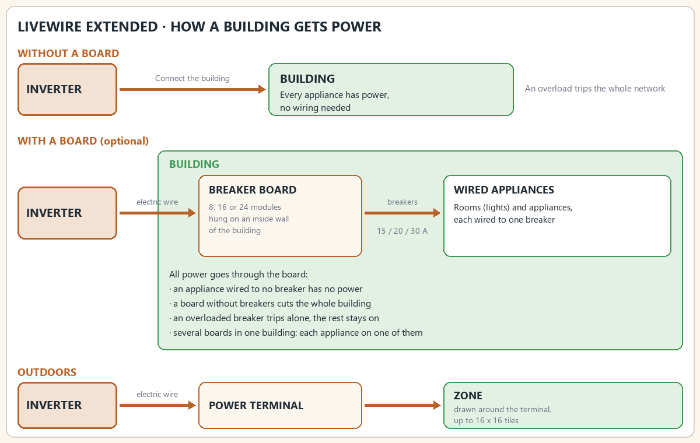
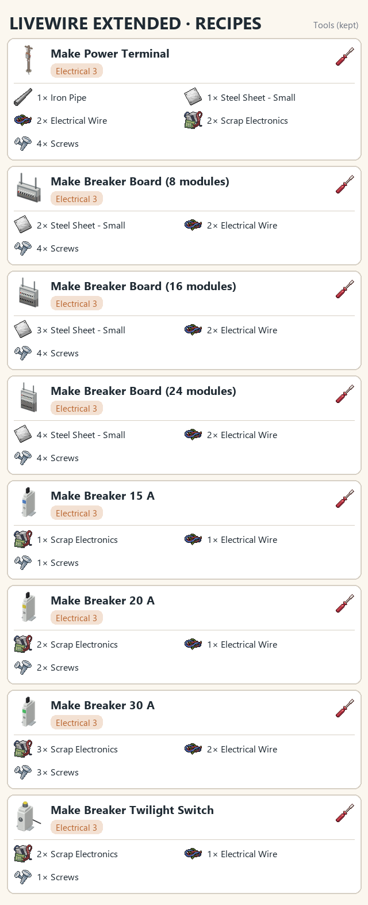
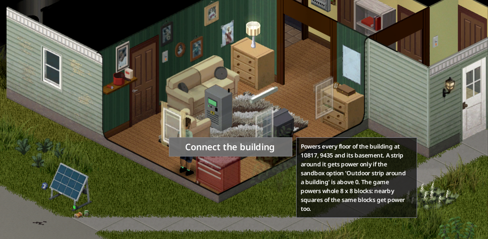
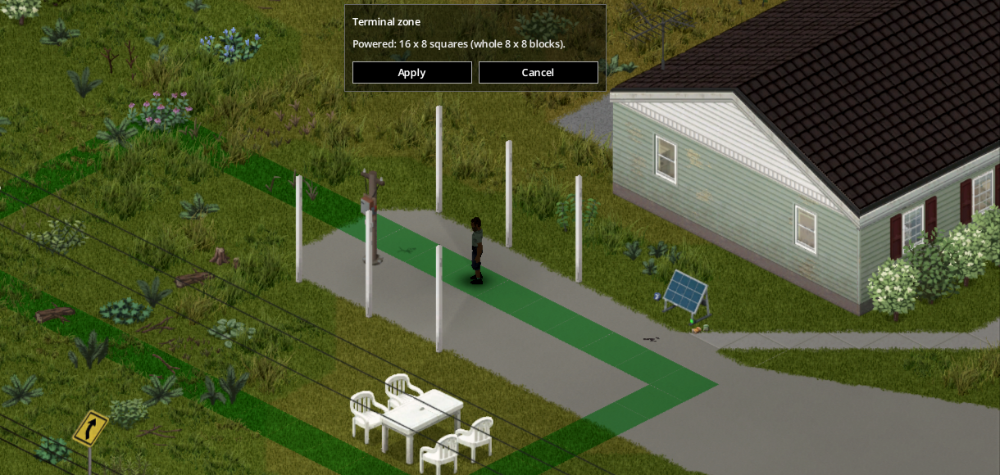
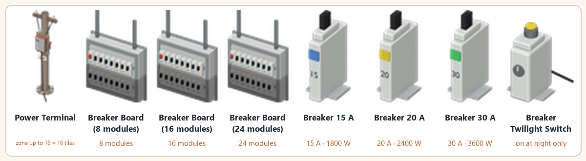
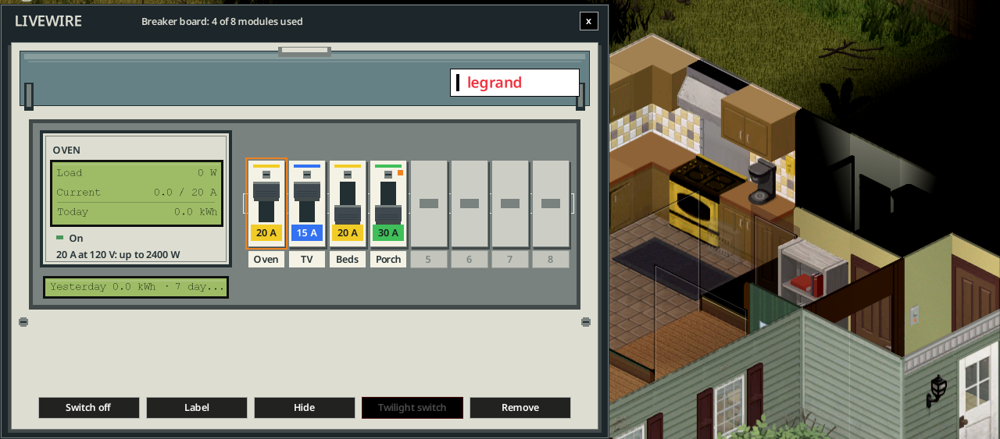
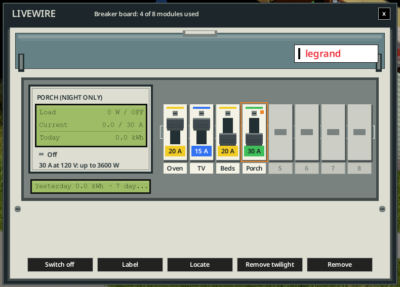
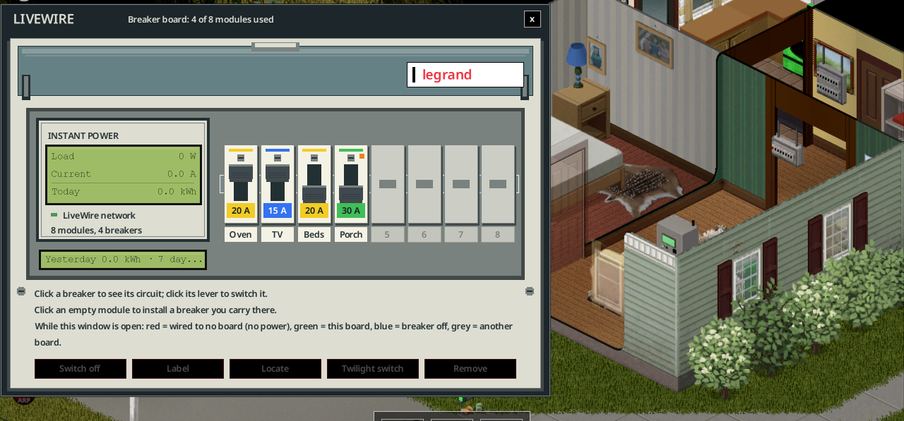

> Version française : [LiveWire Extended](../fr/14-livewire-extended.md)

# LiveWire Extended (optional add-on)

**LiveWire Extended** (`batman_LiveWireExtended`, version 1.0.0) is an optional add-on for LiveWire. It needs LiveWire. It adds four ways to bring power where the base mod cannot: a whole building connected to one inverter, an outdoor power terminal with its own zone, breaker boards where each appliance is wired to a breaker (one breaker can feed several appliances), and the breakers, labels and twilight switches that go with them. With the add-on, an inverter powers only what is connected to it, and no longer a radius around itself. Without it, LiveWire works as before.

## Enable and requirements

- LiveWire Extended ships in the same Steam Workshop item as LiveWire (ID 3821807453). Subscribe to that item, then enable **LiveWire Extended** in the mod list. It loads after LiveWire.
- It requires LiveWire (`batman_LiveWire`). Without LiveWire, it does nothing.
- **Adding it to a world in progress:** inverters no longer have a radius, so on the first start each inverter already placed inside a building gets that building connected (every floor and the basement), as **Connect the building** would. An inverter standing outside, or in a building another inverter already powers, keeps no power until you connect a building or a terminal to it. This happens once per world.
- Connecting a building, linking the power terminal or a breaker board to an inverter, installing a breaker, wiring an appliance and enlarging a board need **Electrical level 3** and a **screwdriver**. Placing or picking up a terminal or a board needs a screwdriver and no level. Fitting a twilight switch needs a screwdriver and no level; only crafting the switch needs level 3.
- The sandbox option **Skill requirements** (LiveWire options) also applies to Extended: when it is off, no level is required for the jobs above. The crafting recipes keep their level 3.
- Mods declared incompatible: see [Incompatible mods](#incompatible-mods).

## Recipes

Recipes are at Electrical level 3, each with a screwdriver. Times are the recipe times in [Recipes](08-recipes.md#extended-recipes).

| Recipe | Ingredients |
|---|---|
| Make Power Terminal | 1 Iron Pipe, 1 Steel Sheet - Small, 2 Electrical Wire, 2 Scrap Electronics, 4 Screws |
| Make Breaker Board (8 modules) | 2 Steel Sheet - Small, 2 Electrical Wire, 4 Screws |
| Make Breaker Board (16 modules) | 3 Steel Sheet - Small, 2 Electrical Wire, 4 Screws |
| Make Breaker Board (24 modules) | 4 Steel Sheet - Small, 2 Electrical Wire, 4 Screws |
| Make Breaker 15 A | 1 Scrap Electronics, 1 Electrical Wire, 1 Screws |
| Make Breaker 20 A | 2 Scrap Electronics, 1 Electrical Wire, 2 Screws |
| Make Breaker 30 A | 3 Scrap Electronics, 2 Electrical Wire, 3 Screws |
| Make Breaker Twilight Switch | 2 Scrap Electronics, 1 Electrical Wire, 1 Screws |

Pick a terminal or a board up with a screwdriver, then dismantle it in the crafting menu (screwdriver kept, no Electrical level). You get back fewer parts than it cost. Breakers and twilight switches are removed from the board into your inventory and have no dismantle recipe.

| Recipe | Result | Time |
|---|---|---|
| Dismantle Power Terminal | 1 Iron Pipe, 1 Steel Sheet - Small, 1 Electrical Wire, 2 Screws | 130 |
| Dismantle Breaker Board (8 modules) | 1 Steel Sheet - Small, 1 Electrical Wire, 2 Screws | 90 |
| Dismantle Breaker Board (16 modules) | 2 Steel Sheet - Small, 1 Electrical Wire, 2 Screws | 110 |
| Dismantle Breaker Board (24 modules) | 3 Steel Sheet - Small, 1 Electrical Wire, 2 Screws | 130 |

## Connect a whole building

Right-click an inverter > **LiveWire Extended** > **Connect the building**. It needs Electrical level 3 and a screwdriver. It uses no wire.

- The building the inverter stands in is connected. If the inverter stands outside, the nearest building within its generator range (20 squares by default) is connected.
- The whole building is powered: every floor, the basement, and the rest of the 8 x 8 blocks it covers. The game powers whole blocks, so squares next to the building in the same blocks get power too.
- A sandbox option, **Outdoor strip around a building** (0 to 8 squares, 0 by default), adds a strip of outdoor squares around the connected building.
- A building is connected to one inverter at most. **Disconnect the building** is in the same menu and shows where the building is.
- Appliances of the building are then billed by the inverter like the others: consumption, breaker and battery work as usual.

*The inverter menu offers **Connect the building**; its tooltip gives the building's position and explains the 8 x 8 blocks.*

## Power terminal and zone

The **Power Terminal** brings power outdoors: a vegetable garden, a workshop, a yard, a player-built house.

1. **Place it** with the furniture cursor. Placing and picking up need a screwdriver; placing needs no Electrical level.
2. **Link it to an inverter**: right-click it > **LiveWire Extended** > **Link to an inverter**. It needs Electrical level 3, a screwdriver and electric wire: one wire per 4 squares of cable, within the cable range. Its own 8 x 8 block gets power at once.
3. **Set the zone**: right-click it > **Set the zone**, then click and drag on the ground. The outline shows the squares the game will really power, rounded to whole 8 x 8 blocks: **green** when the zone is allowed, **red** when it is not. **Apply** keeps the zone.

*Setting the zone: the green outline shows the squares that will get power, rounded to whole 8 x 8 blocks.*

The zone rules:

- At most **2 x 2 blocks** (16 x 16 squares).
- Each block of the zone must be **within one block** of the terminal's own block. The zone therefore stays next to the terminal.
- A block powers the terminal's floor. Where that floor has no square, the ground floor is powered instead.

**Unlink the terminal** or pick it up: its zone goes, and so does every building it connected (see [Distant buildings](#distant-buildings)). **Disconnect the zone** removes the zone alone.

### Distant buildings

A linked terminal placed **inside a building**, or within **2 squares** of it, offers **Connect the building** on its own menu. The building is then powered through the terminal, from the terminal's inverter. Use it for a garage or a shed that the inverter cannot reach. Unlinking or picking up the terminal removes that building.

## Breaker boards

A **breaker board** (8, 16 or 24 modules) hangs on an inside wall of a building. Each module holds one breaker. Each breaker feeds the appliances you wire to it. The board is linked to an inverter with electric wire, like the terminal, and serves the building it hangs in (see [Which building a board serves](#which-building-a-board-serves)).

### Place a board

- Place it with the furniture cursor on an **inside wall**. A closed, roofed room counts as inside.
- A crafted board is **not weatherproof**. On an outside wall, or on a porch, yard or edge of a map building, the cursor refuses it and says why: *Not weatherproof: hang it on an inside wall of a building (a closed, roofed shelter counts).* Multiplayer clients get the same refusal, except in a fresh roofed player house, where the server makes the decision.
- The game's own electrical boxes on a facade are weatherproof. They are not moved with the furniture cursor. Where the map has one on a facade, it serves the building on the other side of its wall.
- **Link to an inverter**: right-click the board > **LiveWire Extended** > **Link to an inverter** (Electrical level 3, electric wire by distance). **Unlink the breaker board** undoes it.
- Placing and picking up need a screwdriver.

### Enlarge a board

A board you placed grows in place, from 8 to 16 and then 24 modules. Right-click it > **Enlarge the board (8 → 16 modules)**. The menu shows the next size: a 16-module board offers 16 → 24. Enlarging needs Electrical level 3, a screwdriver, **1 Steel Sheet - Small** and **4 Screws** in your inventory. Breakers, labels and appliances are kept. The game's own wall boxes cannot be enlarged, and a 24-module board cannot grow further.

### Breakers: 15, 20 and 30 A

- A breaker takes **one module**. Install it in an empty module, with a screwdriver and Electrical level 3: from the board window (click an empty module) or from the board's menu (**Install a breaker**).
- Ratings at 120 V: **15 A = 1,800 W**, **20 A = 2,400 W**, **30 A = 3,600 W**.
- Find them in electrician, electronics, tool store and wire factory loot, and in garage and tool crate loot, or craft them (Electrical level 3; a higher rating needs more parts; see [Recipes](#recipes)).
- Remove a breaker with a screwdriver: **Remove the breaker of module N (Breaker 15 A)**. The breaker goes back to your inventory. The bracket shows the item name (Breaker 15 A, 20 A or 30 A). In menus, a module is named by its rating (for example 15 A), or by its label when it has one.

### Wire an appliance

Wiring links one appliance to one breaker. It needs:

- a linked breaker board that holds a breaker, and the appliance in its reach,
- Electrical level 3 and a screwdriver,
- a **voltage tester** in your inventory (it is kept, not used up),
- electric wire for the cable distance.

It gives **5 XP** per appliance, once per day for the same appliance.

Two ways to start:

- **From the board**: the board window or menu > **Wire an appliance**. The list is grouped by room (**Outside** for appliances with no room), then by appliance (with its distance), then by breaker module. Only appliances of the building the board serves are listed.
- **From the appliance**: right-click it > **Wire to a breaker board**, then the board, then the module.

An appliance already wired shows **Unwire from module N** in its menu. A multi-tile appliance counts as one appliance. A room and its wall switches count as one lighting point.

Once a board serves its building, **every appliance of that building that is wired to no breaker has no current**. The building's other appliances follow their breaker. Without a served building, nothing changes.

### Tripping

- Each breaker **trips on its own** when its circuit draws more than its rating (watts = amps x 120 V). The check runs about every 10 game minutes.
- A tripped breaker is off. Players within 20 tiles see a message: *A breaker tripped: module N was overloaded.*
- **Reset** it on the board: the **RESET** lever in the board window, or **Reset module N (15 A) (tripped)** in the menu, where "15 A" is the module's rating or its label.
- How much a circuit draws depends on the sandbox consumption profile.

### Board window, labels and Locate

**Left-click** a breaker board (or right-click > **Open the breaker board**) to open its window. The same reach and sight rules as the other LiveWire screens apply. A board that is not linked says so: *Link the breaker board to an inverter first.*

The window shows the title *Breaker board: N of M modules used*, and for each module:

- its breaker and its **lever**: switch on or off, or RESET after a trip,
- its **label**, written with a pen or a pencil (**Label** button; at most 24 bytes, so accented letters take two),
- its load in W and A, and how many appliances are wired to it.

If you already stand in reach of the board, the switch happens at once. A breaker with no appliance shows **No appliance wired**, and its label is orange.

**Locate** lights up the appliances of that breaker; **Hide** turns the light off.

*Locate on the Oven breaker: the oven lights up in gold; the button now reads Hide.*

*The board window: four labelled breakers; the selected Porch breaker runs on a twilight switch (night only).*

While the window is open, the appliances of the board's region are tinted, and a legend explains the colours:

- **red**: wired to no board (no power),
- **green**: wired to this board,
- **blue**: its breaker is off or tripped,
- **grey**: wired to another board.

*With the window open, the appliances of the board's region are tinted; the legend sits under the breakers.*

### Twilight switch

The **Breaker Twilight Switch** is not a board module of its own: it is fitted **on a breaker** already in a board, and drives that breaker. Garden lights, porch lamps.

- **At night**, from dusk to dawn, the breaker stays **closed**: the power flows.
- **By day**, it **opens**: the circuit is cut.
- Dusk and dawn **follow the seasons**: the lights come on earlier in winter than in summer. It does not react to clouds or rain. The switch checks every ten game minutes.
- Switched off by hand or tripped, the breaker stays open, night or day.

- Fit it: drag the switch from your inventory onto a module. Modules without a twilight switch get a green border. You can also use the **Twilight switch** button in the board window, or **Fit a twilight switch to module N (15 A)** in the menu. Fitting needs a linked board, a breaker in the module, a screwdriver and the switch.
- The breaker's label then reads *(night only)*.
- Remove it with **Remove the twilight switch of module N (15 A)**, or the **Remove twilight** button.

### Energy metering

Each breaker counts its energy: **today**, **yesterday** and the **last 7 days**, in kWh. The board window shows them, and the House tab of the inverter software lists the energy of each breaker.

### Prewired boards in the map

Some buildings of the map already have boards. The sandbox option **Buildings with a breaker board (%)** (default **30**, 0 to 100) sets the share of buildings that get one. A building with its own electrical box uses it as its board. Other buildings get a board on a bare wall: the garage first, then a utility room, then the entrance, then any room.

A map board does nothing until it is linked to an inverter. The first time it is linked, it is **prewired** once:

- one **20 A breaker per room**, for its lights and appliances,
- the stove and the dryer, each on its own **30 A breaker**,
- the smallest board that fits (8, 16 or 24 modules); rooms beyond its capacity share the room breakers.

Prewired breakers have no labels: find out which breaker feeds what.

## Which building a board serves

A board serves the **site** it hangs in:

- a **map building**: every floor and the basement,
- a **player-built house**: the closed, roofed room the board hangs in, plus the closed, roofed rooms stacked above and below it. Every floor of the house is served.

A **porch, a yard or the edge of a map building** is not served. A weatherproof box hanging on a facade serves the building across its wall. A board that serves nothing says so in its window: *This board hangs outside: it serves no building.*

This rule applies in single player and on a dedicated server.

## On the inverter screen

The inverter screen lists the buildings and terminal zones connected to it.

## Other mods

- **My Tailor Is Rich**: its electric sewing machine follows its breaker.
- **Functional Appliances 2**: its machines follow their breaker.
- **LiveWire's own water pump and management computer**: they follow their breaker too.
- **Project Viewpoint**: the optional mod **LiveWire - Viewpoint models** (`batman_LiveWireViewpoint`) adds 3D models of the power terminal and the breaker boards when LiveWire Extended is enabled. It needs Project Viewpoint.

## Incompatible mods

LiveWire Extended is declared incompatible with **LG Extended Electricity** and **Knox Power**. Do not enable them together.

## Removing the add-on

Before removing LiveWire Extended, an **admin** turns every breaker back on. Otherwise, breakers could keep cutting appliances once the add-on is gone.

1. Open the menu of a breaker board and choose **Admin: switch every breaker back on (before removing the mod)**.
2. Breakers cut nothing. Every appliance gets its normal state: fridges cool again, Functional Appliances 2 machines get their setting back, and terminal zones are restored. The message reads: *Every breaker is back on and no board cuts anymore (N points restored). LiveWire Extended can be removed.*
3. Untick **LiveWire Extended** in the mod list. LiveWire then works without the add-on, with its own radius. Nothing is lost in LiveWire's own data.

The same menu item **Admin: breaker boards work again** resumes the boards if you change your mind.

On a server, the player needs an access level other than *None*. In single player, the player can use it.
