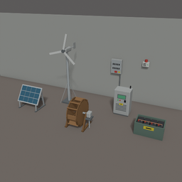
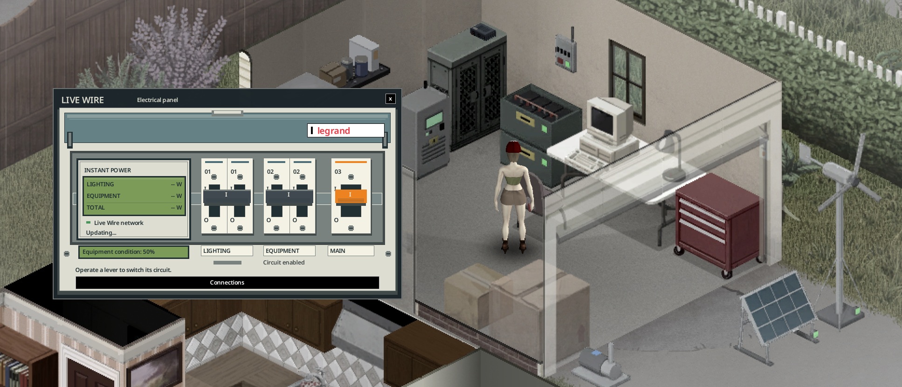

> Version française : [Accueil](../fr/Home.md)

# LiveWire

**LiveWire** (version 2.0.0, mod id `batman_LiveWire`, [Workshop item 3821807453](https://steamcommunity.com/sharedfiles/filedetails/?id=3821807453)) is a Project Zomboid **Build 42.21** mod (it runs on Build 42.22). It adds solar panels, wind turbines and water wheels, batteries in a power bank, an inverter that powers the house, and a water pump that feeds the taps from water barrels. The Electrical skill becomes a trade.

**LiveWire Extended** (version 1.0.0, `batman_LiveWireExtended`) is an optional add-on in the same Workshop item. It connects whole buildings, adds outdoor power terminals and breaker boards where each appliance has its own breaker. See [LiveWire Extended](14-livewire-extended.md).

**LiveWire - Viewpoint models** (version 2.0.0, `batman_LiveWireViewpoint`) is another optional mod in the same Workshop item. It adds 3D models of the devices, and of the LiveWire Extended power terminal and breaker boards, for Project Viewpoint; it does nothing without Project Viewpoint.

New here? Start with [Getting started](01-getting-started.md).

## Pages

- [Getting started](01-getting-started.md): your first source, your first inverter and the first link.
- [Equipment](02-equipment.md): every device, the batteries, placing, turning, picking up and dismantling.
- [Wiring](03-wiring.md): linking devices to an inverter, wire cost, ranges and the Connections window.
- [Production and calculations](04-production-and-calculations.md): what each source makes and what appliances use.
- [Inverter screen and software](05-inverter-screen-and-software.md): the inverter LCD, LiveWire Monitor, the hum, soundproofing and direct clicks.
- [Optional equipment](06-optional-equipment.md): breaker, low battery alarm, backup generator, management computer, coupled inverters and the two-circuit electrical panel.
- [Water pump](07-water-pump.md): water barrels that feed the house taps.
- [Recipes](08-recipes.md): every craft and dismantle recipe.
- [Loot tables](09-loot-tables.md): where devices and parts are found.
- [Electrical skill and maintenance](10-electrical-skill-and-maintenance.md): skill levels, wear, repair and cleaning.
- [Sandbox options](11-sandbox-options.md): every LiveWire option.
- [Multiplayer](12-multiplayer.md): dedicated servers and multiplayer rules.
- [FAQ](13-faq.md): common questions.
- [LiveWire Extended](14-livewire-extended.md): the optional add-on: whole buildings, outdoor terminals and breaker boards.

---

[Repository README](https://github.com/cyberbobjr/LiveWire) · [Licence (MIT)](https://github.com/cyberbobjr/LiveWire/blob/main/LICENSE)
