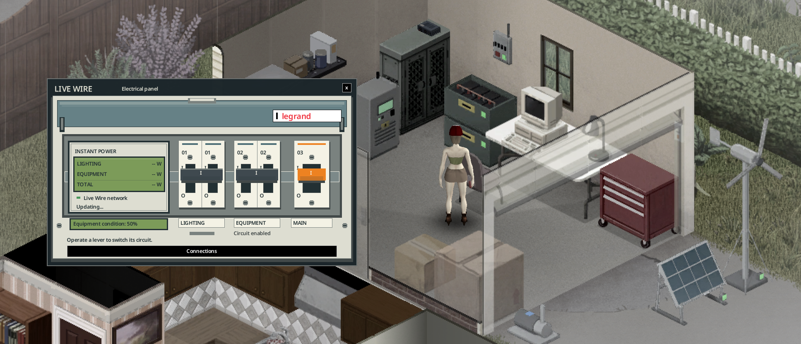
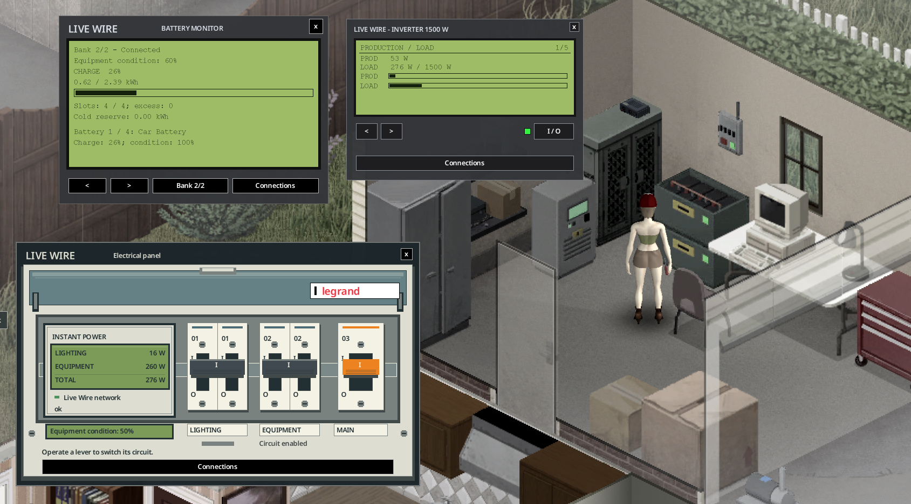

> Version française : [Accueil](../fr/Home.md)

# Live Wire

Live Wire is a Project Zomboid **Build 42.21** mod (mod id `batman_LiveWire`, [Workshop item 3821807453](https://steamcommunity.com/sharedfiles/filedetails/?id=3821807453)). It adds solar panels, wind turbines and water wheels, batteries in a power bank, an inverter that powers the house, and a water pump that feeds its taps from water barrels. The Electrical skill becomes a trade.

New here? Start with [Getting started](01-getting-started.md).

## Version 1.6.0

A substantial minor update: control lighting and appliances from a working electrical panel, open an LCD on each device and manage its connections from one window. Stack two power banks, inspect consumers and cable links, and plan production with the three-day forecast and event log.

Solar orientation and dirt, battery testing and repair, salvage, electrical work risks, revised recipes and broader equipment loot add more depth to the Electrical skill. See the [changelog](../../../CHANGELOG.md), [recipes](08-recipes.md) and [maintenance guide](10-electrical-skill-and-maintenance.md).

## Pages

- [Getting started](01-getting-started.md)
- [Equipment](02-equipment.md)
- [Wiring](03-wiring.md)
- [Production and calculations](04-production-and-calculations.md)
- [Inverter screen and software](05-inverter-screen-and-software.md)
- [Optional equipment](06-optional-equipment.md)
- [Water pump](07-water-pump.md)
- [Recipes](08-recipes.md)
- [Loot tables](09-loot-tables.md)
- [Electrical skill and maintenance](10-electrical-skill-and-maintenance.md)
- [Sandbox options](11-sandbox-options.md)
- [Multiplayer](12-multiplayer.md)
- [FAQ](13-faq.md)

---

[Repository README](https://github.com/cyberbobjr/LiveWire) · [Licence (MIT)](https://github.com/cyberbobjr/LiveWire/blob/main/LICENSE)
