<!-- generated by tools/make_doc_tables.py -->

## RECIPES

| Recipe | Ingredients | Tools (kept) | Skill | Result |
|---|---|---|---|---|
| Make Voltage Tester | 1 × 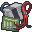 Scrap Electronics 1 ×  Electrical Wire 1 ×  Light Bulb 1 ×  Battery |  | Electrical 1 |  **Voltage Tester** |
| Make Solar Cell from Scrap | 5 ×  Scrap Electronics 1 ×  Aluminum Foil |   | Electrical 3 |  **Solar Cell** |
| Make Solar Panel | 10 ×  Solar Cell 1 ×  Steel Sheet 2 ×  Electrical Wire 4 × 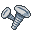 Screws 1 ×  Glue |   | Electrical 3 |  **Solar Panel** |
| Make Inverter | 4 ×  Scrap Electronics 2 ×  Amplifier 3 ×  Electrical Wire 1 ×  Steel Sheet - Small 4 ×  Screws |   | Electrical 3 |  **Inverter** |
| Build Inverter Cabinet | 1 ×  Inverter 4 ×  Scrap Electronics 2 ×  Amplifier 4 ×  Electrical Wire 1 ×  Steel Sheet 8 ×  Screws |   | Electrical 3 | 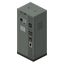 **Inverter Cabinet** |
| Make Wind Turbine Blades | 2 ×  Steel Sheet 2 ×  Screws |   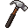 | none |  **Wind Turbine Blade Set** |
| Make Wind Turbine Mast | 1 ×  Iron Pipe 2 ×  Steel Rod 2 ×  Screws |    | none |  **Wind Turbine Mast** |
| Assemble Wind Turbine | 1 ×  Wind Turbine Blade Set 1 ×  Wind Turbine Mast 2 ×  Amplifier 3 ×  Electrical Wire 4 ×  Scrap Electronics 2 ×  Screws |   | Electrical 3 |  **Wind Turbine** |
| Make Water Wheel | 8 ×  Plank 20 × 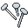 Nails 2 ×  Amplifier 3 ×  Electrical Wire 4 ×  Scrap Electronics 1 ×  Steel Rod |   | Electrical 4 |  **Water Wheel** |
| Make Power Bank | 2 ×  Scrap Electronics 3 ×  Electrical Wire 1 ×  Steel Sheet 4 ×  Screws |   | Electrical 2 |  **Power Bank** |
| Make Breaker Panel | 2 ×  Scrap Electronics 1 ×  Electrical Wire 1 ×  Steel Sheet - Small 2 ×  Screws |  | Electrical 3 |  **Breaker Panel** |
| Make Water Pump | 3 ×  Scrap Electronics 2 ×  Electrical Wire 2 ×  Iron Pipe 1 ×  Steel Sheet - Small 4 ×  Screws |   | Electrical 3 | 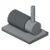 **Water Pump** |
| Make Inverter Coupling Kit | 2 ×  Scrap Electronics 2 ×  Electrical Wire 1 ×  Amplifier |  | Electrical 3 |  **Inverter Coupling Kit** |
| Make Deep-Cycle Battery | 2 ×  Car Battery (any) 2 ×  Electrical Wire 1 ×  Scrap Metal |   | Electrical 3 |  **Deep-Cycle Battery** |
| Make Low Battery Alarm | 1 ×  Scrap Electronics 1 ×  Electrical Wire 1 ×  Amplifier |  | Electrical 2 |  **Low Battery Alarm** |
| Make Inverter Soundproofing Kit | 4 ×  Plank 10 ×  Nails 4 × 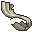 Rag |   | Electrical 2 |  **Inverter Soundproofing Kit** |

## DISMANTLING

| Recipe | Ingredients | Tools (kept) | Skill | Result |
|---|---|---|---|---|
| Dismantle Voltage Tester | 1 ×  Voltage Tester |  | none |  **Scrap Electronics** |
| Dismantle Solar Panel | 1 ×  Solar Panel |  | none | 1 ×  **Steel Sheet** 2 ×  **Screws** |
| Dismantle Wind Turbine | 1 ×  Wind Turbine |  | none | 1 ×  **Wind Turbine Blade Set** 1 ×  **Wind Turbine Mast** 1 ×  **Screws** |
| Dismantle Water Wheel | 1 ×  Water Wheel |   | none | 6 ×  **Plank** 10 ×  **Nails** 1 ×  **Steel Rod** |
| Dismantle Inverter | 1 ×  Inverter |  | none | 1 ×  **Steel Sheet - Small** 2 ×  **Screws** |
| Dismantle Inverter Cabinet | 1 ×  Inverter Cabinet |  | none | 1 ×  **Steel Sheet** 1 ×  **Steel Sheet - Small** 6 ×  **Screws** |
| Dismantle Power Bank | 1 ×  Power Bank |  | none | 1 ×  **Steel Sheet** 2 ×  **Screws** |
| Dismantle Breaker Panel | 1 ×  Breaker Panel |  | none | 1 ×  **Steel Sheet - Small** 1 ×  **Screws** |
| Dismantle Low Battery Alarm | 1 ×  Low Battery Alarm |  | none |  **Electrical Wire** |
| Dismantle Water Pump | 1 ×  Water Pump |   | none | 2 ×  **Iron Pipe** 1 ×  **Steel Sheet - Small** 2 ×  **Screws** |
| Dismantle Inverter Coupling Kit | 1 ×  Inverter Coupling Kit |  | none | 1 ×  **Amplifier** 1 ×  **Electrical Wire** 1 ×  **Scrap Electronics** |
| Dismantle Inverter Soundproofing Kit | 1 ×  Inverter Soundproofing Kit |   | none | 3 ×  **Plank** 5 ×  **Nails** 2 ×  **Rag** |

## RECIPES EXTENDED

| Recipe | Ingredients | Tools (kept) | Skill | Result |
|---|---|---|---|---|
| Make Power Terminal | 1 ×  Iron Pipe 1 ×  Steel Sheet - Small 2 ×  Electrical Wire 2 ×  Scrap Electronics 4 ×  Screws |  | Electrical 3 | 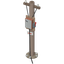 **Power Terminal** |
| Make Breaker Board (8 modules) | 2 ×  Steel Sheet - Small 2 ×  Electrical Wire 4 ×  Screws |  | Electrical 3 | 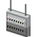 **Breaker Board (8 modules)** |
| Make Breaker Board (16 modules) | 3 ×  Steel Sheet - Small 2 ×  Electrical Wire 4 ×  Screws |  | Electrical 3 | 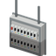 **Breaker Board (16 modules)** |
| Make Breaker Board (24 modules) | 4 ×  Steel Sheet - Small 2 ×  Electrical Wire 4 ×  Screws |  | Electrical 3 |  **Breaker Board (24 modules)** |
| Make Breaker 15 A | 1 ×  Scrap Electronics 1 ×  Electrical Wire 1 ×  Screws |  | Electrical 3 | 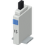 **Breaker 15 A** |
| Make Breaker 20 A | 2 ×  Scrap Electronics 1 ×  Electrical Wire 2 ×  Screws |  | Electrical 3 | 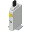 **Breaker 20 A** |
| Make Breaker 30 A | 3 ×  Scrap Electronics 2 ×  Electrical Wire 3 ×  Screws |  | Electrical 3 | 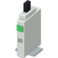 **Breaker 30 A** |
| Make Breaker Twilight Switch | 2 ×  Scrap Electronics 1 ×  Electrical Wire 1 ×  Screws |  | Electrical 3 | 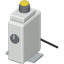 **Breaker Twilight Switch** |

## CELLS (x5)

| Vanilla list | Where | Weight (×5) | Rolls | ≈ chance per container |
|---|---|---|---|---|
| `GarageTools` | Garage tool storage | 10 | 4 | 21.9 % |
| `CrateTools` | Tool crates | 5 | 4 | 11.5 % |
| `GarageMetalwork` | Garage metalwork storage | 5 | 4 | 11.5 % |
| `MechanicShelfElectric` | Mechanic shop, electrical shelf | 10 | 4 | 21.9 % |
| `ElectricianTools` | Electrician's tools | 15 | 3 | 24.6 % |
| `MetalShopTools` | Metal shop tools | 5 | 4 | 11.5 % |
| `WireFactoryElectric` | Wire factory, electrical | 10 | 4 | 21.9 % |
| `ToolStoreMisc` | Hardware store, miscellaneous | 10 | 4 | 21.9 % |
| `CrateElectronics` | Electronics crates | 10 | 4 | 21.9 % |
| `ElectronicStoreMisc` | Electronics store, miscellaneous | 10 | 4 | 21.9 % |
| `ToolStoreMetalwork` | Hardware store, metalwork | 5 | 4 | 11.5 % |
| `CrateMetalwork` | Metalwork crates | 5 | 4 | 11.5 % |

## LOOT: Ready-made LiveWire equipment

Ready-made equipment, at the default EquipmentLootMultiplier = 5 (range 1–20). Estimates assume this loot list is selected, a vanilla loot modifier of 0.6, no zombie-density or time modifiers and enough container space; they are not a guaranteed discovery rate. LiveWire Extended equipment is in the same table.

| Equipment | Vanilla list | Where | Weight (×5) | Rolls | ≈ chance per container |
|---|---|---|---|---|---|
|  **Solar Cell** | `ElectricianTools` | Electrician's tools | 15 | 3 | 24.6 % |
|  | `GarageTools` | Garage tool storage | 10 | 4 | 21.9 % |
|  | `MechanicShelfElectric` | Mechanic shop, electrical shelf | 10 | 4 | 21.9 % |
|  | `WireFactoryElectric` | Wire factory, electrical | 10 | 4 | 21.9 % |
|  | `ToolStoreMisc` | Hardware store, miscellaneous | 10 | 4 | 21.9 % |
|  | `CrateElectronics` | Electronics crates | 10 | 4 | 21.9 % |
|  | `ElectronicStoreMisc` | Electronics store, miscellaneous | 10 | 4 | 21.9 % |
|  | `ElectricianTruckBed` | Electrician vehicle, truck bed or trunk | 10 | 4 | 21.9 % |
|  | `CrateTools` | Tool crates | 5 | 4 | 11.5 % |
|  | `GarageMetalwork` | Garage metalwork storage | 5 | 4 | 11.5 % |
|  | `MetalShopTools` | Metal shop tools | 5 | 4 | 11.5 % |
|  | `ToolStoreMetalwork` | Hardware store, metalwork | 5 | 4 | 11.5 % |
|  | `CrateMetalwork` | Metalwork crates | 5 | 4 | 11.5 % |
|  **Solar Panel** (furniture: × 0.6 included) | `GarageMetalwork` | Garage metalwork storage | 2.5 | 4 | 5.9 % |
|  | `ToolStoreMisc` | Hardware store, miscellaneous | 2.5 | 4 | 5.9 % |
|  | `CrateElectronics` | Electronics crates | 2.5 | 4 | 5.9 % |
|  | `ElectronicStoreMisc` | Electronics store, miscellaneous | 2.5 | 4 | 5.9 % |
|  | `ElectricianTruckBed` | Electrician vehicle, truck bed or trunk | 2.5 | 4 | 5.9 % |
|  | `GarageTools` | Garage tool storage | 1.5 | 4 | 3.6 % |
|  | `CrateTools` | Tool crates | 1.5 | 4 | 3.6 % |
|  | `ToolStoreTools` | Hardware store, tools | 1.5 | 4 | 3.6 % |
|  | `CrateMetalwork` | Metalwork crates | 1.5 | 4 | 3.6 % |
|  | `ToolStoreMetalwork` | Hardware store, metalwork | 1.5 | 4 | 3.6 % |
|  | `GarageMechanics` | Garage, mechanic storage | 1.5 | 4 | 3.6 % |
|  | `MetalWelderTruckBed` | Metalworker vehicle, truck bed or trunk | 1.5 | 4 | 3.6 % |
|  **Disk: LiveWire Management Software** (needs the Computer Mod) | `ElectronicStoreComputers` | Electronics store, computers | 2 | 1 | 1.2 % |
|  | `CrateComputer` | Computer crates | 2 | 4 | 4.7 % |
|  | `UniversityDesk_Electrical` | University desk, electrical | 2 | 4 | 4.7 % |
|  | `BookstoreComputer` | Bookstore, computers | 1 | 4 | 2.4 % |
|  | `UniversityDesk_Computer` | University desk, computers | 1 | 4 | 2.4 % |
|  | `OfficeDesk` | Office desk | 0.3 | 4 | 0.7 % |
|  **Voltage Tester** | `ElectricianTools` | Electrician's tools | 5 | 3 | 8.7 % |
|  | `ElectricianTruckBed` | Electrician vehicle, truck bed or trunk | 5 | 4 | 11.5 % |
|  | `WireFactoryElectric` | Wire factory, electrical | 2.5 | 4 | 5.9 % |
|  | `ToolStoreTools` | Hardware store, tools | 1.5 | 4 | 3.6 % |
|  | `ElectronicStoreMisc` | Electronics store, miscellaneous | 1.5 | 4 | 3.6 % |
|  | `CrateElectronics` | Electronics crates | 1.5 | 4 | 3.6 % |
|  | `MechanicShelfElectric` | Mechanic shop, electrical shelf | 1.5 | 4 | 3.6 % |
|  | `ElectricianGloveBox` | Electrician vehicle, glove box | 1.5 | 1 | 0.9 % |
|  | `GarageTools` | Garage tool storage | 1 | 4 | 2.4 % |
|  | `CrateTools` | Tool crates | 1 | 4 | 2.4 % |
|  **Deep-Cycle Battery** | `CarSupplyBatteries` | Car parts store, batteries | 10 | 4 | 21.9 % |
|  | `MechanicShelfElectric` | Mechanic shop, electrical shelf | 5 | 4 | 11.5 % |
|  | `CrateMechanics` | Mechanic supply crates | 3.5 | 4 | 8.1 % |
|  | `CrateElectronics` | Electronics crates | 2.5 | 4 | 5.9 % |
|  | `ElectronicStoreMisc` | Electronics store, miscellaneous | 2.5 | 4 | 5.9 % |
|  | `GarageMechanics` | Garage, mechanic storage | 1.5 | 4 | 3.6 % |
|  | `CampingStoreGear` | Camping store, gear | 1.5 | 4 | 3.6 % |
|  **Inverter** (furniture: × 0.6 included) | `ElectricianTools` | Electrician's tools | 2.5 | 3 | 4.4 % |
|  | `WireFactoryElectric` | Wire factory, electrical | 2.5 | 4 | 5.9 % |
|  | `CrateElectronics` | Electronics crates | 2.5 | 4 | 5.9 % |
|  | `ElectronicStoreMisc` | Electronics store, miscellaneous | 2.5 | 4 | 5.9 % |
|  | `ElectricianTruckBed` | Electrician vehicle, truck bed or trunk | 2.5 | 4 | 5.9 % |
|  | `ElectronicStoreAppliances` | Electronics store, appliances | 1.5 | 1 | 0.9 % |
|  | `MechanicShelfElectric` | Mechanic shop, electrical shelf | 1.5 | 4 | 3.6 % |
|  | `GarageMechanics` | Garage, mechanic storage | 1.5 | 4 | 3.6 % |
|  | `ToolStoreMisc` | Hardware store, miscellaneous | 1 | 4 | 2.4 % |
|  | `CrateTools` | Tool crates | 1 | 4 | 2.4 % |
|  | `GarageTools` | Garage tool storage | 0.5 | 4 | 1.2 % |
|  **Breaker Panel** (furniture: × 0.6 included) | `ElectricianTools` | Electrician's tools | 5 | 3 | 8.7 % |
|  | `WireFactoryElectric` | Wire factory, electrical | 5 | 4 | 11.5 % |
|  | `ElectricianTruckBed` | Electrician vehicle, truck bed or trunk | 5 | 4 | 11.5 % |
|  | `CrateElectronics` | Electronics crates | 3.5 | 4 | 8.1 % |
|  | `ToolStoreMisc` | Hardware store, miscellaneous | 2.5 | 4 | 5.9 % |
|  | `ElectronicStoreMisc` | Electronics store, miscellaneous | 2.5 | 4 | 5.9 % |
|  | `ToolStoreTools` | Hardware store, tools | 2.5 | 4 | 5.9 % |
|  | `GarageTools` | Garage tool storage | 1.5 | 4 | 3.6 % |
|  | `CrateTools` | Tool crates | 1.5 | 4 | 3.6 % |
|  | `CrateMetalwork` | Metalwork crates | 1.5 | 4 | 3.6 % |
|  | `GarageMechanics` | Garage, mechanic storage | 1.5 | 4 | 3.6 % |
|  | `GarageMetalwork` | Garage metalwork storage | 1.5 | 4 | 3.6 % |
|  **Power Bank** (furniture: × 0.6 included) | `ElectricianTools` | Electrician's tools | 2.5 | 3 | 4.4 % |
|  | `MechanicShelfElectric` | Mechanic shop, electrical shelf | 2.5 | 4 | 5.9 % |
|  | `CrateElectronics` | Electronics crates | 2.5 | 4 | 5.9 % |
|  | `ElectricianTruckBed` | Electrician vehicle, truck bed or trunk | 2.5 | 4 | 5.9 % |
|  | `ElectronicStoreMisc` | Electronics store, miscellaneous | 2 | 4 | 4.7 % |
|  | `ToolStoreMisc` | Hardware store, miscellaneous | 1.5 | 4 | 3.6 % |
|  | `CrateMechanics` | Mechanic supply crates | 1.5 | 4 | 3.6 % |
|  | `GarageTools` | Garage tool storage | 1 | 4 | 2.4 % |
|  | `GarageMechanics` | Garage, mechanic storage | 1 | 4 | 2.4 % |
|  | `CrateTools` | Tool crates | 1 | 4 | 2.4 % |
|  **Low Battery Alarm** (furniture: × 0.6 included) | `ElectricianTools` | Electrician's tools | 5 | 3 | 8.7 % |
|  | `WireFactoryElectric` | Wire factory, electrical | 5 | 4 | 11.5 % |
|  | `ElectricianTruckBed` | Electrician vehicle, truck bed or trunk | 5 | 4 | 11.5 % |
|  | `CrateElectronics` | Electronics crates | 3.5 | 4 | 8.1 % |
|  | `ToolStoreMisc` | Hardware store, miscellaneous | 2.5 | 4 | 5.9 % |
|  | `ElectronicStoreMisc` | Electronics store, miscellaneous | 2.5 | 4 | 5.9 % |
|  | `CrateTools` | Tool crates | 1.5 | 4 | 3.6 % |
|  | `GarageTools` | Garage tool storage | 1.5 | 4 | 3.6 % |
|  | `GarageMechanics` | Garage, mechanic storage | 1.5 | 4 | 3.6 % |
|  **Wind Turbine** (furniture: × 0.6 included) | `WireFactoryElectric` | Wire factory, electrical | 2.5 | 4 | 5.9 % |
|  | `ToolStoreMetalwork` | Hardware store, metalwork | 2.5 | 4 | 5.9 % |
|  | `WireFactoryTools` | Wire factory, tools | 2.5 | 4 | 5.9 % |
|  | `ToolStoreMisc` | Hardware store, miscellaneous | 1.5 | 4 | 3.6 % |
|  | `CrateElectronics` | Electronics crates | 1.5 | 4 | 3.6 % |
|  | `CrateMetalwork` | Metalwork crates | 1.5 | 4 | 3.6 % |
|  | `CrateTools` | Tool crates | 1.5 | 4 | 3.6 % |
|  | `CrateFarming` | Farming supply crates | 1.5 | 4 | 3.6 % |
|  | `ToolStoreFarming` | Hardware/outdoor store, farming | 1.5 | 4 | 3.6 % |
|  | `MechanicShelfTools` | Mechanic shop, tools | 1.5 | 4 | 3.6 % |
|  | `MetalWelderTruckBed` | Metalworker vehicle, truck bed or trunk | 1.5 | 4 | 3.6 % |
|  | `GarageMetalwork` | Garage metalwork storage | 1 | 4 | 2.4 % |
|  **Water Wheel** (furniture: × 0.6 included) | `CrateCarpentry` | Carpentry crates | 2.5 | 4 | 5.9 % |
|  | `ToolStoreCarpentry` | Hardware store, carpentry | 2.5 | 4 | 5.9 % |
|  | `CrateFarming` | Farming supply crates | 2.5 | 4 | 5.9 % |
|  | `ToolStoreFarming` | Hardware/outdoor store, farming | 1.5 | 4 | 3.6 % |
|  | `CrateTools` | Tool crates | 1.5 | 4 | 3.6 % |
|  | `CrateMechanics` | Mechanic supply crates | 1.5 | 4 | 3.6 % |
|  | `CrateMetalwork` | Metalwork crates | 1.5 | 4 | 3.6 % |
|  **Wind Turbine Blade Set** | `CrateMetalwork` | Metalwork crates | 5 | 4 | 11.5 % |
|  | `ToolStoreMetalwork` | Hardware store, metalwork | 5 | 4 | 11.5 % |
|  | `MetalWelderTruckBed` | Metalworker vehicle, truck bed or trunk | 5 | 4 | 11.5 % |
|  | `CrateTools` | Tool crates | 3.5 | 4 | 8.1 % |
|  | `CrateFarming` | Farming supply crates | 3.5 | 4 | 8.1 % |
|  | `ToolStoreFarming` | Hardware/outdoor store, farming | 3.5 | 4 | 8.1 % |
|  | `WireFactoryTools` | Wire factory, tools | 3.5 | 4 | 8.1 % |
|  | `GarageMetalwork` | Garage metalwork storage | 3.5 | 4 | 8.1 % |
|  **Wind Turbine Mast** | `CrateMetalwork` | Metalwork crates | 5 | 4 | 11.5 % |
|  | `ToolStoreMetalwork` | Hardware store, metalwork | 5 | 4 | 11.5 % |
|  | `MetalWelderTruckBed` | Metalworker vehicle, truck bed or trunk | 5 | 4 | 11.5 % |
|  | `CrateTools` | Tool crates | 3.5 | 4 | 8.1 % |
|  | `CrateMechanics` | Mechanic supply crates | 3.5 | 4 | 8.1 % |
|  | `CrateFarming` | Farming supply crates | 3.5 | 4 | 8.1 % |
|  | `ToolStoreFarming` | Hardware/outdoor store, farming | 3.5 | 4 | 8.1 % |
|  | `GarageMetalwork` | Garage metalwork storage | 3.5 | 4 | 8.1 % |
|  **Power Terminal** (furniture: × 0.6 included) | `ElectricianTools` | Electrician's tools | 1.5 | 3 | 2.7 % |
|  | `WireFactoryElectric` | Wire factory, electrical | 1.5 | 4 | 3.6 % |
|  | `ElectricianTruckBed` | Electrician vehicle, truck bed or trunk | 1.5 | 4 | 3.6 % |
|  | `ToolStoreMisc` | Hardware store, miscellaneous | 1.1 | 4 | 2.5 % |
|  | `CrateElectronics` | Electronics crates | 1.1 | 4 | 2.5 % |
|  **Breaker 15 A** | `ElectricianTools` | Electrician's tools | 4 | 3 | 7.0 % |
|  | `WireFactoryElectric` | Wire factory, electrical | 4 | 4 | 9.3 % |
|  | `ElectricianTruckBed` | Electrician vehicle, truck bed or trunk | 4 | 4 | 9.3 % |
|  | `ToolStoreMisc` | Hardware store, miscellaneous | 2.8 | 4 | 6.6 % |
|  | `CrateElectronics` | Electronics crates | 2.8 | 4 | 6.6 % |
|  | `GarageTools` | Garage tool storage | 1.6 | 4 | 3.8 % |
|  | `CrateTools` | Tool crates | 1.2 | 4 | 2.8 % |
|  | `GarageMetalwork` | Garage metalwork storage | 0.8 | 4 | 1.9 % |
|  **Breaker 20 A** | `ElectricianTools` | Electrician's tools | 4 | 3 | 7.0 % |
|  | `WireFactoryElectric` | Wire factory, electrical | 4 | 4 | 9.3 % |
|  | `ElectricianTruckBed` | Electrician vehicle, truck bed or trunk | 4 | 4 | 9.3 % |
|  | `ToolStoreMisc` | Hardware store, miscellaneous | 2.8 | 4 | 6.6 % |
|  | `CrateElectronics` | Electronics crates | 2.8 | 4 | 6.6 % |
|  | `GarageTools` | Garage tool storage | 1.6 | 4 | 3.8 % |
|  | `CrateTools` | Tool crates | 1.2 | 4 | 2.8 % |
|  | `GarageMetalwork` | Garage metalwork storage | 0.8 | 4 | 1.9 % |
|  **Breaker 30 A** | `ElectricianTools` | Electrician's tools | 2.5 | 3 | 4.4 % |
|  | `WireFactoryElectric` | Wire factory, electrical | 2.5 | 4 | 5.9 % |
|  | `ElectricianTruckBed` | Electrician vehicle, truck bed or trunk | 2.5 | 4 | 5.9 % |
|  | `ToolStoreMisc` | Hardware store, miscellaneous | 1.8 | 4 | 4.1 % |
|  | `CrateElectronics` | Electronics crates | 1.8 | 4 | 4.1 % |
|  | `GarageTools` | Garage tool storage | 1 | 4 | 2.4 % |
|  | `CrateTools` | Tool crates | 0.8 | 4 | 1.8 % |
|  | `GarageMetalwork` | Garage metalwork storage | 0.5 | 4 | 1.2 % |
|  **Breaker Board (8 modules)** (furniture: × 0.6 included) | `ElectricianTools` | Electrician's tools | 1 | 3 | 1.8 % |
|  | `WireFactoryElectric` | Wire factory, electrical | 1 | 4 | 2.4 % |
|  | `ToolStoreMisc` | Hardware store, miscellaneous | 0.7 | 4 | 1.7 % |
|  | `CrateElectronics` | Electronics crates | 0.7 | 4 | 1.7 % |
|  | `ElectricianTruckBed` | Electrician vehicle, truck bed or trunk | 0.5 | 4 | 1.2 % |
|  **Breaker Board (16 modules)** (furniture: × 0.6 included) | `ElectricianTools` | Electrician's tools | 0.6 | 3 | 1.1 % |
|  | `WireFactoryElectric` | Wire factory, electrical | 0.6 | 4 | 1.4 % |
|  | `ToolStoreMisc` | Hardware store, miscellaneous | 0.4 | 4 | 1.0 % |
|  | `CrateElectronics` | Electronics crates | 0.4 | 4 | 1.0 % |
|  | `ElectricianTruckBed` | Electrician vehicle, truck bed or trunk | 0.2 | 4 | 0.6 % |
|  **Breaker Board (24 modules)** (furniture: × 0.6 included) | `ElectricianTools` | Electrician's tools | 0.3 | 3 | 0.5 % |
|  | `WireFactoryElectric` | Wire factory, electrical | 0.3 | 4 | 0.7 % |
|  | `ToolStoreMisc` | Hardware store, miscellaneous | 0.2 | 4 | 0.5 % |
|  | `CrateElectronics` | Electronics crates | 0.2 | 4 | 0.5 % |
|  **Breaker Twilight Switch** | `ElectricianTools` | Electrician's tools | 0.8 | 3 | 1.3 % |
|  | `WireFactoryElectric` | Wire factory, electrical | 0.8 | 4 | 1.8 % |
|  | `ToolStoreMisc` | Hardware store, miscellaneous | 0.5 | 4 | 1.3 % |
|  | `CrateElectronics` | Electronics crates | 0.5 | 4 | 1.3 % |
|  | `ElectricianTruckBed` | Electrician vehicle, truck bed or trunk | 0.5 | 4 | 1.2 % |
