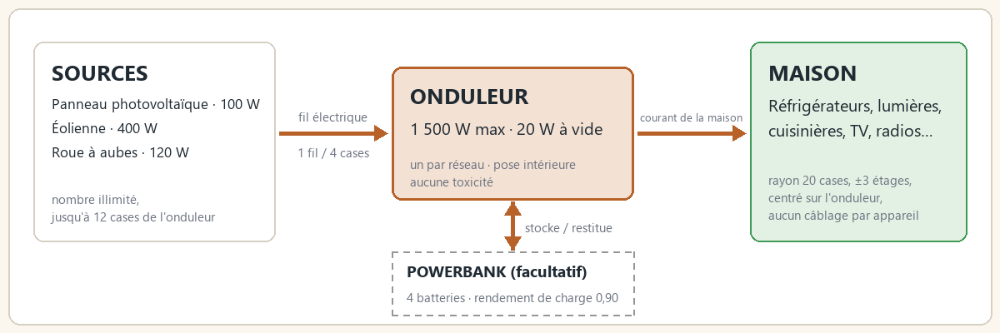
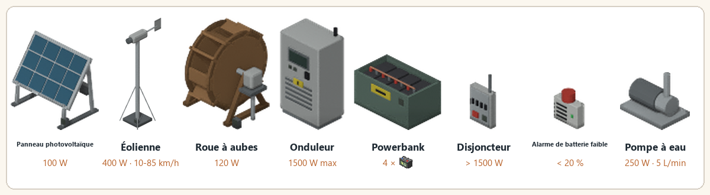

> English version: [Getting started](../en/01-getting-started.md)

# Premiers pas

**Live Wire** (`batman_LiveWire`) est un mod pour Project Zomboid, Build 42.21, traduit en anglais, français, allemand, espagnol, portugais (Brésil et Portugal), russe, chinois, japonais et coréen. La compétence Électricité devient un vrai métier : panneaux photovoltaïques, éoliennes et roues à aubes produisent un courant silencieux. Un onduleur placé dans la maison alimente tous les appareils alentour, sans carburant ni fumées. Des batteries rangées dans une powerbank stockent le surplus pour la nuit.

Le serveur fait autorité : le mod est conçu pour le multijoueur et les serveurs dédiés.

## Trois rôles, un réseau

| Rôle | Équipement | Détail |
|---|---|---|
| Produire | Panneau (100 W), éolienne (400 W), roue à aubes (120 W) | Nombre de sources illimité par onduleur, chacune à portée de câble (12 cases horizontalement et 3 étages d'écart au plus par défaut) |
| Stocker (facultatif) | Batteries de voiture ou batteries stationnaires dans une powerbank | 4 batteries comptées par powerbank, rendement de charge de 0,90, plusieurs powerbanks par onduleur |
| Convertir et distribuer | Onduleur | 1 500 W maximum pour la maison, 20 W de consommation à vide, rendement de 0,85 à 1,0 selon le niveau de l'installateur, un seul par réseau |
| Alimenter | La maison | Tout appareil branché à moins de 20 cases et ±3 étages de l'onduleur est alimenté (options vanilla GeneratorTileRange et GeneratorVerticalPowerRange) |

L'onduleur peut être posé à l'intérieur, sans toxicité : ce n'est pas un générateur du jeu. C'est le jeu lui-même qui décide ce qui est alimenté (une case est alimentée comme si elle était près d'un générateur) : frigos, lumières, cuisinières, télévisions et radios fonctionnent exactement comme en vanilla, sans câblage appareil par appareil.

## Installation minimale

Une source et un onduleur suffisent. Sans batterie, la maison ne tourne que sur la production du moment : par exemple, trois panneaux par temps clair font fonctionner un frigo-congélateur à midi, pas la nuit. Ajoutez une powerbank et des batteries pour la nuit (voir [Production et calculs](04-production-et-calculs.md) pour le dimensionnement).

## Eau courante (1.2.0)

Une pompe à eau raccordée à l'onduleur alimente les points d'eau de la maison depuis des barils posés à côté d'elle (récupérateurs d'eau de pluie vanilla ou Useful Barrels) : éviers, douches, baignoires et toilettes refonctionnent après la coupure d'eau. Détails dans [Pompe à eau](07-pompe-a-eau.md).

## Frigos pendant une absence

Frigos et congélateurs gardent la nourriture au froid pendant que vous êtes loin (zone déchargée), tant qu'il y a du courant. Vérifié en jeu : un steak frais dans un frigo alimenté, joueur à 300 cases, 10 heures de jeu : vieillissement de 0,083 jour (froid) au lieu de 0,417 jour (chaud).

Limite du moteur : l'état d'alimentation trouvé au rechargement de la zone compte pour toute la durée de l'absence.

## Étape par étape

1. **Trouver une source et un onduleur.** Des panneaux solaires et des onduleurs tout faits se trouvent dans les garages, les quincailleries et les rangements d'électricien ([Tables de butin](09-tables-de-butin.md)). On peut aussi les fabriquer dans la catégorie **Électricité** : panneau solaire au niveau 3 d'Électricité (10 cellules solaires, récupérées sur des calculatrices avec un tournevis), onduleur au niveau 5 ([Recettes](08-recettes.md)).
2. **Les poser** avec le curseur de meubles vanilla. Poser et ramasser demandent un tournevis et le niveau d'Électricité de l'appareil. Panneaux solaires, éoliennes et roues à aubes se posent dehors ; l'onduleur peut aller à l'intérieur.
3. **Raccorder la source** : clic droit dessus, **Live Wire**, puis **Raccorder à un onduleur** (ou, depuis l'onduleur, **Raccorder un équipement**). Il faut 1 fil électrique par tranche de 4 cases, arrondi au-dessus ([Raccordement](03-raccordement.md)).
4. **Vérifier** : l'onduleur démarre allumé. Son menu contextuel affiche la zone alimentée (un cercle cyan au sol) et ouvre son écran ([Écran et logiciel](05-ecran-et-logiciel.md)).
5. **Stocker pour la nuit** (facultatif) : une powerbank garnie de batteries de voiture ou à décharge profonde, raccordée de la même façon ([Équipements](02-equipements.md)).

> Capture à faire : le menu « Raccorder à un onduleur » d'un panneau solaire, avec le nombre de fils.

## Installation

Abonnez-vous au mod sur le Workshop Steam ([objet Workshop 3821807453](https://steamcommunity.com/sharedfiles/filedetails/?id=3821807453)), ou copiez `Contents/mods/batman_LiveWire` dans `Zomboid/mods`, puis activez `batman_LiveWire` (Build 42.21). Le Computer Mod (3725497089) et le Laptop Mod (3798992436) sont facultatifs ; leur intégration est décrite dans [Écran et logiciel](05-ecran-et-logiciel.md).

## Voir aussi

[Équipements](02-equipements.md) · [Raccordement](03-raccordement.md) · [Production et calculs](04-production-et-calculs.md) · [Multijoueur](12-multijoueur.md) · [FAQ](13-faq.md)
