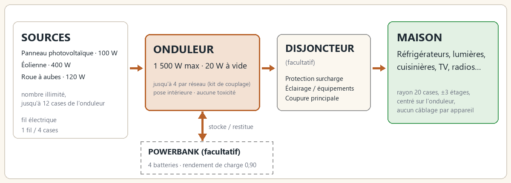
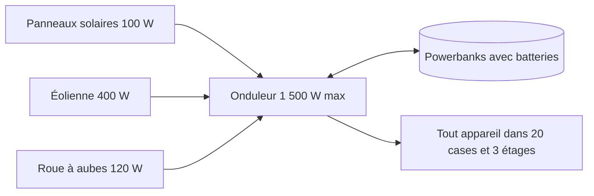
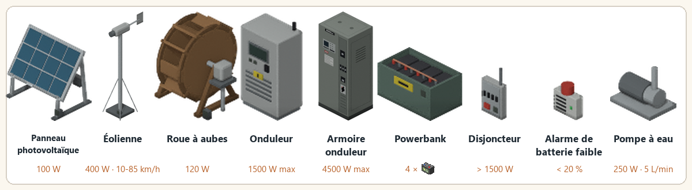
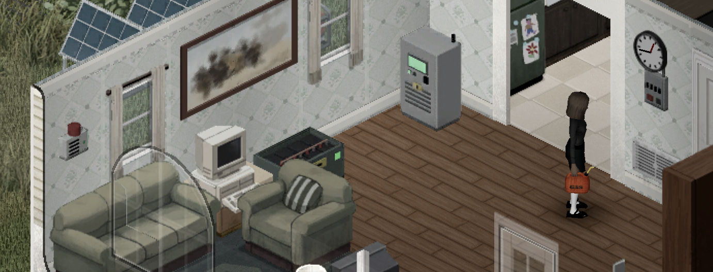

> English version: [Getting started](../en/01-getting-started.md)

# Premiers pas

**LiveWire** (`batman_LiveWire`) est un mod pour Project Zomboid, Build 42.21 (il fonctionne aussi en Build 42.22). La compétence Électricité devient un vrai métier : panneaux photovoltaïques, éoliennes et roues à aubes produisent un courant silencieux. Un onduleur placé dans la maison alimente tous les appareils alentour, sans carburant ni fumées. Des batteries rangées dans une powerbank stockent le surplus pour la nuit.

Le mod fonctionne en solo, sur un serveur dédié et en multijoueur. Le serveur décide de tout, donc les règles sont les mêmes pour chaque joueur.

L'interface est écrite en anglais et en français. Des fichiers de traduction existent aussi pour l'allemand, l'espagnol, le portugais (Brésil et Portugal), le russe, le chinois, le japonais, le coréen et le turc.

*Schéma : sources, onduleur, powerbank et maison.*

## Trois rôles, un réseau

| Rôle | Équipement | Détail |
|---|---|---|
| Produire | Panneau photovoltaïque (100 W), éolienne (400 W), roue à aubes (120 W) | Nombre de sources illimité par onduleur, chacune à portée de câble (12 cases horizontalement, et 3 étages au-dessus ou en dessous par défaut) |
| Stocker (facultatif) | Batteries de voiture ou batteries stationnaires dans une powerbank | 4 batteries comptées par powerbank, rendement de charge de 0,90, plusieurs powerbanks par onduleur |
| Convertir et distribuer | Onduleur : 1 500 W maximum pour la maison, 20 W de consommation à vide, rendement de 0,85 à 1,0 selon le niveau d'Électricité de celui qui a branché l'appareil | Un onduleur maître par réseau, avec jusqu'à 3 onduleurs couplés (4 onduleurs par réseau). Armoire onduleur : 4 500 W, 60 W à vide, fabriquée à partir d'un onduleur au niveau 3 d'Électricité. Les deux peuvent se poser à l'intérieur ; ce ne sont pas des générateurs, donc pas de fumées |
| Alimenter | La maison | Tout appareil branché à moins de 20 cases et à 3 étages près de l'onduleur est alimenté. Les valeurs viennent des options vanilla GeneratorTileRange et GeneratorVerticalPowerRange |

L'onduleur peut être posé à l'intérieur, sans toxicité : ce n'est pas un générateur du jeu. C'est le jeu lui-même qui décide ce qui est alimenté (une case est alimentée comme si elle était près d'un générateur) : frigos, lumières, cuisinières, télévisions et radios fonctionnent comme en vanilla, sans câblage appareil par appareil.

À l'intérieur d'un bâtiment, l'onduleur peut aussi puiser sur le réseau public tant que le courant est présent. Voir [Production et calculs](04-production-et-calculs.md#charge-des-batteries).

## Installation minimale

Une source et un onduleur suffisent. Sans batterie, la maison ne tourne que sur la production du moment : par exemple, trois panneaux par temps clair peuvent faire fonctionner un frigo-congélateur à midi, pas la nuit. Ajoutez une powerbank et des batteries pour la nuit (voir [Production et calculs](04-production-et-calculs.md) pour le dimensionnement).

## Frigos pendant une absence

Frigos et congélateurs gardent la nourriture au froid pendant que vous êtes loin (zone déchargée), tant qu'il y a du courant.

Limite du moteur : l'état d'alimentation trouvé au rechargement de la zone compte pour toute la durée de l'absence.

## Eau courante

Une pompe à eau raccordée à l'onduleur alimente les points d'eau de la maison depuis des barils posés à côté d'elle (récupérateurs d'eau de pluie vanilla ou Useful Barrels) : éviers, douches, baignoires et toilettes reçoivent de l'eau tant que le réseau a du courant. Détails dans [Pompe à eau](07-pompe-a-eau.md).

## Étape par étape

1. **Trouver une source et un onduleur.** Des panneaux solaires et des onduleurs tout faits se trouvent dans les garages, les quincailleries et les rangements d'électricien ([Tables de butin](09-tables-de-butin.md)). On peut aussi les fabriquer dans la catégorie **Électricité** : le kit de panneau solaire et le kit d'onduleur demandent le niveau 3 d'Électricité. Les cellules solaires, qui entrent dans le kit de panneau, se fabriquent à partir de Pièces électroniques ([Recettes](08-recettes.md)).
2. **Les poser** avec le curseur de meubles vanilla. Poser, tourner et ramasser demandent un **tournevis**, sans niveau d'Électricité. Brancher chaque appareil à l'onduleur demande un tournevis, des fils électriques et le niveau d'Électricité de l'appareil ([Raccordement](03-raccordement.md)). Les panneaux solaires et les éoliennes se posent dehors ; une roue à aubes se pose au rez-de-chaussée, au bord d'une rivière ; l'onduleur peut aller à l'intérieur.
3. **Raccorder la source** : clic droit dessus, **LiveWire**, puis **Raccorder à un onduleur** (ou, depuis l'onduleur, **Raccorder un équipement**). Il faut 1 fil électrique par tranche de 4 cases, arrondi au-dessus ([Raccordement](03-raccordement.md)).
4. **Vérifier** : le menu clic droit de l'onduleur affiche la zone alimentée (un cercle cyan au sol) et ouvre son écran ([Écran et logiciel](05-ecran-et-logiciel.md)).
5. **Stocker pour la nuit** (facultatif) : une powerbank garnie de batteries de voiture ou stationnaires, raccordée de la même façon ([Équipements](02-equipements.md)).

## Installation

Abonnez-vous au mod sur le Workshop Steam ([objet Workshop 3821807453](https://steamcommunity.com/sharedfiles/filedetails/?id=3821807453)), ou copiez `Contents/mods/batman_LiveWire` dans `Zomboid/mods`, puis activez `batman_LiveWire` (Build 42.21 ou suivante).

[LiveWire Extended](14-livewire-extended.md) est un module facultatif du même objet Workshop : activez `batman_LiveWireExtended` pour l'utiliser. Le Computer Mod (3725497089) et le Laptop Mod (3798992436) sont facultatifs ; leur intégration est décrite dans [Écran et logiciel](05-ecran-et-logiciel.md).

## Équipements en un coup d'œil

*Tous les équipements LiveWire et leurs chiffres.*

## Captures d'écran

Dehors : panneaux solaires et éolienne, avec leurs voyants verts « connecté », et le générateur de secours.

Dedans : l'onduleur (écran allumé), la powerbank, l'ordinateur, l'alarme murale et le disjoncteur.

## Voir aussi

[Équipements](02-equipements.md) · [Raccordement](03-raccordement.md) · [Production et calculs](04-production-et-calculs.md) · [Multijoueur](12-multijoueur.md) · [FAQ](13-faq.md) · [LiveWire Extended](14-livewire-extended.md)
