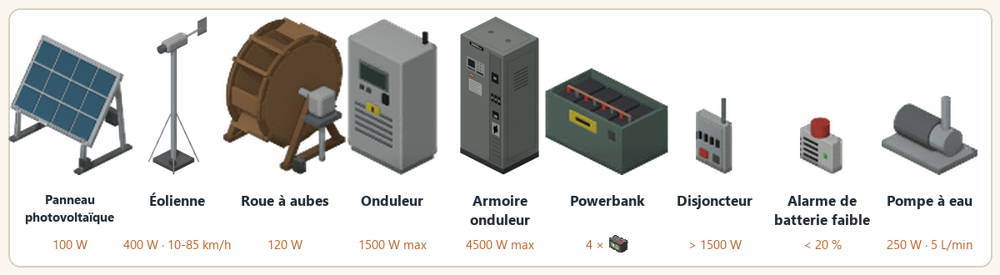
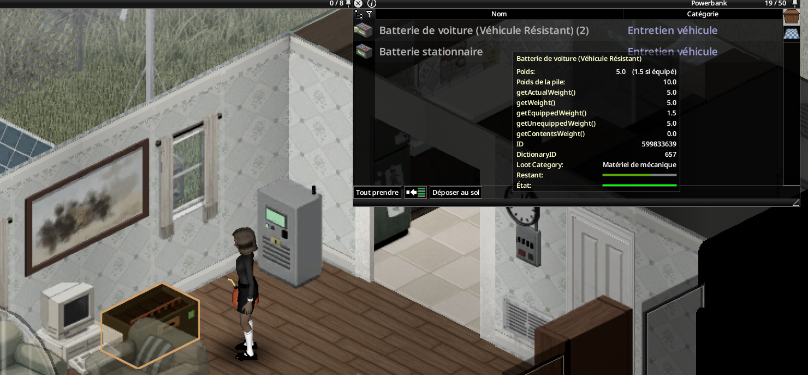

> English version: [Equipment](../en/02-equipment.md)

# Équipements

Chaque équipement est une vraie tuile du mod, posée comme un meuble vanilla. Chaque recette d'équipement donne un meuble posable `Base.Mov_LiveWire_*`. Les pièces et kits (cellules solaires, kits de couplage, kits d'insonorisation, etc.) sont des objets séparés.

## Tableau des équipements

| Équipement | Rôle | Pose | Niveau pour brancher |
|---|---|---|---|
| Panneau photovoltaïque | Source, 100 W | Dehors, sous ciel dégagé | 3 |
| Éolienne | Source, 400 W ; les pales tournent avec le vent | Dehors ; le vent est 15 % plus fort par étage, jusqu'au 3e | 2 |
| Roue à aubes | Source, 120 W jour et nuit ; la roue tourne avec la rivière | Rez-de-chaussée, au bord d'une rivière | 2 |
| Onduleur | Cœur du réseau, 1 500 W | Toute case de sol, intérieur compris | 3 |
| Armoire onduleur | Cœur du réseau, 4 500 W, 60 W à vide ; fabriquée à partir d'un onduleur | Toute case de sol, intérieur compris | 3 |
| Powerbank | Stockage, 4 batteries comptées ; s'ouvre comme une caisse (capacité 50) | Partout ; ramassée seulement vide | 2 |
| Disjoncteur | Sécurité, facultatif | Sur un mur (nord ou ouest) | 3 |
| Alarme de batterie faible | Alerte, facultatif | Sur un mur | 2 |
| Pompe à eau | Alimente les points d'eau de la maison depuis des barils, 250 W pendant le pompage | N'importe où, à côté de ses barils | 3 |

La dernière colonne donne le niveau nécessaire pour brancher l'équipement à un onduleur. Un onduleur demande en plus le niveau 3 pour son premier branchement, qui le met en service. La pose ne demande aucun niveau.

La fabrication demande davantage : le kit de roue à aubes exige le niveau 4 d'Électricité, et les autres kits demandent de 1 à 3 (voir [Recettes](08-recettes.md)).

Le mod facultatif Viewpoint affiche des modèles 3D de ces équipements (voir [Accueil](Home.md)).

## Batteries

Les batteries ne se posent jamais au sol : glissez-les dans la powerbank avec l'inventaire vanilla.

| Batterie | Capacité nominale | Durée de vie |
|---|---|---|
| Batterie de voiture `Base.CarBattery1` | 0,40 kWh | 150 cycles |
| Batterie de voiture `Base.CarBattery2` | 0,60 kWh | 150 cycles |
| Batterie de voiture `Base.CarBattery3` | 0,90 kWh | 150 cycles |
| Batterie stationnaire `LiveWire.DeepCycleBattery` | 1,50 kWh | 600 cycles |

Capacité effective = nominale × (0,4 + 0,6 × état/100) × BatteryCapacityMultiplier.

## Pièces

- Les **cellules solaires** (`LiveWire.SolarCell`) se fabriquent avec 5 × Pièces électroniques et de l'aluminium, au niveau 3 d'Électricité, avec un tournevis et une pince. Une calculatrice démontée avec la recette vanilla « Démonter un appareil électronique simple » donne aussi une cellule solaire.
- Le **kit de panneau solaire** demande 10 cellules solaires. Voir [Recettes](08-recettes.md) pour tous les kits.
- Les **pales et le mât d'éolienne** n'exigent aucun niveau d'Électricité. Les pales se fabriquent avec un tournevis, des cisailles à tôle et un marteau ; le mât avec un tournevis, un marteau et une clé à tuyau. Les deux entrent dans le kit d'éolienne.
- La **batterie stationnaire** (`LiveWire.DeepCycleBattery`) se fabrique au niveau 3 d'Électricité avec un tournevis et une pince, à partir de deux batteries de voiture, de fil électrique et de ferraille.

## Superposer deux powerbanks

Utilisez le curseur de pose de meubles pour poser une seconde powerbank sur la même case que la première : le fantôme apparaît au-dessus. Deux banques au maximum par pile, soit huit emplacements de batteries (quatre par banque).

Chaque banque possède son propre conteneur et son propre branchement à l'onduleur. Le bouton **Banque 1/2** ou **Banque 2/2** du LCD passe de la banque du bas à celle du haut et sélectionne son conteneur de butin. La liste des raccordements indique aussi le numéro de banque. Superposer ne crée ni batteries ni énergie. Pour déplacer ou ramasser la banque du bas, videz et ramassez d'abord celle du dessus.

## Voyants

- Onduleur et armoire onduleur : écran allumé en marche, voyant rouge en cas de défaut.
- Sources et powerbank : voyant vert « connecté ».
- Disjoncteur : vert quand la distribution est alimentée, rouge quand il a sauté. Un voyant vert ne prouve pas que le circuit est sûr à isoler pour un entretien.
- Alarme : gyrophare allumé pendant la sonnerie.
- Pompe à eau : voyant bleu lorsqu'elle est alimentée, même au repos.

## Règles de pose

- Poser, tourner et ramasser avec le curseur de meuble vanilla (fantôme, 4 orientations, 2 pour les objets muraux).
- Poser, tourner et ramasser demandent un **tournevis**, sans niveau d'Électricité.
- Brancher un équipement à un onduleur est expliqué dans [Raccordement](03-raccordement.md).
- Un appareil ramassé garde son état.
- Tourner un appareil vers une autre orientation garde le même appareil et ses liens. Ramassé ensuite, il revient comme son propre objet, avec son état.
- Panneau et éolienne : à l'extérieur, sous ciel ouvert.
- Roue à aubes : berge d'une rivière, rez-de-chaussée, à côté de l'eau de la rivière. Lacs, étangs et piscines sont refusés.
- Pompe à eau : n'importe où ; ses barils doivent être sur les 8 cases autour d'elle (voir [Pompe à eau](07-pompe-a-eau.md)).
- Une case refusée affiche la raison en rouge dans le panneau du curseur.

## Démontage

Chaque équipement, le kit de couplage, le kit d'insonorisation, les pales et le mât d'éolienne, et la batterie stationnaire ont une recette de démontage dans le menu de fabrication. Elle demande un tournevis (certaines recettes demandent aussi un marteau ou une clé à tuyau) et aucun niveau d'Électricité. On récupère des pièces métalliques, et des pièces électroniques selon l'état de l'objet : un équipement usé en rend moins. Un kit d'insonorisation ou de couplage posé sur un onduleur revient en entier.

Les cellules solaires ne se démontent pas.

## Voir aussi

[Raccordement](03-raccordement.md) · [Recettes](08-recettes.md) · [Équipements optionnels](06-equipements-optionnels.md) · [Compétence Électricité et entretien](10-competence-electricite-et-entretien.md) · [LiveWire Extended](14-livewire-extended.md)
