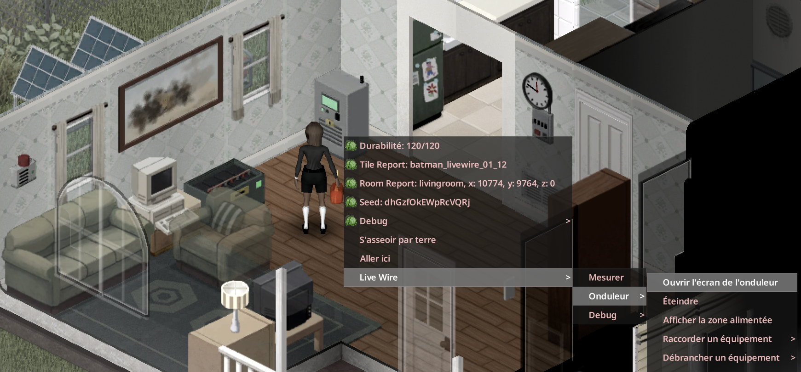

> English version: [Wiring](../en/03-wiring.md)

# Raccordement

Les équipements d'un réseau LiveWire se relient à l'onduleur par des fils électriques. La maison, elle, n'a besoin d'aucun câblage : tout appareil dans la zone alimentée par l'onduleur fonctionne.

## Pas à pas

1. Fabriquez les équipements ([Recettes](08-recettes.md)) et posez-les avec le curseur de meuble. Brancher un équipement demande un **tournevis**, des fils électriques et le niveau d'Électricité de l'équipement (voir le [tableau des équipements](02-equipements.md)). Mettre un onduleur en service par son premier branchement demande le niveau 3.
2. Clic droit sur un équipement, puis « LiveWire », puis le nom de l'équipement : le menu indique « Raccordé à l'onduleur à N cases » ou « Non raccordé ». Choisissez ensuite « Raccorder à un onduleur », avec une ligne par onduleur à portée : « Onduleur à N cases (k fil(s)) ».
3. Autre voie : clic droit sur l'onduleur, « Raccorder un équipement » (liste des équipements libres à portée, avec distance et fils) ; « Débrancher un équipement » fait l'inverse.

## Coût en fils

Un fil électrique `Base.ElectricWire` par tranche de 4 cases de distance, arrondi à l'entier supérieur, au moins 1 (option WirePerTiles ; 0 = câblage gratuit).

| Distance | Calcul | Fils |
|---|---|---|
| 4 cases | 4 / 4 = 1 | 1 |
| 9 cases | 9 / 4 = 2,25, arrondi | 3 |
| 12 cases | 12 / 4 = 3 | 3 |

## Portée et limites

| Règle | Valeur |
|---|---|
| Portée de câble | 12 cases horizontalement (option LinkRange, 4 à 30), et 3 étages au-dessus ou en dessous par défaut (option LinkVerticalRange, 0 à 10 ; 0 = même étage). S'applique aussi au couplage d'onduleurs |
| Onduleurs par réseau | Un onduleur maître, plus jusqu'à 3 onduleurs couplés (4 au total). Voir [Équipements optionnels](06-equipements-optionnels.md#onduleurs-en-parallèle-couplage) |
| Sources par onduleur | Illimitées |
| Powerbanks par onduleur | Plusieurs |
| Disjoncteur, alarme, ordinateur de gestion, générateur de secours | Un de chaque par réseau au plus |

## Générateur et ordinateur vanilla

Le générateur de secours et l'ordinateur de bureau sont des objets vanilla trouvés dans le monde, pas des recettes. Ils se raccordent depuis leur propre menu : « LiveWire », puis « Générateur de secours » ou « Ordinateur de gestion », puis « Raccorder à un onduleur ». Le menu du générateur de secours est décrit dans [Équipements optionnels](06-equipements-optionnels.md).

## Débrancher, ramasser et tourner

- Débrancher un équipement, ou le ramasser, rend ses fils électriques (« fil(s) électrique(s) récupéré(s) »).
- Ramasser l'onduleur déconnecte tout son réseau, et les fils de ce réseau reviennent.
- Tourner l'onduleur conserve ses liens.
- Ramasser une source conserve son état ; reposée, elle est « Non raccordé ».

## Menu de l'onduleur

Clic droit sur l'onduleur :

| Entrée | Effet |
|---|---|
| Ouvrir l'écran de l'onduleur | Ouvre l'écran LCD |
| Allumer / Éteindre | Marche / arrêt |
| Réarmer | Réarme après une disjonction |
| Afficher la zone alimentée | Cercle cyan au sol |
| Raccorder un équipement / Débrancher un équipement | Gérer les liens |
| Insonoriser l'onduleur (ou Retirer l'insonorisation) | Pose ou retrait du kit d'insonorisation |
| Inspecter | Inspection (expérience) |
| Réparer / Remettre à neuf | Réparation / remise à neuf |
| Renommer le réseau | Nom du réseau |

Un onduleur couplé à un maître affiche « Découpler » à la place des options de couplage.

## Tout raccorder depuis une seule fenêtre

Cliquez directement sur un équipement LiveWire proche, et son écran s'ouvre : l'onduleur ouvre son écran, une powerbank son LCD, un disjoncteur son tableau électrique. Les panneaux solaires, les éoliennes, les roues à aubes, les pompes et les alarmes ouvrent leur propre LCD. Chacun de ces écrans a un bouton **Raccordements** (sur l'onduleur, la powerbank et le disjoncteur, il est sur l'écran lui-même). Ce bouton ouvre la fenêtre commune.

Dans la fenêtre, choisissez un onduleur, sélectionnez un équipement, puis **Raccorder** ou **Débrancher**. Le personnage se déplace jusqu'à lui ; les fils et les règles de compétence restent nécessaires. La fenêtre reste ouverte pour les autres équipements. **Actualiser** recherche les équipements nouvellement posés. Les équipements raccordés à un autre réseau sont signalés : débranchez-les d'abord de ce réseau.

Le clic droit reste disponible. Le couplage des onduleurs et les barils de pompe conservent leurs options spécifiques.

## Voir aussi

[Équipements](02-equipements.md) · [Écran et logiciel](05-ecran-et-logiciel.md) · [Options sandbox](11-options-sandbox.md) · [LiveWire Extended](14-livewire-extended.md)
