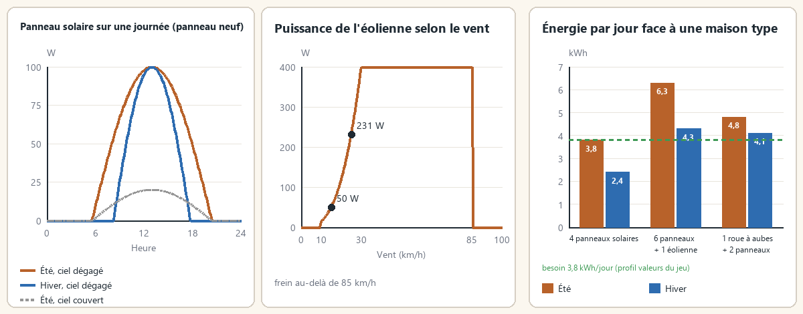
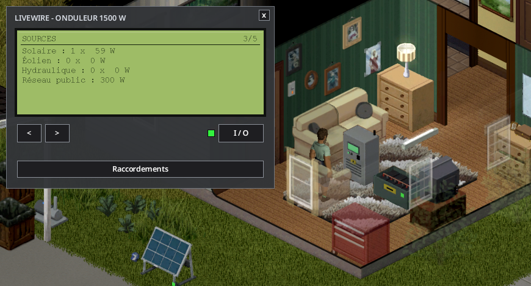

> English version: [Production and calculations](../en/04-production-and-calculations.md)

# Production et calculs

Les exemples solaires supposent des panneaux propres, déneigés et orientés au sud. Orientation, saleté et météo modifient le résultat réel.

Le serveur calcule tout toutes les 10 minutes de jeu, joueurs présents ou non (option SimulateUnloaded, activée par défaut). Les valeurs ci-dessous sont des valeurs de départ pour l'équilibrage.

*Journée solaire, courbe de l'éolienne et énergie par jour face à une maison type.*

## Puissance d'une source

P = nominale × facteur de source × facteur d'état × rendement d'installation × multiplicateur sandbox

Chaque source lisse sa sortie (réponse sur 30 minutes de jeu) : un nuage de passage ne fait pas clignoter la maison.

### Facteur d'état

Facteur d'état = 0,5 + 0,5 × état/100.

| État | Facteur |
|---|---|
| 100 | 1,000 |
| 75 | 0,875 |
| 50 | 0,750 |
| 25 | 0,625 |
| 0 | 0,500 |

### Rendement d'installation

Il est fixé au premier branchement de l'équipement à un onduleur, d'après le niveau d'Électricité de celui qui le branche.

| Niveau | Rendement |
|---|---|
| 0 à 6 | 0,85 |
| 7 à 8 | 0,95 |
| 9 à 10 | 1,0 |

## Solaire (100 W)

Courbe en sinus entre l'aube et le crépuscule de la saison. Les nuages laissent 20 % en ciel couvert (facteur × (1 − 0,8 × nuages)). La neige se dépose sur le panneau pendant une chute de neige et fond au-dessus de 0 °C (l'action « Déneiger » l'enlève à la main). Environ 0,93 kWh par jour d'été et 0,60 kWh en hiver (panneau neuf, ciel dégagé), avant rendement d'installation. Avec le rendement habituel de 0,85 (niveau 3 à 6 d'Électricité), cela fait environ 0,79 kWh et 0,51 kWh. La journée dure environ 14,6 heures au solstice d'été et 9,4 heures au solstice d'hiver (latitude du jeu : 38).

## Éolien (400 W)

0 sous 10 km/h ; (v / 30)³ entre 10 et 30 km/h ; 100 % de 30 à 85 km/h ; 0 au-dessus de 85 km/h (frein automatique). Le vent est 15 % plus fort par étage, jusqu'au 3e.

| Vent (km/h) | Part de la puissance nominale | Puissance |
|---|---|---|
| 0 | 0 % | 0 W |
| 10 | 4 % | environ 15 W |
| 15 | 13 % | environ 50 W |
| 20 | 30 % | environ 119 W |
| 25 | 58 % | environ 231 W |
| 30 | 100 % | 400 W |
| 60 | 100 % | 400 W |
| 85 | 100 % | 400 W |
| 90 | 0 % (frein) | 0 W |

## Roue à aubes (120 W)

Jour et nuit, environ 2,9 kWh par jour. Rivières seulement (le moteur ne sait pas distinguer le courant d'un lac). La roue tourne avec la rivière, plus vite au printemps et plus lentement en été.

| Saison | Coefficient | Puissance | kWh/jour |
|---|---|---|---|
| Printemps | × 1,2 | 144 W | environ 3,5 |
| Été | × 0,8 | 96 W | environ 2,3 |
| Automne | × 1,0 | 120 W | environ 2,9 |
| Hiver | × 1,0 | 120 W | environ 2,9 |

(Valeurs nominales, avant état et rendement d'installation.)

## Charge des batteries

- Surplus × 0,90 (rendement de charge).
- Autodécharge : 0,2 % par jour.
- Batterie pleine : la production en trop est perdue (affichée « Production perdue »).
- Capacité effective = nominale × (0,4 + 0,6 × état/100) × BatteryCapacityMultiplier.

### Réseau public

L'option sandbox `GridCharging` est activée par défaut. Tant que le réseau public fonctionne, un onduleur installé dans une pièce d'un bâtiment peut tirer du secteur jusqu'à un cinquième de sa puissance nominale (300 W pour un onduleur, 900 W pour une armoire onduleur). Ce courant couvre d'abord ce que les sources ne fournissent pas, puis recharge les batteries. Il n'est tiré que si besoin, donc rien n'est perdu. Le réseau s'arrête quand la coupure de courant vanilla du jeu prend effet.

Un onduleur cassé ne recharge ni depuis le réseau ni depuis les sources. Un onduleur éteint laisse ses sources recharger les batteries.

*Écran de l'onduleur, page 3 : le réseau public apparaît comme une source, à côté du panneau solaire.*

## Ordre d'alimentation de l'onduleur

L'onduleur couvre d'abord la demande avec la production du moment (× rendement), puis avec le réseau public tant qu'il fonctionne (option `GridCharging`), puis avec les batteries. Il ne peut redémarrer que si la production (réseau compris) couvre la demande, ou si les batteries contiennent plus de 2 % de leur capacité. La consommation des appareils dépend de l'option `ConsumptionProfile` (ci-dessous).

## Consommation des appareils

L'option sandbox **`ConsumptionProfile`** (« Profil de consommation ») fixe la puissance consommée par chaque appareil allumé. Ce sont des **moyennes sur un pas de 10 minutes**, pas des pointes au démarrage : le compresseur d'un frigo s'arrête et redémarre. Un frigo-congélateur qui tire 300 à 400 W quand il tourne consomme donc environ 130 W en moyenne.

| Appareil (allumé) | Ultra-réaliste 1993 | Réaliste 1993 | Valeurs du jeu (défaut) | Confort |
|---|---|---|---|---|
| Lumière (un interrupteur, donc une pièce) | 100 W | 60 W | 2 W | 1 W |
| Radio sur secteur | 40 W | 20 W | 10 W | 5 W |
| Télévision | 120 W | 80 W | 30 W | 15 W |
| Frigo seul ou congélateur seul | 130 W | 90 W | 80 W | 40 W |
| Frigo-congélateur | 180 W | 130 W | 130 W | 65 W |
| Cuisinière électrique | 3 000 W | 2 000 W | 90 W | 45 W |
| Micro-ondes | 1 500 W | 1 100 W | 90 W | 45 W |
| Lave-linge | 700 W | 500 W | 90 W | 45 W |
| Sèche-linge | 5 000 W | 3 000 W | 90 W | 45 W |
| Lave-linge séchant (lavage / séchage) | 700 / 3 000 W | 500 / 2 000 W | 90 W | 45 W |
| Lave-linge + sèche-linge superposés (par moitié en marche) | 700 + 5 000 W | 500 + 3 000 W | 900 + 900 W | 45 + 45 W |
| Chargeur de batterie de voiture | 250 W | 150 W | 50 W | 25 W |
| Appareil au gaz (commandes seulement) et appareils ajoutés par d'autres mods | valeur du jeu | valeur du jeu | valeur du jeu | moitié |

- **Valeurs du jeu** : celles du moteur, utilisées par le générateur vanilla (1 unité de puissance du moteur par heure = 1 000 W). Une base coûte donc autant sur un onduleur que sur un générateur vanilla. Elles sont très basses pour les lumières, les télévisions et les cuisinières. Le lave-linge + sèche-linge superposé vanilla est au contraire étrangement élevé (0,9 par moitié au lieu de 0,09).
- **Réaliste 1993** : consommations courantes d'un foyer de l'époque. Ampoules à incandescence de 60 W, téléviseur cathodique, frigo-congélateur des années 90 (environ 1 100 kWh par an), cuisinière et sèche-linge électriques en 240 V.
- **Ultra-réaliste 1993** : appareils plus anciens et plus gourmands. Plafonniers de 100 W, grand téléviseur cathodique, frigo des années 80, cuisinière et sèche-linge à pleine puissance.
- **Confort** : la moitié des valeurs du jeu, avec le lave-linge + sèche-linge superposé corrigé.
- `PowerScale` multiplie le résultat du profil (1 = aucun changement). L'onduleur consomme toujours 20 W à vide.
- Un appareil de plusieurs cases (grands frigos de magasin, cuisinières larges) compte une seule fois, sur sa première case : les autres cases du même meuble ne consomment rien.
- Le profil peut changer en cours de partie : la demande suit à la mesure suivante.

### Ce que changent les profils réalistes

La limite de l'onduleur reste **1 500 W** (4 500 W pour l'armoire onduleur ; les [onduleurs couplés](06-equipements-optionnels.md#onduleurs-en-parallèle-couplage) s'additionnent), dans l'ordre de grandeur des onduleurs autonomes des années 90. Avec les profils 1993 :

- Une cuisinière électrique (2 000 ou 3 000 W) ou un sèche-linge fait disjoncter un onduleur seul. Cuisinez au gaz, au poêle à bois ou au feu de camp, ou couplez des onduleurs. Un disjoncteur protège l'onduleur.
- Les lumières deviennent la principale charge de nuit : éteignez les pièces vides.

## Exemple de dimensionnement

Journée de référence : un frigo-congélateur toute la journée, 10 lumières pendant 6 heures, la télévision pendant 3 heures, plus l'onduleur à vide (20 W). Lumières et télévision servent la nuit. Une nuit d'hiver dure 14 heures. La demande du soir exclut la consommation à vide de l'onduleur (20 W) ; l'énergie par jour et la nuit d'hiver l'incluent. Les batteries pour la nuit sont l'énergie de la nuit d'hiver divisée par la capacité nominale d'une batterie neuve, arrondie au-dessus, sans pertes de charge.

| Profil | Demande le soir (hors à vide) | Énergie par jour | Nuit d'hiver | Batteries pour la nuit |
|---|---|---|---|---|
| Ultra-réaliste 1993 | 1 300 W | 11,2 kWh | 9,2 kWh | environ 16 batteries de voiture ou 7 stationnaires |
| Réaliste 1993 | 810 W | 7,4 kWh | 5,9 kWh | environ 10 batteries de voiture ou 4 stationnaires |
| Valeurs du jeu | 180 W | 3,8 kWh | 2,3 kWh | environ 4 batteries de voiture ou 2 stationnaires |
| Confort | 90 W | 2,1 kWh | 1,3 kWh | environ 3 batteries de voiture ou 1 stationnaire |

(Batterie de voiture standard : 0,6 kWh ; batterie stationnaire : 1,5 kWh ; batteries neuves en parfait état.)

Production des sources par jour, pour des équipements neufs, ciel dégagé, rendement d'installation de 0,85 (niveau 3 à 6 d'Électricité) et un vent stable de 25 km/h au niveau du sol (58 % de 400 W = 231 W, soit 196 W après rendement) :

- panneau solaire : environ 0,79 kWh en été et 0,51 kWh en hiver ;
- roue à aubes : environ 2,0 kWh en été (96 W) et 2,4 kWh en automne ou en hiver (120 W) ;
- éolienne : environ 4,7 kWh, les mêmes dans les deux saisons. Le vent réel varie, et une éolienne ne produit rien sous 10 km/h ni au-dessus de 85 km/h : le rendement réel diffère de ce chiffre à vent stable.

| Installation | Été (kWh/jour) | Hiver (kWh/jour) | Suffisant pour (à comparer à l'énergie par jour ci-dessus) |
|---|---|---|---|
| 4 panneaux | 3,2 | 2,0 | Confort en été, juste en dessous en hiver (2,1 nécessaires) |
| 6 panneaux + 1 éolienne | 9,5 | 7,8 | Réaliste 1993 dans les deux saisons |
| 1 roue à aubes + 8 panneaux | 8,3 | 6,5 | Réaliste 1993 en été, Valeurs du jeu en hiver |
| 2 roues à aubes + 9 panneaux | 11,0 | 9,5 | Réaliste 1993 dans les deux saisons ; Ultra-réaliste 1993 juste en dessous en été (11,2 nécessaires) |

## Combien de panneaux ?

Il n'y a pas de limite : les productions s'additionnent (100 W nominaux chacun). Le plafond de 1 500 W concerne la demande de la maison, pas la production.

## Orientation et entretien des panneaux

Avec l'option sandbox `SolarOrientation` activée (par défaut), le sud donne 100 %, l'est et l'ouest 85 % (avec un pic de production plus tôt ou plus tard), et le nord 55 %. L'inspection d'un panneau indique son orientation, sa saleté et sa neige. L'option `SolarDirt` ajoute une lente accumulation de poussière (plus rapide en automne) ; la pluie aide à la nettoyer.

Deux actions nettoient un panneau. **Nettoyer le panneau** utilise un chiffon et 0,5 L d'eau, et retire la saleté et la neige. **Déneiger** retire seulement la neige.

Une éolienne freinée a un voyant de connexion qui clignote.

## Voir aussi

[Équipements](02-equipements.md) · [Compétence Électricité et entretien](10-competence-electricite-et-entretien.md) · [Options sandbox](11-options-sandbox.md) · [Équipements optionnels](06-equipements-optionnels.md)
