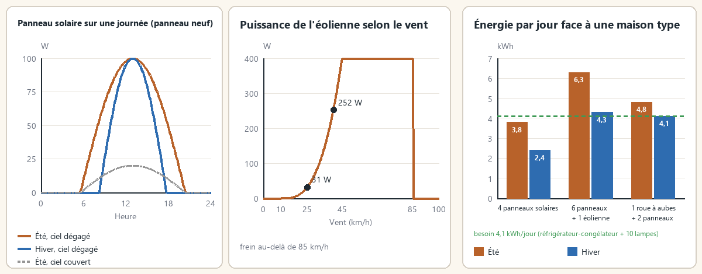

> English version: [Production and calculations](../en/04-production-and-calculations.md)

# Production et calculs

Les exemples solaires supposent des panneaux propres, déneigés et orientés au sud. Orientation, saleté et météo modifient le résultat réel.

Le serveur calcule tout toutes les 10 minutes de jeu, joueurs présents ou non (option SimulateUnloaded, activée par défaut). Cette page détaille le modèle.

## Puissance d'une source

P = nominale × facteur de source × facteur d'état × rendement de pose × multiplicateur sandbox

Chaque source lisse sa sortie (réponse sur 30 minutes de jeu) : un nuage de passage ne fait pas clignoter la maison.

### Facteur d'état

Facteur d'état = 0,5 + 0,5 × état/100.

| État | Facteur |
|---|---|
| 100 | 1,000 |
| 75 | 0,875 |
| 50 | 0,750 |
| 25 | 0,625 |
| 0 | 0,500 |

### Rendement de pose

Il dépend du niveau d'Électricité de l'installateur au moment de la pose.

| Niveau | Rendement |
|---|---|
| 3 à 6 | 0,85 |
| 7 à 8 | 0,95 |
| 9 à 10 | 1,0 |

## Solaire (100 W)

Courbe en sinus entre l'aube et le crépuscule de la saison. Les nuages laissent 20 % en ciel couvert (facteur × (1 − 0,8 × nuages)). La neige se dépose sur le panneau pendant une chute de neige et fond au-dessus de 0 °C (action « Déneiger »). Environ 0,94 kWh par jour d'été et 0,60 kWh en hiver (panneau neuf, ciel dégagé).

## Éolien (400 W)

0 sous 10 km/h ; ((v − 10) / 35)³ entre 10 et 45 km/h ; 100 % de 45 à 85 km/h ; 0 au-dessus de 85 km/h (frein automatique). Le vent gagne 15 % par étage, jusqu'au 3e.

| Vent (km/h) | Part de la puissance nominale | Puissance |
|---|---|---|
| 0 | 0 % | 0 W |
| 10 | 0 % | 0 W |
| 20 | 2 % | environ 9 W |
| 25 | 8 % | environ 31 W |
| 30 | 19 % | environ 75 W |
| 40 | 63 % | environ 252 W |
| 45 | 100 % | 400 W |
| 60 | 100 % | 400 W |
| 85 | 100 % | 400 W |
| 90 | 0 % (frein) | 0 W |

## Roue à aubes (120 W)

Jour et nuit, environ 2,9 kWh par jour. Rivières seulement (le moteur ne sait pas distinguer le courant d'un lac).

| Saison | Coefficient | Puissance | kWh/jour |
|---|---|---|---|
| Printemps | × 1,2 | 144 W | environ 3,5 |
| Été | × 0,8 | 96 W | environ 2,3 |
| Automne | × 1,0 | 120 W | environ 2,9 |
| Hiver | × 1,0 | 120 W | environ 2,9 |

(Valeurs nominales, avant état et rendement de pose.)

## Charge des batteries

- Surplus × 0,90 (rendement de charge).
- Autodécharge : 0,2 % par jour.
- Batterie pleine : la production en trop est perdue (affichée « Production perdue »).
- La consommation des appareils dépend de l'option `ConsumptionProfile` (ci-dessous).

## Ordre d'alimentation de l'onduleur

L'onduleur couvre d'abord la demande avec la production du moment (× rendement), puis avec les batteries. Il ne peut redémarrer que si la production couvre la demande ou si les batteries contiennent plus de 2 % de leur capacité. La limite de 1 500 W s'applique à la demande de la maison, pas à la production.

## Consommation des appareils

L'option sandbox **`ConsumptionProfile`** (« Profil de consommation ») fixe la puissance consommée par chaque appareil allumé. Ce sont des **moyennes sur un pas de 10 minutes**, pas des pointes au démarrage : le compresseur d'un frigo s'arrête et redémarre. Un frigo-congélateur qui tire 300 à 400 W quand il tourne consomme donc environ 130 W en moyenne.

| Appareil (allumé) | Ultra-réaliste 1993 | Réaliste 1993 | Valeurs du jeu (défaut) | Confort |
|---|---|---|---|---|
| Lumière (un interrupteur, donc une pièce) | 100 W | 60 W | 2 W | 1 W |
| Radio sur secteur | 40 W | 20 W | 10 W | 5 W |
| Télévision | 120 W | 80 W | 30 W | 15 W |
| Frigo seul ou congélateur seul | 130 W | 90 W | 80 W | 40 W |
| Frigo-congélateur | 180 W | 130 W | 130 W | 65 W |
| Cuisinière électrique | 3 000 W | 2 000 W | 90 W | 45 W |
| Micro-ondes | 1 500 W | 1 100 W | 90 W | 45 W |
| Lave-linge | 700 W | 500 W | 90 W | 45 W |
| Sèche-linge | 5 000 W | 3 000 W | 90 W | 45 W |
| Lave-linge séchant (lavage / séchage) | 700 / 3 000 W | 500 / 2 000 W | 90 W | 45 W |
| Lave-linge + sèche-linge superposés (par moitié en marche) | 700 + 5 000 W | 500 + 3 000 W | 900 + 900 W | 45 + 45 W |
| Chargeur de batterie de voiture | 250 W | 150 W | 50 W | 25 W |
| Appareil au gaz (commandes seulement) et appareils ajoutés par d'autres mods | valeur du jeu | valeur du jeu | valeur du jeu | moitié |

- **Valeurs du jeu** : celles du moteur, utilisées par le générateur vanilla (1 unité de puissance du moteur par heure = 1 000 W). Une base coûte donc autant sur un onduleur que sur un générateur vanilla. Elles sont très basses pour les lumières, les télévisions et les cuisinières. Le lave-linge + sèche-linge superposé vanilla est au contraire étrangement élevé (0,9 par moitié au lieu de 0,09).
- **Réaliste 1993** : consommations courantes d'un foyer de l'époque. Ampoules à incandescence de 60 W, téléviseur cathodique de 63 cm, frigo-congélateur des années 90 (environ 1 100 kWh par an), cuisinière et sèche-linge électriques en 240 V.
- **Ultra-réaliste 1993** : appareils plus anciens et plus gourmands. Plafonniers de 100 W, grand téléviseur cathodique, frigo des années 80, cuisinière et sèche-linge à pleine puissance.
- **Confort** : la moitié des valeurs du jeu, avec le lave-linge + sèche-linge superposé corrigé.
- `PowerScale` multiplie le résultat du profil (1 = aucun changement). L'onduleur consomme toujours 20 W à vide.
- Un appareil de deux cases avec un frigo ou un congélateur sur chacune (grands frigos de magasin) compte deux fois, comme avec un générateur vanilla : c'est un appareil plus gros.
- Le profil peut changer en cours de partie : la demande suit à la mesure suivante.

### Ce que changent les profils réalistes

La limite de l'onduleur reste **1 500 W** (jusqu'à 6 000 W avec des [onduleurs couplés](06-equipements-optionnels.md)), dans l'ordre de grandeur des onduleurs autonomes des années 90. Avec les profils 1993 :

- Une cuisinière électrique (2 000 ou 3 000 W) ou un sèche-linge fait disjoncter un onduleur seul. Cuisinez au gaz, au poêle à bois ou au feu de camp, ou couplez des onduleurs. Un disjoncteur protège l'onduleur.
- Les lumières deviennent la principale charge de nuit : éteignez les pièces vides.

## Exemple de dimensionnement

Journée de référence : un frigo-congélateur toute la journée, 10 lumières pendant 6 heures, la télévision pendant 3 heures, plus l'onduleur à vide (20 W). Lumières et télévision servent la nuit. Une nuit d'hiver dure 14 heures.

| Profil | Demande le soir | Énergie par jour | Nuit d'hiver | Batteries pour la nuit |
|---|---|---|---|---|
| Ultra-réaliste 1993 | 1 300 W | 11,2 kWh | 9,2 kWh | environ 16 batteries de voiture ou 7 stationnaires |
| Réaliste 1993 | 810 W | 7,4 kWh | 5,9 kWh | environ 10 batteries de voiture ou 4 stationnaires |
| Valeurs du jeu | 180 W | 3,8 kWh | 2,3 kWh | environ 4 batteries de voiture ou 2 stationnaires |
| Confort | 90 W | 2,1 kWh | 1,3 kWh | environ 3 batteries de voiture ou 1 stationnaire |

(Batterie de voiture standard : 0,6 kWh ; batterie stationnaire : 1,5 kWh ; batteries neuves en parfait état.)

Production d'hiver des sources : panneau solaire environ 0,6 kWh/jour, roue à aubes environ 2,9 kWh/jour, éolienne environ 0,7 kWh/jour avec un vent moyen de 25 km/h.

| Installation | Été (kWh/jour) | Hiver (kWh/jour) | Suffisant pour |
|---|---|---|---|
| 4 panneaux | 3,8 | 2,4 | Confort |
| 6 panneaux + 1 éolienne | 6,3 | 4,3 | Valeurs du jeu |
| 1 roue à aubes + 8 panneaux | 9,8 | 7,7 | Réaliste 1993 |
| 2 roues à aubes + 9 panneaux | 13,1 | 11,2 | Ultra-réaliste 1993 (tout juste) |

## Combien de panneaux ?

Il n'y a pas de limite : les productions s'additionnent (100 W nominaux chacun). Le plafond de 1 500 W concerne la demande de la maison, pas la production.

## Orientation et entretien des panneaux

L'orientation visible de la tuile compte : sud 100 %, est et ouest 85 % avec un
décalage de production de deux heures, nord 55 %. L'inspection indique orientation,
saleté et neige. La saleté réduit la production, s'accumule plus vite en automne
et diminue sous la pluie. Nettoyer demande un chiffon conservé et 0,5 L d'eau ;
le nettoyage retire saleté et neige. La suie des incendies n'est pas modélisée.

Le frein conserve ses commandes existantes et arrête la production de l'éolienne.
Le voyant clignote lorsque le frein est serré ; le journal avertit une fois par
épisode orageux si une éolienne tourne librement.

## Voir aussi

[Équipements](02-equipements.md) · [Compétence Électricité et entretien](10-competence-electricite-et-entretien.md) · [Options sandbox](11-options-sandbox.md) · [Multijoueur](12-multijoueur.md)
