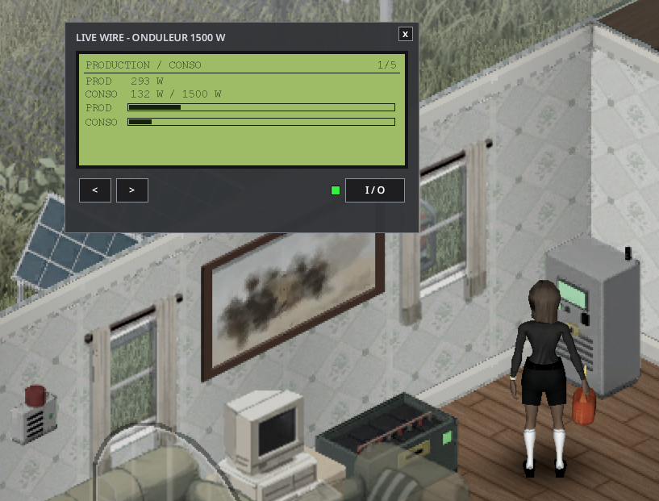
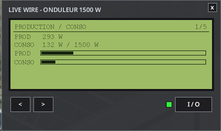
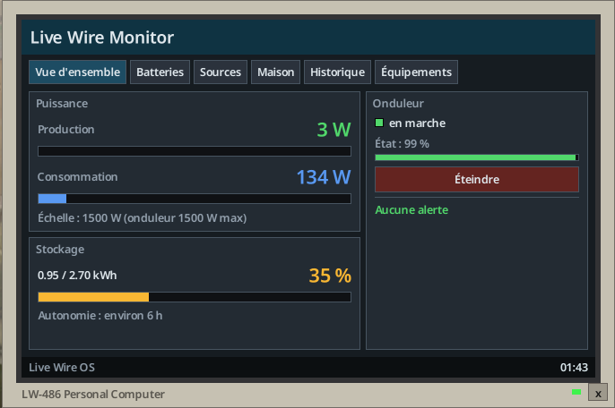
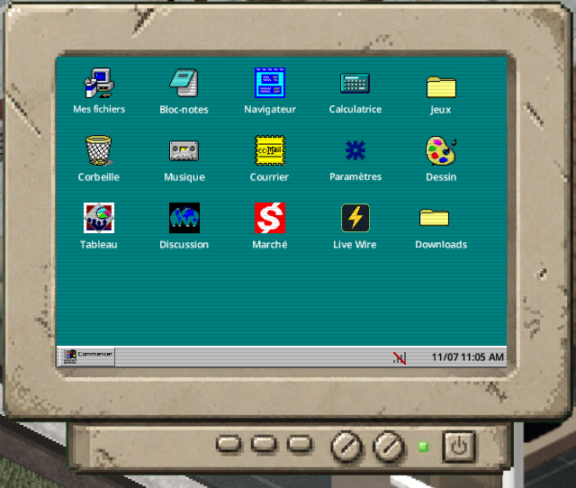
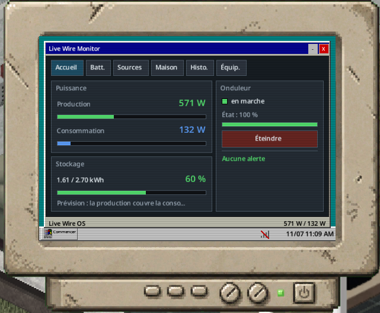
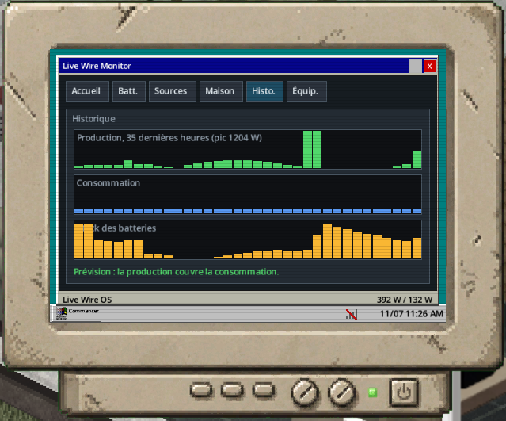
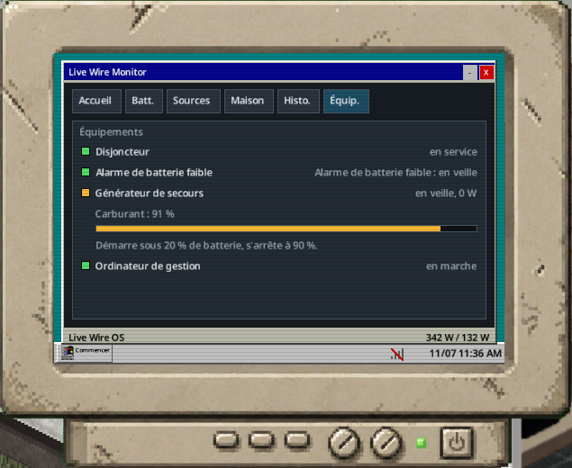

> English version: [Inverter screen and software](../en/05-inverter-screen-and-software.md)

# Écran de l'onduleur et logiciel

On peut suivre le réseau depuis l'écran LCD de l'onduleur, ou depuis le logiciel de gestion **LiveWire Monitor**.

## Écran LCD

Clic droit sur l'onduleur, puis « Ouvrir l'écran de l'onduleur ». Écran rétroéclairé de 5 pages, que l'on parcourt avec les boutons < et > :

| Page | Contenu |
|---|---|
| 1 | Production / conso ; ligne SECTEUR quand l'onduleur tire du réseau public |
| 2 | Batteries |
| 3 | Sources ; ligne « Réseau public » quand l'onduleur peut s'en servir (option `GridCharging`, dans un bâtiment) |
| 4 | Maison |
| 5 | État |

- Le bouton **I/O** a un voyant : vert = allumé, rouge = éteint, orange clignotant = défaut.
- Le bouton **RAZ** est disponible quand l'onduleur a sauté.
- Les barres de production et de charge utilisent la même échelle. Les longues lignes défilent d'avant en arrière. Un texte raccourci se termine par trois points.

## Taille des fenêtres et police

Les fenêtres LiveWire (onduleur, powerbank, équipement, raccordements, disjoncteur, écran du logiciel de l'ordinateur) suivent la taille de police du jeu. À l'ouverture, une fenêtre est agrandie à partir de la taille de la police « Small », puis réduite si besoin pour tenir à l'écran. Un changement de police s'applique après le redémarrage du jeu.

## Logiciel « LiveWire Monitor »

| Onglet | Contenu |
|---|---|
| Vue d'ensemble | Production et consommation en grands chiffres, barres à la même échelle, jauge de stockage et autonomie, fiche de l'onduleur (voyant, état, On/Off, Reset), alertes |
| Batteries | État des batteries |
| Sources | Détail des sources |
| Maison | Détail de la maison |
| Historique | Graphiques sur 48 h (production, consommation, stock des batteries) et prévision « les batteries tiendront jusqu'au lever du jour » ; exige un ordinateur de gestion relié |
| Équipements | Disjoncteur, alarme, générateur de secours, ordinateur, et nombre de pompes en service avec leur débit |
| Consommateurs | Consommation mesurée des appareils, 200 entrées au maximum |
| Prévisions | Production estimée sur trois jours d'après la météo ; ordinateur de gestion alimenté requis |
| Événements | Les 30 derniers événements horodatés du réseau |

L'historique et la prévision demandent un ordinateur de gestion relié (voir [Équipements optionnels](06-equipements-optionnels.md)).

Le nom du réseau se change avec **Renommer le réseau** (dans le menu clic droit de l'onduleur ou dans le logiciel). Le nom apparaît dans le logiciel et dans les alertes de batterie faible.

### Sans Computer Mod

Un ordinateur de bureau vanilla relié à l'onduleur ouvre le logiciel sur l'écran propre au mod (moniteur, écran de démarrage « LiveWire OS », barre d'état avec l'heure du jeu).

*Logiciel de gestion sur un ordinateur vanilla, sans Computer Mod ni Laptop Mod.*

### Avec Computer Mod ou Laptop Mod

Avec le Computer Mod facultatif (Workshop 3725497089) ou le Laptop Mod (3798992436), le logiciel arrive sur un disque : « Disque : logiciel de gestion LiveWire » (`LiveWire.MonitorDisk`), trouvé dans le butin d'ordinateurs ([Tables de butin](09-tables-de-butin.md)).

1. Clic droit sur l'ordinateur, le disque en main.
2. Choisissez « Installer le logiciel LiveWire ».
3. Il apparaît comme application « LiveWire » sur leur bureau et s'exécute dans leur fenêtre (barre de titre, réduire, fermer, barre des tâches).

Il montre l'onduleur relié à cet ordinateur, ou à défaut l'onduleur le plus proche à portée de câble.

## Bourdonnement de l'onduleur

Un son propre au mod, audible seulement à une case autour d'un onduleur allumé (même étage). Chaque joueur règle son volume dans Options, Mods, LiveWire (0 = coupé, de 0 à 100). Les zombies entendent l'onduleur à 2 cases (option InverterNoiseRadius ; 0 = silencieux).

## Kit d'insonorisation

Le kit d'insonorisation (`LiveWire.SoundproofKit`, niveau 2 d'Électricité) se pose sur l'onduleur avec « Insonoriser l'onduleur », et se retire avec « Retirer l'insonorisation » ; le kit est rendu.

| Effet | Valeur |
|---|---|
| Bourdonnement | Aucun |
| Zombies | N'entendent pas l'onduleur |
| Température et usure | L'onduleur chauffe davantage et s'use 25 % plus vite |
| Aspect | Mousse acoustique grise sur le dessus, les côtés et l'arrière ; « Insonorisé » à l'inspection et sur la page État |

Le kit suit l'onduleur quand on le ramasse.

## Consommateurs, câblage, événements et prévisions

L'onduleur propose des interrupteurs pour la carte des charges (silhouettes colorées des appareils) et pour la vue du câblage (tirets entre les étages). Les charges vertes sont sous 50 W, les orange jusqu'à 300 W, les rouges au-dessus ; le gris appartient à un autre onduleur.

Le logiciel ajoute les consommateurs par pages, les 30 derniers événements horodatés, et une prévision de production sur trois jours quand un ordinateur de gestion est alimenté. Les prévisions tiennent compte de l'orientation actuelle des panneaux, de la saleté, de la neige, de l'état des sources et des freins des éoliennes ; l'entretien est supposé inchangé. Une estimation ne peut garantir ni la météo, ni l'entretien futur, ni les pannes.

## Clic direct et LCD de powerbank

Restez à deux cases environ de l'équipement, avec lui en vue, puis faites un clic gauche dessus :

- un onduleur ouvre son LCD ;
- un disjoncteur ouvre son tableau électrique ;
- une powerbank ouvre son LCD ;
- un panneau solaire, une éolienne, une roue à aubes, une pompe ou une alarme ouvre son propre LCD.

Évitez de viser ou d'utiliser un curseur de construction pendant le clic.

Une **powerbank** a son propre LCD : charge utile, kWh disponibles, capacité utile, réserve liée au froid, places occupées et batteries en trop. Les boutons précédent/suivant affichent la charge et l'état de chaque batterie. Ce LCD fonctionne même sans raccordement. L'inventaire vanilla sert à déplacer les batteries. Le bouton **Raccordements** ouvre la fenêtre commune.

**Afficher les consommateurs** teinte directement les appareils, y compris les lumières : vert sous 50 W, orange jusqu'à 300 W, rouge au-dessus ; bleu à l'arrêt ou non alimenté, gris pour un autre réseau, **blanc** pour un appareil encore alimenté par le réseau public. Une fenêtre **Consommateurs**, en haut de l'écran, donne la légende de ces couleurs ; sa croix ferme la vue. Tant que le réseau public fonctionne, ces appareils ne consomment rien sur l'onduleur : le personnage l'annonce à l'ouverture (« Réseau public encore actif ») et la fenêtre le rappelle en jaune. Masquer retire ces teintes. Les watts exacts restent consultables dans la liste du logiciel.

## Voir aussi

[Équipements optionnels](06-equipements-optionnels.md) · [Raccordement](03-raccordement.md) · [Options sandbox](11-options-sandbox.md) · [Tables de butin](09-tables-de-butin.md)
