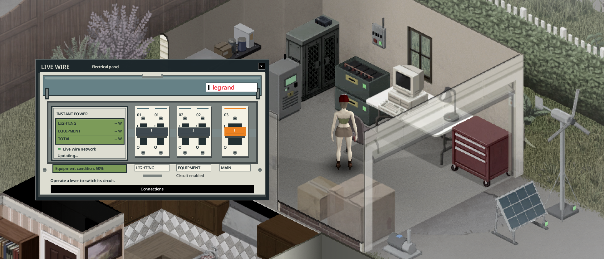

> English version: [Optional equipment](../en/06-optional-equipment.md)

# Équipements optionnels

Quatre équipements facultatifs renforcent un réseau sans être nécessaires à son fonctionnement. Chaque réseau en accepte au plus un de chaque. Pour les relier, voir [Raccordement](03-raccordement.md).

| Équipement | Effet | Niveau |
|---|---|---|
| Disjoncteur (mural) | Saute à la place de l'onduleur quand la demande de la maison dépasse son maximum (1 500 W, 4 500 W pour une armoire onduleur) : l'onduleur ne perd pas 3 points d'état. Lampe rouge quand il a sauté ; réarmement sur le disjoncteur lui-même (« Réarmer le disjoncteur »), refusé tant qu'il y a surcharge. | 3 |
| Alarme de batterie faible (murale) | Sous 20 % de stock : message aux joueurs à moins de 30 cases, répété toutes les 2 heures de jeu. L'alarme bippe toutes les 10 minutes de jeu jusqu'à « Couper la sonnerie ». Le gyrophare reste allumé jusqu'à ce que le stock repasse au-dessus de 25 %. | 2 |
| Générateur de secours (générateur vanilla) | Démarré par le mod sous 20 % de batterie, arrêté à 90 % (options sandbox `BackupStartPercent` / `BackupStopPercent`). Fournit 1 200 W et brûle 1 L de carburant par 3 kWh (en plus de sa consommation vanilla). Toujours bruyant et toxique en intérieur ; à brancher et alimenter en carburant à la manière vanilla. | 2 |
| Ordinateur de gestion (ordinateur de bureau vanilla) | Historique 48 h, prévisions météo sur trois jours, consommateurs et journal d'événements. Délestage automatique : éteint les lumières sous 15 % pour garder le frigo, réarmé au-dessus de 30 %. | 3 |

Le générateur de secours et l'ordinateur ne se fabriquent pas : ce sont des objets vanilla trouvés dans le monde. Raccordez-les depuis leur propre menu clic droit (voir [Raccordement](03-raccordement.md)).

## Commande manuelle du générateur de secours

Allumer ou éteindre vous-même le générateur de secours (menu vanilla) le met en commande manuelle. Le mod ne le démarre ni ne l'arrête. Les joueurs à moins de 30 cases reçoivent un avertissement qui explique comment rendre la main. L'écran de l'onduleur affiche « Générateur : commande manuelle », et le logiciel affiche « Pilotage automatique suspendu ».

Pour revenir au pilotage automatique : clic droit sur le générateur, puis **LiveWire**, puis **Générateur de secours**, puis **Reprendre le secours automatique**. Les joueurs proches sont prévenus quand il repasse en automatique.

## Onduleurs en parallèle (couplage)

Dans une vraie installation autonome, on gagne de la puissance en ajoutant des onduleurs identiques en parallèle, pas en poussant un onduleur au-delà de sa capacité. LiveWire fait de même. Un réseau compte jusqu'à **4 onduleurs** : un maître et jusqu'à 3 esclaves.

- Clic droit sur un onduleur > **Coupler à un onduleur** > un onduleur maître à portée de câble. L'onduleur cliqué devient **esclave**. Coût : un tournevis, le niveau 3 d'Électricité, le fil électrique de la distance et 1 **kit de couplage d'onduleurs** (recette au niveau 3 d'Électricité).
- L'esclave ne doit avoir aucun équipement raccordé. Un maître accepte au plus 3 esclaves.
- Un seul réseau, un seul parc de batteries, une seule zone alimentée (celle du maître). Capacité = somme des onduleurs en service (1 500 W par onduleur, 4 500 W par armoire onduleur ; les deux se couplent entre eux). Chaque onduleur allumé consomme sa part à vide (20 W, 60 W pour une armoire) et s'use comme d'habitude.
- Un esclave éteint ou cassé ne compte pas : si la demande dépasse alors ce qui reste, le disjoncteur (ou le maître) saute. Chaque esclave a son interrupteur ; on réarme sur le maître ou sur le disjoncteur.
- **Découpler** sur l'esclave le rend de nouveau indépendant (le kit est rendu). Ramasser un maître libère ses esclaves.
- La page État de l'écran LCD et le logiciel affichent « Couplés : n / total en service » et la capacité totale.
- Deux onduleurs indépendants dont les zones se recouvrent ne comptent pas deux fois les mêmes appareils : chaque appareil est compté par l'onduleur allumé le plus proche.

## Quand le disjoncteur saute-t-il ?

Quand la demande des appareils de la maison dépasse le maximum de l'onduleur, 1 500 W (4 500 W pour une armoire onduleur ; la consommation à vide ne compte pas). La vérification a lieu à chaque pas de simulation : toutes les 10 minutes de jeu et juste après une action. Exemples : un lave-linge et un sèche-linge superposés qui tournent ensemble (1 800 W avec les valeurs du jeu) ; avec les profils de consommation 1993, une cuisinière électrique ou un sèche-linge seul.

Sans disjoncteur, c'est l'onduleur qui saute et perd 3 points d'état (réarmement sur l'onduleur). Avec un disjoncteur, c'est lui qui saute ; réarmez-le sur le disjoncteur (« Réarmer le disjoncteur »), ce qui est refusé tant que la charge est trop forte. Éteignez d'abord quelques appareils.

## Tableau électrique à deux circuits

Ouvrez le tableau sur un disjoncteur raccordé. Il comporte un wattmètre LCD, deux leviers de circuit (éclairage et équipements) et un levier principal orange.

- Le levier principal ouvre ou ferme la distribution, ou réarme une surcharge une fois la charge corrigée. La production des sources et la charge des batteries continuent ; le levier principal ne coupe que la distribution de ce réseau.
- Le levier **éclairage** coupe les vrais interrupteurs secteur et rétablit les choix mémorisés. Les lampes sur pile ne sont pas concernées. Les interrupteurs de pièce vanilla agissent sur toute la pièce.
- Le levier **équipements** arrête les réfrigérateurs et congélateurs, les télévisions et radios sur secteur, les cuisinières, micro-ondes, lave-linge, sèche-linge, appareils combinés et chargeurs de batterie de voiture. Les pompes à carburant ne distribuent pas. Les pompes à eau LiveWire cessent de remplir leurs relais (l'eau déjà stockée reste disponible). L'éclairage peut rester allumé. Les appareils déjà éteints restent éteints au retour du courant, et les cycles des machines reprennent avec leur durée normale. Les appareils sur batterie continuent de fonctionner seuls.
- Les deux leviers donnent les quatre combinaisons. Vos choix sont conservés lors d'une sauvegarde et d'un redémarrage.

Le LCD affiche **éclairage, équipements et total en watts**, d'après la dernière mesure du réseau. Les équipements incluent les pompes à eau LiveWire. Ce sont des puissances actuelles, pas des totaux en kWh. La consommation à vide de l'onduleur, les pertes et la charge des batteries ne sont pas comptées. Un circuit ouvert sans charge affiche « 0 W / COUPÉ ». Après un retour dans une zone ou une reconnexion, « Actualisation... » et des tirets remplacent une mesure pas encore disponible.

Corrigez la charge avant de réarmer une surcharge. Le réarmement ne ferme jamais un circuit que vous avez ouvert volontairement, et le délestage automatique de l'éclairage ne le ferme pas non plus.

Les onduleurs couplés partagent le tableau de leur maître. Dans les zones qui se recouvrent, chaque appareil dépend du maître indépendant le plus proche. Les interrupteurs d'une pièce suivent le tableau le plus proche du centre de la pièce. Couper un circuit arrête l'appareil concerné, même si sa prise pourrait recevoir un autre courant. Le levier principal, lui, ne coupe que la distribution de ce réseau.

Les appareils de mods qui utilisent les classes ou types de conteneurs vanilla suivent les mêmes règles ; les services électriques spécifiques nécessitent une compatibilité explicite. Avant de désactiver LiveWire, rétablissez les circuits pour que les frigos sauvegardés retrouvent leur type d'origine.

Le tableau électrique en jeu, avec ses leviers éclairage et équipements et son wattmètre instantané. « Updating... » est l'état temporaire avant réception des mesures.

Le menu contextuel ne propose qu'une ouverture par panneau : le tableau électrique pour le disjoncteur, le panneau LCD pour la powerbank. **Raccordements** est un écran distinct, accessible par un bouton sur chaque panneau d'équipement.

Les panneaux d'équipement affichent **État équipement : … %** : c'est l'usure de la powerbank ou du tableau, distincte de la charge et de l'état des batteries. Deux powerbanks superposées ont chacune leur état. Il reste visible sans raccordement et à 0 %. Les sources, pompes et alarmes ont aussi leur LCD individuel ; l'onduleur affiche son état dans sa page État. « -- % » signifie donnée inconnue.

## LCD de chaque appareil et choix de l'onduleur

Cliquez sur un panneau solaire, une éolienne, une roue à aubes, une pompe ou une alarme pour ouvrir son LCD. Il montre son état en %, sa production mesurée et sa puissance nominale. Le panneau solaire affiche aussi saleté et neige, l'éolienne son frein. Une source non raccordée ou cassée produit 0 W. La pompe affiche son état, son débit d'eau mesuré et sa consommation électrique. L'alarme a un écran d'état. Pendant que le LCD est ouvert, ses relevés sont actualisés toutes les deux secondes.

Le bouton **Raccordements** de chaque équipement permet de choisir l'onduleur pour cet équipement seul. Sur l'onduleur, ce bouton garde la liste complète des équipements du réseau choisi. Débranchez un équipement avant de le déplacer vers un autre réseau ; les coûts de câble, outils et compétences restent applicables.

Sur le disjoncteur posé, le **voyant vert** indique une distribution alimentée. Il reste vert si seuls les circuits éclairage ou équipements sont ouverts ; si le principal est coupé ou s'il n'y a pas de courant, il est éteint. **Rouge** : protection déclenchée. Ce voyant ne prouve pas que l'entretien est sans risque : éteignez l'onduleur.

## Voir aussi

[Équipements](02-equipements.md) · [Écran et logiciel](05-ecran-et-logiciel.md) · [Compétence Électricité et entretien](10-competence-electricite-et-entretien.md) · [Options sandbox](11-options-sandbox.md) · [LiveWire Extended](14-livewire-extended.md)
