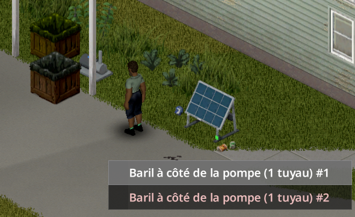

> English version: [Water pump](../en/07-water-pump.md)

# Pompe à eau

Des barils d'eau posés au sol peuvent alimenter les points d'eau de toute une maison. Une pompe électrique, raccordée à l'onduleur et posée à côté des barils, alimente les éviers, douches, baignoires et toilettes tant que le réseau a du courant.

## Ce qu'il faut

| Objet | Détail |
|---|---|
| Pompe à eau | Recette au niveau 3 d'Électricité (voir [Recettes](08-recettes.md)). Se pose au tournevis comme tout équipement LiveWire, dedans ou dehors, sans niveau. Le branchement de la pompe à l'onduleur demande un tournevis et le niveau 3 ; relier un baril à la pompe ne demande aucun niveau (il faut un tuyau). |
| Fil électrique | Pour raccorder la pompe à un onduleur, comme tout équipement (1 fil pour 4 cases). |
| Barils d'eau | Récupérateurs d'eau de pluie vanilla, ou barils du mod facultatif **Useful Barrels**. Jusqu'à 8 par pompe. |
| Tuyaux en métal | 1 par baril, rendu quand on débranche le baril. |
| Clé à tuyau | Pour raccorder éviers, douches et toilettes (action vanilla). |

## Installation

1. Posez la pompe **à côté des barils** : un baril doit être sur l'une des 8 cases autour de la pompe, au même étage (diagonales comprises). Une pompe entourée de barils en accepte jusqu'à 8.
2. Raccordez la pompe à un onduleur : clic droit sur la pompe, puis **LiveWire**, puis **Pompe à eau**, puis **Raccorder à un onduleur**.
3. Raccordez chaque baril : clic droit sur la pompe, puis **Raccorder un baril** ; ou clic droit sur le baril, puis **Baril d'eau**, puis **Pompe à côté de ce baril (1 tuyau)**.
4. Raccordez les points d'eau avec une clé à tuyau, comme en vanilla (clic droit sur l'évier, puis **Raccorder la plomberie de...**). L'option apparaît dès que la pompe dessert le point d'eau.

*Le menu **Raccorder un baril** de la pompe : une ligne par baril posé à côté d'elle.*

## Fonctionnement

- **Eau uniquement.** Un baril qui contient autre chose (essence, alcool…), même mélangé à de l'eau, est refusé. Un baril vide peut être raccordé ; il sert dès qu'il se remplit.
- **L'eau de pluie sort propre.** L'eau de pluie d'un baril est croupie, mais un point d'eau raccordé donne de l'eau propre, comme en vanilla.
- **Portée.** La pompe alimente les points d'eau raccordés situés à **15 cases** au plus (option sandbox `PumpRange`, 5 à 30), et jusqu'à 3 étages au-dessus ou en dessous (la même plage d'étages que la portée d'alimentation de l'onduleur).
- **Réservoirs relais invisibles.** Le jeu ne cherche la source d'un point d'eau qu'à l'étage juste au-dessus. La pompe pose donc un petit réservoir invisible de 25 litres au-dessus de chaque point d'eau à portée. Rien à poser à la main.
- **Seuls les points d'eau raccordés sont remplis.** Un réservoir vide suffit pour proposer **Raccorder la plomberie de...** : la pompe ne remplit donc que les réservoirs qui alimentent un point d'eau déjà raccordé avec la clé à tuyau. Les éviers non raccordés, et ceux des maisons voisines, ne prennent pas l'eau de vos barils. Un point d'eau que vous raccordez reçoit de l'eau dans la minute de jeu qui suit.
- **Débit et courant.** 5 litres par minute de jeu et par pompe, 250 W pendant le pompage. La pompe **s'arrête seule** quand les réservoirs de tous les points d'eau raccordés sont pleins : aucun courant consommé, aucun bruit.
- **Les points d'eau déjà alimentés** (baril vanilla à l'étage, réseau d'eau encore en service, autre mod) le restent : la pompe ne leur fait pas concurrence.
- **Plusieurs pompes** peuvent partager un même réseau.
- **En votre absence**, la pluie continue de remplir les barils (c'est le jeu qui s'en charge). La pompe ne travaille que dans une zone chargée, là où l'on se sert de toute façon des points d'eau.

## Voir ce qui est alimenté

- Clic droit sur la pompe, puis **Afficher les points d'eau alimentés** : un cercle bleu montre la portée, et les points d'eau desservis, les barils raccordés et la pompe sont surlignés en bleu. Les points d'eau à portée qui ne sont pas encore raccordés sont surlignés en gris : ils ne reçoivent pas d'eau tant que vous ne les raccordez pas. **Masquer les points d'eau alimentés** l'éteint.
- Un **voyant bleu** s'allume sur la pompe lorsqu'elle est alimentée, même au repos ou sans point d'eau raccordé. Il s'éteint sans courant ou lorsque le circuit équipements ou principal est coupé.
- Le menu de la pompe indique son état : en marche, à l'arrêt (tous les points d'eau pleins), pas de courant, pas d'eau dans les barils, hors service.
- Le logiciel de gestion (onglet Équipements) affiche le nombre de pompes en service et leur débit en litres par heure.

Cliquez sur la pompe pour son **LCD individuel** : état de la pompe, débit d'eau mesuré en L/h et consommation en W. Lire le LCD ne déplace aucune eau. Le bouton **Raccordements** choisit l'onduleur de cette pompe ; les barils restent gérés par leurs actions habituelles. Voir [les écrans et raccordements](06-equipements-optionnels.md#lcd-de-chaque-appareil-et-choix-de-londuleur).

Le LCD de la pompe a un fond **bleu**. Le voyant posé sur la pompe indique qu'elle est alimentée, pas un débit garanti. Les règles de débit et de barils restent les mêmes. Avant toute intervention, éteignez l'onduleur, même si le voyant est éteint.

## Bruit

Un léger ronronnement de moteur s'entend autour d'une pompe en marche (même réglage de volume que le bourdonnement de l'onduleur, Options > Mods > LiveWire). Les zombies l'entendent à 2 cases.

## Usure

La pompe ne s'use que pendant qu'elle tourne (1 point d'état par 10 jours de pompage) et se répare comme les autres équipements. Hors service, elle ne remplit pas les réservoirs.

## Avant de retirer le mod

Lancez d'abord l'action de debug ou d'administration **Retirer tous les relais d'eau** (clic droit, puis LiveWire ; mode debug en solo, admin en multijoueur), puis sauvegardez. L'action arrête aussi toutes les pompes, pour qu'aucun réservoir ne revienne. Les réservoirs des zones non chargées sont retirés au prochain chargement de leur zone, tant que le mod est encore installé. Pour réutiliser les pompes sans retirer le mod, lancez l'action de debug **Réactiver les pompes à eau**.

## Voir aussi

[Équipements](02-equipements.md) - [Raccordement](03-raccordement.md) - [Recettes](08-recettes.md) - [Options sandbox](11-options-sandbox.md) - [Multijoueur](12-multijoueur.md)
