> English version: [Recipes](../en/08-recipes.md)

# Recettes

Les 29 recettes Live Wire sont dans le menu d'artisanat. Les recettes d'Électricité se débloquent automatiquement au niveau requis ; les pales et le mât sont dans **Métallerie**, sans niveau d'Électricité requis. Les outils sont conservés (certains peuvent s'user). Toutes donnent de l'XP d'Électricité, y compris pales, mât et démontage du testeur.

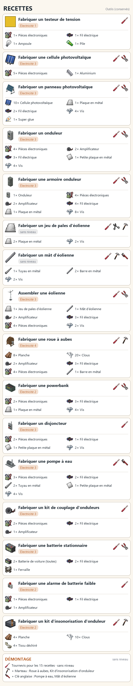

| Ingrédients | Outils (conservés) | Compétence | Résultat |
|---|---|---|---|
| 1 × 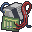 Pièces électroniques 1 ×  Fil électrique 1 ×  Ampoule 1 ×  Pile |  | Électricité 1 |  **Testeur de tension** |
| 1 ×  Testeur de tension |  | aucune |  **Pièces électroniques** |
| 1 × 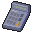 Calculatrice |  | aucune | 1 ×  **Pièces électroniques** 1 × 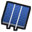 **Cellule photovoltaïque** |
| 2 ×  Pièces électroniques 3 ×  Fil électrique 1 × 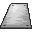 Plaque en métal 4 × 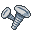 Vis |  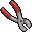 | Électricité 2 |  **Powerbank** |
| 1 ×  Pièces électroniques 1 ×  Fil électrique 1 ×  Amplificateur |  | Électricité 2 |  **Alarme de batterie faible** |
| 4 × 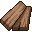 Planche 10 × 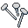 Clous 4 × 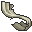 Tissu déchiré | 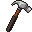 | Électricité 2 |  **Kit d'insonorisation d'onduleur** |
| 10 ×  Cellule photovoltaïque 1 ×  Plaque en métal 2 ×  Fil électrique 4 ×  Vis 1 ×  Super glue |   | Électricité 3 |  **Panneau photovoltaïque** |
| 2 ×  Pièces électroniques 1 ×  Fil électrique 1 × 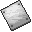 Petite plaque en métal 2 ×  Vis |  | Électricité 3 |  **Disjoncteur** |
| 4 ×  Pièces électroniques 2 ×  Amplificateur 3 ×  Fil électrique 1 ×  Petite plaque en métal 4 ×  Vis |   | Électricité 3 |  **Onduleur** |
| 1 ×  Onduleur 4 ×  Pièces électroniques 2 ×  Amplificateur 4 ×  Fil électrique 1 ×  Plaque en métal 8 ×  Vis |   | Électricité 3 | 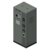 **Armoire onduleur** |
| 2 ×  Plaque en métal 2 ×  Vis |   | aucune |  **Jeu de pales d’éolienne** |
| 1 ×  Tuyau en métal 2 ×  Barre en métal 2 ×  Vis |   | aucune |  **Mât d’éolienne** |
| 1 ×  Jeu de pales d’éolienne 1 ×  Mât d’éolienne 2 ×  Amplificateur 3 ×  Fil électrique 4 ×  Pièces électroniques 2 ×  Vis |   | Électricité 3 |  **Éolienne** |
| 2 ×  Batterie de voiture (toutes) 2 ×  Fil électrique 1 × 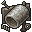 Ferraille |  | Électricité 3 |  **Batterie stationnaire** |
| 3 ×  Pièces électroniques 2 ×  Fil électrique 2 ×  Tuyau en métal 1 ×  Petite plaque en métal 4 ×  Vis |   | Électricité 3 | 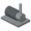 **Pompe à eau** |
| 2 ×  Pièces électroniques 2 ×  Fil électrique 1 ×  Amplificateur |  | Électricité 3 |  **Kit de couplage d'onduleurs** |
| 5 ×  Pièces électroniques 1 × 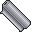 Aluminium |  | Électricité 3 |  **Cellule photovoltaïque** |
| 8 ×  Planche 20 ×  Clous 2 ×  Amplificateur 3 ×  Fil électrique 4 ×  Pièces électroniques 1 ×  Barre en métal |   | Électricité 4 |  **Roue à aubes** |

## Notes

- L'ordinateur de gestion et le générateur de secours ne se fabriquent pas : ce sont des objets vanilla trouvés dans le monde.
- Les cellules photovoltaïques se trouvent dans le butin, se récupèrent sur les calculatrices ou se fabriquent au niveau 3 ([Tables de butin](09-tables-de-butin.md)).
- La batterie stationnaire sort vide ; son état est la moyenne de celui des deux batteries de voiture.

## Pales, mât et amplificateurs

Fabriquez un jeu de pales avec deux plaques métalliques et deux vis (cisailles et
marteau), puis un mât avec un tuyau métallique, deux barres et deux vis (marteau et
clé à tuyau). Ces deux pièces ne demandent aucun niveau d'Électricité. Assemblez
les deux avec deux amplificateurs, trois fils, quatre déchets et deux vis au niveau 3.
La roue à aubes se fabrique au niveau 4, avec deux amplificateurs également.

Pales et mâts peuvent aussi être trouvés dans le butin technique. Les amplificateurs
sont des pièces vanilla : récupérez-les notamment par démontage des appareils.
Démonter un haut-parleur donne un amplificateur et un déchet par la recette vanilla.
Leur butin reste inchangé. Le branchement des deux machines complètes à un onduleur demande seulement le niveau 2 ; la pose et le ramassage n'en demandent aucun. Machines existantes et identifiants conservés.
Les deux nouvelles pièces ont temporairement des icônes et modèles au sol vanilla.

Les recettes des équipements affichent leur icône de résultat après redémarrage
complet du jeu.

## Armoire onduleur

**Fabriquer une armoire onduleur** transforme un onduleur ordinaire en grande armoire
électrique : 4 500 W au lieu de 1 500 W, 60 W de consommation à vide au lieu de 20 W.
Il faut le niveau 3 d'Électricité pour la fabriquer et la mettre en service (premier branchement) ; la pose et le ramassage n'en demandent aucun.
L'onduleur utilisé est consommé (son état est perdu : l'armoire est neuve). L'armoire
fonctionne comme un onduleur (écran, voyants de marche et de défaut, kit
d'insonorisation, usure) et se couple avec des onduleurs ou d'autres armoires ; la
puissance du réseau est la somme des onduleurs en service. On ne la trouve pas dans le
butin. Modèle offert par PewPewCricket.

## Démonter un testeur de tension

La recette d'artisanat **Démonter un testeur de tension** consomme un testeur
LiveWire et donne un déchet électronique. Un tournevis en état est requis et
conservé. Aucun niveau d'Électricité requis ; durée de recette 60 et 2 XP
d'Électricité. Le fil, l'ampoule et la pile de fabrication ne sont pas récupérés :
un cycle fabrication/démontage ne crée donc pas de matériaux.

Toutes les recettes LiveWire donnent de l'XP d'Électricité ; pales et mât donnent chacun 2 XP.

## Démonter un équipement

Chaque équipement et kit Live Wire se démonte depuis le menu d'artisanat
(**Démonter un onduleur**, **Démonter un panneau photovoltaïque**, etc.) : ramassez
d'abord l'équipement, puis démontez-le depuis l'inventaire. Un tournevis en état est
requis et conservé ; aucun niveau d'Électricité n'est demandé. On récupère toujours
moins de pièces que la fabrication n'en coûte : fabriquer puis démonter ne crée donc
jamais de matériaux.

Les pièces métalliques reviennent toujours. Les pièces électroniques dépendent de
l'état de l'équipement : le tableau les donne à 100 % ; un équipement à 60 % en
rend 60 %, arrondi à l'unité inférieure, et un équipement hors d'usage n'en rend
aucune. Un kit d'insonorisation monté sur un onduleur, ou le kit de couplage d'un
onduleur couplé, est rendu entier.

| Équipement | Toujours | Pièces électroniques à 100 % |
|---|---|---|
| Panneau photovoltaïque | 1 plaque en métal, 2 vis | 8 cellules photovoltaïques, 1 fil électrique |
| Éolienne | jeu de pales, mât, 1 vis | 2 amplificateurs, 2 fils, 3 pièces électroniques |
| Roue à aubes (avec un marteau) | 6 planches, 10 clous, 1 barre en métal | 2 amplificateurs, 2 fils, 3 pièces électroniques |
| Onduleur | 1 petite plaque en métal, 2 vis | 2 amplificateurs, 2 fils, 3 pièces électroniques |
| Armoire onduleur | 1 plaque en métal, 1 petite plaque en métal, 6 vis | 4 amplificateurs, 5 fils, 6 pièces électroniques |
| Powerbank | 1 plaque en métal, 2 vis | 2 fils, 1 pièce électronique |
| Disjoncteur | 1 petite plaque en métal, 1 vis | 1 fil, 1 pièce électronique |
| Alarme de batterie faible | 1 fil | 1 amplificateur |
| Pompe à eau (avec une clé à tube) | 2 tuyaux en métal, 1 petite plaque en métal, 2 vis | 1 fil, 2 pièces électroniques |
| Kit de couplage d'onduleurs | 1 amplificateur, 1 fil, 1 pièce électronique | — |
| Kit d'insonorisation (marteau au lieu du tournevis) | 3 planches, 5 clous, 2 tissus déchirés | — |

La batterie stationnaire, le jeu de pales et le mât ne se démontent pas. Un
équipement encore posé et à 0 % peut aussi être démonté sur place avec
**Démonter pour pièces** ([Compétence Électricité et entretien](10-competence-electricite-et-entretien.md)).

## Voir aussi

[Équipements](02-equipements.md) · [Compétence Électricité et entretien](10-competence-electricite-et-entretien.md) · [Tables de butin](09-tables-de-butin.md)
