> English version: [Recipes](../en/08-recipes.md)

# Recettes

Les recettes sont dans le menu d'artisanat, catégorie Électricité, et s'apprennent automatiquement au niveau d'Électricité requis. Les outils sont conservés.

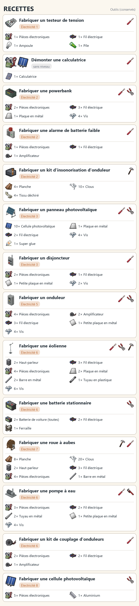

| Ingrédients | Outils (conservés) | Compétence | Résultat |
|---|---|---|---|
| 1 × 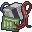 Pièces électroniques 1 ×  Fil électrique 1 ×  Ampoule 1 ×  Pile |  | Électricité 1 |  **Testeur de tension** |
| 1 ×  Calculatrice |  | aucune | 1 ×  **Pièces électroniques** 1 × 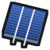 **Cellule photovoltaïque** |
| 2 ×  Pièces électroniques 3 ×  Fil électrique 1 ×  Plaque en métal 4 × 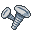 Vis |  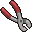 | Électricité 2 |  **Powerbank** |
| 1 ×  Pièces électroniques 1 ×  Fil électrique 1 ×  Amplificateur |  | Électricité 2 |  **Alarme de batterie faible** |
| 4 ×  Planche 10 × 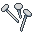 Clous 4 × 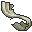 Tissu déchiré | 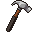 | Électricité 2 |  **Kit d'insonorisation d'onduleur** |
| 10 ×  Cellule photovoltaïque 1 ×  Plaque en métal 2 ×  Fil électrique 4 ×  Vis 1 ×  Super glue |   | Électricité 3 |  **Panneau photovoltaïque** |
| 2 ×  Pièces électroniques 1 ×  Fil électrique 1 × 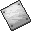 Petite plaque en métal 2 ×  Vis |  | Électricité 3 |  **Disjoncteur** |
| 4 ×  Pièces électroniques 2 ×  Amplificateur 3 ×  Fil électrique 1 ×  Petite plaque en métal 4 ×  Vis |   | Électricité 5 |  **Onduleur** |
| 2 ×  Haut-parleur 3 ×  Fil électrique 4 ×  Pièces électroniques 2 ×  Plaque en métal 2 ×  Barre en métal 1 ×  Tuyau en plastique 6 ×  Vis |    | Électricité 6 |  **Éolienne** |
| 2 ×  Batterie de voiture (toutes) 2 ×  Fil électrique 1 × 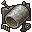 Ferraille |  | Électricité 6 |  **Batterie stationnaire** |
| 8 ×  Planche 20 ×  Clous 2 ×  Haut-parleur 3 ×  Fil électrique 4 ×  Pièces électroniques 1 ×  Barre en métal |   | Électricité 7 |  **Roue à aubes** |
| 3 ×  Pièces électroniques 2 ×  Fil électrique 2 ×  Tuyau en métal 1 ×  Petite plaque en métal 4 ×  Vis |   | Électricité 6 | 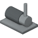 **Pompe à eau** |
| 2 ×  Pièces électroniques 2 ×  Fil électrique 1 ×  Amplificateur |  | Électricité 6 |  **Kit de couplage d'onduleurs** |
| 5 ×  Pièces électroniques 1 ×  Aluminium |  | Électricité 8 |  **Cellule photovoltaïque** |

## Notes

- L'ordinateur de gestion et le générateur de secours ne se fabriquent pas : ce sont des objets vanilla trouvés dans le monde.
- Les cellules photovoltaïques se trouvent dans le butin, se récupèrent sur les calculatrices ou se fabriquent au niveau 8 ([Tables de butin](09-tables-de-butin.md)).
- La batterie stationnaire sort vide ; son état est la moyenne de celui des deux batteries de voiture.

## Voir aussi

[Équipements](02-equipements.md) · [Compétence Électricité et entretien](10-competence-electricite-et-entretien.md) · [Tables de butin](09-tables-de-butin.md)
