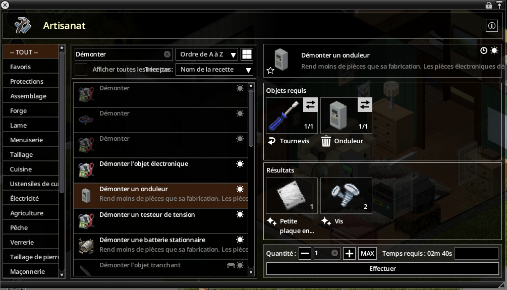

> English version: [Recipes](../en/08-recipes.md)

# Recettes

Les 31 recettes LiveWire de base sont dans le menu d'artisanat : 16 de fabrication et 15 de démontage. LiveWire Extended ajoute 8 recettes de fabrication, listées dans [LiveWire Extended](14-livewire-extended.md#recettes). Les recettes d'Électricité apparaissent au niveau requis ; les pales et le mât sont dans **Travail des métaux**, sans niveau d'Électricité requis. Les outils sont conservés (certains peuvent s'user). Toutes les recettes donnent de l'XP d'Électricité, y compris pales, mât et démontage du testeur.

*Planche illustrée des recettes.*

## Recettes de fabrication

La durée est la valeur de recette du script du jeu, en unités de temps de jeu.

| Ingrédients | Outils (conservés) | Compétence | Durée | Résultat |
|---|---|---|---|---|
| 1 ×  Pièces électroniques 1 ×  Fil électrique 1 ×  Ampoule 1 ×  Pile |  | Électricité 1 | 80 |  **Testeur de tension** |
| 5 ×  Pièces électroniques 1 ×  Aluminium |   | Électricité 3 | 100 |  **Cellule photovoltaïque** |
| 10 ×  Cellule photovoltaïque 1 ×  Plaque en métal 2 ×  Fil électrique 4 ×  Vis 1 ×  Super glue |   | Électricité 3 | 270 |  **Panneau photovoltaïque** |
| 1 ×  Pièces électroniques 1 ×  Fil électrique 1 ×  Amplificateur |  | Électricité 2 | 100 |  **Alarme de batterie faible** |
| 2 ×  Pièces électroniques 3 ×  Fil électrique 1 ×  Plaque en métal 4 ×  Vis |   | Électricité 2 | 200 |  **Powerbank** |
| 4 ×  Planche 10 ×  Clous 4 ×  Tissu déchiré |   | Électricité 2 | 200 |  **Kit d'insonorisation d'onduleur** |
| 2 ×  Pièces électroniques 1 ×  Fil électrique 1 ×  Petite plaque en métal 2 ×  Vis |  | Électricité 3 | 130 |  **Disjoncteur** |
| 4 ×  Pièces électroniques 2 ×  Amplificateur 3 ×  Fil électrique 1 ×  Petite plaque en métal 4 ×  Vis |   | Électricité 3 | 340 |  **Onduleur** |
| 1 ×  Onduleur 4 ×  Pièces électroniques 2 ×  Amplificateur 4 ×  Fil électrique 1 ×  Plaque en métal 8 ×  Vis |   | Électricité 3 | 470 |  **Armoire onduleur** |
| 2 ×  Plaque en métal 2 ×  Vis |    | aucune | 120 |  **Jeu de pales d’éolienne** |
| 1 ×  Tuyau en métal 2 ×  Barre en métal 2 ×  Vis |    | aucune | 120 |  **Mât d’éolienne** |
| 1 ×  Jeu de pales d’éolienne 1 ×  Mât d’éolienne 2 ×  Amplificateur 3 ×  Fil électrique 4 ×  Pièces électroniques 2 ×  Vis |   | Électricité 3 | 160 |  **Éolienne** |
| 2 ×  Batterie de voiture (toutes) 2 ×  Fil électrique 1 ×  Ferraille |   | Électricité 3 | 270 |  **Batterie stationnaire** |
| 3 ×  Pièces électroniques 2 ×  Fil électrique 2 ×  Tuyau en métal 1 ×  Petite plaque en métal 4 ×  Vis |   | Électricité 3 | 270 |  **Pompe à eau** |
| 2 ×  Pièces électroniques 2 ×  Fil électrique 1 ×  Amplificateur |  | Électricité 3 | 130 |  **Kit de couplage d'onduleurs** |
| 8 ×  Planche 20 ×  Clous 2 ×  Amplificateur 3 ×  Fil électrique 4 ×  Pièces électroniques 1 ×  Barre en métal |   | Électricité 4 | 400 |  **Roue à aubes** |

## Recettes de démontage

Le démontage demande de ramasser l'équipement d'abord. Un tournevis en état est requis et conservé. Aucune recette de démontage ne demande de niveau d'Électricité. Chaque recette est listée avec ses outils et sa durée.

| Recette | Outils (conservés) | Durée |
|---|---|---|
| Démonter un testeur de tension | Tournevis | 60 |
| Démonter un panneau photovoltaïque | Tournevis | 200 |
| Démonter une éolienne | Tournevis | 150 |
| Démonter une roue à aubes | Tournevis, marteau | 250 |
| Démonter un onduleur | Tournevis | 200 |
| Démonter une armoire onduleur | Tournevis | 300 |
| Démonter une powerbank | Tournevis | 120 |
| Démonter un disjoncteur | Tournevis | 80 |
| Démonter une alarme de batterie faible | Tournevis | 60 |
| Démonter une pompe à eau | Tournevis, clé à tuyau | 200 |
| Démonter un kit de couplage d'onduleurs | Tournevis | 60 |
| Démonter un kit d'insonorisation d'onduleur | Tournevis, marteau | 150 |
| Démonter un jeu de pales d’éolienne | Tournevis | 60 |
| Démonter un mât d’éolienne | Tournevis, clé à tuyau | 60 |
| Démonter une batterie stationnaire | Tournevis | 120 |

## Pales, mât et amplificateurs

Fabriquez un jeu de pales avec deux plaques en métal et deux vis (tournevis, cisailles
et marteau), puis un mât avec un tuyau en métal, deux barres en métal et deux vis (tournevis,
marteau et clé à tuyau). Ces deux pièces ne demandent aucun niveau d'Électricité. Assemblez
les deux avec deux amplificateurs, trois fils électriques, quatre pièces électroniques et deux vis au niveau 3.
La roue à aubes se fabrique au niveau 4, avec deux amplificateurs également.

Pales et mâts se trouvent aussi dans le butin ; voir [Tables de butin](09-tables-de-butin.md).
Les amplificateurs sont des pièces vanilla, récupérées notamment en démontant des appareils.
Leur butin reste inchangé. Le branchement des deux machines complètes à un onduleur
demande seulement le niveau 2. La pose et le ramassage demandent un tournevis, sans niveau d'Électricité.

## Armoire onduleur

**Fabriquer une armoire onduleur** transforme un onduleur ordinaire en grande armoire
électrique : 4 500 W au lieu de 1 500 W, 60 W de consommation à vide au lieu de 20 W.
Il faut le niveau 3 d'Électricité pour la fabriquer et la mettre en service (premier branchement) ;
la pose et le ramassage demandent un tournevis, sans niveau d'Électricité.
L'onduleur utilisé est consommé (son état est perdu : l'armoire est neuve). L'armoire
fonctionne comme un onduleur (écran, voyants de marche et de défaut, kit
d'insonorisation, usure) et se couple avec des onduleurs ou d'autres armoires ; la
puissance du réseau est la somme des onduleurs en service. On ne la trouve pas dans le
butin. Modèle offert par PewPewCricket.

## Démonter un testeur de tension

La recette d'artisanat **Démonter un testeur de tension** consomme un testeur
LiveWire et donne une pièce électronique. Un tournevis en état est requis et
conservé. Aucun niveau d'Électricité requis ; durée de recette 60 et 2 XP
d'Électricité. Le fil, l'ampoule et la pile de fabrication ne sont pas récupérés :
un cycle fabrication/démontage ne crée donc pas de matériaux.

Toutes les recettes LiveWire donnent de l'XP d'Électricité ; pales et mât donnent chacun 2 XP.

## Démonter un équipement

Chaque équipement et kit LiveWire de base se démonte depuis le menu d'artisanat
(**Démonter un onduleur**, **Démonter un panneau photovoltaïque**, etc.) : ramassez
d'abord l'équipement, puis démontez-le depuis l'inventaire. Un tournevis en état est
requis et conservé ; aucun niveau d'Électricité n'est demandé. On récupère toujours
moins de pièces que la fabrication n'en coûte : fabriquer puis démonter ne crée donc
jamais de matériaux. Les équipements LiveWire Extended n'ont pas de recette de démontage.

*Démonter un onduleur dans le menu d'artisanat : le tournevis est conservé, l'onduleur est consommé.*

Les pièces métalliques reviennent toujours. Les pièces électroniques dépendent de
l'état de l'équipement : le tableau les donne à 100 % ; un équipement à 60 % en
rend 60 %, arrondi à l'unité inférieure, et un équipement hors d'usage n'en rend
aucune. Un kit d'insonorisation monté sur un onduleur, ou le kit de couplage d'un
onduleur couplé, est rendu entier.

| Équipement | Toujours | Pièces électroniques à 100 % |
|---|---|---|
| Panneau photovoltaïque | 1 plaque en métal, 2 vis | 8 cellules photovoltaïques, 1 fil électrique |
| Éolienne | jeu de pales, mât, 1 vis | 2 amplificateurs, 2 fils, 3 pièces électroniques |
| Roue à aubes (avec un marteau) | 6 planches, 10 clous, 1 barre en métal | 2 amplificateurs, 2 fils, 3 pièces électroniques |
| Onduleur | 1 petite plaque en métal, 2 vis | 2 amplificateurs, 2 fils, 3 pièces électroniques |
| Armoire onduleur | 1 plaque en métal, 1 petite plaque en métal, 6 vis | 4 amplificateurs, 5 fils, 6 pièces électroniques |
| Powerbank | 1 plaque en métal, 2 vis | 2 fils, 1 pièce électronique |
| Jeu de pales d’éolienne | 1 plaque en métal, 1 vis | — |
| Mât d’éolienne | 1 tuyau en métal, 1 barre en métal, 1 vis | — |
| Batterie stationnaire | 1 ferraille | 2 fils |
| Disjoncteur | 1 petite plaque en métal, 1 vis | 1 fil, 1 pièce électronique |
| Alarme de batterie faible | 1 fil | 1 amplificateur |
| Pompe à eau (avec une clé à tuyau) | 2 tuyaux en métal, 1 petite plaque en métal, 2 vis | 1 fil, 2 pièces électroniques |
| Kit de couplage d'onduleurs | 1 amplificateur, 1 fil, 1 pièce électronique | — |
| Kit d'insonorisation (marteau en plus du tournevis) | 3 planches, 5 clous, 2 tissus déchirés | — |

La cellule photovoltaïque ne se démonte pas. Un
équipement hors d'usage se ramasse d'abord (tournevis), puis se démonte comme les autres.

Une calculatrice démontée avec la recette du jeu **Démonter l'objet électronique**
donne aussi une cellule photovoltaïque.

## Recettes Extended

LiveWire Extended ajoute huit recettes de fabrication, toutes au niveau 3 d'Électricité et toutes avec un tournevis. Leurs ingrédients sont listés dans [LiveWire Extended](14-livewire-extended.md#recettes).

| Recette | Résultat | Durée |
|---|---|---|
| Fabriquer une borne électrique | Borne électrique | 270 |
| Fabriquer un tableau électrique (8 modules) | Tableau électrique (8 modules) | 190 |
| Fabriquer un tableau électrique (16 modules) | Tableau électrique (16 modules) | 240 |
| Fabriquer un tableau électrique (24 modules) | Tableau électrique (24 modules) | 290 |
| Fabriquer un disjoncteur 15 A | Disjoncteur 15 A | 90 |
| Fabriquer un disjoncteur 20 A | Disjoncteur 20 A | 100 |
| Fabriquer un disjoncteur 30 A | Disjoncteur 30 A | 120 |
| Fabriquer un interrupteur crépusculaire pour disjoncteur | Interrupteur crépusculaire pour disjoncteur | 130 |

## Voir aussi

[Équipements](02-equipements.md) · [Tables de butin](09-tables-de-butin.md) · [Compétence Électricité et entretien](10-competence-electricite-et-entretien.md) · [Raccordement](03-raccordement.md) · [LiveWire Extended](14-livewire-extended.md)
