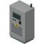
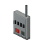
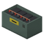
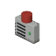
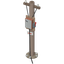
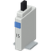
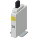
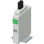

> English version: [Loot tables](../en/09-loot-tables.md)

# Tables de butin

LiveWire ajoute des cellules photovoltaïques, des équipements tout faits et un disque de logiciel facultatif aux listes de butin vanilla. Les véhicules d'électricien (dont les utilitaires des entreprises d'électricité) et de métallier transportent aussi des équipements : listes `ElectricianTruckBed`, `ElectricianGloveBox` et `MetalWelderTruckBed` ci-dessous.

## Lire les poids et les tirages

Project Zomboid teste chaque objet indépendamment à chaque tirage d'une liste de conteneur. Un objet de **poids** W a une chance de W × M % par tirage, où M est le modificateur de butin du jeu pour cet objet. La colonne « Tirages » est le nombre de tirages de cette liste vanilla.

Chance approximative par conteneur ≈ 1 − (1 − W × M / 100)^Tirages.

Le jeu choisit M d'après la catégorie de butin de l'objet, réglée dans la page sandbox **Rareté du butin**. Les objets de LiveWire et de LiveWire Extended n'ont pas de catégorie propre : ils tombent dans **Autres**. Seule exception, la batterie stationnaire : le jeu la classe en entretien de véhicule, elle suit donc **Matériel de mécanique**. Ces deux réglages valent 0,6 à rareté normale : les tableaux utilisent M = 0,6 pour tous les objets. Avec d'autres réglages de butin, les chances réelles changent ; la densité de zombies, le temps et la place disponible les changent aussi.

## Cellule photovoltaïque (`LiveWire.SolarCell`, toujours)

Poids à ×5 ; estimations si cette liste est sélectionnée, avec le modificateur de butin du jeu à rareté normale (0,6).

| Liste vanilla | Où | Poids (×5) | Tirages | ≈ chance par conteneur |
|---|---|---|---|---|
| `GarageTools` | Rangement d'outils de garage | 10 | 4 | 21,9 % |
| `CrateTools` | Caisses d'outils | 5 | 4 | 11,5 % |
| `GarageMetalwork` | Rangement de métallerie de garage | 5 | 4 | 11,5 % |
| `MechanicShelfElectric` | Garage automobile, étagère électrique | 10 | 4 | 21,9 % |
| `ElectricianTools` | Outils d'électricien | 15 | 3 | 24,6 % |
| `MetalShopTools` | Outils de métallerie | 5 | 4 | 11,5 % |
| `WireFactoryElectric` | Usine de câbles, rayon électrique | 10 | 4 | 21,9 % |
| `ToolStoreMisc` | Quincaillerie, divers | 10 | 4 | 21,9 % |
| `CrateElectronics` | Caisses d'électronique | 10 | 4 | 21,9 % |
| `ElectronicStoreMisc` | Magasin d'électronique, divers | 10 | 4 | 21,9 % |
| `ToolStoreMetalwork` | Quincaillerie, métallerie | 5 | 4 | 11,5 % |
| `CrateMetalwork` | Caisses de métallerie | 5 | 4 | 11,5 % |
| `ElectricianTruckBed` | Véhicule d'électricien, plateau ou coffre | 10 | 4 | 21,9 % |

## Équipements LiveWire tout faits

Poids avec EquipmentLootMultiplier = 5 par défaut (plage 1–20). Estimations si cette liste est sélectionnée, avec le modificateur de butin du jeu à rareté normale (0,6), sans effet de densité de zombies ni du temps et avec assez de place ; ce ne sont pas des taux de découverte garantis.

Fouillez les quincailleries, garages et ateliers automobiles, magasins d'électronique, usines électriques et caisses d'entrepôt. Les batteries stationnaires peuvent aussi apparaître parmi le matériel de camping. Chaque type de rangement a sa propre liste : aucun lieu précis ne garantit une découverte. Les roues à aubes se trouvent dans les rangements et caisses de menuiserie et d'agriculture, ainsi que dans les caisses d'outils, de mécanique et de métallerie. Les pompes à eau et les armoires onduleur sont à fabriquer uniquement.

Réglez **Fréquence des équipements et pièces LiveWire** dans la page sandbox **LiveWire** : **5 par défaut**, de **1 à 20**. Redémarrez le jeu ou le serveur dédié après modification. Seuls les prochains tirages sont concernés, y compris la réapparition vanilla du butin si elle est activée ; aucun remplissage des conteneurs déjà fouillés. Les cellules photovoltaïques sont incluses. Objets et poids vanilla inchangés. Le disque du logiciel n'est pas concerné par cette option.

| Équipement | Liste vanilla | Où | Poids (×5) | Tirages | ≈ chance par conteneur |
|---|---|---|---|---|---|
|  **Panneau photovoltaïque** | `GarageMetalwork` | Rangement de métallerie de garage | 2,5 | 4 | 5,9 % |
|  | `ToolStoreMisc` | Quincaillerie, divers | 2,5 | 4 | 5,9 % |
|  | `CrateElectronics` | Caisses d'électronique | 2,5 | 4 | 5,9 % |
|  | `ElectronicStoreMisc` | Magasin d'électronique, divers | 2,5 | 4 | 5,9 % |
|  | `ElectricianTruckBed` | Véhicule d'électricien, plateau ou coffre | 2,5 | 4 | 5,9 % |
|  | `GarageTools` | Rangement d'outils de garage | 1,5 | 4 | 3,6 % |
|  | `CrateTools` | Caisses d'outils | 1,5 | 4 | 3,6 % |
|  | `ToolStoreTools` | Quincaillerie, outils | 1,5 | 4 | 3,6 % |
|  | `CrateMetalwork` | Caisses de métallerie | 1,5 | 4 | 3,6 % |
|  | `ToolStoreMetalwork` | Quincaillerie, métallerie | 1,5 | 4 | 3,6 % |
|  | `GarageMechanics` | Garage, rangement mécanique | 1,5 | 4 | 3,6 % |
|  | `MetalWelderTruckBed` | Véhicule de métallier, plateau ou coffre | 1,5 | 4 | 3,6 % |
|  **Testeur de tension** | `ElectricianTools` | Outils d'électricien | 5 | 3 | 8,7 % |
|  | `ElectricianTruckBed` | Véhicule d'électricien, plateau ou coffre | 5 | 4 | 11,5 % |
|  | `WireFactoryElectric` | Usine de câbles, rayon électrique | 2,5 | 4 | 5,9 % |
|  | `ToolStoreTools` | Quincaillerie, outils | 1,5 | 4 | 3,6 % |
|  | `ElectronicStoreMisc` | Magasin d'électronique, divers | 1,5 | 4 | 3,6 % |
|  | `CrateElectronics` | Caisses d'électronique | 1,5 | 4 | 3,6 % |
|  | `MechanicShelfElectric` | Garage automobile, étagère électrique | 1,5 | 4 | 3,6 % |
|  | `ElectricianGloveBox` | Véhicule d'électricien, boîte à gants | 1,5 | 1 | 0,9 % |
|  | `GarageTools` | Rangement d'outils de garage | 1 | 4 | 2,4 % |
|  | `CrateTools` | Caisses d'outils | 1 | 4 | 2,4 % |
|  **Batterie stationnaire** (réglage de butin : Matériel de mécanique) | `CarSupplyBatteries` | Magasin de pièces auto, batteries | 10 | 4 | 21,9 % |
|  | `MechanicShelfElectric` | Garage automobile, étagère électrique | 5 | 4 | 11,5 % |
|  | `CrateMechanics` | Caisses de mécanique | 3,5 | 4 | 8,1 % |
|  | `CrateElectronics` | Caisses d'électronique | 2,5 | 4 | 5,9 % |
|  | `ElectronicStoreMisc` | Magasin d'électronique, divers | 2,5 | 4 | 5,9 % |
|  | `GarageMechanics` | Garage, rangement mécanique | 1,5 | 4 | 3,6 % |
|  | `CampingStoreGear` | Magasin de camping, matériel | 1,5 | 4 | 3,6 % |
|  **Onduleur** | `ElectricianTools` | Outils d'électricien | 2,5 | 3 | 4,4 % |
|  | `WireFactoryElectric` | Usine de câbles, rayon électrique | 2,5 | 4 | 5,9 % |
|  | `CrateElectronics` | Caisses d'électronique | 2,5 | 4 | 5,9 % |
|  | `ElectronicStoreMisc` | Magasin d'électronique, divers | 2,5 | 4 | 5,9 % |
|  | `ElectricianTruckBed` | Véhicule d'électricien, plateau ou coffre | 2,5 | 4 | 5,9 % |
|  | `ElectronicStoreAppliances` | Magasin d'électronique, appareils | 1,5 | 1 | 0,9 % |
|  | `MechanicShelfElectric` | Garage automobile, étagère électrique | 1,5 | 4 | 3,6 % |
|  | `GarageMechanics` | Garage, rangement mécanique | 1,5 | 4 | 3,6 % |
|  | `ToolStoreMisc` | Quincaillerie, divers | 1 | 4 | 2,4 % |
|  | `CrateTools` | Caisses d'outils | 1 | 4 | 2,4 % |
|  | `GarageTools` | Rangement d'outils de garage | 0,5 | 4 | 1,2 % |
|  **Disjoncteur** | `ElectricianTools` | Outils d'électricien | 5 | 3 | 8,7 % |
|  | `WireFactoryElectric` | Usine de câbles, rayon électrique | 5 | 4 | 11,5 % |
|  | `ElectricianTruckBed` | Véhicule d'électricien, plateau ou coffre | 5 | 4 | 11,5 % |
|  | `CrateElectronics` | Caisses d'électronique | 3,5 | 4 | 8,1 % |
|  | `ToolStoreMisc` | Quincaillerie, divers | 2,5 | 4 | 5,9 % |
|  | `ElectronicStoreMisc` | Magasin d'électronique, divers | 2,5 | 4 | 5,9 % |
|  | `ToolStoreTools` | Quincaillerie, outils | 2,5 | 4 | 5,9 % |
|  | `GarageTools` | Rangement d'outils de garage | 1,5 | 4 | 3,6 % |
|  | `CrateTools` | Caisses d'outils | 1,5 | 4 | 3,6 % |
|  | `CrateMetalwork` | Caisses de métallerie | 1,5 | 4 | 3,6 % |
|  | `GarageMechanics` | Garage, rangement mécanique | 1,5 | 4 | 3,6 % |
|  | `GarageMetalwork` | Rangement de métallerie de garage | 1,5 | 4 | 3,6 % |
|  **Powerbank** | `ElectricianTools` | Outils d'électricien | 2,5 | 3 | 4,4 % |
|  | `MechanicShelfElectric` | Garage automobile, étagère électrique | 2,5 | 4 | 5,9 % |
|  | `CrateElectronics` | Caisses d'électronique | 2,5 | 4 | 5,9 % |
|  | `ElectricianTruckBed` | Véhicule d'électricien, plateau ou coffre | 2,5 | 4 | 5,9 % |
|  | `ElectronicStoreMisc` | Magasin d'électronique, divers | 2 | 4 | 4,7 % |
|  | `ToolStoreMisc` | Quincaillerie, divers | 1,5 | 4 | 3,6 % |
|  | `CrateMechanics` | Caisses de mécanique | 1,5 | 4 | 3,6 % |
|  | `GarageTools` | Rangement d'outils de garage | 1 | 4 | 2,4 % |
|  | `GarageMechanics` | Garage, rangement mécanique | 1 | 4 | 2,4 % |
|  | `CrateTools` | Caisses d'outils | 1 | 4 | 2,4 % |
|  **Alarme de batterie faible** | `ElectricianTools` | Outils d'électricien | 5 | 3 | 8,7 % |
|  | `WireFactoryElectric` | Usine de câbles, rayon électrique | 5 | 4 | 11,5 % |
|  | `ElectricianTruckBed` | Véhicule d'électricien, plateau ou coffre | 5 | 4 | 11,5 % |
|  | `CrateElectronics` | Caisses d'électronique | 3,5 | 4 | 8,1 % |
|  | `ToolStoreMisc` | Quincaillerie, divers | 2,5 | 4 | 5,9 % |
|  | `ElectronicStoreMisc` | Magasin d'électronique, divers | 2,5 | 4 | 5,9 % |
|  | `CrateTools` | Caisses d'outils | 1,5 | 4 | 3,6 % |
|  | `GarageTools` | Rangement d'outils de garage | 1,5 | 4 | 3,6 % |
|  | `GarageMechanics` | Garage, rangement mécanique | 1,5 | 4 | 3,6 % |
|  **Éolienne** | `WireFactoryElectric` | Usine de câbles, rayon électrique | 2,5 | 4 | 5,9 % |
|  | `ToolStoreMetalwork` | Quincaillerie, métallerie | 2,5 | 4 | 5,9 % |
|  | `WireFactoryTools` | Usine de câbles, outils | 2,5 | 4 | 5,9 % |
|  | `ToolStoreMisc` | Quincaillerie, divers | 1,5 | 4 | 3,6 % |
|  | `CrateElectronics` | Caisses d'électronique | 1,5 | 4 | 3,6 % |
|  | `CrateMetalwork` | Caisses de métallerie | 1,5 | 4 | 3,6 % |
|  | `CrateTools` | Caisses d'outils | 1,5 | 4 | 3,6 % |
|  | `CrateFarming` | Caisses de matériel agricole | 1,5 | 4 | 3,6 % |
|  | `ToolStoreFarming` | Quincaillerie ou magasin extérieur, agriculture | 1,5 | 4 | 3,6 % |
|  | `MechanicShelfTools` | Garage automobile, outils | 1,5 | 4 | 3,6 % |
|  | `MetalWelderTruckBed` | Véhicule de métallier, plateau ou coffre | 1,5 | 4 | 3,6 % |
|  | `GarageMetalwork` | Rangement de métallerie de garage | 1 | 4 | 2,4 % |
|  **Roue à aubes** | `CrateCarpentry` | Caisses de menuiserie | 2,5 | 4 | 5,9 % |
|  | `ToolStoreCarpentry` | Quincaillerie, menuiserie | 2,5 | 4 | 5,9 % |
|  | `CrateFarming` | Caisses de matériel agricole | 2,5 | 4 | 5,9 % |
|  | `ToolStoreFarming` | Quincaillerie ou magasin extérieur, agriculture | 1,5 | 4 | 3,6 % |
|  | `CrateTools` | Caisses d'outils | 1,5 | 4 | 3,6 % |
|  | `CrateMechanics` | Caisses de mécanique | 1,5 | 4 | 3,6 % |
|  | `CrateMetalwork` | Caisses de métallerie | 1,5 | 4 | 3,6 % |
|  **Jeu de pales d’éolienne** | `CrateMetalwork` | Caisses de métallerie | 5 | 4 | 11,5 % |
|  | `ToolStoreMetalwork` | Quincaillerie, métallerie | 5 | 4 | 11,5 % |
|  | `MetalWelderTruckBed` | Véhicule de métallier, plateau ou coffre | 5 | 4 | 11,5 % |
|  | `CrateTools` | Caisses d'outils | 3,5 | 4 | 8,1 % |
|  | `CrateFarming` | Caisses de matériel agricole | 3,5 | 4 | 8,1 % |
|  | `ToolStoreFarming` | Quincaillerie ou magasin extérieur, agriculture | 3,5 | 4 | 8,1 % |
|  | `WireFactoryTools` | Usine de câbles, outils | 3,5 | 4 | 8,1 % |
|  | `GarageMetalwork` | Rangement de métallerie de garage | 3,5 | 4 | 8,1 % |
|  **Mât d’éolienne** | `CrateMetalwork` | Caisses de métallerie | 5 | 4 | 11,5 % |
|  | `ToolStoreMetalwork` | Quincaillerie, métallerie | 5 | 4 | 11,5 % |
|  | `MetalWelderTruckBed` | Véhicule de métallier, plateau ou coffre | 5 | 4 | 11,5 % |
|  | `CrateTools` | Caisses d'outils | 3,5 | 4 | 8,1 % |
|  | `CrateMechanics` | Caisses de mécanique | 3,5 | 4 | 8,1 % |
|  | `CrateFarming` | Caisses de matériel agricole | 3,5 | 4 | 8,1 % |
|  | `ToolStoreFarming` | Quincaillerie ou magasin extérieur, agriculture | 3,5 | 4 | 8,1 % |
|  | `GarageMetalwork` | Rangement de métallerie de garage | 3,5 | 4 | 8,1 % |

## Pièces du mod

Cellules photovoltaïques, jeux de pales et mâts sont des pièces LiveWire et utilisent le même multiplicateur.
Seuls les objets définis par LiveWire figurent dans ces ajouts de butin et tableaux. Les ingrédients vanilla
(fils, pièces électroniques, amplificateurs, haut-parleurs, ampoules, piles et matériaux) gardent leurs tables
et poids existants. Cette option n'ajoute, ne retire ni ne repondère aucun objet vanilla.

## Butin de LiveWire Extended

Les équipements de l'extension optionnelle (borne électrique, tableaux électriques, disjoncteurs et interrupteur crépusculaire) utilisent le même multiplicateur. Les disjoncteurs sont les plus fréquents : outils d'électricien, quincailleries, caisses d'électronique et d'usine de câbles, véhicules d'électricien, et aussi rangements d'outils de garage, caisses d'outils et rangements de métallerie de garage des maisons. Les tableaux électriques et les interrupteurs crépusculaires sont plus rares : ils ne se trouvent que dans les listes des outils d'électricien, de la quincaillerie, des caisses d'électronique et de l'usine de câbles, et dans les véhicules d'électricien (sauf le tableau de 24 modules, jamais dans un véhicule). La borne électrique se trouve dans ces mêmes listes et dans les véhicules d'électricien.

| Équipement | Liste vanilla | Où | Poids (×5) | Tirages | ≈ chance par conteneur |
|---|---|---|---|---|---|
|  **Borne électrique** | `ElectricianTools` | Outils d'électricien | 1,5 | 3 | 2,7 % |
|  | `WireFactoryElectric` | Usine de câbles, rayon électrique | 1,5 | 4 | 3,6 % |
|  | `ElectricianTruckBed` | Véhicule d'électricien, plateau ou coffre | 1,5 | 4 | 3,6 % |
|  | `ToolStoreMisc` | Quincaillerie, divers | 1,1 | 4 | 2,5 % |
|  | `CrateElectronics` | Caisses d'électronique | 1,1 | 4 | 2,5 % |
|  **Disjoncteur 15 A** | `ElectricianTools` | Outils d'électricien | 4 | 3 | 7,0 % |
|  | `WireFactoryElectric` | Usine de câbles, rayon électrique | 4 | 4 | 9,3 % |
|  | `ElectricianTruckBed` | Véhicule d'électricien, plateau ou coffre | 4 | 4 | 9,3 % |
|  | `ToolStoreMisc` | Quincaillerie, divers | 2,8 | 4 | 6,6 % |
|  | `CrateElectronics` | Caisses d'électronique | 2,8 | 4 | 6,6 % |
|  | `GarageTools` | Rangement d'outils de garage | 1,6 | 4 | 3,8 % |
|  | `CrateTools` | Caisses d'outils | 1,2 | 4 | 2,8 % |
|  | `GarageMetalwork` | Rangement de métallerie de garage | 0,8 | 4 | 1,9 % |
|  **Disjoncteur 20 A** | `ElectricianTools` | Outils d'électricien | 4 | 3 | 7,0 % |
|  | `WireFactoryElectric` | Usine de câbles, rayon électrique | 4 | 4 | 9,3 % |
|  | `ElectricianTruckBed` | Véhicule d'électricien, plateau ou coffre | 4 | 4 | 9,3 % |
|  | `ToolStoreMisc` | Quincaillerie, divers | 2,8 | 4 | 6,6 % |
|  | `CrateElectronics` | Caisses d'électronique | 2,8 | 4 | 6,6 % |
|  | `GarageTools` | Rangement d'outils de garage | 1,6 | 4 | 3,8 % |
|  | `CrateTools` | Caisses d'outils | 1,2 | 4 | 2,8 % |
|  | `GarageMetalwork` | Rangement de métallerie de garage | 0,8 | 4 | 1,9 % |
|  **Disjoncteur 30 A** | `ElectricianTools` | Outils d'électricien | 2,5 | 3 | 4,4 % |
|  | `WireFactoryElectric` | Usine de câbles, rayon électrique | 2,5 | 4 | 5,9 % |
|  | `ElectricianTruckBed` | Véhicule d'électricien, plateau ou coffre | 2,5 | 4 | 5,9 % |
|  | `ToolStoreMisc` | Quincaillerie, divers | 1,8 | 4 | 4,1 % |
|  | `CrateElectronics` | Caisses d'électronique | 1,8 | 4 | 4,1 % |
|  | `GarageTools` | Rangement d'outils de garage | 1 | 4 | 2,4 % |
|  | `CrateTools` | Caisses d'outils | 0,8 | 4 | 1,8 % |
|  | `GarageMetalwork` | Rangement de métallerie de garage | 0,5 | 4 | 1,2 % |
|  **Tableau électrique (8 modules)** | `ElectricianTools` | Outils d'électricien | 1 | 3 | 1,8 % |
|  | `WireFactoryElectric` | Usine de câbles, rayon électrique | 1 | 4 | 2,4 % |
|  | `ToolStoreMisc` | Quincaillerie, divers | 0,7 | 4 | 1,7 % |
|  | `CrateElectronics` | Caisses d'électronique | 0,7 | 4 | 1,7 % |
|  | `ElectricianTruckBed` | Véhicule d'électricien, plateau ou coffre | 0,5 | 4 | 1,2 % |
|  **Tableau électrique (16 modules)** | `ElectricianTools` | Outils d'électricien | 0,6 | 3 | 1,1 % |
|  | `WireFactoryElectric` | Usine de câbles, rayon électrique | 0,6 | 4 | 1,4 % |
|  | `ToolStoreMisc` | Quincaillerie, divers | 0,4 | 4 | 1,0 % |
|  | `CrateElectronics` | Caisses d'électronique | 0,4 | 4 | 1,0 % |
|  | `ElectricianTruckBed` | Véhicule d'électricien, plateau ou coffre | 0,2 | 4 | 0,6 % |
|  **Tableau électrique (24 modules)** | `ElectricianTools` | Outils d'électricien | 0,3 | 3 | 0,5 % |
|  | `WireFactoryElectric` | Usine de câbles, rayon électrique | 0,3 | 4 | 0,7 % |
|  | `ToolStoreMisc` | Quincaillerie, divers | 0,2 | 4 | 0,5 % |
|  | `CrateElectronics` | Caisses d'électronique | 0,2 | 4 | 0,5 % |
|  **Interrupteur crépusculaire pour disjoncteur** | `ElectricianTools` | Outils d'électricien | 0,8 | 3 | 1,3 % |
|  | `WireFactoryElectric` | Usine de câbles, rayon électrique | 0,8 | 4 | 1,8 % |
|  | `ToolStoreMisc` | Quincaillerie, divers | 0,5 | 4 | 1,3 % |
|  | `CrateElectronics` | Caisses d'électronique | 0,5 | 4 | 1,3 % |
|  | `ElectricianTruckBed` | Véhicule d'électricien, plateau ou coffre | 0,5 | 4 | 1,2 % |

## Disque du logiciel de gestion (`LiveWire.MonitorDisk`, seulement avec le Computer Mod actif)

Le disque n'est ajouté que si le Computer Mod est actif (le Laptop Mod est une extension du Computer Mod). Ses poids ne sont pas multipliés par le multiplicateur de butin.

| Équipement | Liste vanilla | Où | Poids | Tirages | ≈ chance par conteneur |
|---|---|---|---|---|---|
|  **Disque : logiciel de gestion LiveWire** (nécessite le Computer Mod) | `ElectronicStoreComputers` | Magasin d'électronique, informatique | 2 | 1 | 1,2 % |
|  | `CrateComputer` | Caisses d'informatique | 2 | 4 | 4,7 % |
|  | `UniversityDesk_Electrical` | Bureau universitaire, électricité | 2 | 4 | 4,7 % |
|  | `BookstoreComputer` | Librairie, informatique | 1 | 4 | 2,4 % |
|  | `UniversityDesk_Computer` | Bureau universitaire, informatique | 1 | 4 | 2,4 % |
|  | `OfficeDesk` | Bureau d'entreprise | 0,3 | 4 | 0,7 % |

## Autres moyens d'obtenir des cellules

- Une cellule photovoltaïque par calculatrice démontée avec la recette du jeu « Démonter l'objet électronique » (aucun niveau requis).
- Au niveau 3 d'Électricité : une cellule à partir de 5 pièces électroniques et 1 aluminium.

## Voir aussi

[Recettes](08-recettes.md) · [Équipements](02-equipements.md) · [Écran et logiciel](05-ecran-et-logiciel.md) · [Multijoueur](12-multijoueur.md) · [LiveWire Extended](14-livewire-extended.md)
