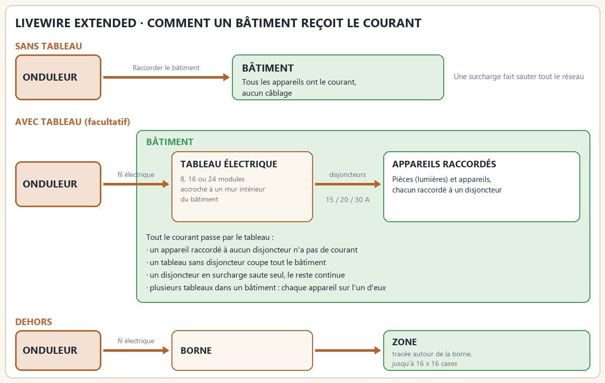
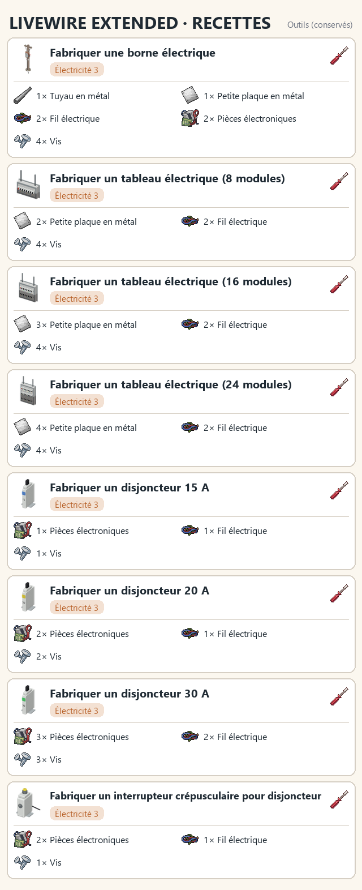
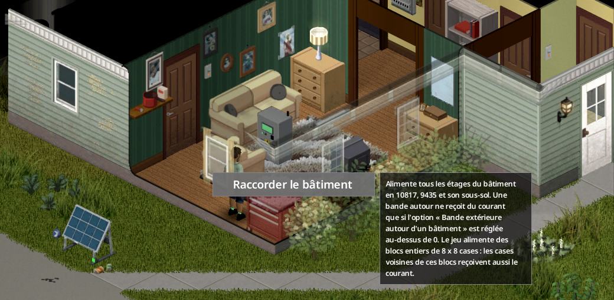
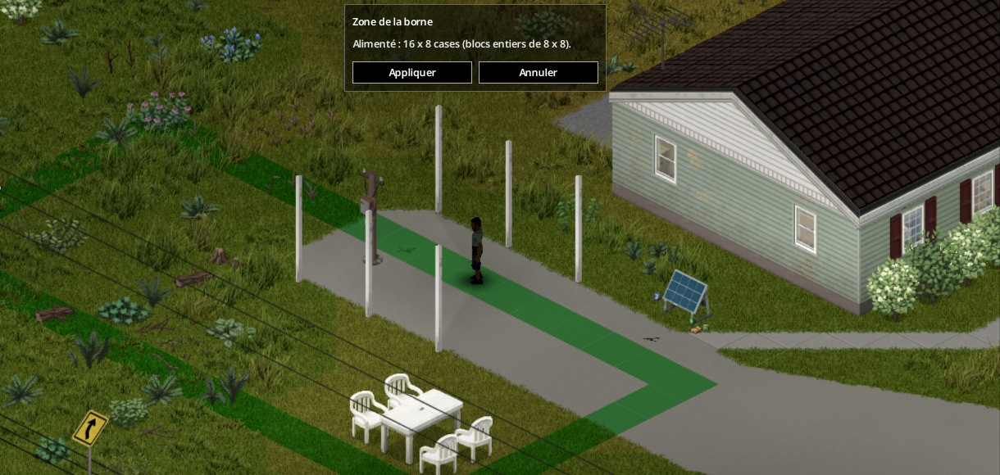
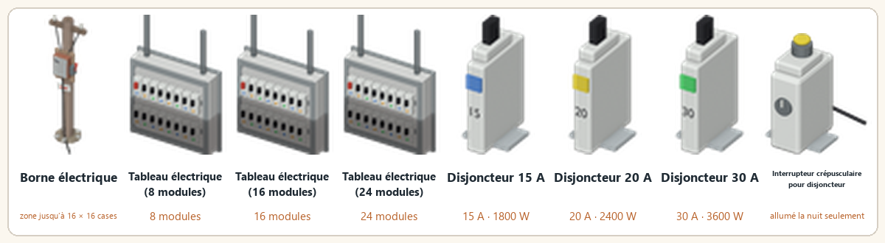
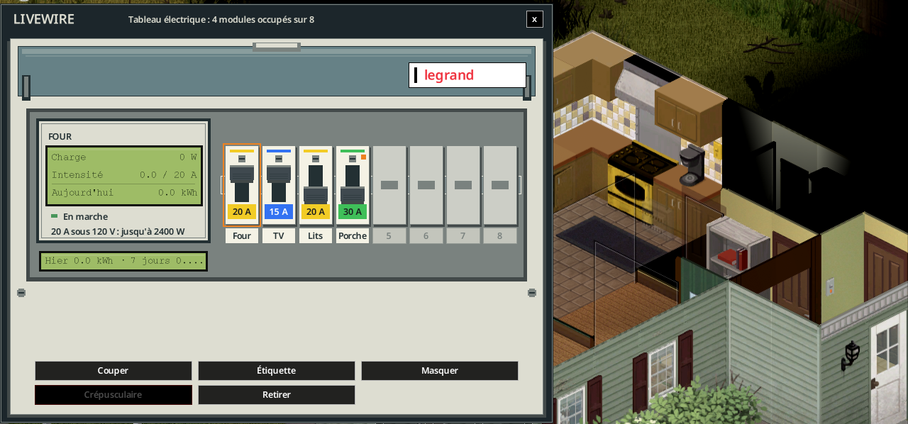
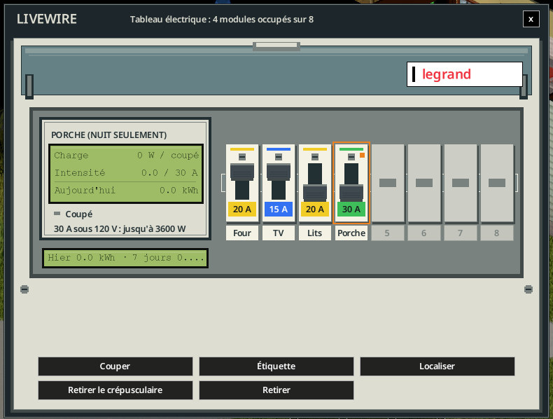
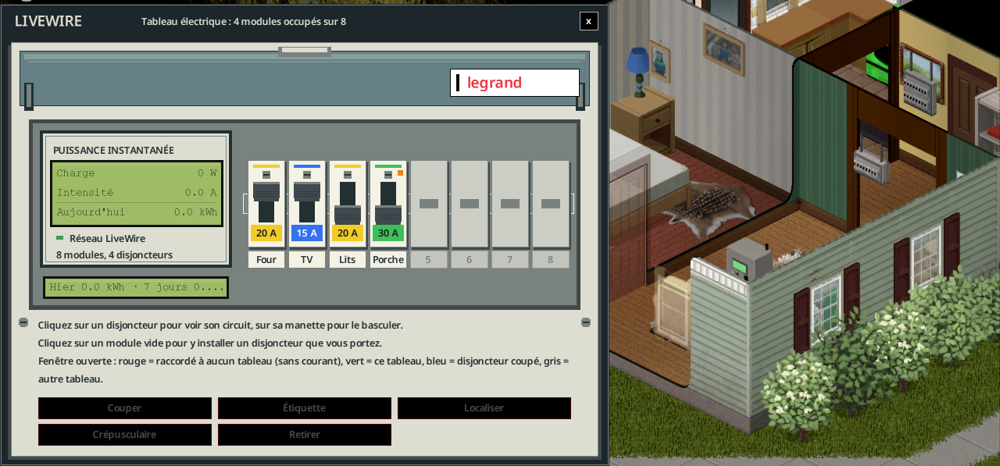

> English version: [LiveWire Extended](../en/14-livewire-extended.md)

# LiveWire Extended (extension optionnelle)

**LiveWire Extended** (`batman_LiveWireExtended`, version 1.0.0) est une extension optionnelle de LiveWire. Elle demande LiveWire. Elle ajoute quatre moyens d'amener le courant là où le mod de base ne peut pas aller : un bâtiment entier raccordé à un onduleur, une borne électrique extérieure avec sa propre zone, des tableaux électriques où chaque appareil est branché sur un disjoncteur (un même disjoncteur peut alimenter plusieurs appareils), et les disjoncteurs, étiquettes et interrupteurs crépusculaires qui vont avec. Avec l'extension, un onduleur n'alimente que ce qui est raccordé à lui, et plus un rayon autour de lui. Sans elle, LiveWire fonctionne comme avant.

## Activer et prérequis

- LiveWire Extended est livrée dans le même élément du Workshop Steam que LiveWire (identifiant 3821807453). Abonnez-vous à cet élément, puis activez **LiveWire Extended** dans la liste des mods. Elle se charge après LiveWire.
- Elle demande LiveWire (`batman_LiveWire`). Sans LiveWire, elle ne fait rien.
- Raccorder un bâtiment, raccorder la borne électrique ou un tableau à un onduleur, installer un disjoncteur, raccorder un appareil et agrandir un tableau demandent le **niveau 3 d'Électricité** et un **tournevis**. Poser ou ramasser une borne ou un tableau demande un **tournevis**, sans niveau. Poser un interrupteur crépusculaire demande un tournevis, sans niveau ; seule sa fabrication demande le niveau 3.
- L'option sandbox **Niveaux requis** (options de LiveWire) s'applique aussi à Extended : désactivée, aucun niveau n'est requis pour les opérations ci-dessus. Les recettes de fabrication gardent leur niveau 3.
- Mods déclarés incompatibles : voir [Mods incompatibles](#mods-incompatibles).

## Recettes

Les recettes demandent le niveau 3 d'Électricité et un tournevis. Les durées sont celles de [Recettes](08-recettes.md#recettes-extended).

| Recette | Ingrédients |
|---|---|
| Fabriquer une borne électrique | 1 tuyau en métal, 1 petite plaque en métal, 2 fils électriques, 2 pièces électroniques, 4 vis |
| Fabriquer un tableau électrique (8 modules) | 2 petites plaques en métal, 2 fils électriques, 4 vis |
| Fabriquer un tableau électrique (16 modules) | 3 petites plaques en métal, 2 fils électriques, 4 vis |
| Fabriquer un tableau électrique (24 modules) | 4 petites plaques en métal, 2 fils électriques, 4 vis |
| Fabriquer un disjoncteur 15 A | 1 pièce électronique, 1 fil électrique, 1 vis |
| Fabriquer un disjoncteur 20 A | 2 pièces électroniques, 1 fil électrique, 2 vis |
| Fabriquer un disjoncteur 30 A | 3 pièces électroniques, 2 fils électriques, 3 vis |
| Fabriquer un interrupteur crépusculaire pour disjoncteur | 2 pièces électroniques, 1 fil électrique, 1 vis |

Les appareils Extended n'ont pas de recette de démontage : on les ramasse au tournevis.

## Raccorder tout un bâtiment

Clic droit sur un onduleur > **LiveWire Extended** > **Raccorder le bâtiment**. Il faut le niveau 3 d'Électricité et un tournevis. Aucun fil n'est utilisé.

- Le bâtiment où se trouve l'onduleur est raccordé. Si l'onduleur est à l'extérieur, c'est le bâtiment le plus proche dans sa portée de générateur (20 cases par défaut).
- Tout le bâtiment reçoit le courant : tous les étages, le sous-sol, et le reste des blocs de 8 x 8 cases qu'il couvre. Le jeu alimente des blocs entiers : les cases voisines situées dans les mêmes blocs reçoivent aussi le courant.
- Une option sandbox, **Bande extérieure autour d'un bâtiment** (0 à 8 cases, 0 par défaut), ajoute une bande de cases extérieures autour du bâtiment raccordé.
- Un bâtiment n'est raccordé qu'à un onduleur à la fois. **Débrancher le bâtiment** se trouve dans le même menu et indique où est le bâtiment.
- Les appareils du bâtiment sont ensuite facturés par l'onduleur comme les autres : consommation, disjoncteur et batterie fonctionnent normalement.

*Le menu de l'onduleur propose **Raccorder le bâtiment** ; son infobulle donne la position du bâtiment et explique les blocs de 8 x 8 cases.*

## Borne électrique et zone

La **borne électrique** amène le courant à l'extérieur : un potager, un atelier, une cour, une maison construite par le joueur.

1. **Posez-la** avec le curseur de meuble. Poser et ramasser demandent un tournevis ; la pose ne demande aucun niveau d'Électricité.
2. **Raccordez-la à un onduleur** : clic droit > **LiveWire Extended** > **Raccorder à un onduleur**. Il faut le niveau 3 d'Électricité, un tournevis et du fil électrique : un fil par 4 cases de câble, dans la portée des câbles. Son propre bloc de 8 x 8 cases reçoit le courant immédiatement.
3. **Réglez la zone** : clic droit > **Régler la zone**, puis cliquez et faites glisser au sol. Le contour montre les cases que le jeu alimentera vraiment, arrondies à des blocs entiers de 8 x 8 : **vert** quand la zone est permise, **rouge** quand elle ne l'est pas. **Appliquer** garde la zone.

*Réglage de la zone : le contour vert montre les cases qui recevront le courant, arrondies à des blocs entiers de 8 x 8.*

Les règles de zone :

- **2 x 2 blocs au plus** (16 x 16 cases).
- Chaque bloc de la zone doit être **à un bloc au plus** du bloc propre de la borne. La zone reste donc proche de la borne.
- Un bloc alimente l'étage de la borne. Quand cet étage n'a pas de case à cet endroit, c'est le rez-de-chaussée qui est alimenté.

**Débrancher la borne** ou la ramasser supprime sa zone, ainsi que chaque bâtiment qu'elle raccordait (voir [Bâtiments éloignés](#bâtiments-éloignés)). **Débrancher la zone** ne supprime que la zone.

### Bâtiments éloignés

Une borne raccordée posée **à l'intérieur d'un bâtiment**, ou à **2 cases** de celui-ci au plus, propose **Raccorder le bâtiment** dans son propre menu. Le bâtiment reçoit alors le courant par la borne, alimentée par l'onduleur de la borne. Servez-vous-en pour un garage ou un abri que l'onduleur n'atteint pas. Débrancher la borne ou la ramasser supprime ce bâtiment.

## Tableaux électriques

Un **tableau électrique** (8, 16 ou 24 modules) s'accroche sur un mur intérieur d'un bâtiment. Chaque module reçoit un disjoncteur. Chaque disjoncteur alimente les appareils que vous y raccordez. Le tableau se raccorde à un onduleur par du fil électrique, comme la borne, et dessert le bâtiment où il est accroché (voir [Quels bâtiments dessert un tableau](#quels-bâtiments-dessert-un-tableau)).

### Poser un tableau

- Posez-le avec le curseur de meuble sur un **mur intérieur**. Une pièce fermée et couverte compte comme intérieur.
- Un tableau fabriqué n'est **pas étanche**. Sur un mur extérieur, un perron, une cour ou le bord d'un bâtiment de la carte, le curseur le refuse et dit pourquoi : *Pas étanche : à accrocher sur un mur intérieur d'un bâtiment (un abri fermé et couvert compte).* Les clients multijoueur voient le même refus, sauf dans une maison de joueur fraîchement construite, fermée et couverte, où c'est le serveur qui décide.
- Les boîtes électriques du jeu, posées sur une façade, sont étanches. Le curseur de meuble ne les déplace pas. Quand la carte en place une sur une façade, elle dessert le bâtiment de l'autre côté de son mur.
- **Raccorder à un onduleur** : clic droit sur le tableau > **LiveWire Extended** > **Raccorder à un onduleur** (niveau 3 d'Électricité, fil électrique selon la distance). **Débrancher le tableau** annule le raccordement.
- Poser et ramasser demandent un tournevis.

### Agrandir un tableau

Un tableau que vous avez posé s'agrandit sur place, de 8 à 16 puis 24 modules. Clic droit sur le tableau > **Agrandir le tableau (8 → 16 modules)**. Le menu affiche la taille suivante : un tableau de 16 modules propose 16 → 24. Il faut le niveau 3 d'Électricité, un tournevis, **1 petite plaque en métal** et **4 vis** dans l'inventaire. Les disjoncteurs, les étiquettes et les appareils sont conservés. Les boîtes électriques du jeu ne s'agrandissent pas, et un tableau de 24 modules ne grandit plus.

### Disjoncteurs : 15, 20 et 30 A

- Un disjoncteur prend **un seul module**. Installez-le dans un module vide, au tournevis et avec le niveau 3 d'Électricité : depuis la fenêtre du tableau (cliquez sur un module vide) ou depuis le menu du tableau (**Installer un disjoncteur**).
- Calibres à 120 V : **15 A = 1 800 W**, **20 A = 2 400 W**, **30 A = 3 600 W**.
- On les trouve dans le butin des électriciens, de l'électronique, des magasins d'outils et des usines de fil électrique, ainsi que dans les garages et les caisses d'outils, ou on les fabrique (niveau 3 d'Électricité ; un calibre plus fort demande plus de pièces ; voir [Recettes](#recettes)).
- Pour retirer un disjoncteur, il faut un tournevis : **Retirer le disjoncteur du module N (Disjoncteur 15 A)**. Le disjoncteur retourne dans votre inventaire ; entre parenthèses, le nom de l'objet (Disjoncteur 15 A, 20 A ou 30 A). Dans les menus, un module se désigne par son calibre (par exemple 15 A), ou par son étiquette s'il en a une.

### Raccorder un appareil

Raccorder un appareil relie un appareil à un disjoncteur. Il faut :

- un tableau raccordé qui porte un disjoncteur, et l'appareil à sa portée,
- le niveau 3 d'Électricité et un tournevis,
- un **testeur de tension** dans votre inventaire (il est conservé, pas consommé),
- du fil électrique pour la distance du câble.

Cela donne **5 XP** par appareil, une fois par jour pour un même appareil.

Deux façons de commencer :

- **Depuis le tableau** : la fenêtre ou le menu du tableau > **Raccorder un appareil**. La liste est groupée par pièce (**Extérieur** pour les appareils sans pièce), puis par appareil (avec sa distance), puis par module. Seuls les appareils du bâtiment que dessert le tableau sont proposés.
- **Depuis l'appareil** : clic droit sur l'appareil > **Raccorder au tableau**, puis le tableau, puis le module.

Un appareil déjà raccordé affiche **Débrancher du module N** dans son menu. Un appareil à plusieurs cases compte pour un seul appareil. Une pièce et ses interrupteurs muraux forment un seul point d'éclairage.

Dès qu'un tableau dessert son bâtiment, **chaque appareil de ce bâtiment qui n'est raccordé à aucun disjoncteur n'a pas de courant**. Les autres appareils suivent leur disjoncteur. Sans bâtiment desservi, rien ne change.

### Déclenchement

- Chaque disjoncteur **saute tout seul** quand son circuit tire plus que son calibre (watts = ampères x 120 V). La vérification a lieu environ toutes les 10 minutes de jeu.
- Un disjoncteur déclenché est coupé. Les joueurs à moins de 20 cases voient ce message : *Un disjoncteur a sauté : le module N était surchargé.*
- **Réarmez-le** sur le tableau : la manette **RÉARMER** dans la fenêtre du tableau, ou **Réarmer le module N (15 A) (déclenché)** dans le menu, où « 15 A » est le calibre du module ou son étiquette.
- La charge d'un circuit dépend du profil de consommation des options sandbox.

### Fenêtre du tableau, étiquettes et Localiser

**Clic gauche** sur un tableau (ou clic droit > **Ouvrir le tableau**) pour ouvrir sa fenêtre. Les mêmes règles de portée et de vue que pour les autres écrans de LiveWire s'appliquent. Un tableau non raccordé le dit : *Raccordez d'abord le tableau à un onduleur.*

La fenêtre affiche le titre *Tableau électrique : N modules occupés sur M*, et pour chaque module :

- son disjoncteur et sa **manette** : couper ou remettre, ou RÉARMER après un déclenchement,
- son **étiquette**, écrite avec un stylo ou un crayon (bouton **Étiquette** ; 24 octets au plus, donc une lettre accentuée en prend deux),
- sa charge en W et en A, et le nombre d'appareils raccordés.

Si vous êtes déjà à portée du tableau, la manœuvre se fait immédiatement. Un disjoncteur sans appareil affiche **Aucun appareil raccordé**, et son étiquette est orange.

**Localiser** allume les appareils de ce disjoncteur ; **Masquer** éteint ce repère.

*Localiser sur le disjoncteur Four : la cuisinière s'allume en doré ; le bouton affiche maintenant Masquer.*

*La fenêtre du tableau : quatre disjoncteurs étiquetés ; le disjoncteur Porche sélectionné passe par un interrupteur crépusculaire (nuit seulement).*

Tant que la fenêtre est ouverte, les appareils de la zone du tableau sont teintés, et une légende explique les couleurs :

- **rouge** : raccordé à aucun tableau (pas de courant),
- **vert** : raccordé à ce tableau,
- **bleu** : son disjoncteur est coupé ou déclenché,
- **gris** : raccordé à un autre tableau.

*Fenêtre ouverte, les appareils de la zone du tableau sont teintés ; la légende se trouve sous les disjoncteurs.*

### Interrupteur crépusculaire

L'**interrupteur crépusculaire pour disjoncteur** n'est pas un module de tableau à part : il se pose **sur un disjoncteur** déjà installé dans un tableau, et commande ce disjoncteur. Éclairages de jardin, lampes de perron.

- **La nuit**, du crépuscule à l'aube, le disjoncteur reste **fermé** : le courant passe.
- **Le jour**, il **s'ouvre** : le circuit est coupé.
- Le crépuscule et l'aube **suivent les saisons** : les lampes s'allument plus tôt en hiver qu'en été. Ni les nuages ni la pluie ne les allument. L'interrupteur vérifie toutes les dix minutes de jeu.
- Coupé à la main ou déclenché, le disjoncteur reste ouvert, de nuit comme de jour.

- Posez-le : glissez l'interrupteur depuis votre inventaire sur un module. Les modules sans interrupteur crépusculaire reçoivent une bordure verte. Vous pouvez aussi utiliser le bouton **Crépusculaire** de la fenêtre du tableau, ou **Poser un interrupteur crépusculaire sur le module N (15 A)** dans le menu. La pose demande un tableau raccordé, un disjoncteur dans le module, un tournevis et l'interrupteur.
- L'étiquette du disjoncteur indique alors *(nuit seulement)*.
- Retirez-le avec **Retirer l'interrupteur crépusculaire du module N (15 A)**, ou le bouton **Retirer le crépusculaire**.

### Comptage de l'énergie

Chaque disjoncteur compte son énergie : **aujourd'hui**, **hier** et les **7 derniers jours**, en kWh. La fenêtre du tableau les affiche, et l'onglet Maison du logiciel de l'onduleur liste l'énergie de chaque disjoncteur.

### Tableaux déjà présents sur la carte

Certains bâtiments de la carte ont déjà un tableau. L'option sandbox **Bâtiments avec un tableau électrique (%)** (par défaut **30**, de 0 à 100) fixe la part des bâtiments qui en reçoivent un. Un bâtiment qui a sa propre boîte électrique l'utilise comme tableau. Les autres bâtiments reçoivent un tableau sur un mur nu : le garage d'abord, puis une pièce technique, puis l'entrée, puis une pièce quelconque.

Un tableau de la carte ne fait rien tant qu'il n'est pas raccordé à un onduleur. Au premier raccordement, il est **câblé à l'avance**, une seule fois :

- un **disjoncteur de 20 A par pièce**, pour ses lampes et ses appareils,
- la cuisinière et le sèche-linge, chacun sur **son propre disjoncteur de 30 A**,
- le plus petit tableau qui convient (8, 16 ou 24 modules) ; les pièces au-delà de sa capacité se partagent les disjoncteurs des pièces.

Les disjoncteurs préinstallés n'ont pas d'étiquette : il faut découvrir quel disjoncteur alimente quoi.

## Quels bâtiments dessert un tableau

Un tableau dessert le **site** où il est accroché :

- un **bâtiment de la carte** : tous ses étages et le sous-sol,
- une **maison construite par le joueur** : la pièce fermée et couverte où le tableau est accroché, plus les pièces fermées et couvertes superposées au-dessus et au-dessous. Tous les étages de la maison sont desservis.

Un **perron, une cour ou le bord d'un bâtiment de la carte** n'est pas desservi. Une boîte étanche accrochée sur une façade dessert le bâtiment de l'autre côté de son mur. Un tableau qui ne dessert rien l'indique dans sa fenêtre : *Ce tableau est accroché à l'extérieur : il ne dessert aucun bâtiment.*

Cette règle s'applique en solo comme sur un serveur dédié.

## Sur l'écran de l'onduleur

L'écran de l'onduleur liste les bâtiments et les zones de borne raccordés à lui.

## Autres mods

- **My Tailor Is Rich** : sa machine à coudre électrique suit son disjoncteur.
- **Functional Appliances 2** : ses machines suivent leur disjoncteur.
- **Pompe à eau et ordinateur de gestion de LiveWire** : ils suivent eux aussi leur disjoncteur.
- **Project Viewpoint** : l'option **LiveWire - Viewpoint models** (`batman_LiveWireViewpoint`) ajoute des modèles 3D de la borne et des tableaux quand LiveWire Extended est activée. Elle demande Project Viewpoint.

## Mods incompatibles

LiveWire Extended est déclarée incompatible avec **LG Extended Electricity** et **Knox Power**. Ne les activez pas ensemble.

## Retirer l'extension

Avant de retirer LiveWire Extended, un **administrateur** remet tous les disjoncteurs en service. Sinon, un disjoncteur peut continuer de couper des appareils que l'extension ne commande plus.

1. Ouvrez le menu d'un tableau électrique et choisissez **Admin : tout remettre en service (avant de retirer le mod)**.
2. Aucun disjoncteur ne coupe. Chaque appareil retrouve son état normal : les réfrigérateurs refroidissent, les machines de Functional Appliances 2 retrouvent leur réglage, et les zones des bornes sont rétablies. Le message dit : *Tous les disjoncteurs sont remis et plus aucun tableau ne coupe (N points rétablis). LiveWire Extended peut être retiré.*
3. Décochez **LiveWire Extended** dans la liste des mods. LiveWire fonctionne alors sans l'extension, avec son propre rayon. Rien n'est perdu dans les données propres à LiveWire.

L'entrée de menu **Admin : remettre les tableaux en fonction** reprend le fonctionnement des tableaux si vous changez d'avis.

Sur un serveur, le joueur doit avoir un niveau d'accès différent de *None*. En solo, le joueur peut utiliser l'action.
