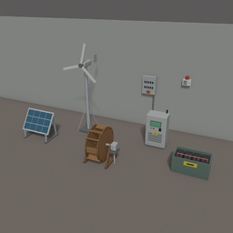
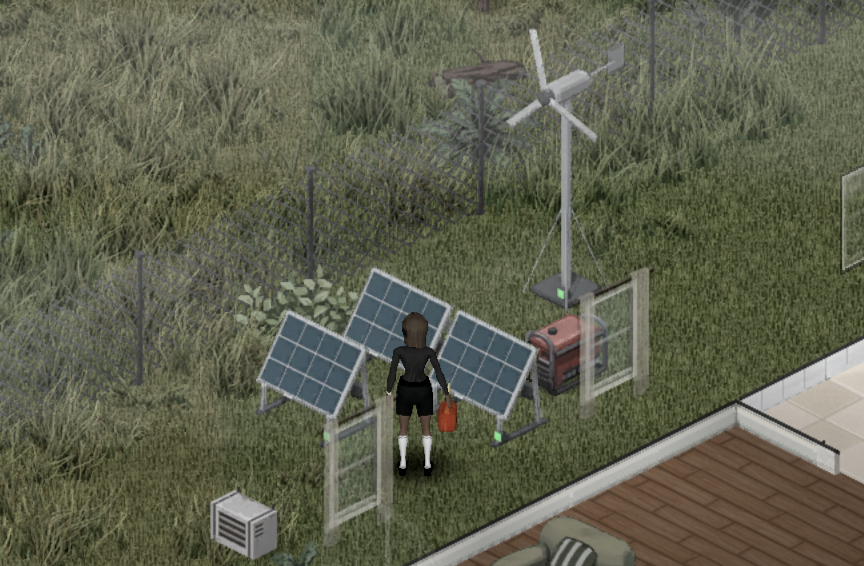

> English version: [Home](../en/Home.md)

# Live Wire

Live Wire est un mod pour Project Zomboid **Build 42.21** (ID du mod `batman_LiveWire`, [objet Workshop 3821807453](https://steamcommunity.com/sharedfiles/filedetails/?id=3821807453)). Il ajoute panneaux solaires, éoliennes et roues à aubes, batteries rangées dans une powerbank, un onduleur qui alimente la maison et une pompe à eau qui alimente les robinets depuis des barils. La compétence Électricité devient un métier.

Pour commencer : [Premiers pas](01-premiers-pas.md).

## Pages

- [Premiers pas](01-premiers-pas.md)
- [Équipements](02-equipements.md)
- [Raccordement](03-raccordement.md)
- [Production et calculs](04-production-et-calculs.md)
- [Écran et logiciel](05-ecran-et-logiciel.md)
- [Équipements optionnels](06-equipements-optionnels.md)
- [Pompe à eau](07-pompe-a-eau.md)
- [Recettes](08-recettes.md)
- [Tables de butin](09-tables-de-butin.md)
- [Compétence Électricité et entretien](10-competence-electricite-et-entretien.md)
- [Options sandbox](11-options-sandbox.md)
- [Multijoueur](12-multijoueur.md)
- [FAQ](13-faq.md)

---

[README du dépôt](https://github.com/cyberbobjr/LiveWire) · [Licence (MIT)](https://github.com/cyberbobjr/LiveWire/blob/main/LICENSE)
