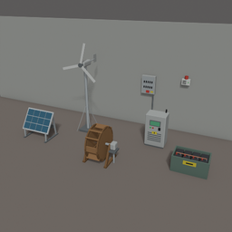
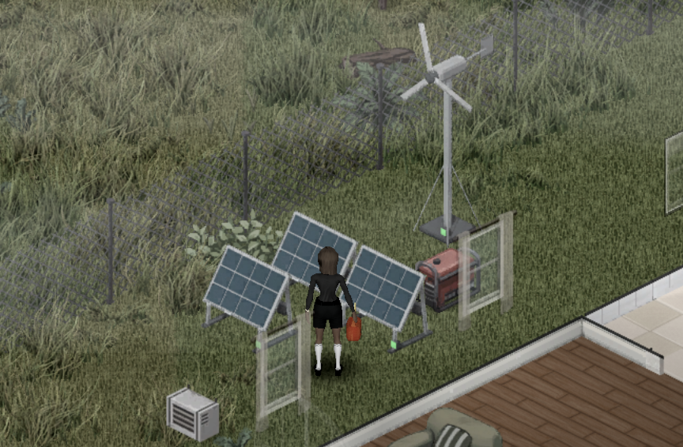
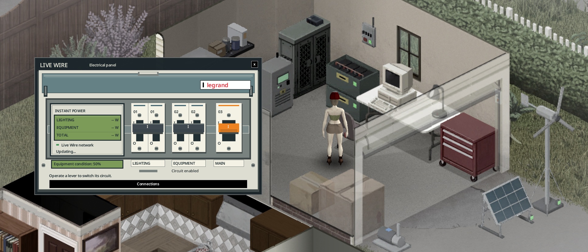
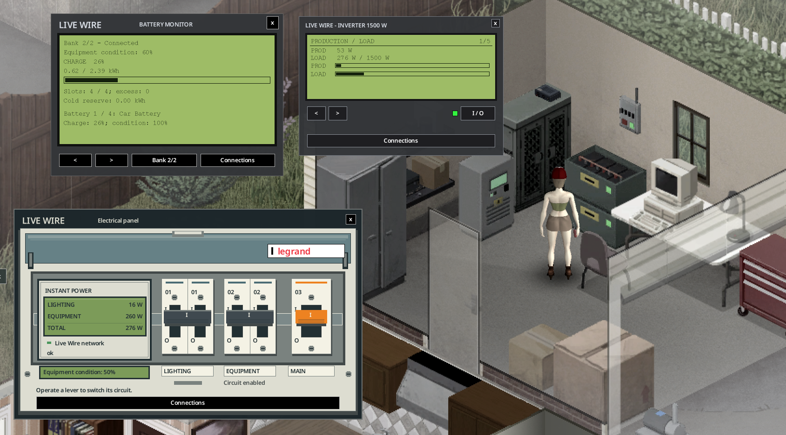

> English version: [Home](../en/Home.md)

# LiveWire

**LiveWire** (version 2.0.0, ID du mod `batman_LiveWire`, [objet Workshop 3821807453](https://steamcommunity.com/sharedfiles/filedetails/?id=3821807453)) est un mod pour Project Zomboid **Build 42.21** (il fonctionne aussi en Build 42.22). Il ajoute panneaux photovoltaïques, éoliennes et roues à aubes, batteries rangées dans une powerbank, un onduleur qui alimente la maison et une pompe à eau qui alimente les robinets depuis des barils. La compétence Électricité devient un métier.

**LiveWire Extended** (version 1.0.0, `batman_LiveWireExtended`) est un module facultatif dans le même objet Workshop. Il raccorde des bâtiments entiers, ajoute des bornes électriques extérieures et des tableaux électriques où chaque appareil a son propre disjoncteur. Voir [LiveWire Extended](14-livewire-extended.md).

**LiveWire - Viewpoint models** (version 2.0.0, `batman_LiveWireViewpoint`) est un autre mod facultatif du même objet Workshop. Il ajoute des modèles 3D des équipements, ainsi que de la borne électrique et des tableaux électriques de LiveWire Extended, pour Project Viewpoint ; il ne fait rien sans Project Viewpoint.

Pour commencer : [Premiers pas](01-premiers-pas.md).

## Pages

- [Premiers pas](01-premiers-pas.md) : première source, premier onduleur et premier raccordement.
- [Équipements](02-equipements.md) : chaque équipement, les batteries, la pose, la rotation, le ramassage et le démontage.
- [Raccordement](03-raccordement.md) : relier les équipements à un onduleur, coût en fils, portées et fenêtre Raccordements.
- [Production et calculs](04-production-et-calculs.md) : ce que produit chaque source et ce que consomment les appareils.
- [Écran et logiciel](05-ecran-et-logiciel.md) : LCD de l'onduleur, LiveWire Monitor, bourdonnement, insonorisation et clics directs.
- [Équipements optionnels](06-equipements-optionnels.md) : disjoncteur, alarme, générateur de secours, ordinateur de gestion, onduleurs couplés et tableau électrique à deux circuits.
- [Pompe à eau](07-pompe-a-eau.md) : des barils d'eau qui alimentent les robinets de la maison.
- [Recettes](08-recettes.md) : toutes les recettes de fabrication et de démontage.
- [Tables de butin](09-tables-de-butin.md) : où trouver les équipements et les pièces.
- [Compétence Électricité et entretien](10-competence-electricite-et-entretien.md) : niveaux de compétence, usure, réparation et nettoyage.
- [Options sandbox](11-options-sandbox.md) : toutes les options de LiveWire.
- [Multijoueur](12-multijoueur.md) : serveurs dédiés et règles du multijoueur.
- [FAQ](13-faq.md) : questions fréquentes.
- [LiveWire Extended](14-livewire-extended.md) : le module facultatif : bâtiments entiers, bornes extérieures et tableaux électriques.

---

[README du dépôt](https://github.com/cyberbobjr/LiveWire) · [Licence (MIT)](https://github.com/cyberbobjr/LiveWire/blob/main/LICENSE)
