<!-- generated by tools/make_doc_tables.py -->

## RECIPES

| Recette | Ingrédients | Outils (conservés) | Compétence | Résultat |
|---|---|---|---|---|
| Fabriquer un testeur de tension | 1 × 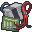 Pièces électroniques 1 ×  Fil électrique 1 ×  Ampoule 1 ×  Pile |  | Électricité 1 |  **Testeur de tension** |
| Fabriquer une cellule photovoltaïque | 5 ×  Pièces électroniques 1 ×  Aluminium |  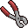 | Électricité 3 | 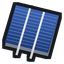 **Cellule photovoltaïque** |
| Fabriquer un panneau photovoltaïque | 10 ×  Cellule photovoltaïque 1 ×  Plaque en métal 2 ×  Fil électrique 4 × 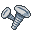 Vis 1 ×  Super glue |   | Électricité 3 |  **Panneau photovoltaïque** |
| Fabriquer un onduleur | 4 ×  Pièces électroniques 2 ×  Amplificateur 3 ×  Fil électrique 1 ×  Petite plaque en métal 4 ×  Vis |   | Électricité 3 |  **Onduleur** |
| Fabriquer une armoire onduleur | 1 ×  Onduleur 4 ×  Pièces électroniques 2 ×  Amplificateur 4 ×  Fil électrique 1 ×  Plaque en métal 8 ×  Vis |   | Électricité 3 | 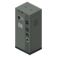 **Armoire onduleur** |
| Fabriquer un jeu de pales d’éolienne | 2 ×  Plaque en métal 2 ×  Vis |   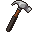 | aucune |  **Jeu de pales d’éolienne** |
| Fabriquer un mât d’éolienne | 1 ×  Tuyau en métal 2 ×  Barre en métal 2 ×  Vis |    | aucune |  **Mât d’éolienne** |
| Assembler une éolienne | 1 ×  Jeu de pales d’éolienne 1 ×  Mât d’éolienne 2 ×  Amplificateur 3 ×  Fil électrique 4 ×  Pièces électroniques 2 ×  Vis |   | Électricité 3 |  **Éolienne** |
| Fabriquer une roue à aubes | 8 ×  Planche 20 × 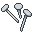 Clous 2 ×  Amplificateur 3 ×  Fil électrique 4 ×  Pièces électroniques 1 ×  Barre en métal |   | Électricité 4 |  **Roue à aubes** |
| Fabriquer une powerbank | 2 ×  Pièces électroniques 3 ×  Fil électrique 1 ×  Plaque en métal 4 ×  Vis |   | Électricité 2 |  **Powerbank** |
| Fabriquer un disjoncteur | 2 ×  Pièces électroniques 1 ×  Fil électrique 1 ×  Petite plaque en métal 2 ×  Vis |  | Électricité 3 |  **Disjoncteur** |
| Fabriquer une pompe à eau | 3 ×  Pièces électroniques 2 ×  Fil électrique 2 ×  Tuyau en métal 1 ×  Petite plaque en métal 4 ×  Vis |   | Électricité 3 | 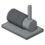 **Pompe à eau** |
| Fabriquer un kit de couplage d'onduleurs | 2 ×  Pièces électroniques 2 ×  Fil électrique 1 ×  Amplificateur |  | Électricité 3 |  **Kit de couplage d'onduleurs** |
| Fabriquer une batterie stationnaire | 2 ×  Batterie de voiture (toutes) 2 ×  Fil électrique 1 × 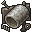 Ferraille |   | Électricité 3 |  **Batterie stationnaire** |
| Fabriquer une alarme de batterie faible | 1 ×  Pièces électroniques 1 ×  Fil électrique 1 ×  Amplificateur |  | Électricité 2 |  **Alarme de batterie faible** |
| Fabriquer un kit d'insonorisation d'onduleur | 4 ×  Planche 10 ×  Clous 4 × 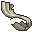 Tissu déchiré |   | Électricité 2 |  **Kit d'insonorisation d'onduleur** |

## DISMANTLING

| Recette | Ingrédients | Outils (conservés) | Compétence | Résultat |
|---|---|---|---|---|
| Démonter un testeur de tension | 1 ×  Testeur de tension |  | aucune |  **Pièces électroniques** |
| Démonter un panneau photovoltaïque | 1 ×  Panneau photovoltaïque |  | aucune | 1 ×  **Plaque en métal** 2 ×  **Vis** |
| Démonter une éolienne | 1 ×  Éolienne |  | aucune | 1 ×  **Jeu de pales d’éolienne** 1 ×  **Mât d’éolienne** 1 ×  **Vis** |
| Démonter une roue à aubes | 1 ×  Roue à aubes |   | aucune | 6 ×  **Planche** 10 ×  **Clous** 1 ×  **Barre en métal** |
| Démonter un onduleur | 1 ×  Onduleur |  | aucune | 1 ×  **Petite plaque en métal** 2 ×  **Vis** |
| Démonter une armoire onduleur | 1 ×  Armoire onduleur |  | aucune | 1 ×  **Plaque en métal** 1 ×  **Petite plaque en métal** 6 ×  **Vis** |
| Démonter une powerbank | 1 ×  Powerbank |  | aucune | 1 ×  **Plaque en métal** 2 ×  **Vis** |
| Démonter un disjoncteur | 1 ×  Disjoncteur |  | aucune | 1 ×  **Petite plaque en métal** 1 ×  **Vis** |
| Démonter une alarme de batterie faible | 1 ×  Alarme de batterie faible |  | aucune |  **Fil électrique** |
| Démonter une pompe à eau | 1 ×  Pompe à eau |   | aucune | 2 ×  **Tuyau en métal** 1 ×  **Petite plaque en métal** 2 ×  **Vis** |
| Démonter un kit de couplage d'onduleurs | 1 ×  Kit de couplage d'onduleurs |  | aucune | 1 ×  **Amplificateur** 1 ×  **Fil électrique** 1 ×  **Pièces électroniques** |
| Démonter un kit d'insonorisation d'onduleur | 1 ×  Kit d'insonorisation d'onduleur |   | aucune | 3 ×  **Planche** 5 ×  **Clous** 2 ×  **Tissu déchiré** |
| Démonter un jeu de pales d’éolienne | 1 ×  Jeu de pales d’éolienne |  | aucune | 1 ×  **Plaque en métal** 1 ×  **Vis** |
| Démonter un mât d’éolienne | 1 ×  Mât d’éolienne |   | aucune | 1 ×  **Tuyau en métal** 1 ×  **Barre en métal** 1 ×  **Vis** |
| Démonter une batterie stationnaire | 1 ×  Batterie stationnaire |  | aucune |  **Ferraille** |

## RECIPES EXTENDED

| Recette | Ingrédients | Outils (conservés) | Compétence | Résultat |
|---|---|---|---|---|
| Fabriquer une borne électrique | 1 ×  Tuyau en métal 1 ×  Petite plaque en métal 2 ×  Fil électrique 2 ×  Pièces électroniques 4 ×  Vis |  | Électricité 3 | 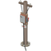 **Borne électrique** |
| Fabriquer un tableau électrique (8 modules) | 2 ×  Petite plaque en métal 2 ×  Fil électrique 4 ×  Vis |  | Électricité 3 | 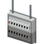 **Tableau électrique (8 modules)** |
| Fabriquer un tableau électrique (16 modules) | 3 ×  Petite plaque en métal 2 ×  Fil électrique 4 ×  Vis |  | Électricité 3 | 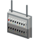 **Tableau électrique (16 modules)** |
| Fabriquer un tableau électrique (24 modules) | 4 ×  Petite plaque en métal 2 ×  Fil électrique 4 ×  Vis |  | Électricité 3 |  **Tableau électrique (24 modules)** |
| Fabriquer un disjoncteur 15 A | 1 ×  Pièces électroniques 1 ×  Fil électrique 1 ×  Vis |  | Électricité 3 | 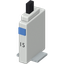 **Disjoncteur 15 A** |
| Fabriquer un disjoncteur 20 A | 2 ×  Pièces électroniques 1 ×  Fil électrique 2 ×  Vis |  | Électricité 3 | 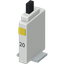 **Disjoncteur 20 A** |
| Fabriquer un disjoncteur 30 A | 3 ×  Pièces électroniques 2 ×  Fil électrique 3 ×  Vis |  | Électricité 3 | 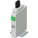 **Disjoncteur 30 A** |
| Fabriquer un interrupteur crépusculaire pour disjoncteur | 2 ×  Pièces électroniques 1 ×  Fil électrique 1 ×  Vis |  | Électricité 3 | 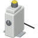 **Interrupteur crépusculaire pour disjoncteur** |

## CELLS (x5)

| Liste vanilla | Où | Poids (×5) | Tirages | ≈ chance par conteneur |
|---|---|---|---|---|
| `GarageTools` | Rangement d'outils de garage | 10 | 4 | 21,9 % |
| `CrateTools` | Caisses d'outils | 5 | 4 | 11,5 % |
| `GarageMetalwork` | Rangement de métallerie de garage | 5 | 4 | 11,5 % |
| `MechanicShelfElectric` | Garage automobile, étagère électrique | 10 | 4 | 21,9 % |
| `ElectricianTools` | Outils d'électricien | 15 | 3 | 24,6 % |
| `MetalShopTools` | Outils de métallerie | 5 | 4 | 11,5 % |
| `WireFactoryElectric` | Usine de câbles, rayon électrique | 10 | 4 | 21,9 % |
| `ToolStoreMisc` | Quincaillerie, divers | 10 | 4 | 21,9 % |
| `CrateElectronics` | Caisses d'électronique | 10 | 4 | 21,9 % |
| `ElectronicStoreMisc` | Magasin d'électronique, divers | 10 | 4 | 21,9 % |
| `ToolStoreMetalwork` | Quincaillerie, métallerie | 5 | 4 | 11,5 % |
| `CrateMetalwork` | Caisses de métallerie | 5 | 4 | 11,5 % |
| `ElectricianTruckBed` | Véhicule d'électricien, plateau ou coffre | 10 | 4 | 21,9 % |

## LOOT: Équipements LiveWire tout faits

Poids avec EquipmentLootMultiplier = 5 par défaut (plage 1–20). Estimations si cette liste est sélectionnée, avec le modificateur de butin du jeu à rareté normale (0,6), sans effet de densité de zombies ni du temps et avec assez de place ; ce ne sont pas des taux de découverte garantis.

| Équipement | Liste vanilla | Où | Poids (×5) | Tirages | ≈ chance par conteneur |
|---|---|---|---|---|---|
|  **Panneau photovoltaïque** | `GarageMetalwork` | Rangement de métallerie de garage | 2,5 | 4 | 5,9 % |
|  | `ToolStoreMisc` | Quincaillerie, divers | 2,5 | 4 | 5,9 % |
|  | `CrateElectronics` | Caisses d'électronique | 2,5 | 4 | 5,9 % |
|  | `ElectronicStoreMisc` | Magasin d'électronique, divers | 2,5 | 4 | 5,9 % |
|  | `ElectricianTruckBed` | Véhicule d'électricien, plateau ou coffre | 2,5 | 4 | 5,9 % |
|  | `GarageTools` | Rangement d'outils de garage | 1,5 | 4 | 3,6 % |
|  | `CrateTools` | Caisses d'outils | 1,5 | 4 | 3,6 % |
|  | `ToolStoreTools` | Quincaillerie, outils | 1,5 | 4 | 3,6 % |
|  | `CrateMetalwork` | Caisses de métallerie | 1,5 | 4 | 3,6 % |
|  | `ToolStoreMetalwork` | Quincaillerie, métallerie | 1,5 | 4 | 3,6 % |
|  | `GarageMechanics` | Garage, rangement mécanique | 1,5 | 4 | 3,6 % |
|  | `MetalWelderTruckBed` | Véhicule de métallier, plateau ou coffre | 1,5 | 4 | 3,6 % |
|  **Testeur de tension** | `ElectricianTools` | Outils d'électricien | 5 | 3 | 8,7 % |
|  | `ElectricianTruckBed` | Véhicule d'électricien, plateau ou coffre | 5 | 4 | 11,5 % |
|  | `WireFactoryElectric` | Usine de câbles, rayon électrique | 2,5 | 4 | 5,9 % |
|  | `ToolStoreTools` | Quincaillerie, outils | 1,5 | 4 | 3,6 % |
|  | `ElectronicStoreMisc` | Magasin d'électronique, divers | 1,5 | 4 | 3,6 % |
|  | `CrateElectronics` | Caisses d'électronique | 1,5 | 4 | 3,6 % |
|  | `MechanicShelfElectric` | Garage automobile, étagère électrique | 1,5 | 4 | 3,6 % |
|  | `ElectricianGloveBox` | Véhicule d'électricien, boîte à gants | 1,5 | 1 | 0,9 % |
|  | `GarageTools` | Rangement d'outils de garage | 1 | 4 | 2,4 % |
|  | `CrateTools` | Caisses d'outils | 1 | 4 | 2,4 % |
|  **Batterie stationnaire** (réglage de butin : Matériel de mécanique) | `CarSupplyBatteries` | Magasin de pièces auto, batteries | 10 | 4 | 21,9 % |
|  | `MechanicShelfElectric` | Garage automobile, étagère électrique | 5 | 4 | 11,5 % |
|  | `CrateMechanics` | Caisses de mécanique | 3,5 | 4 | 8,1 % |
|  | `CrateElectronics` | Caisses d'électronique | 2,5 | 4 | 5,9 % |
|  | `ElectronicStoreMisc` | Magasin d'électronique, divers | 2,5 | 4 | 5,9 % |
|  | `GarageMechanics` | Garage, rangement mécanique | 1,5 | 4 | 3,6 % |
|  | `CampingStoreGear` | Magasin de camping, matériel | 1,5 | 4 | 3,6 % |
|  **Onduleur** | `ElectricianTools` | Outils d'électricien | 2,5 | 3 | 4,4 % |
|  | `WireFactoryElectric` | Usine de câbles, rayon électrique | 2,5 | 4 | 5,9 % |
|  | `CrateElectronics` | Caisses d'électronique | 2,5 | 4 | 5,9 % |
|  | `ElectronicStoreMisc` | Magasin d'électronique, divers | 2,5 | 4 | 5,9 % |
|  | `ElectricianTruckBed` | Véhicule d'électricien, plateau ou coffre | 2,5 | 4 | 5,9 % |
|  | `ElectronicStoreAppliances` | Magasin d'électronique, appareils | 1,5 | 1 | 0,9 % |
|  | `MechanicShelfElectric` | Garage automobile, étagère électrique | 1,5 | 4 | 3,6 % |
|  | `GarageMechanics` | Garage, rangement mécanique | 1,5 | 4 | 3,6 % |
|  | `ToolStoreMisc` | Quincaillerie, divers | 1 | 4 | 2,4 % |
|  | `CrateTools` | Caisses d'outils | 1 | 4 | 2,4 % |
|  | `GarageTools` | Rangement d'outils de garage | 0,5 | 4 | 1,2 % |
|  **Disjoncteur** | `ElectricianTools` | Outils d'électricien | 5 | 3 | 8,7 % |
|  | `WireFactoryElectric` | Usine de câbles, rayon électrique | 5 | 4 | 11,5 % |
|  | `ElectricianTruckBed` | Véhicule d'électricien, plateau ou coffre | 5 | 4 | 11,5 % |
|  | `CrateElectronics` | Caisses d'électronique | 3,5 | 4 | 8,1 % |
|  | `ToolStoreMisc` | Quincaillerie, divers | 2,5 | 4 | 5,9 % |
|  | `ElectronicStoreMisc` | Magasin d'électronique, divers | 2,5 | 4 | 5,9 % |
|  | `ToolStoreTools` | Quincaillerie, outils | 2,5 | 4 | 5,9 % |
|  | `GarageTools` | Rangement d'outils de garage | 1,5 | 4 | 3,6 % |
|  | `CrateTools` | Caisses d'outils | 1,5 | 4 | 3,6 % |
|  | `CrateMetalwork` | Caisses de métallerie | 1,5 | 4 | 3,6 % |
|  | `GarageMechanics` | Garage, rangement mécanique | 1,5 | 4 | 3,6 % |
|  | `GarageMetalwork` | Rangement de métallerie de garage | 1,5 | 4 | 3,6 % |
|  **Powerbank** | `ElectricianTools` | Outils d'électricien | 2,5 | 3 | 4,4 % |
|  | `MechanicShelfElectric` | Garage automobile, étagère électrique | 2,5 | 4 | 5,9 % |
|  | `CrateElectronics` | Caisses d'électronique | 2,5 | 4 | 5,9 % |
|  | `ElectricianTruckBed` | Véhicule d'électricien, plateau ou coffre | 2,5 | 4 | 5,9 % |
|  | `ElectronicStoreMisc` | Magasin d'électronique, divers | 2 | 4 | 4,7 % |
|  | `ToolStoreMisc` | Quincaillerie, divers | 1,5 | 4 | 3,6 % |
|  | `CrateMechanics` | Caisses de mécanique | 1,5 | 4 | 3,6 % |
|  | `GarageTools` | Rangement d'outils de garage | 1 | 4 | 2,4 % |
|  | `GarageMechanics` | Garage, rangement mécanique | 1 | 4 | 2,4 % |
|  | `CrateTools` | Caisses d'outils | 1 | 4 | 2,4 % |
|  **Alarme de batterie faible** | `ElectricianTools` | Outils d'électricien | 5 | 3 | 8,7 % |
|  | `WireFactoryElectric` | Usine de câbles, rayon électrique | 5 | 4 | 11,5 % |
|  | `ElectricianTruckBed` | Véhicule d'électricien, plateau ou coffre | 5 | 4 | 11,5 % |
|  | `CrateElectronics` | Caisses d'électronique | 3,5 | 4 | 8,1 % |
|  | `ToolStoreMisc` | Quincaillerie, divers | 2,5 | 4 | 5,9 % |
|  | `ElectronicStoreMisc` | Magasin d'électronique, divers | 2,5 | 4 | 5,9 % |
|  | `CrateTools` | Caisses d'outils | 1,5 | 4 | 3,6 % |
|  | `GarageTools` | Rangement d'outils de garage | 1,5 | 4 | 3,6 % |
|  | `GarageMechanics` | Garage, rangement mécanique | 1,5 | 4 | 3,6 % |
|  **Éolienne** | `WireFactoryElectric` | Usine de câbles, rayon électrique | 2,5 | 4 | 5,9 % |
|  | `ToolStoreMetalwork` | Quincaillerie, métallerie | 2,5 | 4 | 5,9 % |
|  | `WireFactoryTools` | Usine de câbles, outils | 2,5 | 4 | 5,9 % |
|  | `ToolStoreMisc` | Quincaillerie, divers | 1,5 | 4 | 3,6 % |
|  | `CrateElectronics` | Caisses d'électronique | 1,5 | 4 | 3,6 % |
|  | `CrateMetalwork` | Caisses de métallerie | 1,5 | 4 | 3,6 % |
|  | `CrateTools` | Caisses d'outils | 1,5 | 4 | 3,6 % |
|  | `CrateFarming` | Caisses de matériel agricole | 1,5 | 4 | 3,6 % |
|  | `ToolStoreFarming` | Quincaillerie ou magasin extérieur, agriculture | 1,5 | 4 | 3,6 % |
|  | `MechanicShelfTools` | Garage automobile, outils | 1,5 | 4 | 3,6 % |
|  | `MetalWelderTruckBed` | Véhicule de métallier, plateau ou coffre | 1,5 | 4 | 3,6 % |
|  | `GarageMetalwork` | Rangement de métallerie de garage | 1 | 4 | 2,4 % |
|  **Roue à aubes** | `CrateCarpentry` | Caisses de menuiserie | 2,5 | 4 | 5,9 % |
|  | `ToolStoreCarpentry` | Quincaillerie, menuiserie | 2,5 | 4 | 5,9 % |
|  | `CrateFarming` | Caisses de matériel agricole | 2,5 | 4 | 5,9 % |
|  | `ToolStoreFarming` | Quincaillerie ou magasin extérieur, agriculture | 1,5 | 4 | 3,6 % |
|  | `CrateTools` | Caisses d'outils | 1,5 | 4 | 3,6 % |
|  | `CrateMechanics` | Caisses de mécanique | 1,5 | 4 | 3,6 % |
|  | `CrateMetalwork` | Caisses de métallerie | 1,5 | 4 | 3,6 % |
|  **Jeu de pales d’éolienne** | `CrateMetalwork` | Caisses de métallerie | 5 | 4 | 11,5 % |
|  | `ToolStoreMetalwork` | Quincaillerie, métallerie | 5 | 4 | 11,5 % |
|  | `MetalWelderTruckBed` | Véhicule de métallier, plateau ou coffre | 5 | 4 | 11,5 % |
|  | `CrateTools` | Caisses d'outils | 3,5 | 4 | 8,1 % |
|  | `CrateFarming` | Caisses de matériel agricole | 3,5 | 4 | 8,1 % |
|  | `ToolStoreFarming` | Quincaillerie ou magasin extérieur, agriculture | 3,5 | 4 | 8,1 % |
|  | `WireFactoryTools` | Usine de câbles, outils | 3,5 | 4 | 8,1 % |
|  | `GarageMetalwork` | Rangement de métallerie de garage | 3,5 | 4 | 8,1 % |
|  **Mât d’éolienne** | `CrateMetalwork` | Caisses de métallerie | 5 | 4 | 11,5 % |
|  | `ToolStoreMetalwork` | Quincaillerie, métallerie | 5 | 4 | 11,5 % |
|  | `MetalWelderTruckBed` | Véhicule de métallier, plateau ou coffre | 5 | 4 | 11,5 % |
|  | `CrateTools` | Caisses d'outils | 3,5 | 4 | 8,1 % |
|  | `CrateMechanics` | Caisses de mécanique | 3,5 | 4 | 8,1 % |
|  | `CrateFarming` | Caisses de matériel agricole | 3,5 | 4 | 8,1 % |
|  | `ToolStoreFarming` | Quincaillerie ou magasin extérieur, agriculture | 3,5 | 4 | 8,1 % |
|  | `GarageMetalwork` | Rangement de métallerie de garage | 3,5 | 4 | 8,1 % |

## LOOT EXTENDED: Équipements LiveWire Extended

| Équipement | Liste vanilla | Où | Poids (×5) | Tirages | ≈ chance par conteneur |
|---|---|---|---|---|---|
|  **Borne électrique** | `ElectricianTools` | Outils d'électricien | 1,5 | 3 | 2,7 % |
|  | `WireFactoryElectric` | Usine de câbles, rayon électrique | 1,5 | 4 | 3,6 % |
|  | `ElectricianTruckBed` | Véhicule d'électricien, plateau ou coffre | 1,5 | 4 | 3,6 % |
|  | `ToolStoreMisc` | Quincaillerie, divers | 1,1 | 4 | 2,5 % |
|  | `CrateElectronics` | Caisses d'électronique | 1,1 | 4 | 2,5 % |
|  **Disjoncteur 15 A** | `ElectricianTools` | Outils d'électricien | 4 | 3 | 7,0 % |
|  | `WireFactoryElectric` | Usine de câbles, rayon électrique | 4 | 4 | 9,3 % |
|  | `ElectricianTruckBed` | Véhicule d'électricien, plateau ou coffre | 4 | 4 | 9,3 % |
|  | `ToolStoreMisc` | Quincaillerie, divers | 2,8 | 4 | 6,6 % |
|  | `CrateElectronics` | Caisses d'électronique | 2,8 | 4 | 6,6 % |
|  | `GarageTools` | Rangement d'outils de garage | 1,6 | 4 | 3,8 % |
|  | `CrateTools` | Caisses d'outils | 1,2 | 4 | 2,8 % |
|  | `GarageMetalwork` | Rangement de métallerie de garage | 0,8 | 4 | 1,9 % |
|  **Disjoncteur 20 A** | `ElectricianTools` | Outils d'électricien | 4 | 3 | 7,0 % |
|  | `WireFactoryElectric` | Usine de câbles, rayon électrique | 4 | 4 | 9,3 % |
|  | `ElectricianTruckBed` | Véhicule d'électricien, plateau ou coffre | 4 | 4 | 9,3 % |
|  | `ToolStoreMisc` | Quincaillerie, divers | 2,8 | 4 | 6,6 % |
|  | `CrateElectronics` | Caisses d'électronique | 2,8 | 4 | 6,6 % |
|  | `GarageTools` | Rangement d'outils de garage | 1,6 | 4 | 3,8 % |
|  | `CrateTools` | Caisses d'outils | 1,2 | 4 | 2,8 % |
|  | `GarageMetalwork` | Rangement de métallerie de garage | 0,8 | 4 | 1,9 % |
|  **Disjoncteur 30 A** | `ElectricianTools` | Outils d'électricien | 2,5 | 3 | 4,4 % |
|  | `WireFactoryElectric` | Usine de câbles, rayon électrique | 2,5 | 4 | 5,9 % |
|  | `ElectricianTruckBed` | Véhicule d'électricien, plateau ou coffre | 2,5 | 4 | 5,9 % |
|  | `ToolStoreMisc` | Quincaillerie, divers | 1,8 | 4 | 4,1 % |
|  | `CrateElectronics` | Caisses d'électronique | 1,8 | 4 | 4,1 % |
|  | `GarageTools` | Rangement d'outils de garage | 1 | 4 | 2,4 % |
|  | `CrateTools` | Caisses d'outils | 0,8 | 4 | 1,8 % |
|  | `GarageMetalwork` | Rangement de métallerie de garage | 0,5 | 4 | 1,2 % |
|  **Tableau électrique (8 modules)** | `ElectricianTools` | Outils d'électricien | 1 | 3 | 1,8 % |
|  | `WireFactoryElectric` | Usine de câbles, rayon électrique | 1 | 4 | 2,4 % |
|  | `ToolStoreMisc` | Quincaillerie, divers | 0,7 | 4 | 1,7 % |
|  | `CrateElectronics` | Caisses d'électronique | 0,7 | 4 | 1,7 % |
|  | `ElectricianTruckBed` | Véhicule d'électricien, plateau ou coffre | 0,5 | 4 | 1,2 % |
|  **Tableau électrique (16 modules)** | `ElectricianTools` | Outils d'électricien | 0,6 | 3 | 1,1 % |
|  | `WireFactoryElectric` | Usine de câbles, rayon électrique | 0,6 | 4 | 1,4 % |
|  | `ToolStoreMisc` | Quincaillerie, divers | 0,4 | 4 | 1,0 % |
|  | `CrateElectronics` | Caisses d'électronique | 0,4 | 4 | 1,0 % |
|  | `ElectricianTruckBed` | Véhicule d'électricien, plateau ou coffre | 0,2 | 4 | 0,6 % |
|  **Tableau électrique (24 modules)** | `ElectricianTools` | Outils d'électricien | 0,3 | 3 | 0,5 % |
|  | `WireFactoryElectric` | Usine de câbles, rayon électrique | 0,3 | 4 | 0,7 % |
|  | `ToolStoreMisc` | Quincaillerie, divers | 0,2 | 4 | 0,5 % |
|  | `CrateElectronics` | Caisses d'électronique | 0,2 | 4 | 0,5 % |
|  **Interrupteur crépusculaire pour disjoncteur** | `ElectricianTools` | Outils d'électricien | 0,8 | 3 | 1,3 % |
|  | `WireFactoryElectric` | Usine de câbles, rayon électrique | 0,8 | 4 | 1,8 % |
|  | `ToolStoreMisc` | Quincaillerie, divers | 0,5 | 4 | 1,3 % |
|  | `CrateElectronics` | Caisses d'électronique | 0,5 | 4 | 1,3 % |
|  | `ElectricianTruckBed` | Véhicule d'électricien, plateau ou coffre | 0,5 | 4 | 1,2 % |

## DISK: Disque du logiciel de gestion

| Équipement | Liste vanilla | Où | Poids | Tirages | ≈ chance par conteneur |
|---|---|---|---|---|---|
|  **Disque : logiciel de gestion LiveWire** (nécessite le Computer Mod) | `ElectronicStoreComputers` | Magasin d'électronique, informatique | 2 | 1 | 1,2 % |
|  | `CrateComputer` | Caisses d'informatique | 2 | 4 | 4,7 % |
|  | `UniversityDesk_Electrical` | Bureau universitaire, électricité | 2 | 4 | 4,7 % |
|  | `BookstoreComputer` | Librairie, informatique | 1 | 4 | 2,4 % |
|  | `UniversityDesk_Computer` | Bureau universitaire, informatique | 1 | 4 | 2,4 % |
|  | `OfficeDesk` | Bureau d'entreprise | 0,3 | 4 | 0,7 % |
